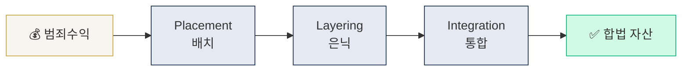
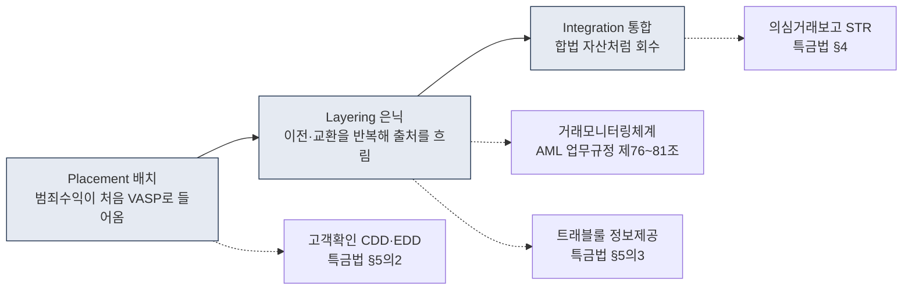

# Day 1 — AML이 뭔가 + 자금세탁 3단계

> 자금세탁(ML)의 본질과 고전 3단계 모델을 머릿속에 박는다. ⏱️ ~75분. 마지막 업데이트: 2026-10-21.


<!-- MAP-START -->
## 🗺 오늘의 지도


<!-- MAP-END -->

## 🎯 핵심 질문
1. 자금세탁의 목적 3가지는?
2. Placement / Layering / Integration 각 단계 예시 1개씩?
3. AML과 CFT의 결정적 차이는?

## 📖 읽기 (~45분)
- 메인: [`../notes/1-foundations/what-is-aml.md`](../notes/1-foundations/what-is-aml.md)

## 🌐 외부 자료 (선택, ~15분)
- [FATF — Money Laundering 페이지](https://www.fatf-gafi.org/en/topics/money-laundering)
- [UNODC — Money Laundering Overview](https://www.unodc.org/unodc/en/money-laundering/overview.html)

## 🛠️ 미니 챌린지 (~15분)
- 종이 또는 메모장에 **3단계 모델을 직접 그려라** (박스 + 화살표)
- 각 단계에 **가상자산 예시 1개씩** 적기
- 예: Placement = OTC desk에서 현금→BTC 매수

## ✅ 체크포인트
- [ ] 자금세탁의 3단계 이름을 외운다
- [ ] AML 9대 의무 (신고/KYC/EDD/TM/제재/STR/CTR/Travel Rule/기록보관/내부통제) 중 5개 이상 떠올린다
- [ ] AML vs CFT 차이를 한 문장으로 설명할 수 있다
- [ ] 한국 AML 감독기관 이름을 말할 수 있다 (FIU, KoFIU)

## 💭 오늘의 한 줄
> _직접 작성: 오늘 가장 의외였던 것 한 줄_

## 💼 실무 현장 (Industry Reality)

> 2026-10-21 판에서 이전 판의 특정 거래소 조직 인원, 은행·벤더 매핑, "1일 1억원·월 3억원 EDD" 기준, 해외 거래소 팀 구성·인원, "Coinbase Lynx" 같은 사내 시스템명, 알람 건수·FP 80% 같은 수치를 삭제했습니다. 모두 공개 1차 근거가 없습니다.

### 3단계가 VASP 통제와 만나는 곳

3단계 모델은 "어디서 무엇으로 막는가"를 정할 때 쓰입니다. 한국 법령과 FATF 문서로 확인되는 통제 지점만 표시하면 다음과 같습니다.



실제 사건은 세 단계가 겹쳐 일어납니다. 화살표는 "주로 걸리는 곳"을 뜻할 뿐 단계와 통제가 1:1로 대응하지는 않습니다.

### 한국 VASP에서는

- **조직**: 2026-08-13 전면 개정된 가상자산사업자 신고매뉴얼은 **AML 업무 인력 4인 이상**(겸직 인정 가능)을 요구합니다([금융위 2026-08-13](https://www.fsc.go.kr/no010101/87521)). 개별 거래소의 실제 인원은 공개되지 않습니다.
- **탐지의 법적 근거**: 거래모니터링은 가상자산 전용 조문이 아니라 FIU 고시 「자금세탁방지 업무규정」 제76~81조 "거래모니터링체계"(2026-01-22 시행)에 있습니다. 본문에 "가상자산"이라는 단어는 나오지 않습니다([법제처 DRF](https://www.law.go.kr/DRF/lawService.do?OC=test&target=admrul&ID=2100000267264&type=XML)).
- **"이상거래"는 세 제도**: 같은 신호라도 FDS·보이스피싱 임시조치(통신사기피해환급법, 거래소 적용 2026-10-01~), 시장감시(가상자산이용자보호법 §12), 의심거래보고(특금법 §4)로 출구가 다릅니다. 자금세탁 3단계와 직접 관련된 출구는 STR입니다.

### 글로벌에서는

- FATF 2021 RBA 가이던스 para 275~276은 지속 모니터링에 대해 "automated systems may be the only realistic method of monitoring transactions, and flagged transactions should go through human/expert analysis"라고 합니다 — 자동화와 사람 검토를 함께 요구합니다([FATF 2021 가이던스](https://www.fatf-gafi.org/content/dam/fatf-gafi/guidance/Updated-Guidance-VA-VASP.pdf.coredownload.pdf)).
- FATF 7차 Targeted Update(2026-07-16)는 처음으로 VASP에 "transactions monitoring and blockchain analytics tools"로 급속 이전을 탐지하라고 권고했습니다([7차 TU PDF](https://www.fatf-gafi.org/content/dam/fatf-gafi/reports/7th-targeted-update-on-implementation-fatf-standards-vas-vasps-2026.pdf.coredownload.pdf)).

### 룰/코드 예시 (가상 예시)

아래는 학습용 의사코드입니다. 임계값과 필드명은 가상이며 특정 벤더 API가 아닙니다. 핵심은 **알람이 곧 차단이나 STR이 아니라는 점**입니다 — 사람 검토를 거쳐 법적 출구를 고릅니다.

```
RULE: mixer_exposure_review          # 임계값은 사내 위험평가로 정함
WHEN incoming_tx AND exposure.mixer_direct > THRESHOLD
THEN open_case(queue = "AML_REVIEW")  # 자동 차단·자동 STR 아님
     reviewer decides -> STR(특금법 §4) | EDD | 기록 후 종결
```

입출금을 막는 조치는 근거 절차가 따로 있습니다. 가상자산이용자보호법 §11은 정당한 사유 없는 입출금 차단을 금지하고, 보이스피싱 임시조치는 통신사기피해환급법 §2의5의 통지·본인확인·해제 절차를 따릅니다([`../notes/4-technology/kyc-kyt.md`](../notes/4-technology/kyc-kyt.md) §6).

### 업무 감각 — 공개 근거가 있는 것만

- 알람→STR 전환율의 공개 벤치마크는 은행권 자료(EY 2018, 리테일 평균 14%)뿐이고 **가상자산 전용 벤치마크는 없습니다**(B)([EY 2018](https://ey.com/content/dam/ey-unified-site/ey-com/en-uk/industries/financial-services/documents/ey-anti-money-laundering-transaction-monitoring-2018-emeia-survey.pdf)).
- 하루 알람 건수·오탐 비율·처리 시간은 회사마다 다르고 공개 자료가 없습니다. 자기 조직에서 직접 재서 기록하세요.

### 자주 나오는 오해

- **"AML은 법무 업무"** — 업무규정 제76~81조는 분석 절차·분석담당자·분석자료 5년 이상 보존을 요구합니다. 데이터·시스템 역량 없이는 이 조문을 이행할 수 없습니다.
- **"룰만 많이 쌓으면 된다"** — FATF 2021 가이던스는 룰의 무결성을 "regular basis"로 검증하라고 요구합니다. 룰 수보다 검증 기록이 중요합니다.
- **"이상거래 = 자금세탁"** — 한국에서 "이상거래"는 법률상 이용자보호법 §12(시장감시) 용어입니다. 자금세탁 의심은 특금법상 "의심되는 거래"입니다.

## 더 깊이 (선택)
- [`../notes/1-foundations/key-concepts.md`](../notes/1-foundations/key-concepts.md) — 내일 다룰 용어 미리보기
