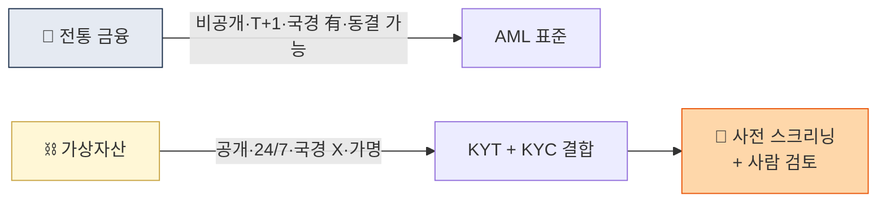
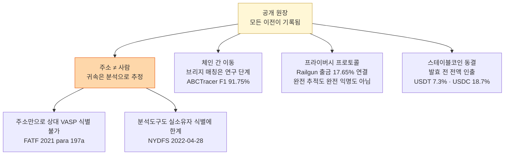

# Day 2 — 왜 가상자산 AML은 다른가

> 전통금융 AML과 가상자산 AML의 본질적 차이 + 투명성의 역설. ⏱️ ~75분. 마지막 업데이트: 2026-10-21.

## 📖 오늘 뭘 배우나

블록체인은 **공개 원장**이라 이론상 추적이 쉽지만, 실제 AML 실무는 훨씬 어렵습니다. 왜 그런가라는 역설이 오늘의 핵심 주제. 주소와 사람의 분리, Mixer·Bridge·DEX 같은 **가상자산 고유 layering 도구**, 그리고 이를 다루는 KYT 산업의 존재 이유까지 연결해서 봅니다.

<!-- MAP-START -->
## 🗺 오늘의 지도

<!-- MAP-END -->

## 🎯 핵심 질문
1. 가상자산 원장이 공개인데 왜 추적이 어려운가?
2. Chainalysis가 2025년 불법 거래액의 84%로 추정한 자산 유형은? (B)
3. 크로스체인 추적이 2025~2026 연구에서 왜 별도 주제가 됐나?

## 📖 읽기 (~45분)
- 메인: [`../notes/1-foundations/why-crypto-different.md`](../notes/1-foundations/why-crypto-different.md)

## 🌐 외부 자료 (선택, ~20분)
- [Chainalysis 2026 Crypto Crime Report Intro](https://www.chainalysis.com/blog/2026-crypto-crime-report-introduction/)

## 🛠️ 미니 챌린지 (~10분)
- 전통금융 AML vs 가상자산 AML **차이 5개**를 한 줄씩 적어라
- 그중 가장 까다로워 보이는 1개에 별표 + 이유

## ✅ 체크포인트
- [ ] "투명성의 역설" 을 한 문장으로 설명할 수 있다
- [ ] 가상자산 layering 도구 5개 이름 댈 수 있다 (mixer/bridge/DEX/peel/privacy coin)
- [ ] 스테이블코인 비중 84%(Chainalysis, B)와 그 분모가 "불법 주소 수취액"이라는 점을 안다
- [ ] 2025년 북한 귀속 탈취액은 발행처마다 다르다는 점을 안다 (Chainalysis USD 20억 · TRM 19.2억, 둘 다 B) + Bybit USD 14.6억(FATF 6차 TU)

## 💭 오늘의 한 줄

## 💼 실무 현장 (Industry Reality)

> 2026-10-21 판에서 이전 판의 "4대 거래소 모두 Chainalysis KYT", "Upbit=VerifyVASP / 나머지=CODE" 같은 거래소별 벤더 매핑, "불법거래 60% 이상 스테이블코인(2025 리포트)", "Coinbase Lynx FP 40% 감축", 벤더 제품 비교표와 "실제 필드" JSON을 삭제했습니다. 공개 1차 근거가 없습니다([`../notes/7-vendors/korea-solutions.md`](../notes/7-vendors/korea-solutions.md)).

### 투명성의 역설 — 어디서 막히나

근거: [FATF 2021 RBA 가이던스](https://www.fatf-gafi.org/content/dam/fatf-gafi/guidance/Updated-Guidance-VA-VASP.pdf.coredownload.pdf) para 197(a), [NYDFS 2022-04-28](https://www.dfs.ny.gov/industry_guidance/industry_letters/il20220428_guidance_use_blockchain_analytics), [ABCTracer arXiv 2504.01822](https://arxiv.org/abs/2504.01822), [Railgun arXiv 2606.25926](https://arxiv.org/abs/2606.25926), [Sanction-Evasion MEV arXiv 2603.27739](https://arxiv.org/abs/2603.27739).

### 범죄 규모 — 두 추정치는 나란히 읽는다

| 발행처(발간일) | 2025년 불법 추정 | 비중과 분모 |
|---|---|---|
| Chainalysis(2026-01-08) | 최소 1,540억 달러, 2024년치는 409억→572억 달러로 상향 | 알려진 서비스 유입 대비 1% 미만, 스테이블코인 84%(B) |
| TRM(2026-01-28) | 1,580억 달러, 2024년 645억 달러 | 전체 온체인 거래량 대비 1.2%, VASP 유동성 대비 2.7%(B) |

두 회사 모두 하한(floor) 추정이고 계속 상향 수정한다고 밝힙니다. 분모가 달라 비중끼리 비교하면 안 됩니다([Chainalysis](https://www.chainalysis.com/blog/2026-crypto-crime-report-introduction/); [TRM](https://www.trmlabs.com/reports-and-whitepapers/2026-crypto-crime-report)).

### 한국 VASP에서는

- 트래블룰은 2026-10-21 현재 **100만원 이상** 이전에만 걸립니다(시행령 §10의10, in-force, 2027-02-18까지). 2026년 상반기 **총 출고 62.8조원 중 트래블룰이 적용된 것은 9.5조원(약 15%)**이었습니다([금융위 2026-10-01](https://www.fsc.go.kr/no010101/87835)). 2027-02-19부터는 금액 기준 없이 다른 VASP로의 모든 이전이 대상입니다(대통령령 제36592호, enacted-not-in-force).
- 국내 사업자 간 트래블룰 메시지는 VerifyVASP·CODE 등 솔루션 네트워크로 오갑니다. CODE 홈페이지는 VerifyVASP를 상호운용 목록에 올립니다(B). **어느 거래소가 어느 네트워크를 쓰는지는 공개 1차 근거로 확인되지 않습니다**([`../notes/3-crypto-aml/travel-rule.md`](../notes/3-crypto-aml/travel-rule.md)).
- FIU 자체는 2026년 업무계획에 "체이널리시스(가상자산 분석도구) 도입"을 넣었습니다([금융위 2026-02-05](https://fsc.go.kr/no010101/86209)). 개별 거래소의 분석 벤더·도입 연도는 공개되지 않았습니다.

### 글로벌에서는

- FATF 7차 TU(2026-07-16)는 범죄조직이 "immune to asset freezing"을 내세운 자체 스테이블코인을 발행한 사례를 들며, VASP가 발행자 수준의 동결·소각에 기대지 못할 수 있다고 경고했습니다(para 35)([7차 TU PDF](https://www.fatf-gafi.org/content/dam/fatf-gafi/reports/7th-targeted-update-on-implementation-fatf-standards-vas-vasps-2026.pdf.coredownload.pdf)).
- BIS 연차경제보고서(2026-06-23)도 발행자 동결과 분석업체 지원이 "cannot replace routine, large-scale AML/CFT controls"라고 했습니다([BIS AER 2026](https://www.bis.org/publ/arpdf/ar2026e3.htm)).

### 자주 나오는 오해

- **"블록체인이 공개라 추적이 쉽다"** — 공개된 것은 이전 기록이지 주소의 주인이 아닙니다. FATF도 주소만으로 상대 VASP를 식별할 기술적 수단은 없다고 인정합니다(2021 para 197(a)).
- **"스테이블코인은 동결되니 안전하다"** — 동결 발효 전 전액 인출된 제재 주소가 USDT 7.3%, USDC 18.7%였습니다. 거래소 측 모니터링을 대신하지 못합니다.
- **"한국은 트래블룰이 전 출고를 덮는다"** — 2026 상반기 기준 출고액의 약 15%만 적용됐습니다.

## 더 깊이 (선택)
- [`../notes/3-crypto-aml/onchain-typology.md`](../notes/3-crypto-aml/onchain-typology.md) — 온체인 유형 미리보기
- [`../reports/가상자산 AML KYT FDS 트래블룰 흐름.md`](../reports/가상자산%20AML%20KYT%20FDS%20트래블룰%20흐름.md) — 2026-10-21 기준 정본 보고서
