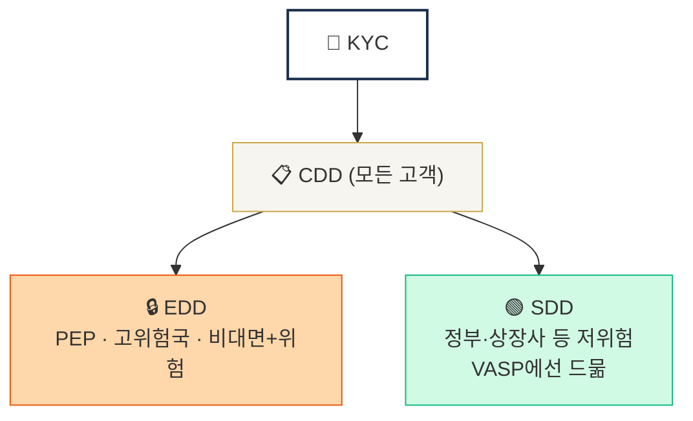
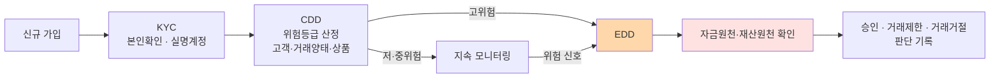

# Day 3 — 핵심 용어 1 (KYC / CDD / EDD / SDD)

> 동심원 4용어를 정확히 구분. ⏱️ ~60분. 마지막 업데이트: 2026-10-21.

## 📖 오늘 뭘 배우나

KYC·CDD·EDD·SDD는 모두 "고객을 확인한다"는 비슷한 말처럼 들리지만 **적용 대상과 강도**가 다릅니다. 동심원 구조로 한번 정리해 두면 이후 모든 실무 판단(누구에게 어느 수준의 확인을 적용할 것인가)의 기반이 됩니다. 특히 EDD 트리거는 반드시 정리해 둬야 하는 **운영 체크리스트**입니다. 2026-08-18 개정 시행령은 강화된 고객확인 여부를 **고객 특성·거래양태·상품 위험도**로 판단하도록 했습니다([금융위 2026-08-11](https://www.fsc.go.kr/no010101/87499)).

<!-- MAP-START -->
## 🗺 오늘의 지도

<!-- MAP-END -->

## 🎯 핵심 질문
1. KYC와 CDD는 어떻게 다른가?
2. EDD가 트리거되는 6가지 상황은?
3. SDD가 가상자산에서 거의 안 쓰이는 이유?

## 📖 읽기 (~30분)
- 메인: [`../notes/1-foundations/key-concepts.md`](../notes/1-foundations/key-concepts.md) — 1~3절
- 보조: [`../notes/5-compliance/cdd-edd.md`](../notes/5-compliance/cdd-edd.md) — 1~2절만

## 🛠️ 미니 챌린지 (~20분)
- 동심원 그림 직접 그리기 (KYC > CDD > EDD/SDD)
- **자기 EDD 트리거 시나리오 2개 만들기** (예: "한국 거주 PEP 임원이 ETH 거래 신청")

## ✅ 체크포인트
- [ ] KYC vs CDD vs EDD 차이를 30초 만에 설명 가능
- [ ] EDD 트리거 6가지 중 4개 이상 댈 수 있다
- [ ] CDD 4단계 (식별 → BO → 목적 → 모니터링) 외운다
- [ ] Beneficial Owner 25% 기준 알고 있다

## 💭 오늘의 한 줄

## 💼 실무 현장 (Industry Reality)

> 2026-10-21 판에서 이전 판의 특정 본인확인기관·조회 API 이름, "일누적 1억원 또는 월 3억원" EDD 기준, "전체 고객의 5~15%가 EDD 대상" 같은 수치를 삭제했습니다. 공개 1차 근거가 없습니다([`../notes/7-vendors/korea-solutions.md`](../notes/7-vendors/korea-solutions.md) §3).

### 한국 VASP에서는

- **KYC는 국내 본인확인과 실명계정에서 시작**합니다. 글로벌 KYC 도구가 신분증 OCR·얼굴 매칭을 해도 국내 실명 확인을 대신하지 못하므로 실무 구성은 "글로벌 도구 + 국내 본인확인" 조합이 됩니다. 원화 거래 거래소는 신고 요건으로 실명확인 입출금계정을 갖춰야 합니다([`../notes/2-regulations/korea-fiu-act.md`](../notes/2-regulations/korea-fiu-act.md) §3).
- **EDD 판단 기준**: 2026-08-18 공포된 대통령령 제36592호는 고객확인의 방법·대상을 명확히 하고, 강화된 고객확인 여부를 고객 특성·거래양태·상품 위험도로 판단하도록 했습니다([금융위 2026-08-11](https://www.fsc.go.kr/no010101/87499)).
- **2027-02-19부터**: 해외 VASP·자기수탁 지갑과의 이전에 위험등급별 허용 요건이 생깁니다. 저위험 해외 VASP는 허용, 그 밖에는 고객과 상대방이 동일인일 때만 허용, FATF 고위험국 소재·무인허가는 제한입니다(감독규정 §28-2, enacted-not-in-force). CDD에서 확인한 고객 정보가 이전 허용 판단의 입력이 됩니다.

### CDD/EDD 실무 플로우

화살표의 등급 구간과 승인권자는 회사 정책으로 정합니다. 법령은 위험기반으로 판단하라고 할 뿐 고정 금액을 주지 않습니다.

### EDD 자금원천 증빙 — 작성 연습용 예시

아래는 사내 정책을 짤 때 쓰는 **예시 목록**입니다. 특정 거래소의 실제 요구 서류나 금액 기준이 아닙니다.

- **근로소득**: 급여 내역, 원천징수 관련 서류
- **사업소득**: 사업자등록, 세무 신고 자료, 거래 내역
- **자산 처분**: 부동산·주식 매도 증빙, 상속·증여 관련 서류
- **해외 원천**: 해외 송금 내역과 은행 거래 내역

### SDD가 가상자산에서 드문 이유

SDD는 저위험이 확인된 고객 유형에 간소화된 절차를 허용하는 개념입니다. 가상자산 거래는 비대면 온보딩이 기본이고, FATF 7차 TU는 소매 사용자로 위장한 역외 VASP 계정을 탐지하라고 권고합니다(권고 6-iii)([7차 TU PDF](https://www.fatf-gafi.org/content/dam/fatf-gafi/reports/7th-targeted-update-on-implementation-fatf-standards-vas-vasps-2026.pdf.coredownload.pdf)). 그래서 "저위험이라 간소화" 판단을 내리기 어렵습니다. 간소화가 허용되는 범위는 법령 원문으로 확인하세요.

### 자주 나오는 오해

- **"KYC만 하면 끝"** — KYC는 "누구인지 확인"이고 CDD는 "위험등급 부여 + 지속 모니터링"입니다. 업무 시간의 대부분은 지속 모니터링과 재평가에 듭니다.
- **"EDD는 고액 고객만"** — 시행령 기준은 금액 하나가 아니라 고객 특성·거래양태·상품 위험도입니다. 소액이라도 위험 신호가 있으면 EDD 대상이 됩니다.

## 더 깊이 (선택)
- D43 (CDD 운영 deep) 미리보기
