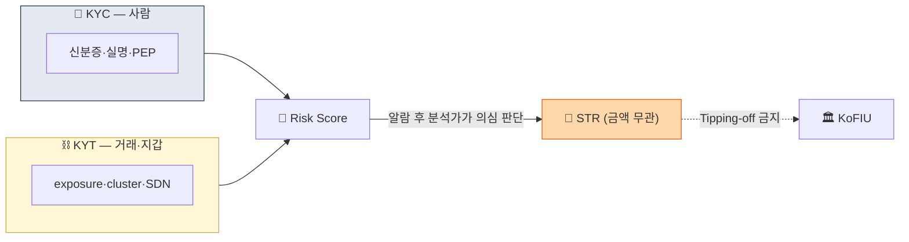
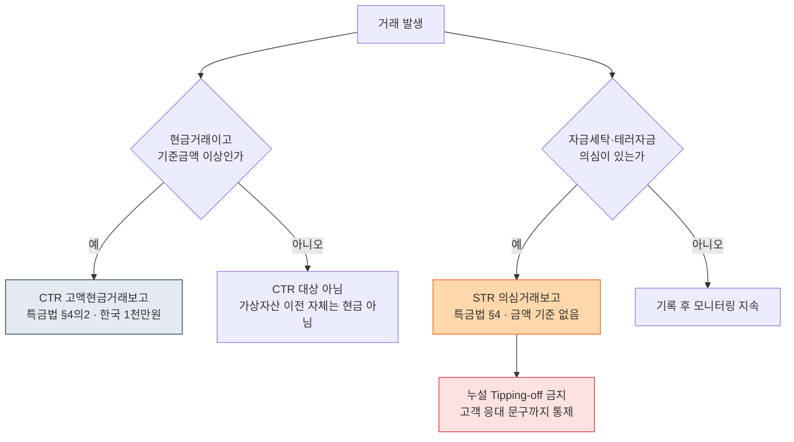

# Day 4 — 핵심 용어 2 (KYT / STR / CTR / PEP / BO)

> 가상자산 특화 용어 + 보고 의무 + PEP/BO. ⏱️ ~75분. 마지막 업데이트: 2026-10-21.

## 📖 오늘 뭘 배우나

어제 배운 KYC·CDD·EDD 위에 **가상자산 고유의 한 층**을 얹습니다 — **KYT(거래·지갑을 안다)**. 단, "KYT"는 업계 용어이고 FATF·한국 고시는 "거래모니터링(transaction monitoring)", "blockchain analytics"라고 씁니다. 여기에 AML 시스템의 최종 출구인 STR·CTR, 자동 고위험인 PEP, 법인고객의 핵심인 Beneficial Owner 25% 원칙까지. 이 5개 용어는 내일부터의 모든 규제·운영 문서에 반복 등장합니다.


<!-- MAP-START -->
## 🗺 오늘의 지도


<!-- MAP-END -->

## 🎯 핵심 질문
1. KYC와 KYT는 무엇이 다른가? (한 문장)
2. STR과 CTR이 둘 다 트리거되면 어떻게 하나?
3. Tipping-off(누설) 금지가 왜 고객센터 문구까지 통제해야 하는 문제인가?

## 📖 읽기 (~40분)
- 메인: [`../notes/1-foundations/key-concepts.md`](../notes/1-foundations/key-concepts.md) — 4~10절
- 보조: [`../notes/4-technology/kyc-kyt.md`](../notes/4-technology/kyc-kyt.md) — 5절 (KYC vs KYT 표)

## 🛠️ 미니 챌린지 (~20분)
- KYC vs KYT 비교표를 직접 작성 (대상/시점/데이터/도구 각 행)
- 자기 회사가 STR을 보내야 할 가상 시나리오 1개 만들기 (3줄)

## ✅ 체크포인트
- [ ] KYC vs KYT 비교 즉답 가능
- [ ] STR 임계금액 (없음) vs CTR 임계금액 (한국 1천만원) 안다
- [ ] PEP 3종류 (Foreign/Domestic/IO) 안다
- [ ] Tipping-off 정의 + 별도 처벌 대상임을 안다 (법정형은 특금법 원문으로 확인)
- [ ] 한국 자금세탁방지 보고책임자(AMLO) 지정 의무 안다

## 💭 오늘의 한 줄

## 💼 실무 현장 (Industry Reality)

> 2026-10-21 판에서 이전 판의 "KYT는 Chainalysis 단일 지배", 거래소별 벤더·제휴은행 매핑, "STR은 엑셀/PDF 수기 업로드 vs FinCEN은 API", PEP DB 구독 벤더명, "의심사유 500~2000자", "§9 1년 이하 징역 또는 1천만원 이하 벌금" 같은 서술을 삭제했습니다. 공개 1차 근거가 없거나 이 저장소 근거 자료로 확인되지 않았습니다.

### STR과 CTR은 따로 판단한다



두 질문은 독립입니다. 둘 다 "예"면 둘 다 보고합니다. 근거: [`../notes/2-regulations/korea-fiu-act.md`](../notes/2-regulations/korea-fiu-act.md) §4, [`../notes/5-compliance/str-ctr.md`](../notes/5-compliance/str-ctr.md).

### 한국 VASP에서는

- **KYT의 법적 이름**: 「자금세탁방지 업무규정」(FIU 고시 제2025-2호, 2026-01-22 시행) 제76~81조 "거래모니터링체계"입니다. 비정상 거래 주의(제77조), 분석 절차(제78조), 분석담당자 지정·FIU 보고(제79조), 분석자료 5년 이상 보존(제80조)을 요구합니다([법제처 DRF](https://www.law.go.kr/DRF/lawService.do?OC=test&target=admrul&ID=2100000267264&type=XML)).
- **STR 채널**: KoFIU 전자보고 시스템입니다. 제출 방식(웹 입력·첨부 업로드 등)과 건당 소요 시간에 대한 공개 자료는 이 저장소 근거 자료에 없습니다.
- **CTR**: 가상자산 이전 자체는 현금거래가 아니므로 CTR 대상이 아닙니다. 현금을 직접 받는 예외적 영업에서만 문제가 됩니다.
- **2027-02-19부터**: 해외 VASP·자기수탁 지갑과의 **1천만원 이상** 이전에는 "자체 의심거래 감시체계"를 구축·운영해야 합니다(시행령 §10-20 ⑦나, 감독규정 §28-2③, enacted-not-in-force). **자동 STR 의무가 아닙니다** — 입법예고안의 "위험도와 관계없이 의심거래로 보아 보고"는 공포본에서 바뀌었습니다([금융위 2026-08-11](https://www.fsc.go.kr/no010101/87499); [금융위 2026-03-30](https://www.fsc.go.kr/no010101/86589)).

### PEP 스크리닝 실무

- 가입 단계에서 이름·생년월일 등으로 PEP·제재 명단과 대조하고, 일치 후보는 사람이 검토해 EDD로 보냅니다. 명단 공급처는 회사마다 다르며 특정 벤더를 쓴다는 공개 근거는 없습니다.
- Domestic PEP는 공식 통합 명단이 없어 Foreign PEP보다 식별이 어렵다는 점을 정책에 반영합니다.

### STR 구조 — 작성 연습용 예시

아래 항목 구성은 사내 작성 연습용입니다. KoFIU 공식 양식의 항목·순서와 같다는 근거는 없습니다([`../notes/5-compliance/str-ctr.md`](../notes/5-compliance/str-ctr.md) 부록 주의문 참조).

```
1. 보고자 정보 — 보고기관·보고책임자·보고일시
2. 거래자 정보 — 신원정보·지갑주소
3. 의심거래 내역 — 거래일시·금액·상대 주소·상대 VASP
4. 의심사유 — 사실관계 + 왜 의심되는가 + 대체 해석을 배제한 근거
5. 증빙자료 — 거래 타임라인·분석도구 결과·KYC 자료
```

"단순히 고액이라 의심" 같은 서술보다 **사실관계·수치·유형(typology)·대체 해석 배제**가 들어간 서술이 판단 근거를 보여 줍니다. FIU가 회사별 STR 품질을 어떻게 평가하는지에 대한 공개 기준은 없습니다.

### Tipping-off 실무 함정

- STR 사실을 거래 상대방에게 알리는 것은 금지되고 별도 처벌 대상입니다. 조문·법정형은 특금법 원문으로 확인하세요.
- "자금세탁 조사 때문에 동결" 같은 고객센터 안내는 그 자체가 누설이 될 수 있습니다. 한편 입출금을 실제로 막는다면 그 근거(통신사기피해환급법 임시조치, 제재 이행, 거래거절 등)에 맞는 통지 절차를 따로 밟아야 합니다 — 가상자산이용자보호법 §11은 정당한 사유 없는 입출금 차단을 금지합니다.

### 자주 나오는 오해

- **"STR은 금액이 커야 제출"** — STR은 **금액 무관**입니다.
- **"2027년부터 1천만원 넘으면 자동 STR"** — 아닙니다. 1천만원은 "자체 의심거래 감시체계"의 대상 금액입니다.
- **"CTR 1천만원은 가상자산에도 적용"** — CTR은 현금거래 기준입니다. 가상자산 이전 자체는 대상이 아닙니다.

## 더 깊이 (선택)
- [`../notes/5-compliance/str-ctr.md`](../notes/5-compliance/str-ctr.md) — STR 운영
