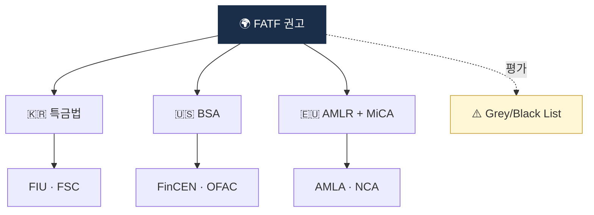
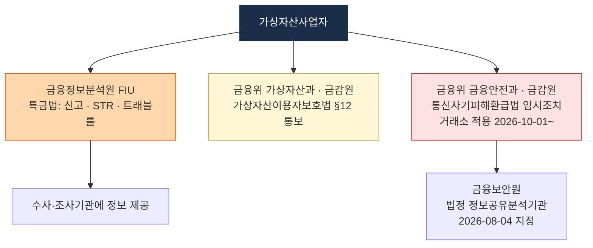

# Day 5 — AML 글로벌 거버넌스 지도

> FATF가 한국/미국/EU에 어떻게 영향을 미치는가. ⏱️ ~75분. 마지막 업데이트: 2026-10-21.

## 📖 오늘 뭘 배우나

한국 특금법 조항을 읽다 보면 "왜 이런 구조인가" 의문이 생기는데, 답은 거의 **FATF 권고**에 있습니다. 오늘은 FATF → 각국법 → 감독기구라는 **규제의 흘러내림 구조**를 머릿속에 심는 날. 이 지도가 있으면 다음 2주간의 법령 학습이 훨씬 입체적으로 보입니다.

<!-- MAP-START -->
## 🗺 오늘의 지도

<!-- MAP-END -->

## 🎯 핵심 질문
1. FATF는 법을 만드는가? (아니라면 무엇을 하는가?)
2. FATF Grey/Black List에 오르면 회원국에 어떤 영향?
3. 한국 "이상거래" 3제도를 누가 감독하는가 (FIU · 금융위·금감원 · 금융안전과·금융보안원)?

## 📖 읽기 (~45분)
- 메인: [`../notes/1-foundations/what-is-aml.md`](../notes/1-foundations/what-is-aml.md) — 5절 (글로벌 거버넌스)
- 보조: [`../notes/2-regulations/README.md`](../notes/2-regulations/README.md)

## 🌐 외부 자료 (선택, ~15분)
- [FATF 공식](https://www.fatf-gafi.org/)
- [FATF Black/Grey List 현행](https://www.fatf-gafi.org/en/publications/High-risk-and-other-monitored-jurisdictions.html)

## 🛠️ 미니 챌린지 (~15분)
- 한 장 그림: **FATF → 각국법 → 감독기구 → 의무자(VASP)** 흐름도
- 한국 / 미국 / EU 라인을 각각 한 줄씩

## ✅ 체크포인트
- [ ] FATF 체계에서 FSRB의 역할을 안다 (7차 TU 응답 147개 관할 = FATF 38 + FSRB 109)
- [ ] 한국이 FATF/APG 가입국임을 안다
- [ ] FATF 권고 → 국내법화 메커니즘 이해
- [ ] 미국 OFAC 지정·§311 특별조치가 외국 VASP에 닿는 경로를 안다

## 💭 오늘의 한 줄

## 💼 실무 현장 (Industry Reality)

> 2026-10-21 판에서 이전 판의 "연간 STR ~100만 건", "2026-01 특금법 개정으로 대주주 심사"(시행은 2026-08-20), 검사역 인원·상주 기간, "AMLA 2025-07 출범", FCA 수리율, 회색명단 국가별 임팩트 표, 거래소 대형 제재 금액, "3년 주기 갱신 신고" 같은 서술을 삭제·정정했습니다. 공개 1차 근거로 확인되지 않거나 틀렸습니다.

### 한국 감독 체계 — 3법 3창구

근거: [`../notes/7-vendors/korea-solutions.md`](../notes/7-vendors/korea-solutions.md) §1, [`../notes/2-regulations/korea-user-protection.md`](../notes/2-regulations/korea-user-protection.md) §4~§6.

### 한국 AML 감독 체계 — 확인되는 것

- **FIU(금융정보분석원)** — 금융위원회 소속. VASP 신고 수리, STR·CTR 수령, 트래블룰 감독. 2025-11-06 두나무에 과태료 352억원을 결정했는데 사유는 고객확인·거래제한·의심거래보고 등의 위반이었고 트래블룰(특금법 §5의3)은 포함되지 않았습니다([FIU 보도자료 KDI 미러](https://eiec.kdi.re.kr/policy/materialView.do?num=273166)).
- **특금법 개정**: 법률 제21358호(2026-02-19 공포)의 신고제·대주주 심사 부분은 **2026-08-20 시행**됐고(in-force), 2026-10-21 기준 현행본은 법률 제21857호(2026-10-02 시행)입니다([금융위 2026-08-11](https://www.fsc.go.kr/no010101/87499)).
- **금융위·금감원** — 가상자산이용자보호법 감독·불공정거래 조사. 법 시행 2년(2026-07-20 공표) 동안 조사 완료 40여 건, 고발·통보 30여 건, 과징금 2건([금융위 2026-07-20](https://fsc.go.kr/po010106/87357)).
- 연간 STR 건수, 검사 인력·기간은 이 저장소 근거 자료에 없습니다. FIU 연차보고서 원문으로 확인하세요.

### 글로벌 감독 — 2026-10-21 기준으로 확인되는 움직임

- **FATF**: 7차 Targeted Update(2026-07-16)에서 트래블룰 입법 관할 **83%(91/109)**, 그중 **60%(55/91)는 감독·집행 조치 전무**([7차 TU PDF](https://www.fatf-gafi.org/content/dam/fatf-gafi/reports/7th-targeted-update-on-implementation-fatf-standards-vas-vasps-2026.pdf.coredownload.pdf)).
- **미국**: OFAC는 2025-03-21 Tornado Cash를 SDN에서 삭제했습니다(엔티티 1개·ETH 주소 90개)([OFAC](https://ofac.treasury.gov/recent-actions/20250321)). FinCEN은 2025-10-14 Huione Group에 §311 최종규칙을 발동했고, 2026-10-06 관보로 믹싱 §311 NPRM과 비수탁지갑 NPRM을 **철회(withdrawn)**했습니다([Federal Register 2026-20429](https://public-inspection.federalregister.gov/2026-20429.pdf)).
- **EU**: 2026-01-01 AML/CFT 규칙제정·가이던스 권한이 EBA에서 **AMLA**로 넘어갔습니다. AMLR은 **2027-07-10 적용 예정**(enacted-not-in-force)입니다([EBA](https://www.eba.europa.eu/regulation-and-policy/anti-money-laundering-and-countering-financing-terrorism)).
- **영국**: FCA의 2026 과징금 목록(2026-09-30까지 17건)에 트래블룰(MLR Part 7A) 위반 건은 없습니다([FCA 2026 fines](https://www.fca.org.uk/news/news-stories/2026-fines)).

### FATF 회색명단 — 2026-06-19 기준

- 2026-06-17~19 총회에서 보스니아헤르체고비나·이라크가 추가되고 알제리·나미비아가 빠져 **현행 회색명단은 22개 관할**입니다(B)([FATF 2026-06 총회 결과](https://www.fatf-gafi.org/en/publications/Fatfgeneral/outcomes-fatf-plenary-june-2026.html)).
- 다음 총회는 **2026-10-26~30**(2026-10-21 기준 미개최)입니다. 개별 22개국 명단은 FATF 원문 페이지로 확인하고, 사내 국가위험표에는 **명단 판 일자**(예: 2026-06-19판)를 함께 적습니다.
- 등재가 특정 국가 경제에 준 영향의 수치는 이 저장소 근거 범위 밖입니다.

### 자주 나오는 오해

- **"FATF가 법을 만든다"** — FATF는 권고(soft law)를 냅니다. 강제력은 상호평가 등급과 회색명단 공개에서 나옵니다.
- **"KoFIU = 금감원"** — 다릅니다. FIU는 특금법상 정보분석·감독 기구이고, 이용자보호법·통신사기피해환급법 쪽 감독은 금융위·금감원 체계입니다.
- **"특금법 신고는 3년마다 갱신 신고"** — 신고에 유효기간이 있어 갱신이 필요하다는 점은 맞지만, 주기 수치는 이 저장소 근거 자료로 재확인되지 않았습니다. 법 원문으로 확인하세요.

## 더 깊이 (선택)
- [`../notes/2-regulations/fatf.md`](../notes/2-regulations/fatf.md) — Day 15에 deep
