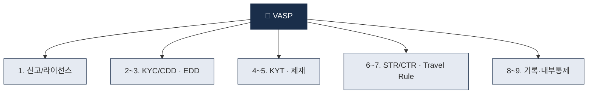
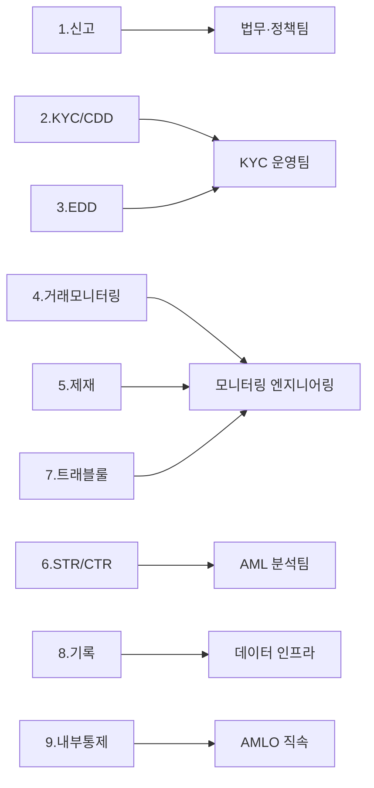

# Day 6 — VASP 정의 + 9 의무

> 가상자산사업자가 떠안는 9가지 의무를 한 장에. ⏱️ ~75분. 마지막 업데이트: 2026-10-21.

## 📖 오늘 뭘 배우나

어제 본 거버넌스 구조가 각 VASP에 구체적으로 **어떤 9가지 의무**로 내려오는지 정리합니다. 신고/라이선스부터 KYC·EDD·KYT·제재·STR·Travel Rule·기록보관·내부통제까지 — 이 9개가 Week 1의 종합 정리이자, Week 2~8 전체의 목차 역할을 합니다.

<!-- MAP-START -->
## 🗺 오늘의 지도

<!-- MAP-END -->

## 🎯 핵심 질문
1. FATF VASP 정의의 5가지 행위는?
2. 한국·미국·EU의 VASP 용어가 다른가?
3. 9 의무 중 가상자산만의 특화 의무는?

## 📖 읽기 (~45분)
- 메인: [`../notes/3-crypto-aml/vasp-obligations.md`](../notes/3-crypto-aml/vasp-obligations.md)

## 🛠️ 미니 챌린지 (~15분)
- **사업유형별 의무 강도 표** 직접 다시 그리기 (거래소 / 수탁 / OTC / DeFi)
- 자기 흥미 있는 사업유형 1개 선택 + "내가 만든다면 어디부터" 메모

## ✅ 체크포인트
- [ ] VASP 9 의무 모두 외운다
- [ ] FATF VASP 정의 5가지 행위 외운다
- [ ] 한국 VASP = 미국 MSB = EU CASP 대응 안다
- [ ] 수탁업과 거래소의 의무 강도 차이 이해

## 💭 오늘의 한 줄

## 💼 실무 현장 (Industry Reality)

> 2026-10-21 판에서 이전 판의 사업유형별 대표 사업자 표, "2026-Q1 신고 현황·누적 수리 ~30건", "수리율 약 30%", 거래소별 트래블룰 허브 매핑, "개인지갑 100만원 초과 시 소유 증명", "EU 1유로부터", 솔루션 네트워크 규모를 삭제·정정했습니다. 공개 1차 근거가 없거나 틀렸습니다.

### 9 의무가 실제로 어떻게 "운영 팀"으로 연결되나

팀 이름은 예시입니다. 법령이 정한 조직 요건은 신고매뉴얼의 **AML 업무 인력 4인 이상**(겸직 인정 가능)입니다([금융위 2026-08-13](https://www.fsc.go.kr/no010101/87521)).

### 9 의무 중 2026-10-21 기준 "시행 중"과 "확정됐으나 미시행"

| 의무 | 한국 근거 | 상태 |
|---|---|---|
| 신고 | 특금법 §7, 법률 제21358호 대주주 심사(2026-08-20 시행) | in-force |
| 거래모니터링 | AML 업무규정 제76~81조(2026-01-22 시행) | in-force |
| 트래블룰 100만원 이상 | 특금법 §5의3, 시행령 §10의10 | in-force, 2027-02-18까지 |
| 트래블룰 전건 + 요청 시 추가정보 3영업일 | 시행령 §10의10 개정(대통령령 제36592호) | enacted-not-in-force, 2027-02-19~ |
| 해외 VASP 3등급·자기수탁 동일인 요건·1천만원 자체 감시체계 | 시행령 §10-20, 감독규정 §28-2 | enacted-not-in-force, 2027-02 중 |

근거: [`../notes/3-crypto-aml/vasp-obligations.md`](../notes/3-crypto-aml/vasp-obligations.md), [`../notes/2-regulations/korea-fiu-act.md`](../notes/2-regulations/korea-fiu-act.md) §5.

### 트래블룰 — 한국 현장

- **근거 조문**: 특금법 **§5의3**(§5의2는 고객확인). 국제 근거는 R.16 본문이 아니라 FATF **INR.15 §7(b)**(2019-06)입니다.
- **금액**: 2026-10-21 현재 "**100만원 이상**"(A형 — 금액 미만이면 의무 없음). **2027-02-19부터 기준금액 없이 다른 VASP로의 모든 이전**(대통령령 제36592호, 2026-08-18 공포, enacted-not-in-force).
- **개인지갑(자기수탁)**: 2027-02-18까지는 법령상 소유 증명 의무가 없습니다. **2027-02-19부터** 감독규정 §28-2④에 따라 **송·수신인이 동일인인 경우에만 허용**되고, 증명 방법은 정하지 않았습니다.
- **비교**: 미국 31 CFR 1010.410(f) "$3,000 or more". EU TFR은 **금액 기준 없이 전건**이고, 자기수탁 주소와 EUR 1,000 이상("amounts to or exceeds") 이전 시 소유·통제를 검증합니다([EBA/GL/2024/11](https://www.eba.europa.eu/sites/default/files/2024-07/6de6e9b9-0ed9-49cd-985d-c0834b5b4356/Travel%20Rule%20Guidelines.pdf)).
- **솔루션**: 국내 메시지는 VerifyVASP·CODE 등 솔루션 네트워크로 오갑니다. 거래소별 사용 네트워크와 네트워크 규모는 공개 1차 근거로 확인되지 않습니다([`../notes/7-vendors/travel-rule-vendors.md`](../notes/7-vendors/travel-rule-vendors.md)).

### VASP vs CASP vs MSB 용어 대응

| 관할 | 용어 | 근거 |
|---|---|---|
| 한국 | 가상자산사업자 | 특금법 §2 |
| 미국 | MSB(Money Services Business) — 가상자산 전용 범주 없이 "other value that substitutes for currency" 문언으로 포섭 | 31 CFR 1010.100(ff)(5)(i)(A) |
| EU | CASP(Crypto-Asset Service Provider) | MiCA(2023/1114) |
| FATF | VASP | R.15(2018-10 개정 용어집) |

### 자주 나오는 오해

- **"VASP 신고는 신고만 하면 되는 것"** — 요건 미충족 시 수리하지 않을 수 있고, 2026-08-20부터 불수리 사유가 늘고 조건부 수리가 가능해졌습니다. 수리율 수치는 공개 근거가 없습니다.
- **"수탁업은 거래모니터링 필요 없다"** — FATF VASP 정의에 보관·관리(safekeeping/administration)가 들어 있습니다. 보관만 해도 입출금 이전은 모니터링 대상입니다.
- **"한국 트래블룰은 100만원 초과부터"** — 문언은 "이상"이고, 2027-02-19부터는 기준금액 자체가 없어집니다.

## 더 깊이 (선택)
- 한국 특금법 §2(정의)의 가상자산사업자 행위 목록 원문 검색해보기
