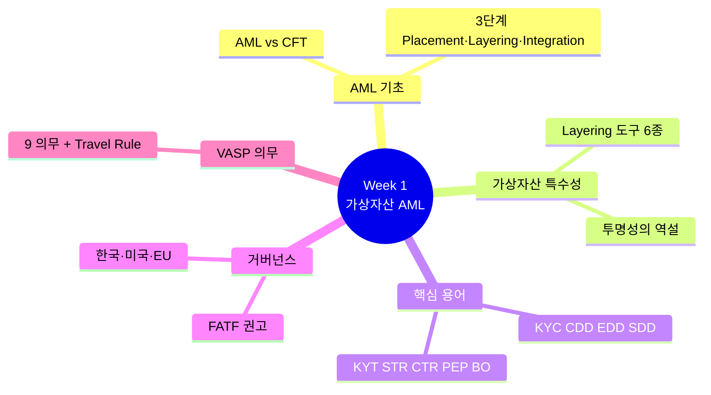
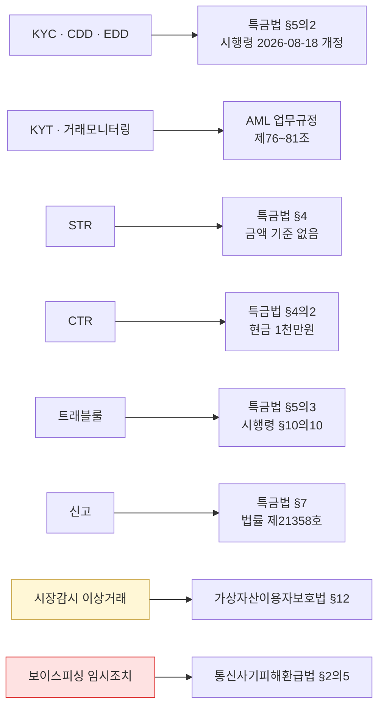

# Day 7 — 🔁 Week 1 리뷰 + 마인드맵

> 1주일 학습을 한 장에 시각화. ⏱️ ~90분. 마지막 업데이트: 2026-10-21.

## 📖 오늘 뭘 배우나

6일 동안 AML 기초·가상자산 특수성·핵심 용어·글로벌 거버넌스·VASP 9의무를 배웠습니다. 오늘은 **마인드맵**으로 이 전부를 시각화하고, 헷갈리는 용어 짝을 솔직히 체크합니다. 이 과정에서 남은 구멍을 발견하는 게 Week 2(한국 규제 deep) 진입 전의 마지막 정비.

<!-- MAP-START -->
## 🗺 오늘의 지도

<!-- MAP-END -->

## 🎯 회고 질문
1. Week 1에서 가장 중요한 개념 3개?
2. 가장 헷갈렸던 짝 (예: KYC vs KYT)?
3. Week 2에서 가장 궁금한 점?

## 📖 빠른 복습 (~30분)
- [`../README.md`](../README.md) — 우선순위 Top 5 다시 보기
- [`../notes/glossary.md`](../notes/glossary.md) — 11~Z 빠른 스캔

### 💡 기억해둘 것: 2026년 특금법 개정

2026-01-29 국회 본회의를 통과한 개정안이 법률 제21358호로 **2026-02-19 공포, 2026-08-20 시행**됐습니다(in-force). 심사 대상 대주주에 "대표이사 또는 이사의 과반수를 선임한 주주"가 들어가고, 불수리 요건으로 부채비율 200% 이하·최근 3년 신용질서 침해 없음 등이 정해졌습니다. 기존 사업자에게는 부채비율·조직인력·전산·내부통제 요건이 1년 유예됩니다. 신고매뉴얼(2026-08-13)은 대주주 변경을 **30일 전 사전신고**로 바꿨습니다([금융위 2026-08-11](https://www.fsc.go.kr/no010101/87499); [금융위 2026-08-13](https://www.fsc.go.kr/no010101/87521)). 심사 소요 기간은 공개 근거가 없습니다.

상세는 [`day_08.md`](day_08.md) / [`../notes/2-regulations/korea-fiu-act.md`](../notes/2-regulations/korea-fiu-act.md) 참조.

## 🛠️ 미니 챌린지 (~50분)
**1. AML 마인드맵 그리기** (40분, 종이 권장)
- 중심: "가상자산 AML"
- 1차 가지: AML 기본 / 가상자산 특수성 / 핵심 용어 / 글로벌 거버넌스 / VASP 의무
- 2차 가지: 각각 3~5개 키워드

**2. 자기 평가 퀴즈** (10분)
다음 중 헷갈리는 것 솔직히 체크:
- [ ] Placement vs Layering vs Integration 구분
- [ ] KYC vs CDD vs EDD vs SDD
- [ ] KYC vs KYT
- [ ] STR vs CTR
- [ ] AMLO vs MLRO vs CCO
- [ ] FATF vs FIU
- [ ] VASP vs CASP vs MSB
- [ ] PEP 3종

→ 체크된 항목 다시 [`../notes/glossary.md`](../notes/glossary.md) 에서 보기

## ✅ 체크포인트
- [ ] 마인드맵 산출
- [ ] 퀴즈 항목 모두 OK
- [ ] [`progress.md`](progress.md) Week 1 7개 모두 체크

## 💭 1주차 회고

가장 의외:
가장 어려움:
다음주 기대:

## 💼 실무 현장 (Industry Reality)

> 2026-10-21 판에서 이전 판의 거래소 채용공고 "실제 JD" 요약, 국내외 거래소 조직 규모 표, 용어별 벤더·제품 매핑, "4층 규범" 서술을 삭제·정정했습니다. 공개 1차 근거가 없습니다.

### Week 1 용어 → 한국 법적 근거

용어를 외웠다면 이제 "어느 조문에서 나오는 의무인가"로 연결합니다. 시스템·벤더는 교체 가능한 부품이고, 검사에서 묻는 것은 근거 조문입니다.

아래 두 칸(시장감시·임시조치)은 AML이 아니라 별도 제도입니다. 같은 "이상" 신호가 세 출구로 갈라진다는 점이 Week 2의 핵심입니다.

### Week 2 진입 전 현실 체크

한국 특금법 트래블룰은 **법률 → 시행령 → FIU 고시**로 위임됩니다. 법률 §5의3은 금액을 정하지 않고, 시행령 §10의10이 "1백만원 이상"(2027-02-18까지)을, 2027-02-19부터는 시행령 §10-20과 감독규정 §28-2가 해외 VASP 등급과 1천만원 감시체계 금액을 정합니다. 그래서 국회를 거치지 않고 시행령·고시만으로 실무 기준이 바뀝니다([`../notes/2-regulations/korea-fiu-act.md`](../notes/2-regulations/korea-fiu-act.md) §5). Week 2에서는 조문 번호와 함께 **"이 숫자가 어느 층위 규범에 적혀 있는가"**를 보세요.

### 자주 나오는 오해

- **"Week 1은 용어만 외우면 끝"** — 용어는 조문·산출물(STR·통보·임시조치)과 연결돼야 쓸 수 있습니다.
- **"KYT는 규제 용어"** — FATF·MAS·한국 고시 어디에도 "KYT"는 없습니다. 감독기관은 "transaction monitoring", "blockchain analytics", 한국 고시는 "거래모니터링체계"라고 씁니다.
- **"2026-01 개정으로 대주주 심사 시작"** — 2026-01-29는 국회 통과일이고, 시행은 2026-08-20입니다.
