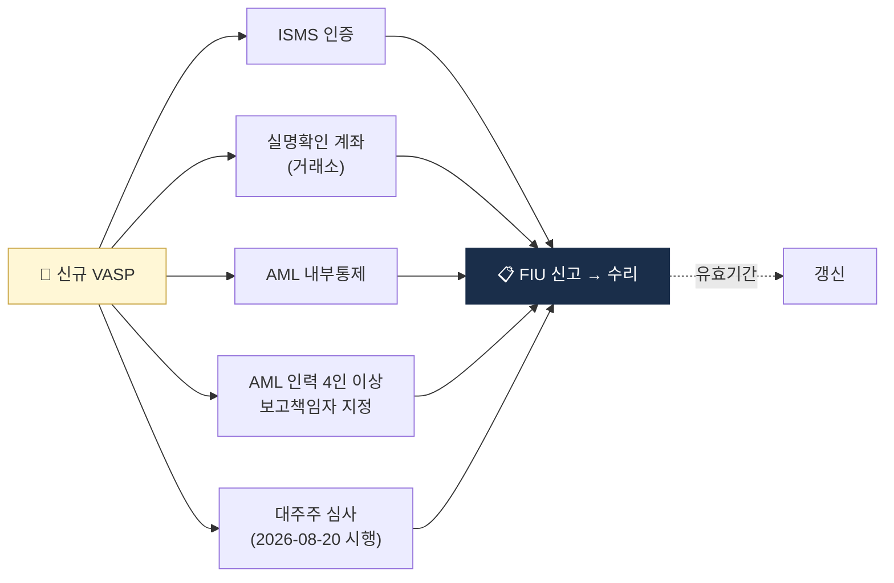
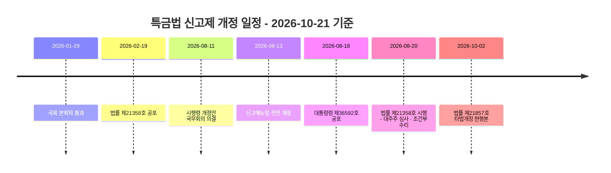
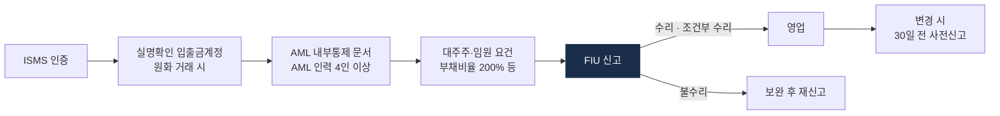

# Day 8 — 한국 특금법 1: VASP 신고제

> 한국 가상자산 AML의 헌법, 신고제 메커니즘. ⏱️ ~75분. 마지막 업데이트: 2026-10-21.

## 📖 오늘 뭘 배우나

한국 가상자산 산업의 **사실상 진입 규제**인 특금법의 VASP 신고제. "신고"라는 이름이지만 요건을 못 갖추면 **수리하지 않을 수 있어** 실질은 인허가에 가깝습니다. ISMS·실명확인 입출금계정·AML 내부통제·결격사유 부재가 기본 요건이고, 법률 제21358호(2026-02-19 공포, **2026-08-20 시행**)로 **대주주 심사**와 조건부 수리가 더해졌습니다. M&A·투자 유치 일정에 대주주 변경 **30일 전 사전신고**를 넣어야 합니다.

<!-- MAP-START -->
## 🗺 오늘의 지도

<!-- MAP-END -->

## 🎯 핵심 질문
1. 특금법 정식 명칭과 약칭은?
2. VASP 신고에 필요한 기본 요건과 2026-08-20 이후 추가된 요건은?
3. 미신고 영업에 FIU는 2026년에 어떻게 대응했나?

## 📖 읽기 (~50분)
- 메인: [`../notes/2-regulations/korea-fiu-act.md`](../notes/2-regulations/korea-fiu-act.md) — 1~5절

## 🌐 외부 자료 (선택, ~15분)
- [국가법령정보센터 — 특금법](https://www.law.go.kr/법령/특정금융거래정보의보고및이용등에관한법률) — §2(정의), §7(신고)만
- [금융위 2026-08-13 — 가상자산사업자 신고매뉴얼 전면 개정](https://www.fsc.go.kr/no010101/87521) — 보도자료 + 첨부 목차

## 🏛 특금법 개정 — 대주주 심사 (2026-08-20 시행)

### 일정 — 통과·공포·시행은 다른 날이다

근거: [금융위 2026-01-29](https://www.fsc.go.kr/no010101/86168), [금융위 2026-08-11](https://www.fsc.go.kr/no010101/87499), [금융위 2026-08-13](https://www.fsc.go.kr/no010101/87521), [법제처 DRF](https://www.law.go.kr/DRF/lawSearch.do?OC=test&target=law&type=JSON&query=특정금융거래정보의보고및이용등에관한법률).

### 변화의 핵심

**기존(2021-03-25 신고제 시행)**: 신고 요건 — ISMS 인증, 실명확인 입출금계정(원화 거래 시), AML/CFT 내부통제체계, 대표자·임원 결격사유 부재.

**개정(2026-08-20 시행)** — 금융위 2026-08-11 자료 기준:

1. **심사 대상 대주주 확대** — 최대주주 외에 "대표이사 또는 이사의 과반수를 선임한 주주". 최대주주가 법인이면 그 법인의 최대주주와 대표자 포함
2. **불수리 요건** — 부채비율 200% 이하(이용자예치금 등은 부채총액에서 제외), 최근 3년간 신용질서 침해 사실 없음, 부실금융기관·인허가 취소자 아님, 임원·대표자의 지배구조법상 자격요건, 조직·인력·물적설비·내부통제체계 구비
3. **조건부 수리** 가능
4. **유예** — 기존 사업자에게 부채비율·조직인력·전산·내부통제 요건 **1년 유예**

신고매뉴얼(2026-08-13 전면 개정)은 다음을 정했습니다.

- **AML 업무 인력 4인 이상**(겸직 인정 가능)
- 고유식별정보·개인신용정보 처리 **전산설비 국내 소재**(클라우드는 국내 리전 인정)
- 대주주·법령준수체계 변경 **30일 전 사전신고**(종전 변경 후 14일 내 사후신고)
- 주요주주 기준(의결권주식 10% 이상 등)

### 실무 영향

- **M&A·투자 일정**: 대주주 변경이 사전신고 대상이므로 계약 일정에 신고 일정을 넣어야 합니다. 심사 소요 기간은 공개 근거가 없습니다.
- **수리 후 유지**: 대주주·부채비율·AML 인력 같은 요건이 수리 후에도 유지되는지가 검사 점검 대상이 됩니다.

### 체크리스트

- [ ] 대주주 범위(이사 과반 선임 주주, 법인 최대주주의 최대주주·대표자) 현황표 갱신
- [ ] 부채비율 200% 산정 근거(이용자예치금 제외) 문서화
- [ ] AML 업무 인력 4인 이상 + 겸직 여부 기록
- [ ] 전산설비 국내 소재(클라우드 리전) 증빙
- [ ] 대주주·법령준수체계 변경 30일 전 사전신고 절차

**상세 근거**: [`../notes/2-regulations/korea-fiu-act.md`](../notes/2-regulations/korea-fiu-act.md) §3.

## 🛠️ 미니 챌린지 (~10분)
- VASP 신고 요건을 메모로 정리 (ISMS / 실명계정 / AML 내부통제 / 결격사유 + 2026-08-20 대주주 심사 / AML 인력 4인)
- 각 요건의 "왜 필요한가" 한 줄 설명

## ✅ 체크포인트
- [ ] 특금법 정식명 외운다
- [ ] FATF VASP 정의 행위(교환·이전·보관 등)와 특금법 §2를 연결할 수 있다
- [ ] 신고 기본 요건 4개 + 2026-08-20 추가 요건 외운다
- [ ] 국회 통과(2026-01-29)·공포(2026-02-19)·시행(2026-08-20)을 구분한다

## 💭 오늘의 한 줄

## 💼 실무 현장 (Industry Reality)

> 2026-10-21 판에서 이전 판의 요건별 준비 기간·비용·연봉 표, 거래소별 실명계좌 제휴은행·체결 시기 표, "평균 수리 기간 6~12개월", "갱신 3년(2024 개정 전 5년)", "미신고 영업 5년 이하 징역 또는 5천만원 이하 벌금", "2024-10 22개 해외 거래소 차단 리스트" 서술을 삭제했습니다. 이 저장소 근거 자료로 확인되지 않습니다.

### 신고 요건 — 준비 순서

순서는 실무 의존성(인증·은행 제휴가 먼저 있어야 신고 서류가 완성됨)을 보여 주는 예시입니다. 각 단계의 기간·비용은 공개 근거가 없습니다.

### 미신고 영업 대응

- 미신고 영업은 형사처벌 대상입니다. 형량은 [법 원문](https://www.law.go.kr/DRF/lawSearch.do?OC=test&target=law&type=JSON&query=특정금융거래정보의보고및이용등에관한법률)으로 확인하세요.
- FIU는 **2026-10-13 미신고 사업자 사이트 27건 접속차단**을 공표했습니다(수사기관 통보 누적 44개)([금융위 2026-10-13](https://www.fsc.go.kr/no010101/87916)).

### 자주 나오는 오해

- **"신고는 형식 절차"** — 요건 미충족 시 수리하지 않을 수 있고, 2026-08-20부터 불수리 사유가 늘었습니다.
- **"2026-01 개정이 이미 2026-01부터 적용"** — 2026-01-29는 국회 통과일입니다. 시행은 2026-08-20이고, 기존 사업자에게는 일부 요건이 1년 유예됩니다.
- **"대주주 변경은 사후 신고"** — 2026-08-13 신고매뉴얼부터 변경 30일 전 사전신고입니다.
