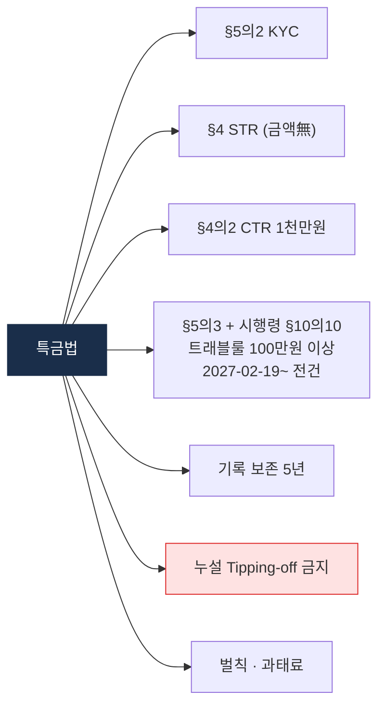
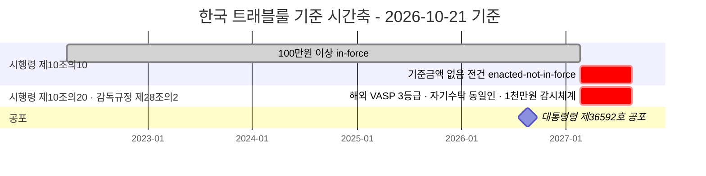

# Day 9 — 한국 특금법 2: AML 의무 + 2026 개정

> KYC/STR/Travel Rule + 2026 개정과 2027-02-19 전환. ⏱️ ~75분. 마지막 업데이트: 2026-10-21.

## 📖 오늘 뭘 배우나

특금법은 진입 규제(§7 신고)만이 아니라 **운영 규제**도 함께 담고 있습니다 — §5의2(고객확인), §4(STR), §4의2(CTR), §5의3 + 시행령 §10의10(트래블룰), 기록 보존. 각 조항이 실무의 어느 프로세스에 매핑되는지 연결 짓는 것이 오늘의 핵심입니다. 트래블룰은 2026-10-21 현재 **100만원 이상**(in-force)이지만, 대통령령 제36592호(2026-08-18 공포)로 **2027-02-19부터 기준금액 없이 전건**이 됩니다(enacted-not-in-force).


<!-- MAP-START -->
## 🗺 오늘의 지도


<!-- MAP-END -->

## 🎯 핵심 질문
1. 특금법상 고객확인 + EDD 판단 기준은 2026-08-18 개정 시행령에서 어떻게 정해졌나?
2. 한국 트래블룰 기준은 2027-02-18까지와 2027-02-19부터 각각 무엇인가?
3. 2027-02-19에 트래블룰 외에 새로 생기는 규율 세 가지는?

## 📖 읽기 (~50분)
- 메인: [`../notes/2-regulations/korea-fiu-act.md`](../notes/2-regulations/korea-fiu-act.md) — 4~10절
- 보조: [`../notes/3-crypto-aml/travel-rule.md`](../notes/3-crypto-aml/travel-rule.md) — 한국 2027 전환

## 🌐 외부 자료 (선택, ~15분)
- [금융위 2026-08-11 — 특금법 시행령 개정안 국무회의 의결](https://www.fsc.go.kr/no010101/87499)
- [법제처 DRF — 시행령 2027-02-19 시행예정 판본](https://www.law.go.kr/DRF/lawService.do?OC=test&target=eflaw&MST=288765&efYd=20270219&type=XML)

## 📋 2026~2027 개정 적용 로드맵

| 일자 | 사건 | 상태(2026-10-21) |
|---|---|---|
| 2026-02-19 | 법률 제21358호 공포 | — |
| 2026-03-30 | 시행령·감독규정 개정안 입법예고 | proposed → 공포로 종료 |
| 2026-08-18 | 대통령령 제36592호 공포 | 본칙 in-force / §10의10·§10-20 enacted-not-in-force |
| 2026-08-20 | 법률 제21358호 시행, 감독규정(FIU 고시 제2026-2호) 시행 | in-force (§28-2 유예) |
| 2026-10-02 | 법률 제21857호·감독규정 제2026-3호 현행본 | in-force |
| **2027-02-19** | 시행령 §10의10(기준금액 폐지)·§10-20 시행 | enacted-not-in-force |
| 2027-02 중 | 감독규정 §28-2 시행 — 고시 부칙 기산점에 따라 02-19 또는 02-21 | enacted-not-in-force, 시행일 미확정 |

근거: [`../notes/2-regulations/korea-fiu-act.md`](../notes/2-regulations/korea-fiu-act.md) §1·§5.



### 2027-02-19 전환 대비 3단계

1. **지금(2026-10-21~)**: 100만원 미만 이전에도 성명·주소를 동시에 보낼 수 있는지, 요청형 추가정보(주민등록번호 등)를 **3영업일 이내** 회신할 수 있는지 시스템 점검
2. **해외 VASP 평가**: 저위험(FATF 권고 이행국·동등 AML·인허가 모두 충족)은 허용, 그 외는 고객·상대방 동일인일 때만, FATF 고위험국·무인허가·고위험 평가는 제한 — 상대 VASP 목록을 이 세 등급으로 분류
3. **자기수탁 주소·1천만원**: 동일인 확인 절차(방법은 법령 미지정)와 1천만원 이상 이전의 **자체 의심거래 감시체계** 설계 — 자동 STR이 아니라 감시 대상

## 🛠️ 미니 챌린지 (~10분)
- 9 의무 (Day 6) → 특금법 § 매핑 시도 (틀려도 OK, D14에 보완)
- 2027-02-19 전후 트래블룰 규칙을 두 줄로 비교해 적기

## ✅ 체크포인트
- [ ] 한국 트래블룰: ~2027-02-18 "100만원 이상"(초과 아님) / 2027-02-19~ 전건 + 요청 시 추가정보 3영업일
- [ ] 트래블룰 근거 조문은 특금법 §5의3(§5의2는 고객확인)
- [ ] 거래기록 보관: 특금법·업무규정 5년(분석자료 5년 이상) / 이용자보호법 시행령 §13 15년 → 같은 자료면 긴 쪽 적용
- [ ] STR 보고 채널 (KoFIU 전자보고) 안다
- [ ] 1천만원 이상은 "자체 의심거래 감시체계" 대상이지 자동 STR이 아님을 안다

## 💭 오늘의 한 줄

## 💼 실무 현장 (Industry Reality)

> 2026-10-21 판에서 이전 판의 "2026-01-29 개정 시행", 조문별 벤더 매핑, "단일 거래 100만원 초과·1일 누적 합산 아님", "개인지갑 100만원 초과 시 소유 증명 요구", "EU TFR은 1유로부터", "과태료 신설로 형사처벌 대신", "3년 갱신 시 신규 요건 적용" 서술을 삭제·정정했습니다.

### 특금법 § → 팀 → 산출물 매핑

| § | 의무 | 담당 팀(예시) | 산출물·근거 |
|---|---|---|---|
| §4 | STR | AML 분석팀 | 의심거래보고 → KoFIU 전자보고 |
| §4의2 | CTR(현금 1천만원) | 현금 취급 시 | 가상자산 이전 자체는 대상 아님 |
| §5의2 | 고객확인·EDD | KYC 운영팀 | 시행령 2026-08-18 개정 — 고객 특성·거래양태·상품 위험도로 EDD 판단 |
| §5의3 + 시행령 §10의10 | 트래블룰 | 트래블룰 운영 | ~2027-02-18 100만원 이상 / 2027-02-19~ 전건 |
| 업무규정 제76~81조 | 거래모니터링체계 | 모니터링 엔지니어링 | 분석 절차·분석담당자·분석자료 5년 이상 보존 |
| §7 | 신고 | 법무·정책팀 | 2026-08-20~ 대주주 심사, 변경 30일 전 사전신고 |
| 누설 금지 | Tipping-off | 전사 교육 | 조문·법정형은 원문 확인 |

### 트래블룰 — 헷갈리는 포인트

- **"이상"이지 "초과"가 아님**: 시행령 §10의10 제1호 문언은 "1백만원 이상"입니다.
- **개인지갑(자기수탁)**: 2027-02-18까지는 법령상 소유 증명 의무가 없습니다(거래소 자율 운영). 2027-02-19부터 감독규정 §28-2④가 **송·수신인이 동일인인 경우에만** 이전을 허용합니다. 증명 방법(서명·소액 송금 등)은 정하지 않았습니다.
- **해외 VASP·sunrise**: 2027-02-19부터 해외 VASP 3등급 규율이 생깁니다. 그 전까지는 별도 법령 규율이 없습니다.
- **EU와의 차이**: EU TFR은 **금액 기준 없이 전건**이고, 자기수탁 주소와 EUR 1,000 이상("amounts to or exceeds") 이전에 소유·통제를 검증합니다. "1유로부터"라는 표현은 틀립니다.
- **커버리지**: 2026 상반기 총 출고 62.8조원 중 트래블룰 적용은 9.5조원(약 15%)이었습니다([금융위 2026-10-01](https://www.fsc.go.kr/no010101/87835)).

### 룰 예시 — 2027-02-19 전후 (가상 의사코드)

```
# ~2027-02-18 (in-force)
RULE: travel_rule_outgoing_current
WHEN withdrawal.amount_krw >= 1_000_000 AND destination.is_vasp
THEN send_originator_beneficiary_info()

# 2027-02-19~ (enacted-not-in-force)
RULE: travel_rule_outgoing_2027
WHEN destination.is_vasp                       # 금액 조건 없음
THEN send_name_and_address_with_transfer()     # 이전과 동시에
     on_request(id_numbers) -> reply_within(3 business days)
     apply_counterparty_tier(low | same_person_only | restricted)

RULE: self_custody_2027
WHEN destination.is_self_custody
THEN allow_only_if(same_person_verified)       # 증명 방법은 법령 미지정
     if amount_krw >= 10_000_000: route_to_internal_monitoring()  # 자동 STR 아님
```

### 자주 나오는 오해

- **"특금법 개정은 2026-01부터 적용"** — 법률 제21358호는 2026-08-20 시행, 트래블룰 전건화는 2027-02-19입니다.
- **"Travel Rule은 송금만"** — 송수신 양방향입니다. 2027-02-19부터는 수취 VASP도 추가정보를 요청할 수 있습니다.
- **"1천만원 이상은 자동 STR"** — 입법예고안의 표현이었고, 공포본은 "자체 의심거래 감시체계"입니다.
