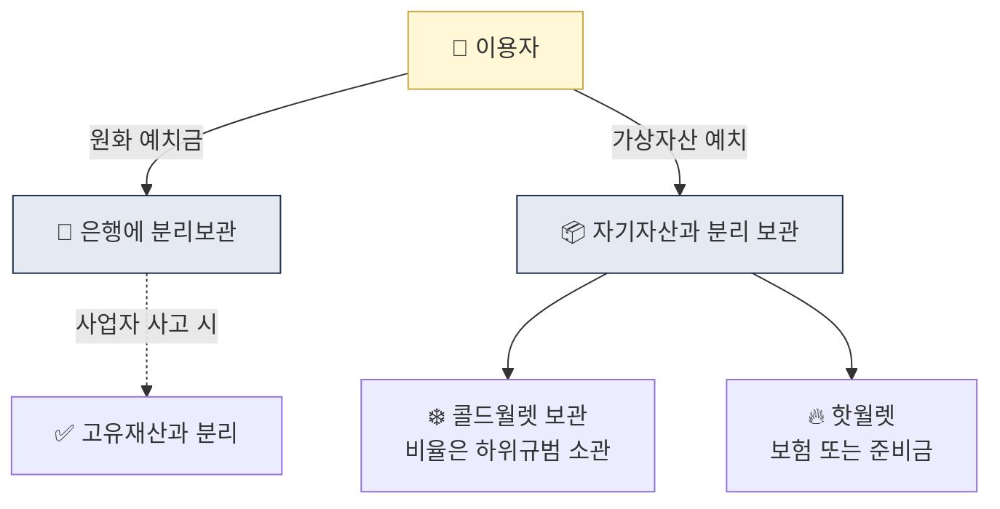
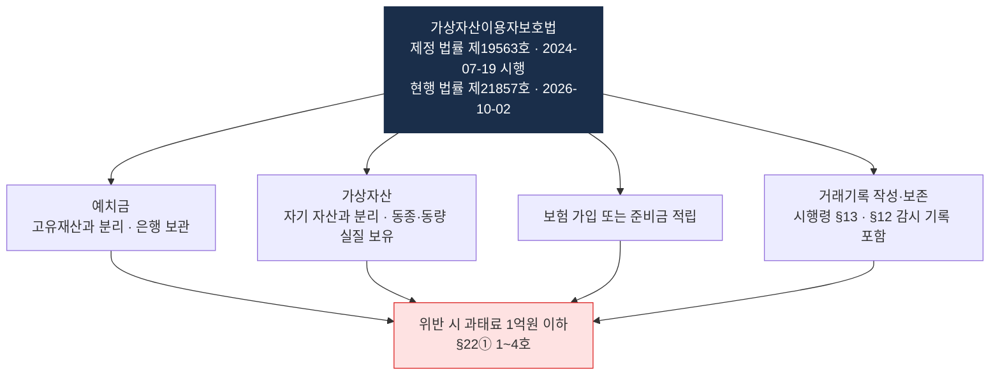

# Day 10 — 가상자산이용자보호법 1: 자산 분리 보관

> 한국 첫 가상자산 전용 법, 이용자 자산 보호. ⏱️ ~75분. 마지막 업데이트: 2026-10-21.

## 📖 오늘 뭘 배우나

특금법이 AML 중심이라면 가상자산이용자보호법(2024-07-19 시행)은 **이용자 자산 보호 중심**. 오늘은 예치금 은행 분리·가상자산 분리 보관·보험(또는 준비금)·거래기록 보존(§6~§9)을 정리합니다. FTX 파산 같은 사고 이후 "거래소가 고객 돈을 마음대로 쓸 수 없게" 만든 구조적 장치가 이 법의 본질입니다. 콜드월렛 보관 비율 같은 구체 수치는 하위규범 소관이라 이 저장소 근거로는 재확인하지 못했습니다.

<!-- MAP-START -->
## 🗺 오늘의 지도

<!-- MAP-END -->

## 🎯 핵심 질문
1. 가상자산이용자보호법 시행일은?
2. 예치금 분리 보관 기관은?
3. 분리보관 의무를 어기면 어떤 제재를 받나? (§22①)

## 📖 읽기 (~50분)
- 메인: [`../notes/2-regulations/korea-user-protection.md`](../notes/2-regulations/korea-user-protection.md) — 1~4절

## 🌐 외부 자료 (선택, ~15분)
- [국가법령정보센터 — 가상자산이용자보호법](https://www.law.go.kr/법령/가상자산이용자보호등에관한법률)
- [금융위 2024-07-08 — 가상자산시장 불공정거래 조사체계](https://www.fsc.go.kr/no010101/82625)

## 🛠️ 미니 챌린지 (~10분)
- "자기 자산 vs 고객 자산 분리"를 고객 입장에서 왜 중요한지 3줄 정리
- 콜드월렛 보관 의무가 출금 처리에 미치는 운영 영향 1가지 적기

## ✅ 체크포인트
- [ ] 시행일 2024-07-19 안다
- [ ] 예치금 → 고유재산과 분리해 은행 보관 안다 (이용료 지급 조문은 법 원문으로 확인)
- [ ] 가상자산 → 동종·동량 실질 보유 의무 안다
- [ ] 거래기록 보존 — 시행령 §13은 §12 상시감시·조치 결과와 통보 기록도 보존 대상에 넣는다 (15년, fds 도시에 F-023)
- [ ] 자산 보호 의무 위반 = 과태료 1억원 이하(§22①1~4호) 안다

## 💭 오늘의 한 줄

## 💼 실무 현장 (Industry Reality)

> 2026-10-21 판에서 이전 판의 거래소별 예치금 은행·수탁사 표, "예치금 이용료 연 1.0~2.1%", 콜드 80%·핫 20% 스윕 구조도, 보험 브로커명, "준비금 핫월렛 총액의 1~5%", "콜드월렛 80% 위반 시 5년/5천만원" 서술을 삭제했습니다. 벌칙은 현행 §22① 문언(과태료 1억원 이하)과 맞지 않고, 나머지는 공개 1차 근거가 없습니다([`../notes/2-regulations/korea-user-protection.md`](../notes/2-regulations/korea-user-protection.md) §3-A).

### 이용자 자산 보호 4의무와 제재

근거: [가상자산이용자보호법 현행본](https://www.law.go.kr/LSW/lsInfoR.do?lsiSeq=290735&efYd=20261002&ancYnChk=0&chrClsCd=010202&urlMode=lsInfoR), [시행령](https://www.law.go.kr/LSW/lsInfoR.do?lsiSeq=290171&efYd=20261002&ancYnChk=0&chrClsCd=010202&urlMode=lsInfoR).

### 실무 번역

- "이용자가 BTC 10개를 맡겼다면 거래소는 실제로 BTC 10개를 **이용자 몫으로 따로** 보유해야 한다" — 이용자 몫을 자체 영업이나 대여에 쓸 수 없습니다.
- 콜드·핫월렛 사이 이동은 보관 방식의 문제이고, 자기 자산과 섞이는 것이 위반입니다. 콜드월렛 보관 비율 등 구체 수치는 하위규범 원문으로 확인하세요.
- 거래기록 보존 대상에는 §12 시장감시의 **상시감시·조치 결과(6호)와 통보·신고·보고 기록(7호)**이 들어갑니다. 시장감시 산출물 자체가 보존 대상이라는 뜻입니다.

### 입출금 차단과의 관계 — §11

자산 보호와 반대 방향의 의무도 있습니다. §11은 **정당한 사유 없는 입출금 차단을 금지**하고, 시행령 §17이 허용 사유(전산장애·보수점검·거래지원 종료·실사 등)를 열거합니다. "위험해 보이면 일단 출금 정지"는 §11과 충돌할 수 있으므로, 보이스피싱 의심이면 통신사기피해환급법 임시조치 절차(통지·본인확인·해제·기록 보존, 거래소 적용 2026-10-01~)를 따릅니다.

### 자주 나오는 오해

- **"분리보관 위반은 5년 이하 징역"** — 현행 §22①은 **과태료 1억원 이하**입니다. 형사처벌(§19)은 §10 불공정거래 행위자에 대한 것입니다.
- **"가상자산 분리보관 = 같은 코인을 그대로"** — 정확히는 **동종·동량 실질 보유**입니다. 콜드/핫 이동은 허용되나 자기 자산과 섞이면 위반입니다.
- **"이용자보호법은 감독기관이 FIU"** — 이 법은 **금융위·금감원**이 감독합니다. FIU는 특금법입니다.
