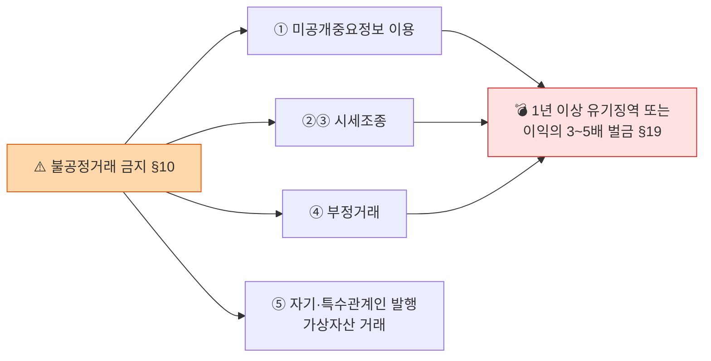
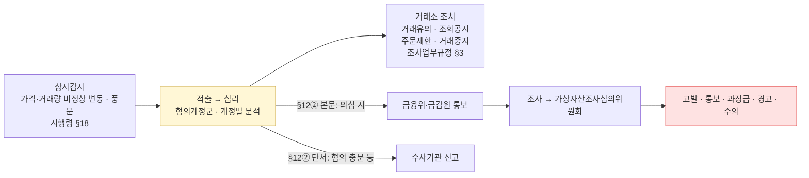
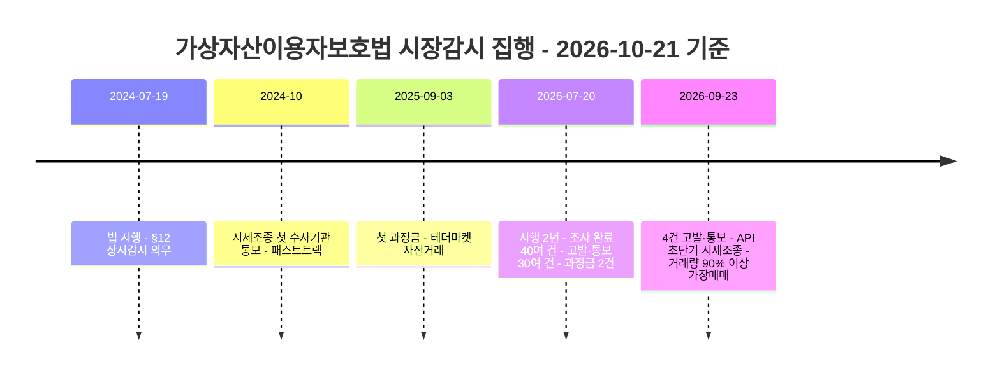

# Day 11 — 가상자산이용자보호법 2: 시세조종 + 2단계 입법

> 시장 건전성 + §12 시장감시 + 향후 입법 방향. ⏱️ ~70분. 마지막 업데이트: 2026-10-21.

## 📖 오늘 뭘 배우나

어제의 자산 보호에 이어, 오늘은 이용자보호법의 **시장 규제**입니다. §10은 미공개중요정보 이용·시세조종·부정거래·자기 발행 가상자산 거래를 금지하고, §12는 거래소에 **이상거래 상시감시**를 의무화합니다. 법률상 "이상거래"는 이 §12의 용어이고, FDS(보이스피싱)나 특금법 STR(자금세탁)과는 다른 제도입니다. 마지막으로 2단계 입법으로 미뤄진 영역(발행·유통, 스테이블코인, 평가·공시업, 외국 사업자, DeFi)을 정리하되, 2026-10-21 기준 진행 상태는 1차 원문으로 확인되지 않았다는 점도 함께 봅니다.

<!-- MAP-START -->
## 🗺 오늘의 지도

<!-- MAP-END -->

## 🎯 핵심 질문
1. 가상자산판 시세조종 처벌 수준은? (형사 §19 vs 과징금 §17)
2. §12 "이상거래"는 FDS·STR과 무엇이 다른가?
3. 2단계 입법으로 미뤄진 영역은 무엇이고, 2026-10-21 기준 상태를 왜 단정할 수 없나?

## 📖 읽기 (~45분)
- 메인: [`../notes/2-regulations/korea-user-protection.md`](../notes/2-regulations/korea-user-protection.md) — 3-B~3-C절, 8~10절

## 🌐 외부 자료 (선택, ~15분)
- [국가법령정보센터 — 가상자산이용자보호법 현행본](https://www.law.go.kr/LSW/lsInfoR.do?lsiSeq=290735&efYd=20261002&ancYnChk=0&chrClsCd=010202&urlMode=lsInfoR) — §10·§12·§17·§19
- [금융위 2026-07-20 — 법 시행 2년 성과](https://fsc.go.kr/po010106/87357)

## 🛠️ 미니 챌린지 (~10분)
- 특금법 vs 이용자보호법 vs 통신사기피해환급법 분담 표 한 페이지 정리 (목적/감독/산출물)
- 2단계 입법 영역 중 거래모니터링에 가장 영향이 클 것 선택 + 이유

## ✅ 체크포인트
- [ ] 시세조종 처벌 (1년 이상 유기징역 또는 이익·회피손실의 3~5배 벌금, §19①) 안다
- [ ] 과징금(§17) — 이익의 2배 이하, 산정 곤란 시 40억원 이하 안다
- [ ] §12 위반은 과태료 1억원 이하(§22①6·7호)이고, 산출물은 차단이 아니라 금융위·금감원 **통보**임을 안다
- [ ] 2단계 입법 영역(발행·유통/스테이블코인/평가·공시업/외국 사업자/DeFi) 안다 — 상태는 proposed 이하로만 이해

## 💭 오늘의 한 줄

## 💼 실무 현장 (Industry Reality)

> 2026-10-21 판에서 이전 판의 "시장감시 팀 5~15명", 시장감시 벤더 제품명 도입 서술, "2024년 1호 처벌 사례는 상장 대가 펌핑 → 징역 판결", "특금법·이용자보호법 병합 기소", 2단계 입법 "전망 임팩트" 표, 시간대별 하루 루틴을 삭제했습니다. 공개 1차 근거가 없습니다([`../notes/2-regulations/korea-user-protection.md`](../notes/2-regulations/korea-user-protection.md) 💼).

### §12 시장감시 — 적출에서 조치까지

근거: [가상자산이용자보호법 §12](https://www.law.go.kr/LSW/lsInfoR.do?lsiSeq=290735&efYd=20261002&ancYnChk=0&chrClsCd=010202&urlMode=lsInfoR), [가상자산시장조사업무규정](https://www.law.go.kr/LSW/admRulInfoR.do?admRulSeq=2100000285440&chrClsCd=010201), [금융위 2024-07-08](https://www.fsc.go.kr/no010101/82625).

### 감독당국이 확인한 거래소 시장감시의 모습 (2024-08-22 점검)

- 거래지원 부서와 분리된 **전담 시장감시 조직** + 합의제 심의기구
- 가격상승률·거래량증가율·최고가 변동폭 등이 임계값을 넘으면 적출하는 **자체 개발 룰 기반 시스템**(임계값은 비공개)
- 이용자 안내 → 거래유의 지정 → 주문·거래 제한 → 거래중단의 단계적 조치
- 금융당국–5대 원화거래소 핫라인

출처: [금융위·금감원 2024-08-22](https://fsc.go.kr/po010101/82943).

### 집행 실적 — 공표분

근거: [금융위 2025-09-03](https://www.fsc.go.kr/po010101/85233), [금융위 2026-07-20](https://fsc.go.kr/po010106/87357), [금융위 2026-09-23](https://www.fsc.go.kr/no010101/87783). 과징금 2건은 부당이득의 125~165% 수준이었습니다. 거래소의 §12 통보 건수 자체는 공표되지 않았습니다.

### 감시 대상 수법 — 2025~2026 의결 사례

일일 가격 기준 시각을 노린 고가매수, 다수 계정의 **API 키를 대여받은** 통정매매, 해외거래소에서 먼저 가격을 끌어올린 연계 시세조종, 마켓메이커를 고용한 **거래량 90% 이상 가장매매**([금융위 2026-04-29](https://www.fsc.go.kr/no010101/86809); [2026-07-01](https://www.fsc.go.kr/no010101/87235); [2026-09-23](https://www.fsc.go.kr/no010101/87783)). 공개 정량 기준은 시장경보의 **소수계정(상위 10개) 매매관여율** 구간(투자주의 50~75%, 투자경고 75~90%, 투자위험 90% 이상)뿐입니다(금융위 2026-07-01).

### 2단계 입법 — 2026-10-21 기준

법 제정 당시 2단계로 미뤄진 주제는 발행·유통 규율, 스테이블코인, 평가·자문·공시업, 외국 사업자, DeFi 등입니다. 디지털자산기본법 정부안·원화 스테이블코인의 진행 상태는 1차 원문으로 확인하지 못했습니다(보고서 부록 B #10). FATF 7차 TU Annex A는 한국의 스테이블코인 발행자 등록·인가 요구를 "No"로 표시했습니다([7차 TU PDF](https://www.fatf-gafi.org/content/dam/fatf-gafi/reports/7th-targeted-update-on-implementation-fatf-standards-vas-vasps-2026.pdf.coredownload.pdf)).

### 자주 나오는 오해

- **"§12 이상거래 감시 = 거래소 FDS"** — 아닙니다. §12는 불공정거래 우려 거래만 대상으로 하는 **시장감시**입니다. 보이스피싱·계정탈취는 통신사기피해환급법, 자금세탁은 특금법 STR입니다.
- **"§12 위반하면 형사처벌"** — §12 위반은 과태료 1억원 이하입니다. 형사처벌(§19)은 §10 불공정거래 행위자에 대한 것입니다.
- **"이상거래가 보이면 바로 수사기관 신고"** — 원칙은 금융위·금감원 통보이고, 신고는 혐의가 충분히 증명된 경우나 수사기관 요청이 있는 경우입니다(조사업무규정 §4).
- **"시장감시와 AML은 같은 팀"** — 산출물(통보 vs STR)과 수령기관이 다르므로 절차를 분리합니다. 시세조종 수익의 출금은 STR 후보가 될 수 있어 케이스 정보는 공유합니다.
