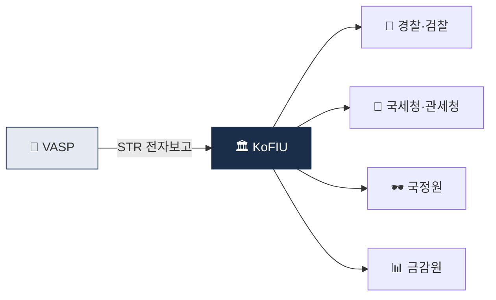
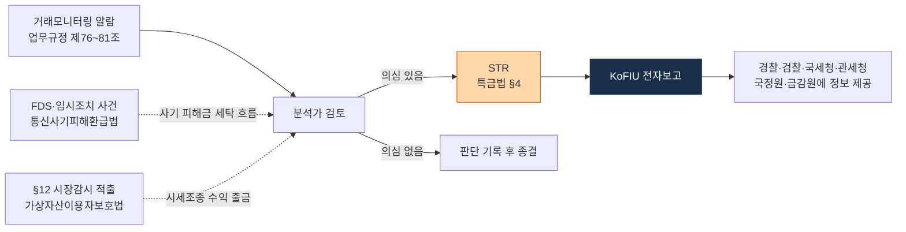

# Day 12 — KoFIU 시스템 + 보고 절차

> STR이 어디로 가는가, 누가 받아 무엇을 하는가. ⏱️ ~70분. 마지막 업데이트: 2026-10-21.

## 📖 오늘 뭘 배우나

회사가 제출한 STR은 **KoFIU를 거쳐 경찰·검찰·국세청 등에 분배**되어 실제 수사로 이어집니다. 오늘은 이 사후 흐름과 **좋은 STR vs 나쁜 STR**의 차이를 정리합니다. 감독당국이 STR 건수가 적은 회사를 오히려 의심하는 이유, 그리고 Tipping-off 금지가 왜 별도 처벌인지도 다시 한번 확인.

<!-- MAP-START -->
## 🗺 오늘의 지도

<!-- MAP-END -->

## 🎯 핵심 질문
1. STR이 KoFIU에 가면 어디로 분배되나?
2. KoFIU와 금감원의 관계는?
3. FDS 알림·시장감시 적출은 어떤 경우에 STR 후보가 되나?

## 📖 읽기 (~45분)
- 메인: [`../notes/5-compliance/str-ctr.md`](../notes/5-compliance/str-ctr.md) — 1~5절

### ⚠️ 2025-06 FATF R.16 개정 — 정확히 무엇이 바뀌었나

- FATF는 2025-06 총회에서 R.16("Payment transparency")을 개정했지만 **VASP를 R.16에 직접 넣지 않고 R.15를 거쳐 간접 적용**합니다(설명서 para 54). de minimis는 "no higher than USD/EUR 1,000" 유지(para 33), 이행 기대시한은 **2030년 말**(para 59)입니다([R.16 개정 설명서](https://www.fatf-gafi.org/content/dam/fatf-gafi/recommendations/Explanatory%20note%20for%20revised%20R.16.pdf.coredownload.pdf)).
- 이전 판의 "Self-hosted wallet KYC 확장", "Protocol Interop 명시 요구", "PII 암호화·GDPR·PIPA 명시"는 설명서에 없는 내용이라 삭제했습니다.
- 한국 트래블룰은 R.16 개정과 별개로 대통령령 제36592호에 따라 **2027-02-19부터 기준금액 없이 전건**이 됩니다(enacted-not-in-force). 자기수탁 주소는 같은 날부터 동일인 이전만 허용됩니다(감독규정 §28-2④).

**상세**: [`day_17.md`](day_17.md) "FATF R.16 2025-06 개정" 참조.

## 🌐 외부 자료 (선택, ~15분)
- [KoFIU 공식](https://www.kofiu.go.kr/) — 연차보고서 검색
- [한국 FIU 연차보고서 검색](https://www.kofiu.go.kr/) (사이트 내 자료실)

## 🛠️ 미니 챌린지 (~10분)
- STR 사후 흐름 그림 그리기 (VASP → KoFIU → 경찰/검찰/국세청/관세청/국정원/금감원)
- "좋은 STR vs 나쁜 STR" 핵심 차이 3가지 정리

## ✅ 체크포인트
- [ ] KoFIU = 한국 FIU = 금융위 산하 안다
- [ ] STR 작성 4요소 (사실/의심사유/증빙/유관거래) 안다
- [ ] Tipping-off 위반 = 별도 처벌 다시 확인
- [ ] CTR 1천만원 + 가상자산 적용 모호 안다

## 💭 오늘의 한 줄

## 💼 실무 현장 (Industry Reality)

> 2026-10-21 판에서 이전 판의 FIU-TIS 제출 단계별 SLA("보완 15일", "7~30일 내 이첩"), "KoFIU 분석 인원 ~70명", "반려율이 높으면 검사 우선순위", "Alert 중 STR 1~5%", "Analyst 1인당 월 3~10건", "거래소 연 수천 건", "Binance SAR 사실상 0건", 영장 vs "§10 자료요청" 비교표와 "월 수십~수백 건"을 삭제했습니다. 공개 1차 근거가 없습니다([`../notes/5-compliance/str-ctr.md`](../notes/5-compliance/str-ctr.md)).

### STR의 입력원과 출구

FDS 임시조치와 §12 통보는 **그 자체로 STR이 아닙니다**. 각자 법적 산출물을 내고, 자금세탁 의심이 따로 성립할 때 STR을 별도로 냅니다([`../notes/2-regulations/korea-user-protection.md`](../notes/2-regulations/korea-user-protection.md) §4).

### KoFIU 제출 실무 — 확인되는 것

- 보고 채널은 KoFIU 전자보고 시스템입니다. 보고책임자(AMLO) 결재를 거쳐 제출합니다.
- 건당 제출 시간·제출 방식(웹 입력 vs API)·처리 기간의 공개 자료는 없습니다. 사내에서 직접 재서 인력 계획에 씁니다.
- 회사가 낸 STR이 어디까지 갔는지는 보통 알 수 없습니다. 수사기관이 다시 접촉할 때 짐작할 뿐입니다.

### 좋은 STR vs 나쁜 STR — 작성 원칙

| 좋은 STR | 나쁜 STR |
|---|---|
| 사실관계 + 수치(금액·일시·노출 경로) | "고액 거래라 의심" |
| 상대 주소·상대 VASP 식별 결과 명시 | "수상한 지갑" |
| 타임라인 재구성 | 단일 거래만 언급 |
| 대체 해석을 배제한 논리 | 일방적 단정 |
| 증빙 첨부 | 거래내역 1건만 |

FIU가 회사별 STR 품질을 어떻게 평가하는지에 대한 공개 기준은 없습니다. 확인되는 것은 제재 사유입니다 — FIU의 2025-11-06 두나무 과태료 352억원 결정 사유에는 **의심거래보고 위반**이 포함됐습니다([FIU 보도자료 KDI 미러](https://eiec.kdi.re.kr/policy/materialView.do?num=273166)).

### STR 건수 현실 감각

- 가상자산 전용 alert-to-STR 전환율 공개 벤치마크는 **없습니다**(B). 공개된 것은 은행권 자료(EY 2018, 리테일 평균 14%)뿐입니다([EY 2018](https://ey.com/content/dam/ey-unified-site/ey-com/en-uk/industries/financial-services/documents/ey-anti-money-laundering-transaction-monitoring-2018-emeia-survey.pdf)).
- 거래소별 STR 제출 건수는 공표되지 않습니다. 연간 접수 건수는 FIU 연차보고서 원문으로 확인하세요.

### 자주 나오는 오해

- **"STR 많이 내면 실적"** — 품질 낮은 STR의 남발과 STR 부재 모두 검사에서 설명을 요구받을 수 있습니다. 판단 기록을 남기세요.
- **"Tipping-off는 직접 말할 때만"** — "계정 이용 일시정지 사유" 같은 우회 안내도 문제될 수 있습니다. 고객 안내문은 사전 검토 대상입니다.
- **"KoFIU가 직접 수사"** — KoFIU는 분석·정보 제공 기구입니다. 수사는 수사기관이 합니다.
- **"FDS 임시조치를 했으니 STR도 된 것"** — 임시조치(통신사기피해환급법)와 STR(특금법 §4)은 별개 의무입니다.
