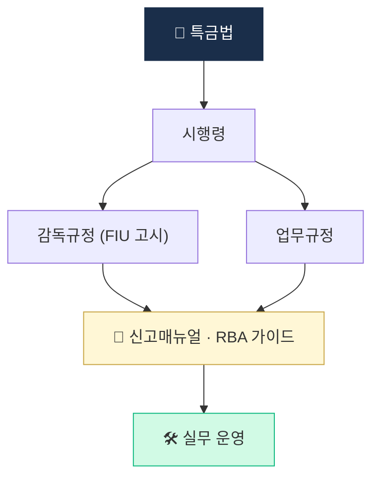
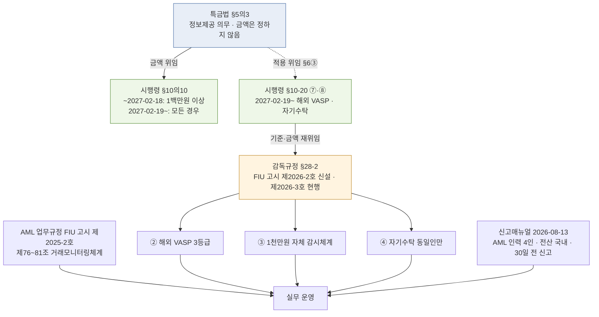

# Day 13 — 한국 가이드라인 정독 (RBA + 신고매뉴얼)

> 법조문 위에 깔린 운영 바이블. ⏱️ ~90분. 마지막 업데이트: 2026-10-21.

## 📖 오늘 뭘 배우나

특금법·이용자보호법의 조문만 읽어서는 실무가 안 됩니다. 실무는 그 위의 **시행령·감독규정·FIU 가이드라인(RBA 처리기준·신고매뉴얼)** 이라는 **4층 규범** 을 봐야 돌아갑니다. 오늘은 이 가이드라인이 고객 위험등급·재실사 주기·EDD 트리거를 어떻게 구체화하는지 확인합니다. 특히 트래블룰처럼 **숫자가 법률이 아니라 시행령·고시에 적혀 있는** 경우가 많아, 어느 층위 규범이 바뀌었는지를 추적하는 습관이 중요합니다.


<!-- MAP-START -->
## 🗺 오늘의 지도


<!-- MAP-END -->

## 🎯 핵심 질문
1. 위험기반접근법(RBA)의 4가지 위험 차원은?
2. 위험등급 3종 (LOW/MED/HIGH) 각 통제 차이는?
3. FIU 신고매뉴얼에서 가장 까다로운 항목은?

## 📖 읽기 (~60분)
- 메인: [`../notes/5-compliance/cdd-edd.md`](../notes/5-compliance/cdd-edd.md) — 3절 (RBA)
- 보조: [`../notes/5-compliance/internal-controls.md`](../notes/5-compliance/internal-controls.md) — 6절 (ERA)

## 🌐 외부 자료 (~20분)
- [금융위 2026-08-13 — 가상자산사업자 신고매뉴얼 전면 개정](https://www.fsc.go.kr/no010101/87521) — 개정 요지 + 첨부 매뉴얼 1개 챕터 정독
- [법제처 DRF — 자금세탁방지 업무규정](https://www.law.go.kr/DRF/lawService.do?OC=test&target=admrul&ID=2100000267264&type=XML) — 제76~81조
- [KoFIU](https://www.kofiu.go.kr/) — RBA 관련 가이드라인 자료 검색

## 🛠️ 미니 챌린지 (~10분)
- 가상의 신규 고객 1명에 대해 RBA 4차원 위험점수 부여 시뮬레이션 (각 1~5점, 총 20점 만점)
- 점수 → 등급 매핑

## ✅ 체크포인트
- [ ] RBA 4차원 (고객/상품/거래/지역) 외운다
- [ ] 등급별 재실사 주기를 정책에 명시해야 한다는 점 안다 (이 저장소 cdd-edd 노트의 "저5/중3/고1년"은 2026-10 근거 자료로 원문 재확인 안 됨 — FIU 가이드라인 원문 확인)
- [ ] 신고매뉴얼(2026-08-13 전면 개정)의 AML 인력 4인 이상·전산설비 국내 소재·30일 전 사전신고를 안다

## 💭 오늘의 한 줄

## 💼 실무 현장 (Industry Reality)

> 2026-10-21 판에서 이전 판의 "한국 거래소 실제 구현" 가중치 공식, "2026-01 개정 후 특수관계인 영문 공증·아포스티유", "AMLO 경력 5년 이상", "ERA 외부 검증이 업계 관행", "3년 1회 갱신 신고"와 주기별 하루 루틴을 삭제·정정했습니다. 공개 1차 근거가 없습니다.

### 규범 층위 — 숫자는 어디에 적혀 있나 (트래블룰 예)



점선은 상위 위임 조문을 직접 대조하지 않았다는 표시입니다([`../notes/2-regulations/korea-fiu-act.md`](../notes/2-regulations/korea-fiu-act.md) §5). 감독규정 §28-2의 시행일은 고시 부칙 기산점에 따라 2027-02-19 또는 02-21이 될 수 있어 확정되지 않았습니다.

### 실무에서 자주 보는 문서

1. **법률** — 의무의 존재와 위반 효과. 감독 대응·분쟁 시 근거
2. **시행령** — 기준금액·정의(트래블룰 100만원 이상 등)
3. **FIU 고시(감독규정·업무규정)** — 거래모니터링체계(제76~81조), 해외 VASP 등급(§28-2)
4. **신고매뉴얼·RBA 가이드라인** — 신고 서류와 위험평가 운영 기준

내부 정책서의 각 절차 옆에 **"근거: 특금법 §4, 업무규정 제76조"**처럼 조문을 적어 두면 하위규범이 개정될 때 영향받는 절차를 바로 찾을 수 있습니다.

### RBA 점수화 — 작성 연습용 가상 예시

아래 가중치·구간은 **학습용 가상값**입니다. 특정 거래소의 실제 모델이 아니고 FIU가 정한 수치도 아닙니다.

```
customer_risk_score =
    w1 * customer_dimension    # PEP·국적·직업·소득
  + w2 * product_dimension     # 취급 자산·서비스
  + w3 * transaction_dimension # 규모·빈도·패턴
  + w4 * geography_dimension   # 거주지·상대국·FATF 명단(판 일자 기록)

# 등급 구간·재실사 주기는 사내 정책으로 정하고 근거를 문서화
```

2026-08-18 개정 시행령은 강화된 고객확인 여부를 **고객 특성·거래양태·상품 위험도**로 판단하도록 했습니다([금융위 2026-08-11](https://www.fsc.go.kr/no010101/87499)). 지역 차원에는 FATF 회색명단(2026-06-19 기준 22개, B)처럼 **판 일자가 있는 입력**을 쓰고 일자를 함께 기록합니다.

### 신고매뉴얼 — 2026-08-13 전면 개정에서 바뀐 항목

- **AML 업무 인력 4인 이상**(겸직 인정 가능)
- 고유식별정보·개인신용정보 처리 **전산설비 국내 소재**(클라우드 국내 리전 인정)
- 대주주·법령준수체계 변경 **30일 전 사전신고**(종전 변경 후 14일 내 사후신고)
- 주요주주 기준(의결권주식 10% 이상 등)

출처: [금융위 2026-08-13](https://www.fsc.go.kr/no010101/87521).

### 자주 나오는 오해

- **"법 조문만 보면 된다"** — 트래블룰 금액·해외 VASP 등급·1천만원 기준은 모두 시행령·고시에 있습니다. 국회를 거치지 않고 바뀝니다.
- **"RBA는 개인고객만"** — 법인·기관 고객도 같은 RBA를 적용합니다. 법인은 실소유자 식별 때문에 더 복잡합니다.
- **"재실사 주기는 법정 고정값"** — 주기를 정해 운영해야 하지만, 이 저장소 근거 자료로는 법정 연수를 원문 확인하지 못했습니다.
