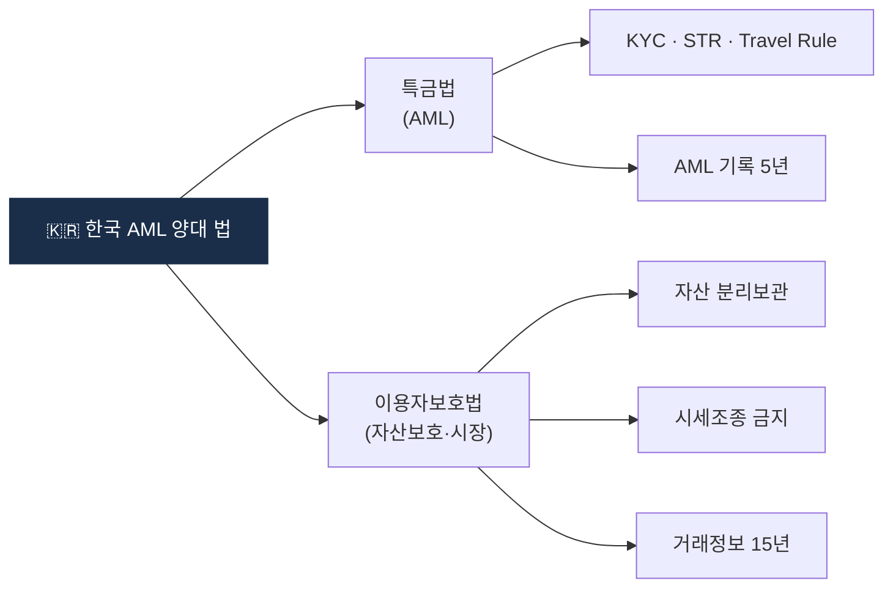
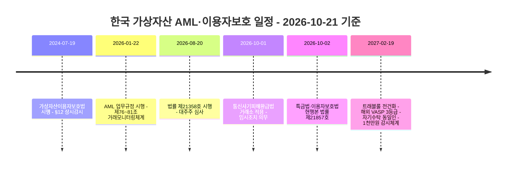

# Day 14 — 🛠️ 한국법 §단위 정리표 + 1주 리뷰

> 특금법 + 이용자보호법(+ 통신사기피해환급법)을 §단위로 자기만의 표로. ⏱️ ~120분. 마지막 업데이트: 2026-10-21.

## 📖 오늘 뭘 배우나

Week 2 전체의 결산. 머릿속 조각들을 **§ 번호 단위 한 장 표**로 재구성해서, 이후 어떤 실무 이슈를 만나도 "이건 특금법 §5의2" 같은 반사적 대응이 가능한 상태를 만드는 날. 조문 번호를 외우는 게 목표가 아니라 **의무 흐름이 § 번호와 함께 기억**되도록.


<!-- MAP-START -->
## 🗺 오늘의 지도


<!-- MAP-END -->

## 🎯 회고 질문
1. 한국 가상자산 AML의 양대 법 + 분담? 2026-10-01부터 더해진 세 번째 법은?
2. 가장 까다로워 보이는 의무 1개?
3. 다음주 (FATF + 글로벌) 어떻게 접근할까?

## 🛠️ 메인 미니 프로젝트 (~90분)

**목표**: 한국법 §단위 정리표 작성 (마크다운 또는 Excel/Notion)

### 형식 (예시)

> 이전 판 예시표의 법정형(“1년/1천만원”, “5년/5천만원”)과 조문 번호 일부(§9 누설, §5의4 기록, 이용자보호법 §10 가상자산 분리, §11 거래기록 15년)는 틀렸거나 이 저장소 근거 자료로 확인되지 않아 고쳤습니다. 확인 안 된 칸은 "원문 확인"으로 둡니다.

| 법 | § | 제목 | 핵심 의무 (한 줄) | 위반 시 |
|---|---|---|---|---|
| 특금법 | §4 | STR | 의심거래 금액 무관 보고 | 원문 확인 |
| 특금법 | §4의2 | CTR | 현금 1천만원 이상 보고 | 원문 확인 |
| 특금법 | §5의2 | 고객확인 | 신원·실소유자·목적, EDD는 고객 특성·거래양태·상품 위험도로 판단(시행령 2026-08-18) | 원문 확인 |
| 특금법 | §5의3 + 시행령 §10의10 | 트래블룰 | ~2027-02-18 100만원 이상 / 2027-02-19~ 전건 | 원문 확인 |
| 특금법 | §7 | VASP 신고 | 2026-08-20~ 대주주 심사·조건부 수리 | 미신고 영업 형사처벌(형량 원문 확인) |
| 특금법 | (누설 금지) | Tipping-off | STR 사실 누설 금지 | 별도 처벌(원문 확인) |
| FIU 고시 | 업무규정 제76~81조 | 거래모니터링체계 | 분석 절차·분석담당자·분석자료 5년 이상 보존 | — |
| 이용자보호법 | §6~§9 | 이용자 자산 보호 | 예치금 분리·가상자산 분리(동종·동량)·보험/준비금·거래기록 | 과태료 1억원 이하(§22①1~4) |
| 이용자보호법 | §10 | 불공정거래 금지 | 미공개정보·시세조종·부정거래·자기발행 거래 | 1년 이상 유기징역 또는 이익 3~5배 벌금(§19①), 과징금(§17) |
| 이용자보호법 | §11 | 입출금 차단 금지 | 정당한 사유 없는 차단 금지(허용 사유 시행령 §17) | 원문 확인 |
| 이용자보호법 | §12 | 이상거래 상시감시 | 시장감시 + 금융위·금감원 통보 | 과태료 1억원 이하(§22①6·7) |
| 이용자보호법 | 시행령 §13 | 거래기록 | 상시감시·통보 기록 포함 15년 보존 | — |
| 통신사기피해환급법 | §2의5 | 임시조치 | 자체점검 상시 실시, 지연·일시정지, 통지·해제(거래소 2026-10-01~) | 지급정지 미이행 손해배상(§4③) |

근거: [`../notes/2-regulations/korea-fiu-act.md`](../notes/2-regulations/korea-fiu-act.md), [`../notes/2-regulations/korea-user-protection.md`](../notes/2-regulations/korea-user-protection.md), [`../notes/3-crypto-aml/vasp-obligations.md`](../notes/3-crypto-aml/vasp-obligations.md).

→ 위 표를 **자기 손으로 다시 작성** (조항 번호 정확치 않아도, 의무 흐름이 머리에 박히는 게 목표)

→ 결과물 저장: `aml/curriculum/_artifacts/d14_korea_law_table.md` (자율)

## ✅ 체크포인트
- [ ] 정리표 산출
- [ ] [`progress.md`](progress.md) Week 2 7개 모두 체크
- [ ] 헷갈리는 § 5개 미만

## 💭 2주차 회고

가장 어려웠던 §:
가장 흥미로웠던 §:
실무에서 직접 부딪힐 것 같은 §:

## 💼 실무 현장 (Industry Reality)

> 2026-10-21 판에서 이전 판의 "§ 인용 빈도 Top 5(체감)", 2026 월별 규제 캘린더("2026-01 대주주 심사 시행" 등), § 단위 KPI 목표치(반려율 10% 미만, 교육 이수율 95% 등)를 삭제했습니다. 날짜가 틀렸거나 공개 근거가 없습니다.

### 2024~2027 한국 규제 캘린더 — 확정된 날짜만



근거: [`../notes/7-vendors/korea-solutions.md`](../notes/7-vendors/korea-solutions.md) §2, [`../notes/2-regulations/korea-fiu-act.md`](../notes/2-regulations/korea-fiu-act.md) §1. 감독규정 §28-2 시행일은 2027-02-19 또는 02-21로 미확정입니다.

### 3법 분담 (한 장 요약)

```
특금법 = AML/CFT — 감독·수령: FIU
  └─ 누가 고객인가 (고객확인·EDD, §5의2)
  └─ 무엇이 의심 거래인가 (거래모니터링 → STR §4, 현금 CTR §4의2)
  └─ 어디로 가는가 (트래블룰 §5의3, 2027-02-19 전건)
  └─ 얼마나 보관하는가 (기록 5년, 분석자료 5년 이상)

가상자산이용자보호법 = 자산 보호·시장 건전성 — 감독: 금융위·금감원
  └─ 자산 분리 (§6~§9)
  └─ 불공정거래 금지 (§10) + 이상거래 상시감시 (§12, 통보)
  └─ 거래기록 15년 (시행령 §13, §12 감시 기록 포함)

통신사기피해환급법 = 보이스피싱 피해 방지 — 거래소 적용 2026-10-01~
  └─ 자체점검 상시 실시 · 임시조치 (§2의5)
  └─ 거래목적 확인 (§2의6) · 지급정지·환급 (§4)
```

**중첩 지점**: 같은 자료가 특금법 기록(5년)과 이용자보호법 거래기록(15년) 양쪽에 해당하면 긴 쪽을 따릅니다.

### 자주 나오는 오해

- **"§ 번호를 외워야 AML 실무"** — 번호보다 **의무 흐름과 산출물(STR·통보·임시조치)**이 중요합니다. 다만 트래블룰 근거를 §5의2로 적는 식의 오류는 검사에서 바로 드러납니다(정답 §5의3).
- **"특금법만 알면 한국 AML 완성"** — 이용자보호법·통신사기피해환급법·FIU 업무규정·개인정보 보호법까지 엮여 있습니다.
- **"이상거래 = 하나의 제도"** — FDS·시장감시·STR 세 제도로 나뉩니다.
