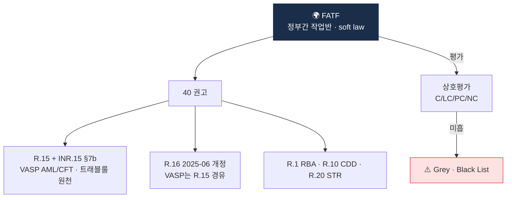
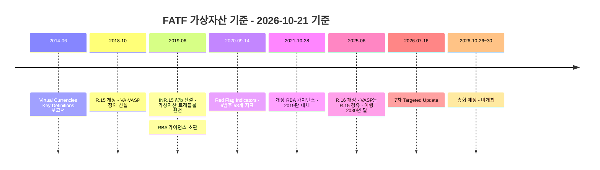
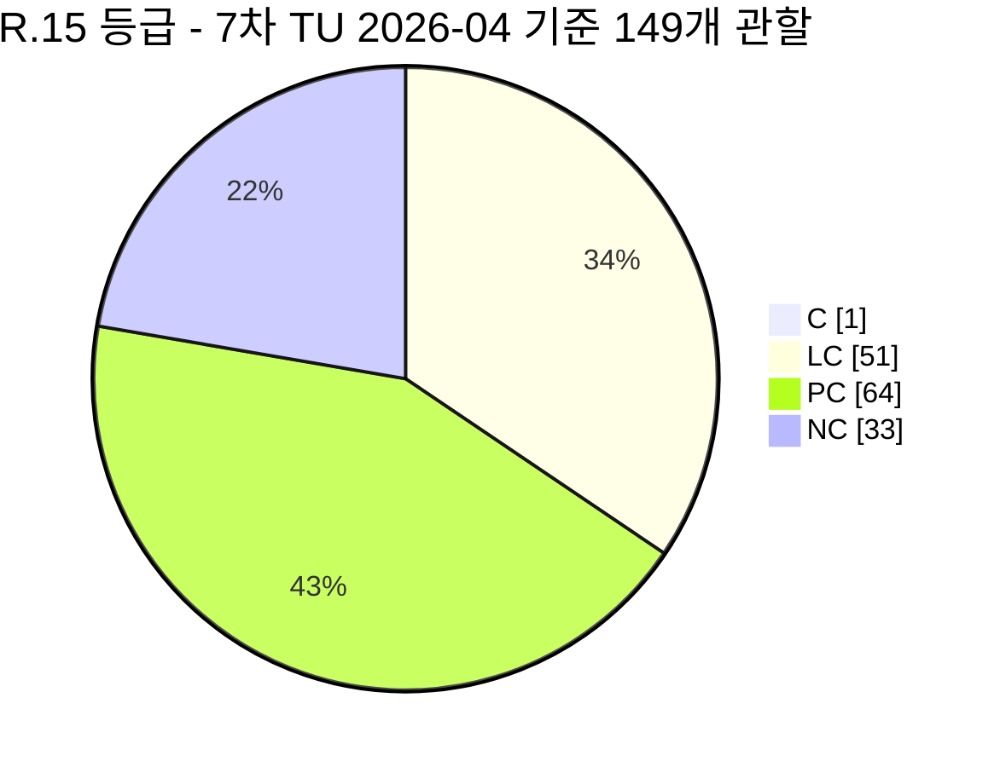

# Day 15 — FATF 구조 + 40 권고안

> 모든 가상자산 AML 룰의 출발점. ⏱️ ~75분. 마지막 업데이트: 2026-10-21.

## 📖 오늘 뭘 배우나

한국 규제 2주를 마쳤으니 이제 그 **원형**인 FATF로 올라갑니다. FATF는 법을 만들지 않지만 **Mutual Evaluation과 Grey·Black List**라는 소프트파워로 각국을 움직입니다. 이 메커니즘을 이해하면 한국이 왜 FATF 권고에 민감한지 보입니다. 한국의 2020 상호평가 R.15 등급 "C"는 2019-06 가상자산 개정 **이전** 기준이고, 7차 Targeted Update(2026-07-16) 표에서는 개정 기준 미평가 "N/A"입니다. 한국 차기 상호평가 일정은 이 저장소 근거 자료로 확인되지 않았습니다.

<!-- MAP-START -->
## 🗺 오늘의 지도

<!-- MAP-END -->

## 🎯 핵심 질문
1. FATF는 법적 강제력이 없는데 무엇으로 각국을 움직이나?
2. Mutual Evaluation의 두 평가축은?
3. Grey/Black List 등재 시 회원국에 미치는 임팩트?

## 📖 읽기 (~50분)
- 메인: [`../notes/2-regulations/fatf.md`](../notes/2-regulations/fatf.md) — 1~3절, 6~7절

## 🌐 외부 자료 (선택, ~15분)
- [FATF 공식](https://www.fatf-gafi.org/)
- [40 Recommendations 페이지](https://www.fatf-gafi.org/en/publications/Fatfrecommendations/Fatf-recommendations.html)

## 🛠️ 미니 챌린지 (~10분)
- 가상자산 핵심 권고 (R.1, R.10~12, R.15, R.16, R.20, R.22) 의 짧은 한 줄 정리
- 40개 중 5개만 골라 본 뒤 "내 회사가 영향받는 정도" 1~5점 매김

## ✅ 체크포인트
- [ ] 회원 수·한국 가입 연도는 FATF 원문으로 직접 확인한다 (이 저장소 근거 범위 밖 — fatf.md §1)
- [ ] 한국 2020 MER R.15 "C"(개정 전 기준) vs 7차 TU "N/A" 차이를 안다
- [ ] Mutual Evaluation 2축 (Technical + Effectiveness) 안다
- [ ] C/LC/PC/NC 등급 안다
- [ ] 가상자산 트래블룰의 원천은 R.16 본문이 아니라 INR.15 §7(b)(2019-06)임을 안다

## 💭 오늘의 한 줄

## 💼 실무 현장 (Industry Reality)

> 2026-10-21 판에서 이전 판의 FATF–한국 대응 연혁표("2019-06 R.15·R.16 가상자산 확장", "2023-06 Travel Rule 강화 해석", "2025-06 R.16 해석지침 → 2026-01 특금법 개정"), "2008 APG·2009 정회원", "2027 차기 ME", 상호평가 절차 수치(400+ 항목·2주 방문), 국가별 R.15·R.16 등급 비교표(한국 "PC")를 삭제·정정했습니다. 틀렸거나 공개 근거가 없습니다.

### FATF 가상자산 기준 연대기

근거: [보고서 연대기 표](../reports/가상자산%20AML%20KYT%20FDS%20트래블룰%20흐름.md), [FATF 2021 RBA 가이던스](https://www.fatf-gafi.org/content/dam/fatf-gafi/guidance/Updated-Guidance-VA-VASP.pdf.coredownload.pdf), [R.16 개정 설명서](https://www.fatf-gafi.org/content/dam/fatf-gafi/recommendations/Explanatory%20note%20for%20revised%20R.16.pdf.coredownload.pdf).

### 한국 FATF 등급 — 정확히 읽기

| 문서 | 한국 R.15 | 읽는 법 |
|---|---|---|
| 4차 상호평가 보고서(2020-04-16 공개, 2020-02 총회 채택) | **"C"**, R.16은 "LC" | 2019-06 가상자산 개정 **이전** 기준 등급 |
| 7차 TU Annex A(2026-07-16) | **"N/A"** | 개정 기준으로 아직 평가받지 않음. 위험평가·입법·검사·집행·트래블룰 "Yes", 스테이블코인 발행자 등록·인가 요구 "No" |

근거: [FATF 한국 MER 2020](https://www.fatf-gafi.org/en/publications/Mutualevaluations/Mer-korea-2020.html), [7차 TU PDF](https://www.fatf-gafi.org/content/dam/fatf-gafi/reports/7th-targeted-update-on-implementation-fatf-standards-vas-vasps-2026.pdf.coredownload.pdf).

### 전 세계 R.15 등급 분포 (2026-04 기준, 149개 관할)

2025년(138개)은 C 1 · LC 40 · PC 68 · NC 29였습니다. 모집단이 매년 늘어나므로 백분율만 비교하면 오독합니다(7차 TU para 5–6).

### 상호평가 기본 구조

- 기술적 이행(Technical Compliance)은 **C / LC / PC / NC**, 효과성(Effectiveness)은 별도 축으로 평가합니다. 평가 이후 후속보고서(FUR)로 등급이 재평가되기도 합니다.
- 절차의 세부 항목 수·방문 기간 같은 수치는 이 저장소 근거 자료에 없습니다. FATF Methodology 원문으로 확인하세요.

### R.15 · 트래블룰 — 한국 현장 체크리스트

**R.15 (VASP AML/CFT)**:
- [ ] VASP 신고·등록 → 특금법 §7 (2026-08-20 대주주 심사 추가)
- [ ] 미신고 사업자 대응 → FIU 2026-10-13 접속차단 27건 공표(수사기관 통보 누적 44개)([금융위 2026-10-13](https://www.fsc.go.kr/no010101/87916))

**트래블룰 (INR.15 §7(b))**:
- [ ] 금액 → 한국 ~2027-02-18 100만원 이상 / 2027-02-19~ 전건, 미국 $3,000 이상, EU 금액 기준 없음(전건)
- [ ] 자기수탁 주소 → 한국 2027-02-19~ 동일인만 허용
- [ ] sunrise 대응 → 한국 2027-02-19~ 해외 VASP 3등급

### 자주 나오는 오해

- **"FATF는 유엔 산하"** — 아닙니다. 조약 기구가 아닌 정부간 작업반이고, 권고는 soft law입니다.
- **"한국은 가상자산에서 PC를 받았다"** — 2020 MER의 R.15는 "C"(개정 전 기준)이고, 개정 기준 등급은 아직 없습니다("N/A").
- **"트래블룰 입법 = 이행 완료"** — 7차 TU 기준 입법 관할의 60%(55/91)는 감독·집행 조치가 한 건도 없었습니다.
