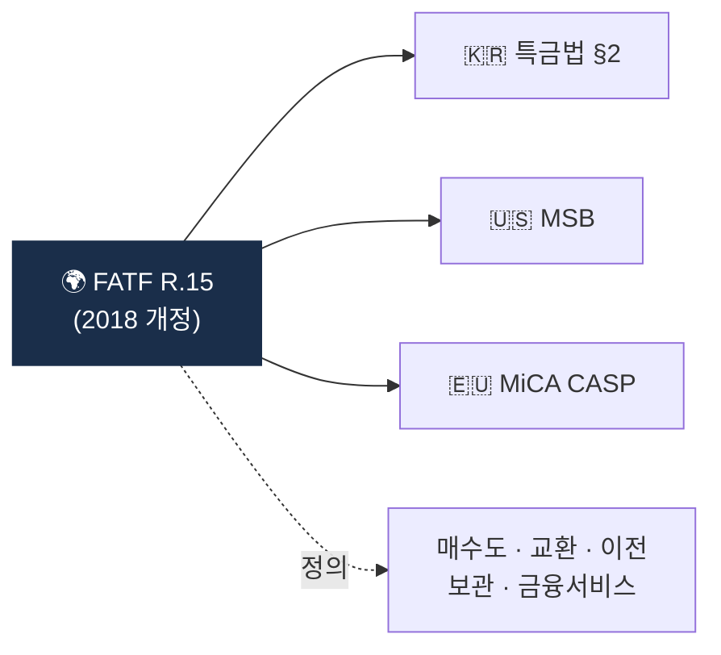
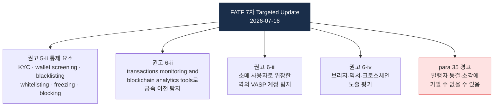

# Day 16 — FATF Recommendation 15 (VASP에 AML/CFT)

> 가상자산을 AML 체계에 끌어들인 결정적 권고. ⏱️ ~70분. 마지막 업데이트: 2026-10-21.

## 📖 오늘 뭘 배우나

2018-10 FATF R.15 개정으로 용어집에 VA·VASP 정의가 신설됐고, 2019-06 INR.15가 VASP에 AML/CFT 의무와 트래블룰(§7(b))을 붙였습니다. 한국이 2020-03-24 특금법을 개정해 VASP 신고제를 넣은 직접 배경이 이것입니다. 오늘은 R.15의 VASP 정의를 한국 특금법 §2(정의)와 매핑해 보고, 2026-07-16 7차 Targeted Update가 R.15 이행에서 무엇을 드러냈는지 확인합니다.

<!-- MAP-START -->
## 🗺 오늘의 지도

<!-- MAP-END -->

## 🎯 핵심 질문
1. R.15는 언제 가상자산을 포함했는가?
2. R.15가 한국 특금법 § 어디에 반영되었나?
3. R.15에서 정의하는 VASP 5가지 행위?

## 📖 읽기 (~45분)
- 메인: [`../notes/2-regulations/fatf.md`](../notes/2-regulations/fatf.md) — 2~3절
- 보조: [`../notes/3-crypto-aml/vasp-obligations.md`](../notes/3-crypto-aml/vasp-obligations.md) — 1절

## 🌐 외부 자료 (선택, ~15분)
- [FATF — Updated Guidance for RBA on VAs and VASPs (2021)](https://www.fatf-gafi.org/en/publications/Virtualassets/Updated-guidance-rba-virtual-assets.html)
- [FATF Virtual Assets 페이지](https://www.fatf-gafi.org/en/topics/virtual-assets.html)

## 🛠️ 미니 챌린지 (~10분)
- R.15 VASP 정의 5가지 행위 → 한국 특금법 §2의 가상자산사업자 행위와 매핑
- 차이점이 있다면 메모

## ✅ 체크포인트
- [ ] R.15의 2018년 가상자산 포섭 안다
- [ ] FATF-한국 특금법 매핑 가능
- [ ] FATF 2026-03-03 스테이블코인·비수탁지갑 보고서가 "기존 VASP 규율을 넘는 별도 체계를 요구하지 않는다"고 선을 그은 점 안다

## 💭 오늘의 한 줄

## 💼 실무 현장 (Industry Reality)

> 2026-10-21 판에서 이전 판의 "거래소들이 신고서에 R.15 매핑표 첨부", "커스터디 신고 지연으로 과징금이 흔한 패턴", Coinbase 내부 분류, "Binance가 R.15 불이행으로 사업권 상실", "한국 다음 평가 2026~2027 예정" 서술을 삭제했습니다. 공개 1차 근거가 없습니다.

### R.15 정의 5개 행위 → 한국 특금법 매핑 (학습용)

| R.15 행위 (FATF 용어집) | 한국 특금법 §2 대응 |
|---|---|
| exchange between VA and fiat | 가상자산 매도·매수 |
| exchange between VAs | 가상자산 간 교환 |
| transfer of VAs | 가상자산 이전 |
| safekeeping/administration of VAs | 가상자산 보관·관리 |
| financial services related to an issuer's offer/sale | 발행 관련 금융서비스(한국 법문 대응은 원문 대조) |

정확한 문언 대조는 특금법 §2 원문으로 하세요. 보관만 해도 VASP 정의에 들어간다는 점이 실무상 가장 중요합니다.

### 7차 TU가 VASP에 요구한 것 — 처음 등장한 "블록체인 분석"

근거: [7차 TU PDF](https://www.fatf-gafi.org/content/dam/fatf-gafi/reports/7th-targeted-update-on-implementation-fatf-standards-vas-vasps-2026.pdf.coredownload.pdf).

### R.15 이행 실태 — 7차 TU 수치

| 항목 | 2026(7차) |
|---|---|
| 라이선스·등록 요구 | 73%(95/130) |
| 실제 인가·등록 발급 | 58%(76/130) — 2025년 65%보다 하락 |
| 역외 VASP에도 인가 요구 | 34%(39/114) |
| 금지 접근 | 23%(33/144) — 2023년 11% |
| DeFi 위험평가 완료 | 18%(26/142), DeFi 인가 2개·집행 1개 |
| P2P 고위험 평가 / 시장지표 수집 | 88%(58/66) / 23%(31/133) |

출처: 위 7차 TU PDF. 2026-03-11 역외 VASP 보고서는 활동기반 접근을 채택한 관할을 46%로 집계했습니다([FATF 2026-03-11](https://www.fatf-gafi.org/en/publications/Virtualassets/Understanding-Mitigating-Risks-Offshore-VASPs.html)).

### FATF 일정 — 실무자가 챙기는 것

- **회색명단**: 2026-06-17~19 총회 결과가 2026-10-21 기준 현행본(22개 관할, B). 다음 총회 **2026-10-26~30**(미개최)([FATF 일정표](https://www.fatf-gafi.org/en/calendars/events.html)).
- **타겟보고서**: 스테이블코인·비수탁지갑(2026-03-03), 역외 VASP(2026-03-11), DeFi(2026-07-21). DeFi 보고서는 2021 가이던스의 DeFi 분석을 "updates and complements"하며 통제 존재를 기능적으로 판정하라고 권고합니다([FATF 2026-07-21](https://www.fatf-gafi.org/en/publications/Virtualassets/targeted-report-decentralised-finance-2026.html)).

### 자주 나오는 오해

- **"R.15가 법이다"** — FATF는 법을 만들지 않습니다. 한국은 2020-03-24 특금법 개정(2021-03-25 시행)으로 국내법화했습니다.
- **"커스터디는 AML 의무 없다"** — R.15 정의에 safekeeping/administration이 들어 있어 보관 단독 사업도 VASP입니다.
- **"DeFi 앱은 무조건 VASP"** — 2021 가이던스는 "A DeFi application … is not a VASP"이지만 통제력·영향력을 가진 사람은 VASP가 될 수 있다고 했습니다(para 66–69).
