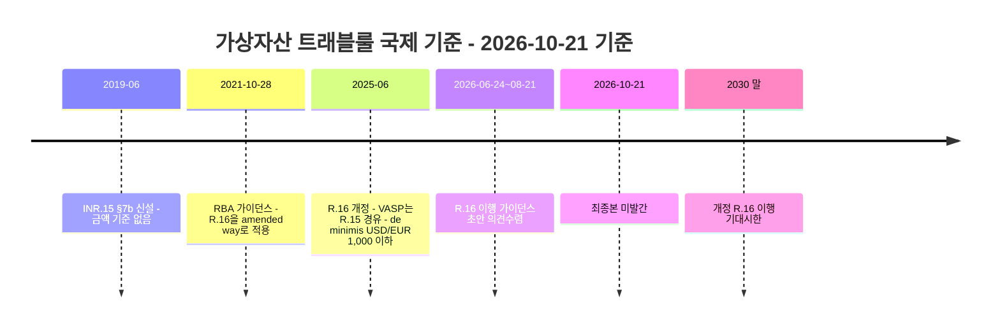
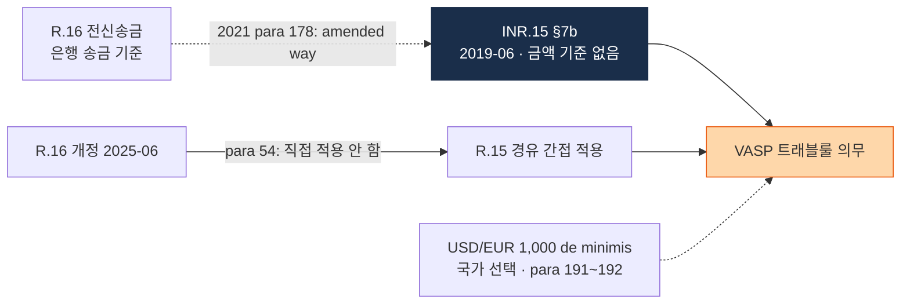

# Day 17 — FATF R.16 (Travel Rule) + 2025-06 개정

> Travel Rule의 국제 기준 — 그리고 그 원천이 R.16 본문이 아닌 이유. ⏱️ ~80분. 마지막 업데이트: 2026-10-21.

## 📖 오늘 뭘 배우나

트래블룰은 가상자산 AML의 **운영 난이도 1순위** 주제입니다. 가상자산 트래블룰의 국제 원천은 R.16 본문이 아니라 **2019-06 신설된 INR.15 §7(b)**이고, 2021 가이던스 para 178은 이를 "Recommendation 16 applies in an amended way to VAs"라고 정리합니다. 2025-06 FATF는 R.16을 개정했지만 **VASP를 R.16에 직접 넣지 않고 R.15를 거쳐 간접 적용**하기로 했고, 이행 기대시한은 **2030년 말**입니다. 개정 R.16 이행 가이던스 초안은 2026-06-24~08-21 의견수렴을 마쳤지만 **2026-10-21 기준 최종본은 발간되지 않았습니다**. 오늘은 정보 항목·금액 구조·**sunrise 문제**를 잡아 둡니다.

<!-- MAP-START -->
## 🗺 오늘의 지도

<!-- MAP-END -->

## 🎯 핵심 질문
1. 가상자산 트래블룰의 국제 원천 조문은? USD/EUR 1,000은 그 조문에서 무슨 역할인가?
2. 2025-06 R.16 개정은 VASP에 어떤 경로로 들어오고, 이행 기대시한은?
3. 2026-10-21 기준 R.16 이행 가이던스는 어떤 상태인가?

## 📖 읽기 (~50분)
- 메인: [`../notes/2-regulations/fatf.md`](../notes/2-regulations/fatf.md) — 4~5절
- 보조: [`../notes/3-crypto-aml/travel-rule.md`](../notes/3-crypto-aml/travel-rule.md) — 1~3절

## 🧭 FATF R.16 2025-06 개정 — 확인되는 것과 아닌 것

### 확인되는 것 (R.16 개정 설명서)

- **VASP 적용 경로**: "FATF has agreed not to bring VASPs directly into the scope of R.16 but to apply the updated requirements indirectly through R.15"(para 54)
- **de minimis**: "no higher than USD/EUR 1,000" 유지(para 33)
- **이행 기대시한**: 2030년 말 — "The FATF will expect that most, or all of the new requirements are in effect by that date"(para 59)

출처: [R.16 개정 설명서](https://www.fatf-gafi.org/content/dam/fatf-gafi/recommendations/Explanatory%20note%20for%20revised%20R.16.pdf.coredownload.pdf).

### 이전 판에서 삭제한 것

이전 판의 "핵심 변화 5개" — "Self-hosted wallet KYC 확장", "임계값 €1~$3,000 재량", "EU 1 EUR부터", "미국 FinCEN 제안 $1,000", "Protocol Interop 의무", "PII 보관기간·GDPR 명시", "FIU 분기별 보고·미흡 VASP NC" — 은 설명서에 없는 내용이라 삭제했습니다. 미국 $250 하향안은 2025-04-16 withdrawn이고, $1,000 제안은 존재가 확인되지 않습니다. 개정 R.16 평가방법론의 발효 상태와 확대 정보항목도 재확인되지 않았습니다(보고서 부록 B #5).

### 근거 경로 — 왜 "R.16 = VASP 트래블룰"이 아닌가

INR.15 §7(b) 문언에는 금액 기준이 없습니다. USD/EUR 1,000은 바로 앞 §7(a)의 임시거래 CDD 기준이고, 2021 가이던스는 이를 국가가 선택할 수 있는 de minimis로 둡니다. 그 미만 이전에도 송수신인 성명과 지갑주소(또는 거래참조번호)는 모아야 합니다(para 191–192)([FATF 2021 RBA 가이던스](https://www.fatf-gafi.org/content/dam/fatf-gafi/guidance/Updated-Guidance-VA-VASP.pdf.coredownload.pdf)).

### 2021 가이던스가 정한 운영 규칙

- 모든 VA 이전은 국경 간 전신송금으로 취급(para 179)
- "즉시"는 이전 전·동시·병행 전송, "Post facto submission … should not be permitted"(para 185, 187)
- 상대 VASP 실사 3단계(para 196–199)
- sunrise 대응: 계약·사업관행으로 상대에게 준수 요구, 내부이전 한정·확인된 본인(first-party) 이전만 허용 등(para 200–201)
- 주소만으로 상대 VASP를 식별할 기술적으로 입증된 수단은 없다고 인정(para 197(a))

### 한국 영향

- 한국 트래블룰은 R.16 개정과 별개로 국내 시행령으로 바뀝니다: **~2027-02-18 100만원 이상**(in-force) → **2027-02-19~ 전건**(대통령령 제36592호, enacted-not-in-force)
- 같은 날부터 해외 VASP 3등급(sunrise 대응의 법령화)과 자기수탁 주소 동일인 요건(감독규정 §28-2)이 시작됩니다

### 실무 대응 체크리스트

- [ ] 상대 VASP 실사 기록(2021 para 196–199)과 해외 VASP 3등급 분류(2027-02-19~)
- [ ] sunrise 상대 처리 정책 문서화
- [ ] 자기수탁 주소 동일인 확인 절차(방법은 법령 미지정)
- [ ] R.16 이행 가이던스 최종본 발간 여부 추적(2026-10-26~30 총회 이후)

## 🌐 외부 자료 (~20분)
- [FATF — Updated R.16 Explanatory Note (PDF)](https://www.fatf-gafi.org/content/dam/fatf-gafi/recommendations/Explanatory%20note%20for%20revised%20R.16.pdf.coredownload.pdf)
- [FIAU Malta — Latest updates from the FATF](https://fiaumalta.org/news/latest-updates-from-the-fatf/) — R.16 가이던스 의견수렴 요약

## 🛠️ 미니 챌린지 (~10분)
- 송신인/수신인 정보 항목을 종이에 두 칼럼으로 정리
- 한·미·EU 금액 구조 표 작성 (한국 ~2027-02-18 100만원 이상 → 2027-02-19 전건 / 미국 $3,000 이상 / EU 금액 기준 없음)

## ✅ 체크포인트
- [ ] 가상자산 트래블룰 원천 = INR.15 §7(b)(2019-06), 금액 기준 없음
- [ ] USD/EUR 1,000 = 국가 선택 de minimis(그 미만도 성명·주소 수집)
- [ ] 2025-06 R.16 개정: VASP는 R.15 경유, 이행 2030년 말
- [ ] R.16 이행 가이던스: 의견수렴 2026-06-24~08-21, 2026-10-21 기준 최종본 미발간
- [ ] Sunrise 문제 정의와 2021 para 200–201 대응 안다

## 💭 오늘의 한 줄

## 💼 실무 현장 (Industry Reality)

> 2026-10-21 판에서 이전 판의 "4대 거래소 트래블룰 전담 2~4명", "임계 상향 가능성 검토 중(금융위 TF)", "Notabene 리포트 기준 완전 이행 ~40%", "Coinbase·Kraken은 EDD + 수동 심사", "2025-06-18 발표", "2026 후반 가이던스 발표 예정" 서술을 삭제·정정했습니다. 공개 1차 근거가 없거나 틀렸습니다.

### 집행 실태 — 7차 TU

- 응답 관할의 **83%(91/109)**가 트래블룰을 입법했지만 그중 **60%(55/91)**는 트래블룰 관련 지적·지시·집행·감독조치가 전혀 없었습니다(2025년 59%). 요약문의 "almost half"가 아니라 본문 para 25의 60%를 인용해야 합니다([7차 TU PDF](https://www.fatf-gafi.org/content/dam/fatf-gafi/reports/7th-targeted-update-on-implementation-fatf-standards-vas-vasps-2026.pdf.coredownload.pdf)).
- 2024-01-01~2026-10-21 사이 **트래블룰 위반을 독립 제재 사유로 명시한 사건은 어느 관할에서도 확인되지 않았습니다.** 가장 가까운 사례인 FINTRAC의 Xeltox(Cryptomus) 행정벌(2025-10-22, C$176,960,190)에서도 트래블룰은 정책 결함 목록의 한 항목이었습니다([FINTRAC](https://fintrac-canafe.canada.ca/pen/amps/pen-2025-10-22-eng)).

### 관할별 금액 구조 (실무에서 매일 참조)

유형: **A** 의무 자체에 금액 · **B** 의무는 전건, 금액은 정보 깊이만 · **C** 금액 없음

| 관할 | 의무 조문 | 유형 | 금액(경계 문언) | 상태 |
|---|---|---|---|---|
| FATF | INR.15 §7(b) | C | 없음(USD/EUR 1,000 de minimis는 선택) | in-force(soft law) |
| 한국(현행) | 특금법 §5의3, 시행령 §10의10 | A | KRW 1,000,000 **이상** | in-force, ~2027-02-18 |
| 한국(2027) | 시행령 §10의10·§10-20, 감독규정 §28-2 | 전건 + 요청 시 추가정보 | 1천만원 이상은 자체 감시체계 | enacted-not-in-force, 2027-02-19~ |
| 미국 | 31 CFR 1010.410(f) | A | USD 3,000 "or more" | in-force |
| EU | TFR Art 14·16 | B′ | 정보는 전건 동일, EUR 1,000 "amounts to or exceeds"면 자기수탁 검증 | in-force, 2024-12-30~ |
| 영국 | MLR reg 64C | B | £800 "equals or exceeds"(2026-06-30~, 이전 €1,000) | in-force |
| 싱가포르 | PSN02 ¶13 | B | S$1,500 "exceeds"면 신원 검증 추가 | in-force |
| 일본 | 범수법 §10의5 | C | 없음(10만엔은 CDD 기준) | in-force, 2023-06-01~ |

출처: [보고서 트래블룰 관할 비교](../reports/가상자산%20AML%20KYT%20FDS%20트래블룰%20흐름.md), [`../notes/3-crypto-aml/travel-rule.md`](../notes/3-crypto-aml/travel-rule.md) §3.

> ⚠️ 금액 기준은 **종류가 다릅니다**. 한국(현행)·미국은 그 금액 미만이면 의무 자체가 없고(A), 영국·싱가포르는 의무가 전건에 걸리며 금액은 **넘길 정보 항목만** 늘립니다(B). EU의 EUR 1,000은 정보 깊이가 아니라 자기수탁 주소 검증의 발동 기준입니다.

### 자주 나오는 오해

- **"R.16이 2019년에 개정돼 VA로 확장됐다"** — 2019-06에 신설된 것은 INR.15 §7(b)입니다.
- **"2025 개정으로 각국이 €1~$3,000 중에서 고른다"** — 설명서에 없습니다. de minimis는 USD/EUR 1,000 이하입니다.
- **"EU TFR은 1유로부터"** — 금액 기준이 아예 없습니다(전건).
- **"Travel Rule은 송금인 정보만"** — 송신·수신 양쪽 VASP 모두 정보 수집·교환 의무가 있습니다.
