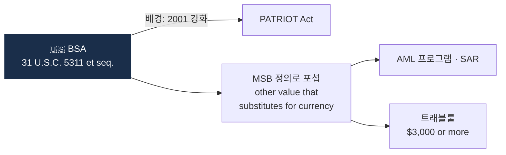
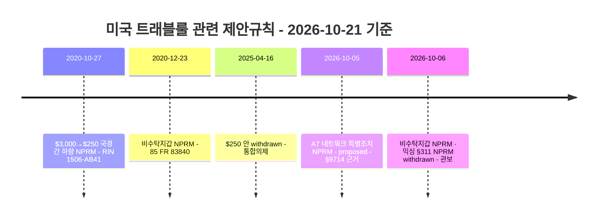

# Day 18 — 미국 BSA + FinCEN

> 미국 AML의 모법 + 가상자산 적용. ⏱️ ~75분. 마지막 업데이트: 2026-10-21.

## 📖 오늘 뭘 배우나

BSA(Bank Secrecy Act)는 미국 AML의 모법입니다(1970 제정·2001 USA PATRIOT Act 확장은 배경 지식으로만). 미국은 가상자산 전용 범주를 따로 두지 않고 MSB 정의의 "other value that substitutes for currency" 문언(31 CFR 1010.100(ff)(5)(i)(A))으로 가상자산 사업자를 포섭합니다. 트래블룰은 2026-10-21에도 여전히 31 CFR 1010.410(f)의 **"$3,000 or more"** 하나입니다. 하향·확장하려던 제안규칙은 모두 철회됐습니다 — $250 안은 2025-04-16, 비수탁지갑 NPRM과 CVC 믹싱 §311 NPRM은 **2026-10-06 관보로 withdrawn**.

<!-- MAP-START -->
## 🗺 오늘의 지도

<!-- MAP-END -->

## 🎯 핵심 질문
1. 가상자산이 BSA 적용을 받는 메커니즘(MSB 정의의 어느 문언)?
2. 미국 트래블룰 금액 기준과 그 문언은? 하향안은 어떻게 됐나?
3. 2026-10-06 FinCEN이 철회한 두 제안규칙은?

## 📖 읽기 (~50분)
- 메인: [`../notes/2-regulations/us-bsa-fincen.md`](../notes/2-regulations/us-bsa-fincen.md) — 1~3절

## 🌐 외부 자료 (선택, ~15분)
- [31 CFR 1010.410 (Cornell LII)](https://www.law.cornell.edu/cfr/text/31/1010.410)
- [FinCEN — 디지털자산 관련 제안규칙 철회 발표](https://www.fincen.gov/news/news-releases/fincen-announces-withdrawals-proposed-digital-asset-related-rules)

## 🛠️ 미니 챌린지 (~10분)
- "한국 특금법 vs 미국 BSA + MSB" 비교표 (적용대상/감독/트래블룰 금액/자기수탁 규율)
- 한국(2027-02-19~ 전건) ↔ 미국($3,000 이상) 이전에서 생기는 비대칭 구간을 한 줄로 적기

## ✅ 체크포인트
- [ ] BSA = 미국 AML 모법, 1970·2001은 배경 지식으로 안다
- [ ] MSB = Money Services Business, 가상자산은 31 CFR 1010.100(ff)(5)(i)(A)로 포섭됨을 안다
- [ ] 미국 트래블룰 31 CFR 1010.410(f) "$3,000 or more", $250 안은 2025-04-16 withdrawn
- [ ] 비수탁지갑 NPRM·믹싱 §311 NPRM 모두 2026-10-06 관보 withdrawn
- [ ] FinCEN = 미국 FIU 안다

## 💭 오늘의 한 줄

## 💼 실무 현장 (Industry Reality)

> 2026-10-21 판에서 이전 판의 "원화 출금이 JPMorgan·BNY 라인을 탄다" 같은 은행 경로 서술, "주별 MTL 48개 × $5K~$100K", "Binance US MTL 시정", "BSA E-Filing API로 자동 제출 vs 한국 수기", 양식 번호·기한, "FinCEN 2026-04 AML Overhaul", "2013·2019-05 가이던스" 서술을 삭제했습니다. 이 저장소 근거 자료로 확인되지 않습니다([`../notes/2-regulations/us-bsa-fincen.md`](../notes/2-regulations/us-bsa-fincen.md)).

### 미국 트래블룰 제안규칙의 운명

근거: [reginfo.gov RIN 1506-AB41](https://www.reginfo.gov/public/do/eAgendaViewRule?pubId=202504&RIN=1506-AB41), [Federal Register 2026-20430](https://public-inspection.federalregister.gov/2026-20430.pdf), [Federal Register 2026-20429](https://public-inspection.federalregister.gov/2026-20429.pdf), [Federal Register 2026-20371](https://public-inspection.federalregister.gov/2026-20371.pdf). 철회 사유는 "chilling effect on legitimate activity"와 "deregulatory agenda"였습니다. 믹싱 NPRM 철회 공고의 RIN 표기(1506-AB47)는 원래 RIN(1506-AB64)과 달라 오기로 보이며, 식별은 88 FR 72701 인용으로 합니다.

### 한국 VASP에서는

미국 규제가 한국 VASP에 닿는 경로는 대체로 넷입니다. 실제 적용 여부는 사안별 법률 검토가 필요합니다.

1. **USD 결제망·환거래 은행** — 미국 금융기관이 제재·§311 결과를 거래 상대에 적용
2. **OFAC 지정** — SDN 주소·지정 VASP와의 거래 차단
3. **§311·§9714 특별조치** — Huione(2025-10-14 최종), A7(2026-10-05 제안)처럼 특정 기관·네트워크와의 이체를 미국 금융기관에 금지
4. **달러 스테이블코인 발행자** — 발행자 동결 결과가 거래소 잔고에 반영될 수 있음

**비대칭 주의**: 한국은 2027-02-19부터 다른 VASP로의 **모든** 이전에 정보제공 의무가 생기지만, 미국 상대방은 $3,000 이상에서만 의무가 있습니다. 이 구간은 sunrise와 같은 방식으로 다뤄야 합니다.

### 집행 — 2025~2026 확인 사례

| 일자 | 대상 | 내용 |
|---|---|---|
| 2025-10-14 | Huione Group | FinCEN §311 최종규칙 — 미국 금융시스템에서 차단([재무부 sb0278](https://home.treasury.gov/news/press-releases/sb0278)) |
| 2025-12-09 | Paxful | $3.5M 민사벌금 — MSB 미등록·AML 프로그램 미비·SAR 미제출. 트래블룰 위반은 사유 아님([FinCEN](https://www.fincen.gov/news/news-releases/fincen-assesses-35-million-penalty-against-paxful-facilitating-suspicious)) |

2024-01-01~2026-10-21 사이 트래블룰 위반을 독립 제재 사유로 명시한 미국 사건은 확인되지 않았습니다. 2020~2025 대형 사건(Binance·OKX·Bittrex 등)의 금액은 이 저장소 근거 자료로 원문 확인되지 않아 싣지 않습니다.

### 참고 가이던스 — 거래모니터링 신호

- **NYDFS 2022-04-28**: 지원 자산마다 거래 추적 절차, 외주·자체 분석도구 모두 허용, 분석도구가 "may not be able to identify underlying owners"라는 한계 인정([NYDFS](https://www.dfs.ny.gov/industry_guidance/industry_letters/il20220428_guidance_use_blockchain_analytics))
- **FinCEN FIN-2023-Alert005(2023-09-08)**: pig butchering 적신호 — 과거 접속 패턴과 다른 IP·기기 ID·지역, ETH 수취 후 TRX 전환·급출금([FinCEN Alert](https://www.fincen.gov/sites/default/files/shared/FinCEN_Alert_Pig_Butchering_FINAL_508c.pdf))

### 자주 나오는 오해

- **"한국에서만 영업하면 FinCEN 무관"** — 결제망·OFAC·특별조치·스테이블코인 경로로 간접 영향이 생길 수 있습니다.
- **"미국도 트래블룰 기준을 낮췄다"** — $250 안은 2025-04-16 withdrawn, 현행은 $3,000 그대로입니다.
- **"비수탁지갑 규칙은 관보 공고 없이 흐지부지됐다"** — 2026-10-06 관보에 철회 공고가 실렸습니다(FR 2026-20430).
