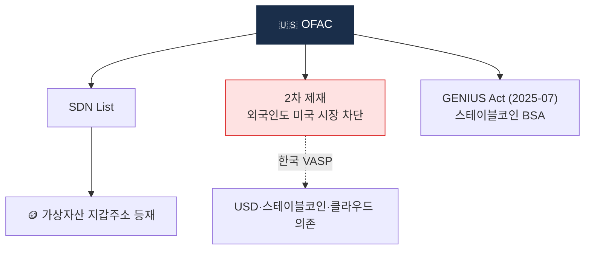
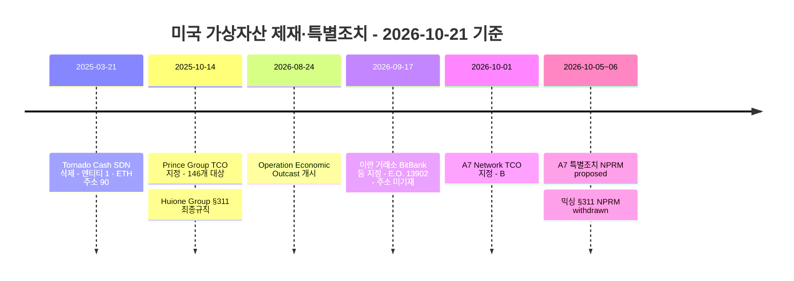
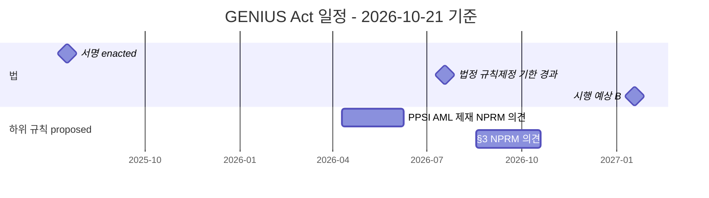

# Day 19 — 미국 OFAC + 2차 제재 + GENIUS Act

> 가상자산 주소를 SDN List에 올리는 그 기관 + 스테이블코인 신법. ⏱️ ~80분. 마지막 업데이트: 2026-10-21.

## 📖 오늘 뭘 배우나

OFAC 제재가 **한국 VASP에도 실질적 영향**을 가지는 경로(USD 결제망·SDN 주소·지정 VASP·스테이블코인 발행자)를 정리하고, 2025-07-18 서명된 **GENIUS Act**가 스테이블코인 발행자를 BSA 금융기관으로 편입하려는 의미를 확인합니다. GENIUS는 2026-10-21 기준 **enacted-not-in-force**이고, 하위 규칙은 전부 proposed이며, 법 시행은 법정 최종기한인 **2027-01-18로 예상**됩니다(B). 2025~2026 미국 제재의 축은 믹서 같은 "유형"이 아니라 Prince Group·Huione·BitBank·A7 같은 특정 "네트워크"로 옮겨 갔습니다.

<!-- MAP-START -->
## 🗺 오늘의 지도

<!-- MAP-END -->

## 🎯 핵심 질문
1. OFAC 지정이 미국 밖 VASP에도 영향을 주는 경로는?
2. 2025-03-21 Tornado Cash SDN 삭제의 범위는? 삭제가 "위험 해제"가 아닌 이유는?
3. GENIUS Act의 2026-07-18과 2027-01-18은 각각 무슨 날짜인가?

## 📖 읽기 (~50분)
- 메인: [`../notes/2-regulations/us-bsa-fincen.md`](../notes/2-regulations/us-bsa-fincen.md) — 3~6절
- 보조: [`../notes/6-cases/tornado-cash.md`](../notes/6-cases/tornado-cash.md)

## 🌐 외부 자료 (~20분)
- [OFAC 공식](https://ofac.treasury.gov/)
- [OFAC SDN 검색](https://sanctionssearch.ofac.treas.gov/) — 디지털화폐 주소가 기재된 항목 찾아보기
- [재무부 GENIUS Act 의회보고서 (2026-03)](https://home.treasury.gov/system/files/246/GENIUS-Act-Illicit-Finance-Innovation-Congressional-Report-March-2026.pdf)

## 🛠️ 미니 챌린지 (~10분)
- OFAC SDN 검색에서 디지털화폐 주소가 기재된 항목 1개를 찾아 메모 (주소가 기재되지 않은 지정도 있다는 점 확인 — 2026-09-17 BitBank)
- GENIUS Act 일정 캘린더 표시: 2025-07-18 서명 / 2026-07-18 법정 규칙제정 기한(경과) / 2027-01-18 시행 예상(B)

## ✅ 체크포인트
- [ ] OFAC = 미국 재무부 제재 집행 안다
- [ ] OFAC 지정·§311·§9714 특별조치가 외국 VASP에 닿는 경로 안다
- [ ] SDN List에 가상자산 주소가 기재될 수 있고, 주소 없는 지정도 있음 안다
- [ ] GENIUS Act = 2025-07-18 서명, enacted-not-in-force, 2026-07-18은 규칙제정 기한, 시행 예상 2027-01-18(B)

## 💭 오늘의 한 줄

## 💼 실무 현장 (Industry Reality)

> 2026-10-21 판에서 이전 판의 "Sanctions Specialist 1~2명", 특정 거래소 해킹 대응 서술, Binance·Bittrex·Kraken 제재 금액, SDN 주소 등재 연혁 목록, Tornado Cash 주소 샘플(2025-03-21 삭제됨), "2026-07-18 BSA 적용 시작·2027-01-18 전면 시행", "50% Rule" 서술을 삭제·정정했습니다. 이 저장소 근거 자료로 확인되지 않거나 틀렸습니다.

### OFAC·FinCEN 2025~2026 — 유형에서 네트워크로

근거: [OFAC 2025-03-21](https://ofac.treasury.gov/recent-actions/20250321), [재무부 sb0278](https://home.treasury.gov/news/press-releases/sb0278), [재무부 sb0632](https://home.treasury.gov/news/press-releases/sb0632/), [OFAC 2026-09-17](https://ofac.treasury.gov/recent-actions/20260917), [Federal Register 2026-20371](https://public-inspection.federalregister.gov/2026-20371.pdf), [Federal Register 2026-20429](https://public-inspection.federalregister.gov/2026-20429.pdf).

### Tornado Cash — 제재 해제 ≠ 위험 해제

- 2025-03-21 SDN 삭제 범위는 엔티티 1개·ETH 주소 90개입니다. 공동개발자 Roman Semenov 항목은 [DPRK3]로 유지됐습니다.
- 2025-08-06 배심은 Roman Storm에게 무면허 송금업 공모 유죄를 평결했고, 자금세탁·IEEPA 위반 공모는 배심 불일치로 끝났습니다(B)([Willkie 2025-08-08](https://complianceconcourse.willkie.com/articles/tornado-cash-cofounder-convicted-for-conspiring-to-operate-an-unlicensed-money-transmitting-business/)).
- 학술 측정(WWW '26): 제재 후 957일간 입금액은 71.03% 줄었지만 Ethereum 보안사고의 78.33%가 여전히 Tornado Cash를 거쳤습니다([arXiv 2507.11721](https://arxiv.org/abs/2507.11721)).

### GENIUS Act — 날짜의 성격을 구분한다

- 2026-04-10 FinCEN·OFAC가 허가 결제스테이블코인 발행자(PPSI)를 BSA 금융기관으로 편입하는 AML/CFT·제재 NPRM을, 2026-06-22 CIP NPRM을 공고했습니다(둘 다 proposed).
- 2026-07-18은 "시행규정 마감"이 아니라 **법정 규칙제정 기한**(경과)입니다. 2026-10-21 기준 최종규칙은 없습니다.
- 재무부 2026-03 의회보고서는 DASP에 "$3,000 or more"의 트래블룰이 적용된다고 다시 확인했습니다.
- 2028-07-18에는 DASP의 비허가 스테이블코인 취급 금지가 시작됩니다(B).

근거: [재무부 2026-03 보고서](https://home.treasury.gov/system/files/246/GENIUS-Act-Illicit-Finance-Innovation-Congressional-Report-March-2026.pdf), [Federal Register 2026-16796](https://public-inspection.federalregister.gov/2026-16796.pdf), [Jones Day](https://www.jonesday.com/en/insights/2026/08/us-treasury-proposes-genius-act-rules-for-stablecoin-issuance-offer-and-sale)(B).

### Sanctions 운영 — 확인되는 원칙

- 신규 지정 주소는 내부 차단 목록과 거래모니터링에 반영하고, 반영 일시를 기록합니다.
- **주소가 공고에 없는 지정**(BitBank)도 있으므로 주소 대조만으로는 부족합니다. 거래 상대 VASP 식별·실사가 함께 필요합니다.
- 제재 해제(Tornado Cash)는 위험 해제가 아닙니다. 노출 모니터링은 유지하고 판단 근거를 기록합니다.
- 갱신 주기·인력 규모는 회사가 정하며 공개 벤치마크는 없습니다.

### 자주 나오는 오해

- **"OFAC은 미국 회사만 적용"** — 미국 결제망·미국 금융기관을 거치는 거래, 지정 VASP와의 거래를 통해 외국 VASP에도 영향이 미칩니다. 적용 여부는 사안별 법률 검토가 필요합니다.
- **"GENIUS는 2026-07-18부터 시행"** — 2026-07-18은 규칙제정 기한이고, 시행은 2027-01-18 예상(B)입니다.
- **"SDN 주소만 대조하면 된다"** — 주소 미기재 지정, 네트워크 단위 특별조치(A7)가 늘고 있습니다.
