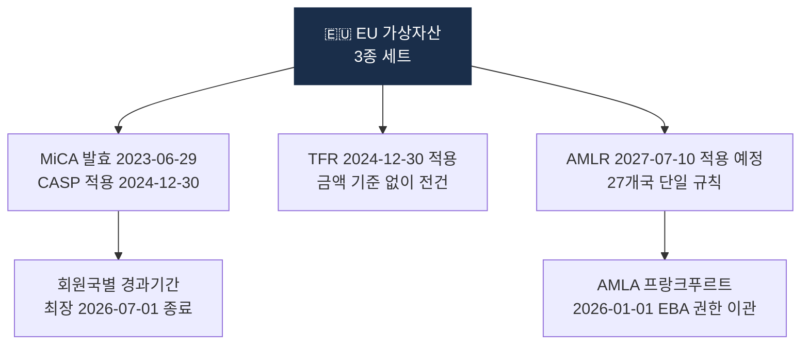
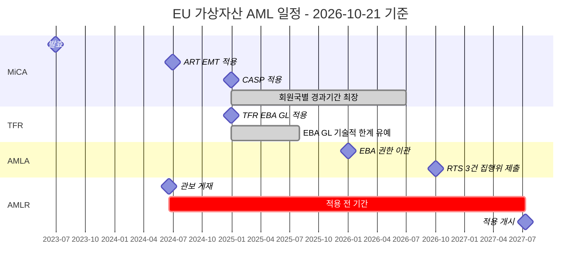

# Day 20 — EU MiCA + AMLR/AMLD6 + TFR

> EU 가상자산 규제 3종 세트. ⏱️ ~80분. 마지막 업데이트: 2026-10-21.

## 📖 오늘 뭘 배우나

EU는 **MiCA(시장) + AMLR·AMLD6(AML) + TFR(트래블룰)** 3종 세트로 가상자산을 규율합니다. TFR은 **금액 기준 없이 모든 암호자산 이전**에 정보를 동반시키고, EUR 1,000은 자기수탁 주소와의 이전에서 소유·통제를 평가하는 **별도 발동선**입니다. MiCA는 **발효(2023-06-29)와 적용(스테이블코인 2024-06-30, CASP 2024-12-30)**이 다르고, 회원국별 경과기간(최장 2026-07-01)은 2026-10-21 기준 이미 끝났습니다. AML 본체인 AMLR은 **2027-07-10 적용 예정(enacted-not-in-force)**이고, 2026-01-01부터 EU 차원 AML 가이던스 권한은 EBA에서 **AMLA**로 넘어갔습니다.

<!-- MAP-START -->
## 🗺 오늘의 지도

<!-- MAP-END -->

## 🎯 핵심 질문
1. MiCA, AMLR, TFR 각각의 정체성 한 줄?
2. EU TFR에는 왜 금액 기준이 없는데 EUR 1,000이라는 숫자가 나오나?
3. MiCA "발효"와 "적용"은 각각 언제이고, 회원국별 경과기간은 2026-10-21 기준 어떤 상태인가?

## 📖 읽기 (~55분)
- 메인: [`../notes/2-regulations/eu-mica-amlr.md`](../notes/2-regulations/eu-mica-amlr.md)

## 🌐 외부 자료 (~15분)
- [ESMA MiCA 페이지](https://www.esma.europa.eu/esmas-activities/digital-finance-and-innovation/markets-crypto-assets-regulation-mica)
- [EBA/GL/2024/11 트래블룰 가이드라인 (PDF)](https://www.eba.europa.eu/sites/default/files/2024-07/6de6e9b9-0ed9-49cd-985d-c0834b5b4356/Travel%20Rule%20Guidelines.pdf)

## 🛠️ 미니 챌린지 (~10분)
- MiCA 토큰 분류 (ART/EMT/그 밖의 암호자산) 외우기
- "한국 사업자가 EU 진출 시 추가로 확인할 것" 5개 작성

## ✅ 체크포인트
- [ ] MiCA 발효 2023-06-29 / 적용 2024-06-30(ART·EMT)·2024-12-30(CASP) 구분
- [ ] CASP = EU의 VASP 안다
- [ ] EU TFR은 금액 기준 없음(전건), "1유로부터"는 틀린 표현임을 안다
- [ ] 자기수탁 주소 + EUR 1,000 이상이면 소유·통제 평가(EBA GL ¶83 방법 1종 이상)
- [ ] AMLR 2027-07-10 적용 예정, AMLA 2026-01-01 권한 이관 안다

## 💭 오늘의 한 줄

## 💼 실무 현장 (Industry Reality)

> 2026-10-21 판에서 이전 판의 "한국 거래소 EU 진출 경쟁", 선호 관할, 해외 거래소별 라이선스 현황, "Tether EU 상장 제한·일부 거래소 USDT 상폐", 특정 발행자 라이선스, "AMLA 2025 출범·대형 CASP 포함 예정", "EU 거주 AMLO 고용이 표준", "TFR 임계 0으로 메시지량 수십 배" 서술을 삭제·정정했습니다. 이 저장소 근거 자료로 확인되지 않거나 틀렸습니다.

### EU 일정 — 법령별로 따로 본다

근거: [EBA AML/CFT 페이지](https://www.eba.europa.eu/regulation-and-policy/anti-money-laundering-and-countering-financing-terrorism), [EBA/GL/2024/11](https://www.eba.europa.eu/sites/default/files/2024-07/6de6e9b9-0ed9-49cd-985d-c0834b5b4356/Travel%20Rule%20Guidelines.pdf), [EUR-Lex OJ L 2024/1624](https://eur-lex.europa.eu/legal-content/EN/TXT/PDF/?uri=OJ:L_202401624), [AMLA RTS](https://www.amla.europa.eu/press-release-amla-finalises-key-standards-private-sector_en).

### TFR — 금액 기준이 없고, EUR 1,000은 다른 의무다

- **TFR 제14조 제1항**: 송신 CASP는 암호자산 이전에 송신인 정보를 동반시킵니다 — 금액 기준 없음. EBA는 "all crypto-asset transfers are subject to the same requirements regardless of their amount"라고 해석합니다.
- **EUR 1,000**: 자기수탁 주소와의 이전이 이 금액에 "amounts to or exceeds"할 때 그 주소의 **소유·통제를 평가**합니다(Art 14(5)·16(2)).
- **검증 방법(EBA GL ¶83)**: 원격 온보딩 검증, 소액 송금(Satoshi test), 메시지 서명, 기타 기술적 수단 중 **최소 1종**. 확인된 주소는 화이트리스트에 올릴 수 있습니다(¶86).
- **sunrise**: EU는 미이행 상대와의 거래를 금지하지 않고 고위험 요소로 분류하며, 반복 누락 기관은 3개월 안에 당국에 보고합니다(§4.5, §4.7).
- 기술적 한계를 이유로 한 유예는 2025-07-31에 끝났습니다(¶24).

### MiCA 토큰 분류

| 분류 | 풀이 |
|---|---|
| **ART** | Asset-Referenced Token — 여러 통화·자산 등을 참조 |
| **EMT** | E-Money Token — 단일 법정통화 참조 |
| 그 밖의 암호자산 | ART·EMT가 아닌 암호자산 |

ART·EMT 규율(Title III·IV)은 2024-06-30부터, CASP 규율은 2024-12-30부터 적용됐습니다. ESMA 임시 CASP 등록부(2026-10-19)는 379행·고유 LEI 376개입니다([ESMA CASPS.csv](https://www.esma.europa.eu/sites/default/files/2024-12/CASPS.csv)).

### EU AMLR/AMLD6 + AMLA — 2026-10-21 기준

- **AMLR**(Regulation (EU) 2024/1624): 2024-06-19 관보 게재, **2027-07-10 적용 예정**. 제79조의 익명성강화코인 취급 금지도 이때 시작됩니다(enacted-not-in-force).
- **AMLD6**: 회원국 국내법화가 필요한 지침. 전환 기한·이행 현황은 이번 기준일 근거로 재확인하지 않았습니다.
- **AMLA**: 본부 프랑크푸르트. 2026-01-01 EBA의 AML/CFT 규칙제정·가이던스 권한을 넘겨받았고, 기존 EBA 가이드라인은 AMLA가 대체할 때까지 유효합니다. 2026-10-01 AMLR 첫 RTS 3건 최종안을 집행위에 제출했고(채택 전), 2026-10-07 MiCA 재검토에 AML 우선과제 5개를 냈습니다([AMLA](https://www.amla.europa.eu/amla-identifies-amlcft-priorities-review-mica_en)).
- **AMLA 직접감독**: 대상은 6개 이상 회원국에서 영업하는 금융기관(그룹) 약 40개이고 VASP 전용 목록이 아닙니다. CASP 포함 여부는 2026-10-21 기준 공개되지 않았습니다(B).

### 한국 사업자 EU 진출 시 확인할 것

- CASP 인가 관할과 ESMA 등록부 기재 여부
- TFR 전건 정보 동반 — 한국 현행 100만원 이상 구조의 룰을 그대로 쓸 수 없음(한국도 2027-02-19부터 전건)
- 자기수탁 주소 EUR 1,000 이상 이전의 검증 방법(EBA GL ¶83) 선택과 화이트리스트 운영
- 개인정보 이전 — 송수신인 정보가 역외로 넘어가므로 GDPR·개인정보 보호법 교차 검토
- AMLR 적용(2027-07-10)과 익명성강화코인 금지 대비

### 자주 나오는 오해

- **"MiCA가 AML 법이다"** — MiCA는 **시장 규제**입니다. AML은 AMLR/AMLD6, 트래블룰은 TFR입니다.
- **"MiCA는 2024-12-30 전면 시행"** — 발효 2023-06-29, 스테이블코인 적용 2024-06-30, CASP 적용 2024-12-30입니다.
- **"EU 트래블룰은 1유로부터"** — 금액 기준 자체가 없습니다(전건).
- **"경과기간으로 2026년까지 안전"** — 회원국별 경과기간은 최장 2026-07-01이었고 2026-10-21 기준 종료됐습니다.
