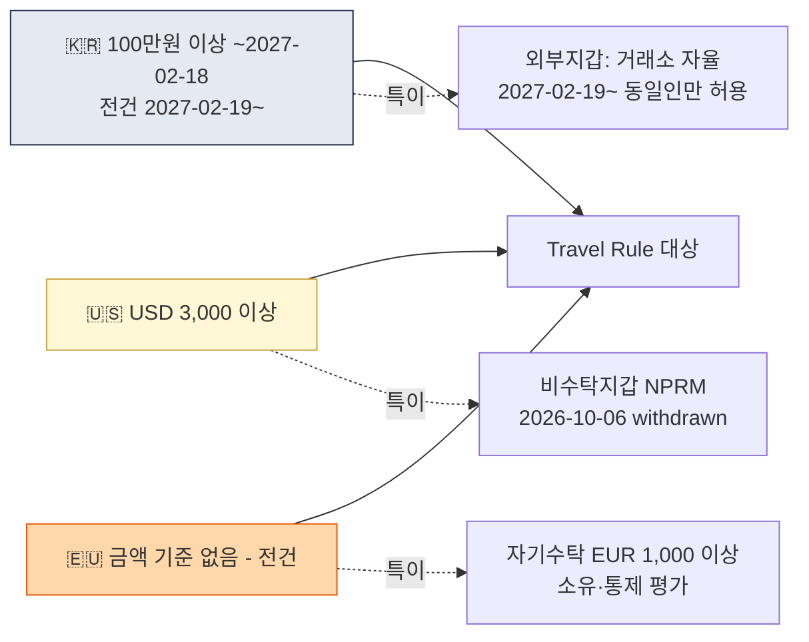
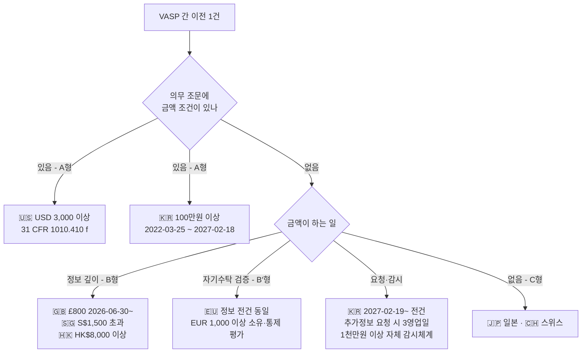

# Day 21 — 🛠️ 한·미·EU Travel Rule 비교표 + 3주 리뷰

> 글로벌 규제 정리 + 시각화. ⏱️ ~120분. 마지막 업데이트: 2026-10-21.

## 📖 오늘 뭘 배우나

한국·미국·EU 규제를 각각 배웠으니 이제 **한 장에 나란히** 놓고 차이를 정리합니다. Travel Rule 금액 구조·stablecoin 접근·unhosted wallet 처리 등 실무에서 바로 판단이 필요한 6~8개 축을 표로 만듭니다. 핵심은 "임계금액 한 칸"으로 적지 않는 것 — 금액이 **의무를 발동**시키는지(A형), **정보 깊이만** 나누는지(B형), 아예 없는지(C형)를 구분하고, 금액마다 **유효 구간**을 붙입니다.

<!-- MAP-START -->
## 🗺 오늘의 지도

<!-- MAP-END -->

## 🎯 회고 질문
1. 한·미·EU 중 금액 기준이 **의무 자체**에 붙는 관할은? (힌트: 2027-02-19 이후 하나가 빠진다)
2. 미국과 EU의 stablecoin 접근 차이는? (GENIUS Act vs MiCA Title III·IV)
3. 한국 사업자가 2027-02-19 전에 준비해야 할 1순위 호환 이슈는?

## 🧭 금액 유형 분류 (2026-10-21 기준)

근거: [`../notes/3-crypto-aml/travel-rule.md`](../notes/3-crypto-aml/travel-rule.md) §4 · [법제처 시행령 시행예정 판본](https://www.law.go.kr/DRF/lawService.do?OC=test&target=eflaw&MST=288765&efYd=20270219&type=XML) · [Cornell LII 31 CFR 1010.410](https://www.law.cornell.edu/cfr/text/31/1010.410) · [EBA/GL/2024/11](https://www.eba.europa.eu/sites/default/files/2024-07/6de6e9b9-0ed9-49cd-985d-c0834b5b4356/Travel%20Rule%20Guidelines.pdf).

## 🛠️ 메인 미니 프로젝트 (~90분)

**목표**: 한·미·EU Travel Rule + AML 핵심 항목 비교표 작성 (모든 칸에 근거 조문과 상태를 붙인다)

### 형식 (예시)
| 항목 | 한국 | 미국 | EU |
|---|---|---|---|
| AML 모법 | 특금법 | BSA | 회원국 AMLD 국내법 → **AMLR 2027-07-10 적용 예정**(enacted-not-in-force) |
| 가상자산 시장법 | 가상자산이용자보호법 | GENIUS Act(스테이블코인, 2025-07-18 서명, enacted-not-in-force) | MiCA(적용 2024-06-30 Title III·IV / 2024-12-30 CASP) + TFR |
| 사업자 명칭 | VASP(가상자산사업자) | MSB 정의로 포섭(31 CFR 1010.100(ff)(5)(i)(A)) | CASP |
| 진입 | FIU 신고(§7) | FinCEN MSB 등록 + 주 송금업 라이선스 | NCA 인가 + passporting |
| Travel Rule 근거 | 특금법 **§5의3**, 시행령 §10의10 | 31 CFR 1010.410(f) | TFR 제14조 |
| TR 금액 구조 | 100만원 **이상**(~2027-02-18, A형) → **전건**(2027-02-19~) | USD 3,000 **이상**(A형) | 금액 기준 없음 — 전건 |
| TR 시행 | 2022-03-25 | 시행일 미등재 | 2024-12-30 |
| Unhosted wallet | ~2027-02-18 법령 미규율(거래소 자율) / 2027-02-19~ 동일인 간만 허용(고시 §28-2④) | 명시 규정 없음(비수탁지갑 NPRM 2026-10-06 withdrawn) | EUR 1,000 이상 소유·통제 평가 |
| KYC | 특금법 §5의2 | BSA CDD | AMLD 국내법(→ AMLR) |
| STR/SAR | 특금법 §4(금액 기준 없음) | SAR | 회원국 FIU 보고 |
| CTR | 특금법 §4의2(현금거래 — 가상자산 거래 자체는 대상 아님) | CTR | — |
| 기록보관 | 특금법·이용자보호법 각각 — 기간은 원문 확인 | 원문 확인 | 원문 확인 |
| 감독 | FIU · FSS(검사 수탁) · FSC | FinCEN · OFAC | 회원국 NCA · AMLA(2026-01-01 EBA 권한 이관) |
| 제재 실례 | 두나무 과태료 352억원(2025-11-06 발표, 트래블룰 위반은 사유 아님) | Paxful $3.5M(2025-12-09, 트래블룰 위반은 사유 아님) | — |

> 이전 판의 "FIU 신고 3년", "이용자보호법 15년 보관", "미신고 5년/5천만원", "$250K+", "€10M/매출 5%" 칸은 이 저장소 근거 자료로 원문을 재확인하지 못해 뺐습니다. 기간·형량은 각 법령 원문으로 확인하십시오([`../notes/2-regulations/korea-user-protection.md`](../notes/2-regulations/korea-user-protection.md)).

근거: [`../notes/2-regulations/korea-fiu-act.md`](../notes/2-regulations/korea-fiu-act.md) · [`../notes/2-regulations/us-bsa-fincen.md`](../notes/2-regulations/us-bsa-fincen.md) · [`../notes/2-regulations/eu-mica-amlr.md`](../notes/2-regulations/eu-mica-amlr.md) · [FIU 보도자료(KDI 전재)](https://eiec.kdi.re.kr/policy/materialView.do?num=273166) · [FinCEN Paxful](https://www.fincen.gov/news/news-releases/fincen-assesses-35-million-penalty-against-paxful).

→ 자기 손으로 다시 작성 (외운 척 하지 말고 노트 보면서 OK, 핵심은 구조 머릿속)

→ 결과물 저장: `aml/curriculum/_artifacts/d21_global_travel_rule_compare.md`

### 🌏 아시아 주요 관할 확장

한국 VASP 글로벌 진출 시 **아시아 관할**도 함께 비교해야 합니다. 같은 "아시아"라도 금액 구조가 A·B·C 로 갈립니다.

| 관할 | 의무 근거 | 유형 | 금액(경계 문언) | 감독 |
|---|---|---|---|---|
| 🇸🇬 싱가포르 | PSN02 ¶13.3~13.11 | B | S$1,500 「exceeds」 — 초과 시 정보 심화 + **신원확인·검증** | MAS |
| 🇦🇪 UAE | VARA Rulebook Part III.G ¶2 | **A** | AED 3,500 「exceeding」 — 정확히 3,500 은 대상 외 | VARA |
| 🇯🇵 일본 | 犯収法 §10-5 | C | 없음 *(施行令 §7 「十万円を超える」 는 CDD 기준)* | FSA |
| 🇭🇰 홍콩 | AMLO Sch.2 s.13A | B | HK$8,000 「not less than」 — 정보 심화 | SFC |

근거: [MAS PSN02](https://www.mas.gov.sg/-/media/amld-amendments---30-june-2025/mas-notice-psn02-amendment--new.pdf) · [VARA Rulebook](https://rulebooks.vara.ae/node/146) · [`../notes/3-crypto-aml/travel-rule.md`](../notes/3-crypto-aml/travel-rule.md) §4.

싱가포르·일본·홍콩은 **의무 자체에는 금액 조건이 없습니다.** 반면 UAE 는 미국·한국(~2027-02-18)처럼 "기준 이하면 대상 아님"인 A형입니다(이전 판의 "UAE 금액 무관 전건 / 1 AED" 는 틀렸습니다).

**상세**: [`../notes/2-regulations/asia-regs.md`](../notes/2-regulations/asia-regs.md)

## ✅ 체크포인트
- [ ] 비교표 산출 (모든 금액 칸에 유효 구간·상태 표기)
- [ ] [`progress.md`](progress.md) Week 3 7개 모두 체크
- [ ] 한·미·EU 핵심 차이 5개 즉답 가능

## 💭 3주차 회고

가장 까다로운 관할:
가장 단순한 관할:
실무에서 1순위로 호환 봐야 할 것:

## 💼 실무 현장 (Industry Reality)

### 멀티관할 운영의 기본 원칙

여러 관할을 동시에 운영할 때 흔히 쓰는 방식은 **"가장 엄격한 기준으로 단일화"** 입니다 — Travel Rule 은 금액 게이트 없이 전건 전송(EU 기준, 한국도 2027-02-19 부터 전건), KYC 는 관할별 요건의 합집합. 단, 단일화가 운영 리스크를 얼마나 줄이는지에 대한 공개 통계는 없습니다(이전 판의 "3~5배 감소"는 근거가 없어 뺐습니다).

### 글로벌 AML Program 의 구조 (예시)

- **Policy Layer**: 단일 글로벌 정책 + 관할별 annex (Korea / US / EU)
- **Operations Layer**: 단일 케이스 관리 시스템 + 관할별 큐 분기
- **Reporting Layer**: 관할별 FIU 보고 채널(한국 FIU, 미국 FinCEN BSA E-Filing, EU 각 회원국 FIU)
- **Sanctions Layer**: OFAC·UN·EU·한국 제재 목록 다중 스크리닝

### 호환 체크리스트 (자주 부딪히는 충돌)

- **한국 2027-02-19 전건화 vs 미국 USD 3,000 이상**: 금액 게이트는 관할·시점별로 저장해야 과거 거래 재검증이 맞습니다
- **한국 자기수탁 "동일인만"(2027-02-19~) vs EU "EUR 1,000 이상 소유·통제 평가"**: 발동 조건이 다릅니다 — 한국은 금액 무관, EU 는 금액 기준. 소유 증명 방법은 한국 고시가 정하지 않았습니다
- **한국 주민등록번호**: 2027-02-19 부터 동시 전송 항목이 아니라 **요청 시 3영업일** 제공 항목입니다
- **기록 보존기간**: 관할·법령마다 다를 수 있으므로 긴 쪽 기준으로 단일화하되, 기간은 원문으로 확인

### 자주 나오는 오해

- **"한 관할만 커버하면 충분"** — 미국 고객·달러 스테이블코인 취급 등으로 다른 관할 의무가 걸릴 수 있습니다
- **"EU 는 1유로부터"** — 틀린 표현입니다. EU 는 금액 기준 없이 전건이고, EUR 1,000 은 자기수탁 소유·통제 평가 기준입니다
- **"미국은 $250 으로 내려간다"** — 하향안은 2025-04-16 withdrawn 입니다([reginfo](https://www.reginfo.gov/public/do/eAgendaViewRule?pubId=202504&RIN=1506-AB41))
