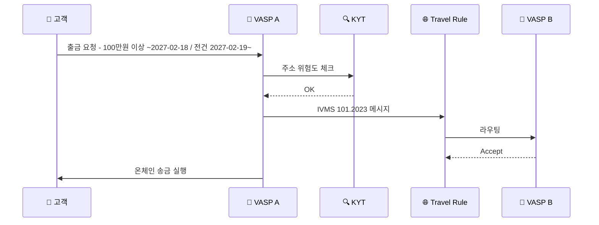
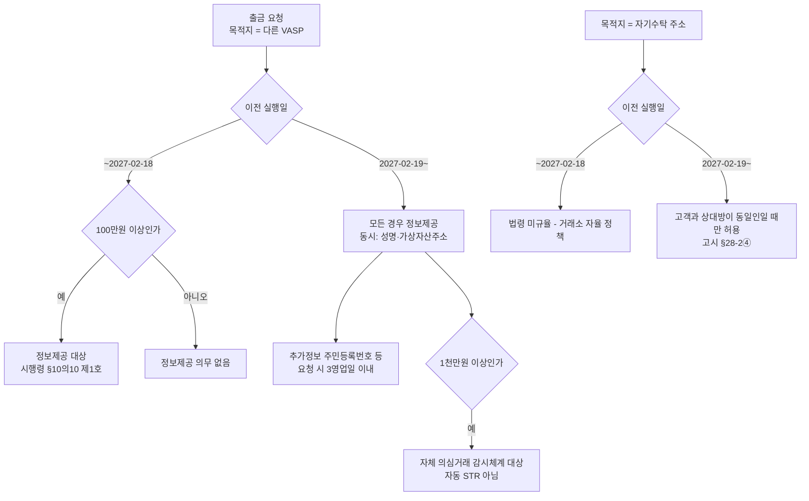

# Day 22 — Travel Rule 운영 흐름 (한국 시나리오: 100만원 이상 → 2027-02-19 전건)

> Travel Rule이 거래소 시스템에서 실제로 어떻게 흘러가는가. ⏱️ ~70분. 마지막 업데이트: 2026-10-21.

## 📖 오늘 뭘 배우나

이론적 Travel Rule에서 **실제 거래소 출금 요청 한 건이 어떻게 처리되는지**의 단계로 줌인합니다. KYT 위험 평가·상대방 식별·IVMS 101.2023 메시지 생성·상대방 응답·Sunrise(미연결) 처리까지 각 단계에서 멈출 수 있는 지점이 명확해집니다. 한국은 시점에 따라 시나리오가 둘입니다 — **2027-02-18 까지는 100만원 이상** 이전만 정보제공 대상(시행령 §10의10 제1호, in-force), **2027-02-19 부터는 기준금액 없이 다른 VASP 로 이전하는 모든 경우**(대통령령 제36592호 2026-08-18 공포, enacted-not-in-force)입니다.


<!-- MAP-START -->
## 🗺 오늘의 지도


<!-- MAP-END -->

## 🎯 핵심 질문
1. 한국 거래소 출금 시 Travel Rule 흐름은? 2027-02-19 전후로 무엇이 바뀌나?
2. 상대방 VASP 가 미연결(sunrise)이면?
3. 개인정보 보호와 Travel Rule 의 충돌 지점은?

## 🔀 시점별 판정 흐름



근거: [법제처 시행령 현행 판본](https://www.law.go.kr/DRF/lawService.do?OC=test&target=eflaw&MST=288765&efYd=20260820&type=XML) · [시행예정 판본(2027-02-19)](https://www.law.go.kr/DRF/lawService.do?OC=test&target=eflaw&MST=288765&efYd=20270219&type=XML) · [감독규정 FIU 고시 제2026-2호](https://www.law.go.kr/DRF/lawService.do?OC=test&target=admrul&ID=2100000285986&type=XML) · [금융위 2026-08-11](https://www.fsc.go.kr/no010101/87499).

## 📖 읽기 (~50분)
- 메인: [`../notes/3-crypto-aml/travel-rule.md`](../notes/3-crypto-aml/travel-rule.md) — 7~9절

## 🛠️ 미니 챌린지 (~20분)
- 출금 흐름을 종이에 직접 그리기 — **2027-02-18 판과 2027-02-19 판 두 장**
- "단계별로 멈출 수 있는 지점" 표시 (KYT 고위험 / TR 보완요청·거절 / Sunrise 처리)
- 시나리오: 50만원을 해외 VASP 로 출금 — 2026-12-01 실행이면? 2027-03-01 실행이면?

## ✅ 체크포인트
- [ ] 한국 기준 "100만원 **이상**"(초과 아님) 과 유효 구간(2022-03-25~2027-02-18) 안다
- [ ] 2027-02-19 부터 동시 제공 항목(성명·가상자산주소)과 요청 시 항목(주민등록번호 등, 3영업일) 구분
- [ ] 외부지갑 등록이 2026-10-21 기준 거래소 자율이고 2027-02-19 부터 고시 의무(동일인)가 됨을 안다
- [ ] 개인정보 국외이전 이슈 인지

## 💭 오늘의 한 줄

## 💼 실무 현장 (Industry Reality)

### 한국 VASP 출금 흐름 (2026-10-21 기준, 일반 구조)

1. 고객 출금 요청 → 주소·금액 입력
2. 목적지 유형 판정: 다른 VASP 인지, 자기수탁 주소인지 — **주소만으로는 상대 VASP 를 확정할 수 없습니다**(FATF 2021 가이던스 para 197(a))
3. **KYT** → 목적지 주소 노출도 평가. 고위험이면 컴플라이언스 검토 큐로
4. **트래블룰 대상 판정** — ~2027-02-18: 100만원 이상 / 2027-02-19~: 금액 무관
5. **Travel Rule 솔루션 네트워크**(국내는 VerifyVASP·CODE 등)로 상대 VASP 식별
6. IVMS 101.2023 메시지 생성·송신 — 이전 **이전 또는 동시**(사후 전송 금지, FATF 2021 para 185·187)
7. 상대방 **미연결**(sunrise) → 보류·거절·위험기반 판단 — 회사 정책으로 명문화
8. 수신 확인 → 온체인 broadcasting
9. 기록 보존 (기간은 특금법·이용자보호법 원문 확인 — 이전 판의 "15년"은 근거 재확인 불가로 삭제)

KYT 응답시간·특정 거래소의 sunrise 정책은 공개 1차 근거가 없어 적지 않습니다.

### 글로벌에서는

Sunrise 대응은 관할마다 규범이 다릅니다: 영국 FCA(2023-08-17)는 미시행 관할로 보낼 때 수신 가능 여부를 합리적으로 확인하고, 불가하면 정보를 수집·검증·보관한 뒤 이전할 수 있다고 했고([FCA 성명](https://www.fca.org.uk/news/statements/fca-sets-out-expectations-uk-cryptoasset-businesses-complying-travel-rule)), EU 는 거래 금지가 아니라 고위험 요소로 분류하고 반복 누락 기관을 식별 후 3개월 안에 당국에 보고합니다(EBA GL §4.5·§4.7). 한국은 2027-02-19 부터 **상대 VASP 의 트래블룰 이행**이 해외 VASP 저위험 허용 요건(고시 §28-2② 나목)에 들어갑니다. 특정 해외 거래소의 sunrise 통과 비율 같은 수치는 공개 근거가 없습니다.

### 출금 멈추는 3가지 지점 (Analyst가 고객에게 설명하는 언어)

```
STOP 1: KYT 고위험
  → "목적지 주소가 고위험 섹터(믹서·제재 대상 등)에 노출"
  → 고객 대응: 자금출처·거래목적 확인 또는 거절

STOP 2: Travel Rule 보완요청·거절
  → "상대 거래소가 수신인 정보 불일치·누락 사유로 회신"
  → 고객 대응: 수신인 정보 재확인 요청

STOP 3: Sunrise
  → "상대 거래소가 Travel Rule 메시지를 받을 수 없음"
  → 고객 대응: 회사 정책(보류·거절·위험기반 판단)에 따름
```

### 개인정보 보호 vs Travel Rule

Travel Rule 은 본질적으로 개인정보를 VASP 간에 전송합니다. EU 는 TFR 전문 19항이 GDPR 완전 준수를, 제3국 이전은 GDPR 제5장을 따르도록 정합니다([EBA/GL/2024/11](https://www.eba.europa.eu/sites/default/files/2024-07/6de6e9b9-0ed9-49cd-985d-c0834b5b4356/Travel%20Rule%20Guidelines.pdf)). 실무 대응:

- **최소 전송**: 한국 2027 판은 주민등록번호 등을 **요청 시에만** 제공 — 동시 전송 대상에 넣지 않는다 (해시 전송 근거는 조문에 없음)
- **전송 구간 암호화**: TRP 는 "Bilateral exchange of encrypted data", TRISA 는 PKI 기반
- **상대 VASP 와 개인정보 처리 계약·근거** 점검

### Analyst 하루 (Travel Rule 담당, 예시)

- 상대방 연결 상태 확인 (신규 연결·단절 VASP)
- Sunrise·보완요청 큐 처리
- IVMS 필드 매핑 오류 티켓 (이름 표기·주소 포맷 불일치)
- 상대 VASP 실사 기록 갱신 (2027-02-19 고시 §28-2 대비)

### 자주 나오는 오해

- **"Travel Rule 성공률 95%+"** — 업계 평균 성공률은 공개 출처로 확인되지 않습니다. 참고로 2026 상반기 총 출고 62.8조원 중 트래블룰 적용분은 9.5조원(약 15%)이었습니다([금융위 2026-10-01](https://www.fsc.go.kr/no010101/87835))
- **"100만원 초과 시 지갑 소유 증명"** — 틀립니다. 2027-02-18 까지 법령상 자기수탁 소유증명 의무는 없고(거래소 자율), 2027-02-19 부터 금액과 무관하게 **동일인 간에만** 허용합니다. 증명 방법은 고시가 정하지 않았습니다
- **"EU 는 1유로부터"** — EU 는 금액 기준 없이 전건이고, EUR 1,000 이상은 자기수탁 주소의 **소유·통제 평가** 기준입니다
