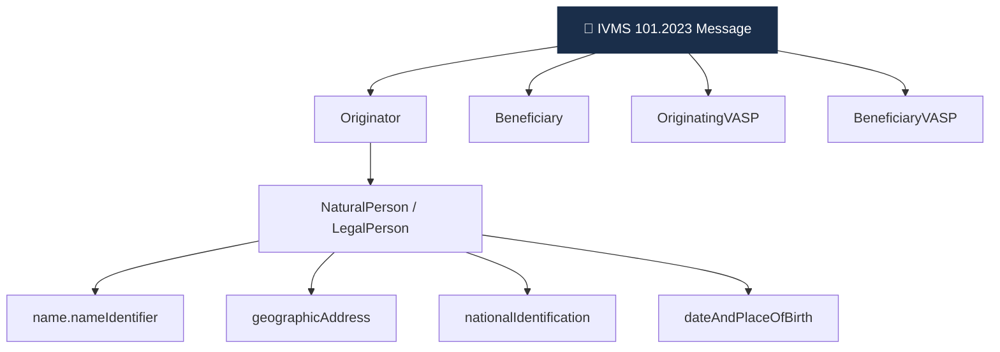
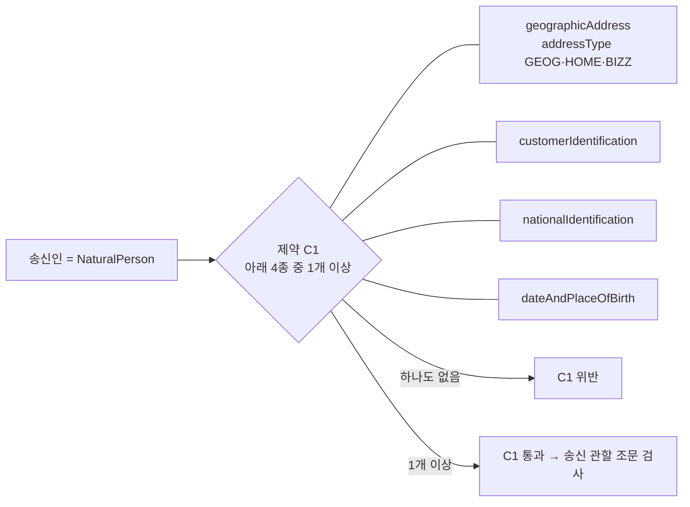

# Day 23 — IVMS 101.2023 표준 deep

> Travel Rule 메시지의 공통 데이터 모델. ⏱️ ~80분. 마지막 업데이트: 2026-10-21.

## 📖 오늘 뭘 배우나

Travel Rule의 **"무엇을"** 을 담당하는 IVMS 101. Originator·Beneficiary·VASP 정보를 표준화한 **데이터 모델**이고, TRP·TRISA·솔루션 네트워크 같은 **프로토콜**이 이 모델의 페이로드를 주고받습니다. 현행판은 **IVMS 101.2023**(Issue 1 FINAL, 2023-08 발행, interVASP Standards Working Group 유지, 2024-06-04 갱신 공표)이고 "IVMS101 v2" 라는 판은 없습니다([interVASP](https://intervasp.org/)). 오늘 자연인 송신인 제약 **C1**(주소·고객식별번호·국가식별번호·생년월일+출생지 중 **1개 이상**)과 관할별 조문 차이를 보고 나면 D28 의 IVMS 빌더 프로젝트를 훨씬 수월하게 작성할 수 있습니다.


<!-- MAP-START -->
## 🗺 오늘의 지도


<!-- MAP-END -->

## 🧩 제약 C1 — 자연인 송신인 "택1 이상"



> C1 원문: "If the originator is a NaturalPerson either (geographicAddress with an addressType value of 'GEOG' or 'HOME' or 'BIZZ') and/or customerIdentification and/or nationalIdentification and/or dateAndPlaceOfBirth is required."([IVMS 101.2023 PDF](https://cdn.jsdelivr.net/npm/ivms101@2.0.0/specs/ivms101-2023.pdf), npm 미러 — 패키지 버전 2.0.0 은 표준 판 명칭이 아님)

## 🧮 IVMS 101 Validator 핵심 (오늘의 핵심)

### IVMS 101.2023 데이터 모델 제약

| 항목 | 내용 |
|---|---|
| PayloadVersionCode | `101` / `101.2023` — 수신 측은 둘 다 처리 |
| LEIText | ISO 17442, 20자 |
| 제약 C1 | 자연인 송신인: 주소(GEOG·HOME·BIZZ)·customerIdentification·nationalIdentification·dateAndPlaceOfBirth 중 **1개 이상** |
| 제약 C7 | 법인 식별 유형은 RAID / MISC / LEIX / TXID |
| 제약 C9 | LEIX 면 registrationAuthority 금지, 비LEIX 면 필수 |
| 주소유형 GEOG | IVMS 고유 추가 |

표준 문서에는 JSON/XML 스키마가 포함되지 않습니다 — 스키마는 구현체가 별도로 관리합니다.

### 관할별 송신인 필수 항목 (조문 문언 기준)

| 관할 | 조문 | 송신인 필수 항목(요지) |
|---|---|---|
| 🇪🇺 EU | TFR 제14조(1) | 성명·DLT 주소·계정번호·**주소 또는 생년월일·출생지**·LEI 등. 금액 무관 전건 동일 |
| 🇬🇧 영국 | MLR reg 64C(5)·(6) | (5) 성명, 계좌번호 또는 고유거래식별자 / (6) 개인: 고객식별번호·주소·신분증 번호·생년월일+출생지 **중 하나** — (4)항 금액(2026-06-30~ £800, 그 전 1,000 euros) 이상 |
| 🇸🇬 싱가포르 | PSN02 ¶13.4·¶13.6 | ≤S$1,500: 4항목 / >S$1,500: 신원확인·검증 + 주소·고유식별번호·생년월일 **중 하나** |
| 🇰🇷 한국 ~2027-02-18 | 시행령 §10의10 제1호 | 100만원 **이상** 이전에서 정보제공 |
| 🇰🇷 한국 2027-02-19~ | 시행령 §10-10 ②·③ (enacted-not-in-force) | 동시: 성명·가상자산주소 / **요청 시 3영업일**: 주민등록번호(법인등록번호)·여권번호·외국인등록번호 |
| 🇺🇸 미국 | 31 CFR 1010.410(f) | USD 3,000 이상 이체지시: 송신인 성명·계좌번호·주소·금액·실행일·수취 금융기관 |

근거: [`../notes/4-technology/travel-rule-protocols.md`](../notes/4-technology/travel-rule-protocols.md) §2 · [EBA/GL/2024/11](https://www.eba.europa.eu/sites/default/files/2024-07/6de6e9b9-0ed9-49cd-985d-c0834b5b4356/Travel%20Rule%20Guidelines.pdf) · [MLR reg 64C](https://www.legislation.gov.uk/uksi/2017/692/regulation/64C) · [MAS PSN02](https://www.mas.gov.sg/-/media/amld-amendments---30-june-2025/mas-notice-psn02-amendment--new.pdf) · [법제처 시행예정 판본](https://www.law.go.kr/DRF/lawService.do?OC=test&target=eflaw&MST=288765&efYd=20270219&type=XML) · [Cornell LII](https://www.law.cornell.edu/cfr/text/31/1010.410).

> 이전 판의 표는 틀렸습니다 — "EU dateOfBirth·placeOfBirth 필수"(TFR 은 주소와 **택일**), "EU 1 EUR↑"(금액 기준 없음), "KR nationalIdentification HASHED(PIPA)"(2027 판은 요청 시 정보 제공을 정할 뿐 해시 전송 근거 없음), "KR 이름 한글+영문 병기 필수"(조문 근거 없음), "KR 주소 필수"(한국 2027 판 동시 항목은 성명·가상자산주소).

### Validator pseudocode (간략)

```python
C1_ANY_OF = ["originator.geographicAddress",      # addressType GEOG/HOME/BIZZ
             "originator.customerIdentification",
             "originator.nationalIdentification",
             "originator.dateAndPlaceOfBirth"]

RULES = {
    "EU": {"required": ["originator.name", "originator.accountNumber",
                        "beneficiary.name", "beneficiary.accountNumber"],
           "one_of": [["originator.geographicAddress", "originator.dateAndPlaceOfBirth"]]},
    "KR_2027": {"required": ["originator.name", "originator.accountNumber",
                             "beneficiary.name", "beneficiary.accountNumber"],
                "on_request": ["originator.nationalIdentification"]},  # 요청 시 3영업일
}

def validate(msg, jur):
    errors = []
    for path in RULES[jur].get("required", []):
        if not get(msg, path):
            errors.append(f"Missing {path}")
    for group in RULES[jur].get("one_of", []):
        if not any(get(msg, p) for p in group):
            errors.append(f"Need at least one of {group}")
    if is_natural_person(msg, "originator") and not any(get(msg, p) for p in C1_ANY_OF):
        errors.append("IVMS 101.2023 C1 위반")
    return errors
```

한국은 시점에 따라 규칙이 다릅니다 — 2027-02-18 까지 실행된 이전은 100만원 이상만 대상, 2027-02-19 부터는 전건입니다. 규칙에 `valid_from`·`valid_to` 를 붙여 과거 거래 재검증이 틀리지 않게 하십시오.

### 🛠️ 오늘의 미니 챌린지 업그레이드

1. 위 관할별 rules 를 Python dict 로 구현 (영국 금액 구간은 유효 구간과 함께)
2. 잘못된 샘플 5개 준비 — 예: 자연인 송신인에 C1 4종 모두 없음 / EU 메시지에 주소·생년월일 둘 다 없음 / 비LEIX 법인 식별에 registrationAuthority 없음(C9) / PayloadVersionCode 누락 / 영국 £800 이상인데 (6)항 정보 없음
3. 반대로 **통과해야 하는** 샘플도 준비 — EU 메시지에 주소만 있고 생년월일 없음(적법)
4. validator 로 검증, 에러 메시지 수집

**상세**: [`../notes/4-technology/travel-rule-protocols.md`](../notes/4-technology/travel-rule-protocols.md) §N 참조.

## 🎯 핵심 질문
1. IVMS 101 은 데이터 모델인가 프로토콜인가? 현행판 명칭은?
2. 메시지의 핵심 객체는? (Originator / Beneficiary / OriginatingVASP / BeneficiaryVASP)
3. 자연인 송신인 제약 C1 은 무엇을 요구하나?

## 📖 읽기 (~50분)
- 메인: [`../notes/4-technology/travel-rule-protocols.md`](../notes/4-technology/travel-rule-protocols.md) — 1~2절, §N

## 🌐 외부 자료 (~25분)
- [interVASP — IVMS 101.2023](https://intervasp.org/)
- [IVMS 101.2023 PDF (npm 미러)](https://cdn.jsdelivr.net/npm/ivms101@2.0.0/specs/ivms101-2023.pdf)

## 🛠️ 미니 챌린지 (~10분)
- IVMS 101 페이로드 의사코드 작성 (Originator → name + accountNumber + C1 항목 1개)
- 한국 사용자 송금 시 채워야 할 필드 체크리스트 — 2027-02-18 판 / 2027-02-19 판

## ✅ 체크포인트
- [ ] IVMS 101.2023 = 데이터 모델, 현행판, "v2" 없음
- [ ] 스키마는 표준 문서에 없고 구현체가 관리함을 안다
- [ ] 제약 C1·C7·C9 설명 가능
- [ ] 관할별 필수 항목 차이(EU 택일, 영국 (6)항 중 하나, 한국 요청 시 항목) 안다

## 💭 오늘의 한 줄

## 💼 실무 현장 (Industry Reality)

### 한국 VASP에서는

국내 사업자 간 메시지는 VerifyVASP·CODE 등 솔루션 네트워크로 오갑니다. 한국 조문 관점의 핵심:

- **2027-02-19 동시 전송 항목**은 송·수신 고객 성명(법인은 명칭·대표자 성명)과 가상자산주소
- **주민등록번호·여권번호·외국인등록번호**는 FIU 원장 또는 수취 VASP **요청 시 3영업일 이내** 제공 — 처음부터 메시지에 넣는 항목이 아님
- 이름 표기(한글/로마자)·주소 포맷에 대한 조문 요구는 없음 — 상대 관할 조문과 매칭 정책으로 정함

### 글로벌에서는

필드 오류 유형별 비율에 대한 공개 통계는 없습니다(이전 판의 "오류 top3 조사", "Coinbase 2024 Q3 IVMS101 Standardization Initiative" 는 출처가 확인되지 않아 뺐습니다). 실무에서 자주 문제 되는 지점은 조문 구조에서 나옵니다:

1. **택일 조문을 "전부 필수"로 구현** — EU 주소 또는 생년월일, 영국 (6)항 중 하나 → 적법한 메시지 거절
2. **금액 구간을 시점 없이 하드코딩** — 영국 1,000 euros(~2026-06-29) → £800(2026-06-30~)
3. **이름 로마자 표기 다양성** — 일치 판정 임계값은 조문이 정하지 않으므로 자사 데이터로 보정

### IVMS 101 객체 구조 (구조 예시)

```json
{
  "originator": {
    "originatorPersons": [{
      "naturalPerson": {
        "name": {
          "nameIdentifier": [{
            "primaryIdentifier": "Hong",
            "secondaryIdentifier": "Gildong",
            "nameIdentifierType": "LEGL"
          }]
        },
        "geographicAddress": [{
          "addressType": "HOME",
          "streetName": "Sejong-daero",
          "townName": "Seoul",
          "country": "KR"
        }]
      }
    }],
    "accountNumber": ["0x742d35Cc6634C0532925a3b844Bc9e7595f5e3E4"]
  }
}
```

(구조를 줄인 예시입니다. 주소 1개로 C1 을 충족합니다. 실제 경로·필드명은 IVMS 101.2023 원문과 사용하는 구현체 스키마로 확인하세요. 이전 판 예시의 nationalIdentifierType "RAID" 는 C7 의 **법인** 식별 유형이라 자연인 예시로 부적절해 뺐습니다.)

### 자주 나오는 오해

- **"IVMS101 이 프로토콜이다"** — IVMS 101 은 **데이터 모델**. TRP·TRISA·솔루션 네트워크가 **전송 프로토콜**입니다
- **"IVMS101 v2 로 곧 바뀐다"** — 현행판 명칭은 IVMS 101.2023. npm 패키지 버전 2.0.0 과 혼동하지 마십시오
- **"EU 는 생년월일 필수"** — TFR 제14조(1)은 주소 **또는** 생년월일·출생지입니다
- **"IVMS101 알면 Travel Rule 끝"** — 데이터 모델은 기본이고, 프로토콜 선택·VASP Discovery·미연결 정책이 함께 있어야 합니다
