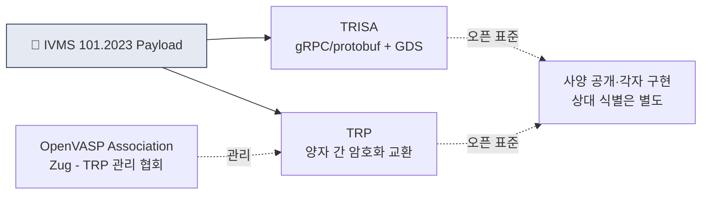
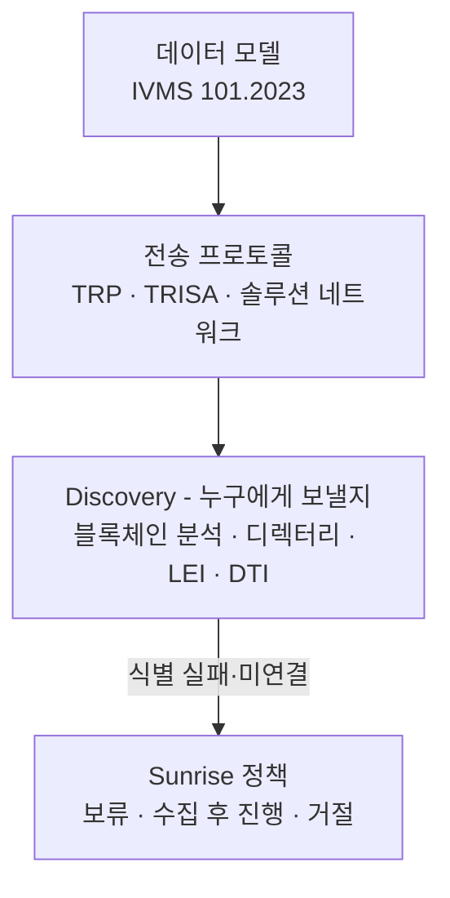

# Day 24 — TRP, TRISA 프로토콜

> 양자 간 오픈 표준 Travel Rule 전송 프로토콜. ⏱️ ~70분. 마지막 업데이트: 2026-10-21.

## 📖 오늘 뭘 배우나

IVMS 101.2023 이 "무엇을"이라면 프로토콜은 "어떻게". **TRP**(OpenVASP Association 관리, 양자 간 암호화 교환)와 **TRISA**(gRPC/protobuf 기반 오픈소스 + Global Directory Service)는 사양이 공개된 양자 간 오픈 표준의 두 축입니다. 이 모델과 회원제 솔루션 네트워크(VerifyVASP·CODE 등)의 구조 차이를 이해하는 게 내일 한국 솔루션을 보는 배경 지식입니다. 벤더·프로토콜 간 우열 평가는 하지 않습니다.

<!-- MAP-START -->
## 🗺 오늘의 지도

<!-- MAP-END -->

## 🧱 3층 구조 — 어디에 무엇이 있나

근거: [`../notes/4-technology/travel-rule-protocols.md`](../notes/4-technology/travel-rule-protocols.md) §1·§3·§5 · [OpenVASP TRP](https://www.openvasp.org/trp) · [trisa.dev](https://trisa.dev/).

## 🎯 핵심 질문
1. TRP 의 모델은? ("No data or metadata is ever exchanged with any third party")
2. TRISA 의 구성은? (gRPC/protobuf + Global Directory Service, 오픈소스 노드 Envoy)
3. 양자 간 오픈 표준 vs 회원제 네트워크 — 신뢰를 어디에 두나?

## 📖 읽기 (~50분)
- 메인: [`../notes/4-technology/travel-rule-protocols.md`](../notes/4-technology/travel-rule-protocols.md) — 3~4절

## 🌐 외부 자료 (~15분)
- [OpenVASP — TRP](https://www.openvasp.org/trp) · [TRP GitLab 사양](https://gitlab.com/OpenVASP/travel-rule-protocol)
- [TRISA 문서 (trisa.dev)](https://trisa.dev/) · [GitHub trisacrypto/trisa](https://github.com/trisacrypto/trisa)

## 🛠️ 미니 챌린지 (~5분)
- TRP / TRISA / 회원제 네트워크 비교 한 줄씩 정리 (관리 주체·신뢰 모델·라우팅)

## ✅ 체크포인트
- [ ] TRP = OpenVASP Association 관리, 양자 간 암호화 교환, ISO 24165(DTI)·IVMS101 호환 안다
- [ ] TRISA = gRPC/protobuf 오픈소스 + Global Directory Service 안다
- [ ] OpenVASP 가 2026-10-21 기준 TRP 의 모체 협회임을 안다 ("Ethereum 기반 메시징"은 2020년 이전 설계 서술)
- [ ] 오픈 표준의 한계 (상대 VASP 식별은 별도) 안다

## 💭 오늘의 한 줄

## 💼 실무 현장 (Industry Reality)

### 공개 사실 (2026-10-21, 자사·공식 페이지 기준)

- **TRP**: OpenVASP Association(Zug)이 관리. 주간 TRP Working Group, GitLab 공개 사양(CC BY-SA 4.0). 모델은 "Bilateral exchange of encrypted data (VASP-to-VASP)". 현행 버전 번호는 사이트에 표시되지 않음. Notabene 는 "Every Notabene customer has a live TRP 1.0 endpoint" 라고 밝힘(B)([Notabene TRP](https://notabene.id/travel-rule-messaging-protocols/trp))
- **TRISA**: gRPC/protobuf 기반 오픈소스 + Global Directory Service(B). 오픈소스 노드 **Envoy** 가 TRISA 와 TRP 를 모두 지원한다고 밝힘(B). 2026-10-21 trisa.io 는 응답하지 않음 — 접속 불가만으로 운영 중단을 추정하지 말 것
- 이전 판의 "TRISA CipherTrace 주도·~200+ 노드", "TRP 21 Analytics·Sygna 공동 개발·REST+OAuth", "OpenVASP Bitcoin Suisse 주도·채택 실패", "Coinbase 3중 연결", "한국 거래소 분산형 직접 구현 사례 없음" 은 공개 1차 근거가 없어 뺐습니다

### 오픈 표준 vs 회원제 네트워크 (구조 비교)

| 항목 | 양자 간 오픈 표준 (TRP, TRISA) | 회원제 네트워크 (솔루션 네트워크) |
|---|---|---|
| 참여 | 사양 공개, 각자 구현 | 네트워크 가입 |
| 신뢰 모델 | 인증서·양자 간 확인 | 네트워크 운영자의 회원 검증 |
| 라우팅 | 상대 식별을 별도로 해야 함 | 네트워크 내 디렉터리 |
| 운영 책임 | 각 VASP | 운영자 + 회원 |

어느 쪽이 낫다는 평가가 아닙니다. 이전 판의 "GDPR 친화 높음/중간", "구현 난이도", "API Key + mutual TLS" 칸은 근거가 없어 뺐습니다.

### 상대 VASP 식별이 먼저

FATF 2021 가이던스 para 197(a): "the FATF is not aware of any technically proven means of identifying the VASP that manages the beneficiary wallet exhaustively, precisely, and accurately … from the VA address alone"([FATF 2021 RBA 가이던스](https://www.fatf-gafi.org/content/dam/fatf-gafi/guidance/Updated-Guidance-VA-VASP.pdf.coredownload.pdf)). 그래서 라벨 DB → 디렉터리 조회 → 고객 확인·수동 검토 순서가 EBA GL ¶77~78 과도 맞습니다.

### 한국 관점

2027-02-19 부터 한국 VASP 는 해외 VASP 의 AML·트래블룰 이행을 평가해 허용 등급을 정합니다(고시 §28-2). 프로토콜 경로뿐 아니라 **평가 자료(인허가·트래블룰 이행 근거)** 를 함께 준비해야 합니다([감독규정 FIU 고시 제2026-2호](https://www.law.go.kr/DRF/lawService.do?OC=test&target=admrul&ID=2100000285986&type=XML)).

### 자주 나오는 오해

- **"TRISA 는 OFAC 이 쓰는 표준이다"** — TRISA 는 민간 오픈소스 프로토콜입니다
- **"프로토콜 하나만 붙이면 충분"** — 어떤 네트워크도 모든 상대방을 덮지 못합니다. 몇 개를 붙이는 게 "표준"인지에 대한 공개 근거는 없고, 출금 상대방 목록에서 출발해 정합니다
- **"IVMS101 v2"** — 현행판은 IVMS 101.2023 입니다
