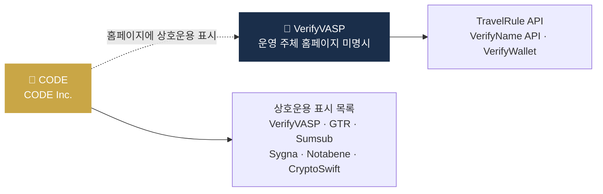
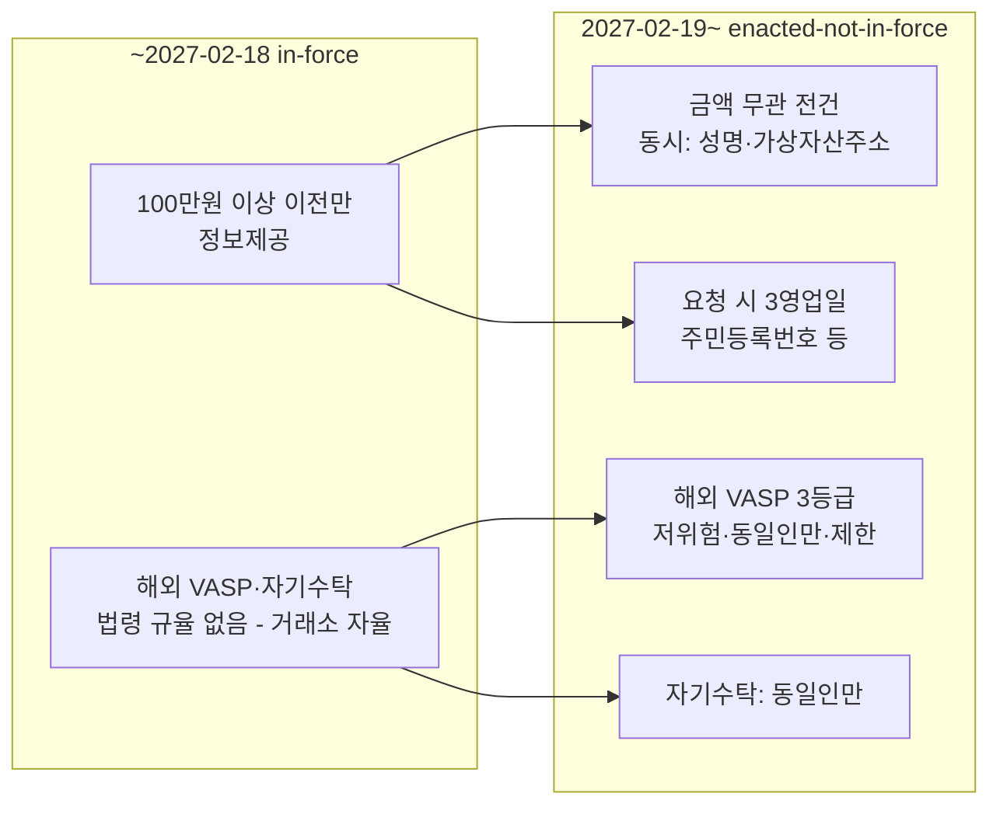

# Day 25 — VerifyVASP, CODE (한국 솔루션 네트워크)

> 한국 시장 Travel Rule 솔루션 deep. ⏱️ ~70분. 마지막 업데이트: 2026-10-21.

## 📖 오늘 뭘 배우나

국내 사업자 간 트래블룰 메시지는 **VerifyVASP·CODE 등 회원제 솔루션 네트워크**로 오갑니다. 오늘은 두 네트워크에 대해 **공개 자료로 확인되는 사실**과 **확인되지 않은 것**을 구분하는 연습을 합니다. 흔히 전해지는 "VerifyVASP = 람다256 + Chainalysis 합작", "CODE = 빗썸·코빗·코인원 3사 합작", 거래소별 솔루션 매핑, 상호 연동 완료 시점은 2026-10-21 기준 공개 1차 근거로 확인되지 않았습니다([`../notes/7-vendors/travel-rule-vendors.md`](../notes/7-vendors/travel-rule-vendors.md) §2). 신규 VASP 의 솔루션 선택 기준도 우열이 아니라 **출금 상대방 목록**에서 출발합니다.

<!-- MAP-START -->
## 🗺 오늘의 지도

<!-- MAP-END -->

## 🎯 핵심 질문
1. VerifyVASP 홈페이지가 밝히는 제품은? 운영 주체는 공개돼 있나?
2. CODE 의 운영 주체와 홈페이지가 표시하는 상호운용 목록은?
3. "연동을 표시함" 과 "커버리지·품질 보장" 은 왜 다른가?

## 📖 읽기 (~45분)
- 메인: [`../notes/7-vendors/travel-rule-vendors.md`](../notes/7-vendors/travel-rule-vendors.md) — 2절 B, C
- 보조: [`../notes/7-vendors/korea-solutions.md`](../notes/7-vendors/korea-solutions.md) — 트래블룰 절

## 🌐 외부 자료 (~20분)
- [VerifyVASP 공식](https://www.verifyvasp.com/)
- [CODE 공식](https://www.codevasp.com/)

## 🛠️ 미니 챌린지 (~5분)
- 두 홈페이지를 열어 "자사가 밝힌 사실" 과 "확인 안 되는 것" 을 두 칸으로 메모
- "신규 한국 VASP 가 솔루션 선택 시 확인할 질문" 3가지 적기 (아래 표 참고)

## ✅ 체크포인트
- [ ] VerifyVASP 제품(TravelRule API·VerifyName API·VerifyWallet)과 운영 주체 미명시 사실 안다
- [ ] CODE = CODE Inc. 운영, 홈페이지 상호운용 목록 안다 (지분 구조는 미확인)
- [ ] 2026 상반기 트래블룰 적용 비중(9.5조/62.8조, 약 15%) 안다
- [ ] 회원제 네트워크 = 운영자가 회원을 검증하는 신뢰 모델 안다

## 💭 오늘의 한 줄

## 💼 실무 현장 (Industry Reality)

### 공개 사실 vs 미확인 (2026-10-21)

| 항목 | VerifyVASP | CODE |
|---|---|---|
| 운영 주체 | 홈페이지에 명시 안 됨 | CODE Inc. |
| 제품·기능(자사 표시, B) | TravelRule API · VerifyName API · VerifyWallet | 상호운용 목록 표시, 2026-03-25 비호스팅 지갑 식별 솔루션 게시 |
| 상호운용(자사 표시, B) | — | CodeVASP·VerifyVASP·GTR·Sumsub·Sygna·Notabene·CryptoSwift |
| 지분 구조 | **미확인** ("람다256 + Chainalysis" 근거 없음) | **미확인** ("3사 합작"은 2022 보도 기반으로만 전해짐) |
| 상호 연동 완료 시점 | **미확인** | **미확인** |

근거: [VerifyVASP](https://www.verifyvasp.com/) · [CODE](https://www.codevasp.com/) · [`../notes/7-vendors/travel-rule-vendors.md`](../notes/7-vendors/travel-rule-vendors.md).

이전 판의 거래소별 솔루션·KYT·은행 매핑 표, "2022-04 상호 연동 합의", "CODE 가 저렴", "해외 미연결 실패율 ~10~20%", "DAXA 공동 제재 주소 리스트" 는 공개 근거가 없어 삭제했습니다.

### 규모 기준선 — 공식 통계

금융위의 2026 상반기 실태조사에서 **총 출고 62.8조원 가운데 트래블룰이 적용된 것은 9.5조원(약 15%)** 이었습니다([금융위 2026-10-01](https://www.fsc.go.kr/no010101/87835)). 현행 제도가 100만원 **이상**·국내 VASP 간 이전으로 한정돼 있기 때문이고, 2027-02-19 전건화 이후 메시지 처리량이 크게 늘 수 있는 구조입니다.

### 2027-02-19 전후 — 솔루션이 감당해야 할 것

근거: [법제처 시행예정 판본](https://www.law.go.kr/DRF/lawService.do?OC=test&target=eflaw&MST=288765&efYd=20270219&type=XML) · [감독규정 FIU 고시 제2026-2호](https://www.law.go.kr/DRF/lawService.do?OC=test&target=admrul&ID=2100000285986&type=XML). 감독규정 §28-2 시행일은 고시 부칙 기산점에 따라 2027-02-21 로 산정될 수 있어 미확정입니다.

### 신규 VASP 의 솔루션 선택 — 확인할 질문

| 질문 | 왜 필요한가 |
|---|---|
| 우리 출금 상대방 상위 N 곳이 이 네트워크(또는 연동 네트워크)에 있는가 | 미연결이면 정보를 보낼 수 없음 (FATF 2021 para 200–201) |
| IVMS 101.2023 C1·LEI 제약(C9~C11)을 검증하는가 | 현행 데이터 모델 제약 |
| 2027-02-19 전건화·요청 시 3영업일 추가정보를 지원하는가 | 금액 게이트 제거, 요청 응답 큐 |
| 상대 VASP 실사 자료(인허가·트래블룰 이행)를 남길 수 있는가 | 고시 §28-2 등급 판정 |
| 메시지·판단 기록을 내보낼 수 있는가 | 벤더 교체 시 기록 보존 |

### 자주 나오는 오해

- **"한국 거래소는 양강 구도로 4사 완결"** — 거래소별로 어느 네트워크를 쓰는지는 공개 1차 근거로 확인되지 않습니다
- **"연동 목록에 있으면 커버된다"** — 연동 목록은 자사가 "연동을 표시함"일 뿐 품질·커버리지·안정성을 뜻하지 않습니다
- **"100만원 미만은 솔루션 대상 아님"** — 2027-02-18 까지만 맞습니다
