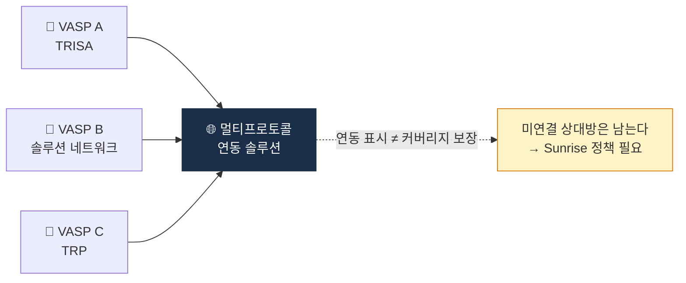
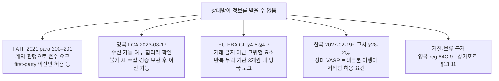

# Day 26 — 멀티프로토콜 연동 솔루션 + Sunrise Issue

> 여러 네트워크를 잇는 솔루션이 왜 필요한가. ⏱️ ~70분. 마지막 업데이트: 2026-10-21.

## 📖 오늘 뭘 배우나

Travel Rule 의 구조적 난제는 **Sunrise Issue** — A국은 시행, B국은 미시행이면 A국 VASP 가 보낸 정보를 B국 상대방이 받을 수단이 없는 상황입니다. FATF 7차 Targeted Update(2026-07-16)에서 응답 109 관할 중 **91곳(83%)이 입법**했고 11곳이 입법 진행 중이며, 입법 관할의 **60%(55/91)** 는 감독·집행 조치가 없었습니다([7차 TU PDF](https://www.fatf-gafi.org/content/dam/fatf-gafi/reports/7th-targeted-update-on-implementation-fatf-standards-vas-vasps-2026.pdf.coredownload.pdf)). 여기에 상대방마다 다른 네트워크를 쓰는 문제가 겹칩니다. Sumsub·Notabene·CODE 처럼 **여러 네트워크와의 연동을 표시하는 솔루션**이 나온 배경이 이것이고, 오늘은 그 구조와 관할별로 허용되는 sunrise 대응을 정리합니다.


<!-- MAP-START -->
## 🗺 오늘의 지도


<!-- MAP-END -->

## 🎯 핵심 질문
1. Sunrise Issue 가 뭔가? (한 줄)
2. 멀티프로토콜 연동 솔루션이 해결하는 것과 못 하는 것은?
3. 관할별로 허용되는 sunrise 대응은? (FATF·영국·EU·한국)

## 📖 읽기 (~50분)
- 메인: [`../notes/4-technology/travel-rule-protocols.md`](../notes/4-technology/travel-rule-protocols.md) — 5~6절, §M.3
- 보조: [`../notes/7-vendors/travel-rule-vendors.md`](../notes/7-vendors/travel-rule-vendors.md) — 2절 A, D
- 보조: [`../notes/3-crypto-aml/travel-rule.md`](../notes/3-crypto-aml/travel-rule.md) — 8절 A

## 🌐 외부 자료 (~15분)
- [Notabene About](https://notabene.id/about-us) · [Sumsub Protocols](https://sumsub.com/protocols/)
- [FCA — Travel Rule 기대 성명(2023-08-17)](https://www.fca.org.uk/news/statements/fca-sets-out-expectations-uk-cryptoasset-businesses-complying-travel-rule)

## 🛠️ 미니 챌린지 (~5분)
- "멀티프로토콜 연동 솔루션 도입 결정 매트릭스" 작성 (장단점 각 3개 — 수치 대신 확인할 질문으로)

## ✅ 체크포인트
- [ ] Sunrise Issue 정의 (관할별 시행 격차 + 네트워크 미연결) 안다
- [ ] 7차 TU 수치 83%(91/109)·60%(55/91) 안다
- [ ] 폴백 정책 종류 (보류 / 수집·검증·보관 후 진행 / 거절) 와 각 근거 조문 안다
- [ ] 2030-12-31 은 sunrise 해소 목표가 아니라 개정 R.16 이행 기대시한임을 안다

## 💭 오늘의 한 줄

## 🧭 관할별 Sunrise 대응 규범



근거: [FATF 2021 RBA 가이던스](https://www.fatf-gafi.org/content/dam/fatf-gafi/guidance/Updated-Guidance-VA-VASP.pdf.coredownload.pdf) · [FCA 성명](https://www.fca.org.uk/news/statements/fca-sets-out-expectations-uk-cryptoasset-businesses-complying-travel-rule) · [EBA/GL/2024/11](https://www.eba.europa.eu/sites/default/files/2024-07/6de6e9b9-0ed9-49cd-985d-c0834b5b4356/Travel%20Rule%20Guidelines.pdf) · [감독규정 FIU 고시 제2026-2호](https://www.law.go.kr/DRF/lawService.do?OC=test&target=admrul&ID=2100000285986&type=XML).

## 💼 실무 현장 (Industry Reality)

### 공개 사실 (2026-10-21, 자사 페이지 기준, B)

- **Notabene**: 제품 SafeTransact·Notabene Flow·TAP. OpenVASP 회원. "Every Notabene customer has a live TRP 1.0 endpoint." 2026-07-23 Ripple 전략투자(금액 비공개) 발표([Notabene](https://notabene.id/about-us))
- **Sumsub**: 자체·GTR·CODE·TRP·Sygna 5개 프로토콜 연동 표시([Sumsub](https://sumsub.com/protocols/))
- **CODE**: 홈페이지 상호운용 목록에 VerifyVASP·GTR·Sumsub·Sygna·Notabene·CryptoSwift 표시([CODE](https://www.codevasp.com/))
- 각 네트워크 회원 수·거래량은 자사 주장(T5급)이라 인용하지 않습니다

이전 판의 "Notabene 1,500+ VASP", "Top 20 대부분 가입", "월 $2K~ 가격", "커버리지 40%→85%", "한국 해외 송금 ~30% Sunrise", "Upbit 2024 가입" 은 공개 1차 근거가 없어 삭제했습니다. 연동 목록은 "연동을 표시함"이지 품질·커버리지를 뜻하지 않습니다.

### Sunrise 3가지 양상

1. **규제 부재**: 해당 관할에 Travel Rule 입법 없음 (7차 TU 기준 109 중 91 입법, 11 진행 중)
2. **입법했으나 집행 공백**: 입법 관할의 60%(55/91)가 지적·지시·집행·감독조치 없음
3. **입법·집행 있으나 네트워크 미연결**: 상대 VASP 가 우리와 다른 네트워크를 씀

### Sunrise 폴백 정책 (템플릿 — 근거 조문을 정책서에 명시)

```
IF counterparty_reachable(network):
    SEND ivms101_2023_message            # 이전 이전 또는 동시 (사후 전송 금지)
ELIF policy == "COLLECT_AND_PROCEED":    # 예: 영국 FCA 2023-08-17 성명
    COLLECT + VERIFY + STORE originator/beneficiary info
    PROCEED by risk-based decision
ELIF policy == "HOLD":
    HOLD for compliance review           # 보류 기간은 회사 정책
ELSE:
    REJECT                               # 예: 영국 reg 64C(9), 싱가포르 ¶13.11
LOG counterparty failure                  # EU: 반복 누락 기관 식별·3개월 내 보고
```

한국은 2027-02-19 부터 상대 VASP 가 저위험 요건(트래블룰 이행 포함)을 못 갖추면 **동일인 간 이전만** 허용, FATF 고위험국·무인허가는 제한입니다(고시 §28-2②).

### 도입 결정 매트릭스 (확인할 질문)

| 기준 | 직접 구현(TRP/TRISA) | 멀티프로토콜 연동 솔루션 |
|---|---|---|
| 상대방 커버 | 우리 출금 상대방이 해당 프로토콜에 있는가 | 표시된 연동 목록에 우리 상대방이 실제로 있는가 |
| 통제권 | 자체 | 솔루션 의존 — 메시지·판단 기록 내보내기 가능한가 |
| 규범 대응 | 직접 구현 | IVMS 101.2023 C1·LEI 제약, 관할별 시점 구간 설정 지원 여부 |
| 한국 2027 | 직접 구현 | 전건화·요청 시 3영업일·상대 VASP 평가 기록 지원 여부 |

비용·온보딩 기간 수치는 공개 근거가 없어 적지 않습니다.

### 자주 나오는 오해

- **"허브 하나면 Sunrise 해결"** — 연동은 네트워크 미연결(양상 3)만 줄입니다. 규제 부재·집행 공백(양상 1·2)은 남습니다
- **"2030 FATF R.16 발효"** — 2030-12-31 은 개정 R.16 의 **이행 기대시한**이고, VASP 에는 R.15 를 거쳐 간접 적용됩니다. VASP 트래블룰의 근거(INR.15 §7(b))는 2019-06 부터 있었습니다
- **"Sunrise 는 5~10년 잔존"** — 그런 전망의 공개 근거는 없습니다. 7차 TU 의 입법·집행 수치로 현재 상태만 말합니다
