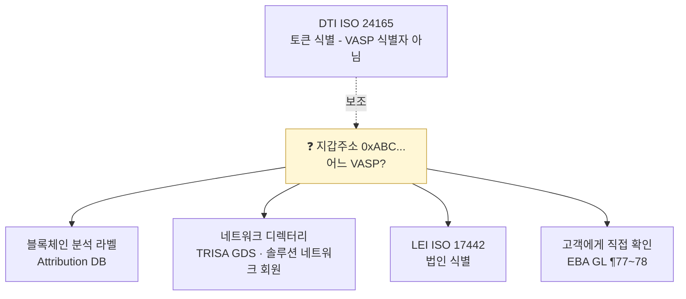
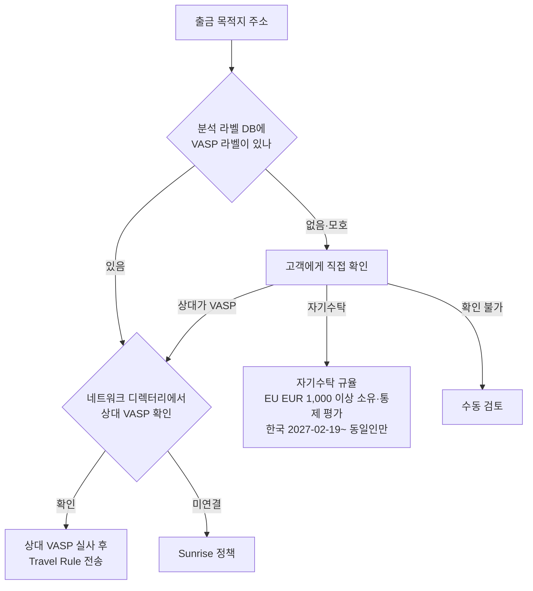

# Day 27 — VASP Discovery + DTI / GLEIF LEI

> 지갑 주소 → 어느 VASP인가? 라우팅의 핵심. ⏱️ ~75분. 마지막 업데이트: 2026-10-21.

## 📖 오늘 뭘 배우나

Travel Rule 의 숨은 난제 — **지갑주소만으로는 상대 VASP 를 식별할 수 없다**. FATF 도 2021 가이던스 para 197(a)에서 "the FATF is not aware of any technically proven means of identifying the VASP that manages the beneficiary wallet exhaustively, precisely, and accurately … from the VA address alone" 라고 인정합니다([FATF 2021 RBA 가이던스](https://www.fatf-gafi.org/content/dam/fatf-gafi/guidance/Updated-Guidance-VA-VASP.pdf.coredownload.pdf)). 오늘은 이를 보완하는 수단(블록체인 분석 라벨·네트워크 디렉터리·LEI·DTI·고객 확인)을 정리하고, **DTI**(ISO 24165, 토큰 식별자)와 **LEI**(ISO 17442, 법인 식별자)가 각각 무엇을 식별하는지 구분합니다.


<!-- MAP-START -->
## 🗺 오늘의 지도


<!-- MAP-END -->

## 🎯 핵심 질문
1. 지갑주소만 보고 상대 VASP 를 식별할 수 있나? FATF 는 뭐라고 했나?
2. DTI = 무엇? (ISO 24165, TRP 가 호환 명시)
3. LEI = 무엇? IVMS 101.2023 에서 어떤 제약(C9~C11)과 묶이나?

## 📖 읽기 (~50분)
- 메인: [`../notes/4-technology/travel-rule-protocols.md`](../notes/4-technology/travel-rule-protocols.md) — 5절, §M.4
- 보조: [`../notes/4-technology/blockchain-analytics.md`](../notes/4-technology/blockchain-analytics.md) — 3절 (Attribution)

## 🌐 외부 자료 (~20분)
- [DTI Foundation](https://dtif.org/)
- [GLEIF LEI 공식](https://www.gleif.org/en/about-lei/this-is-lei)

## 🛠️ 미니 챌린지 (~5분)
- Discovery 수단 5가지 (분석 라벨 / 디렉터리 / LEI / 고객 확인 / DTI 보조) 각 한 줄 정리 + 각 수단의 한계 한 줄

## ✅ 체크포인트
- [ ] 주소 → VASP 식별이 별도 인프라 문제임을 안다 (FATF para 197(a))
- [ ] DTI = **토큰** 식별 표준, VASP 식별자가 아님을 안다
- [ ] LEI = **법인** 식별 표준, IVMS 101.2023 C9~C11 안다
- [ ] 식별 실패 시 순서: 고객 확인 → 수동 검토 (EBA GL ¶77~78)

## 💭 오늘의 한 줄

## 🔁 식별 순서 (EBA GL ¶77~78 과 맞춘 흐름)



근거: [EBA/GL/2024/11](https://www.eba.europa.eu/sites/default/files/2024-07/6de6e9b9-0ed9-49cd-985d-c0834b5b4356/Travel%20Rule%20Guidelines.pdf) ¶77~78·¶83 · [`../notes/3-crypto-aml/travel-rule.md`](../notes/3-crypto-aml/travel-rule.md) §8-B.

## 💼 실무 현장 (Industry Reality)

### 수단별 공개 근거와 한계

| 방식 | 공개 근거로 확인된 내용 | 한계 |
|---|---|---|
| 블록체인 분석·제3자 데이터 | EBA GL ¶77~78 이 자기수탁 판단 수단으로 열거 | 주소만으로 VASP 를 정확히 식별할 기술적 수단 없음(FATF para 197(a)), 신규 주소 라벨링 지연 |
| TRISA Global Directory Service | trisa.dev 가 GDS 를 설명(자사 페이지, B) | 운영 상태·회원 수 미확인 |
| 솔루션 네트워크 회원 디렉터리 | VerifyVASP·CODE·GTR 등 | 비회원 접근 범위는 계약 사항 |
| LEI(ISO 17442) | IVMS 101.2023 C9~C11 | 법인만 |
| DTI(ISO 24165) | TRP 가 호환 명시 | 토큰 식별자이지 VASP 식별자가 아님 |

근거: [`../notes/4-technology/travel-rule-protocols.md`](../notes/4-technology/travel-rule-protocols.md) §M.4.

이전 판의 "라벨 정확도 한국 VASP ~95% / 해외 80~90% / 중소 50% 이하", "지갑 라벨 2,000만+", "방법별 실무 비중 60/20/10%", "Notabene Directory 1,500+", "DTI 2024년부터 MiCA·ESMA 필수", "한국 FIU 신고 시 LEI 확보 권고", 특정 기업 LEI 예시는 공개 1차 근거가 없어 삭제했습니다. 라벨 데이터는 각 회사가 따로 쌓고 공개하지 않습니다([`../notes/4-technology/blockchain-analytics.md`](../notes/4-technology/blockchain-analytics.md) §3).

### LEI 와 IVMS 101.2023 제약

- **C7**: 법인 식별 유형은 RAID / MISC / LEIX / TXID
- **C9**: 식별 유형이 `LEIX` 면 registrationAuthority 금지, 비LEIX 면 필수
- **C10·C11**: GLEIF RA 목록, validLEI
- EU TFR 제14조(1)은 송신인 정보에 LEI 등을 포함합니다(요지)

### 실제 조회 pseudocode (구조 예시)

```
def identify_counterparty(address):
    label = analytics_labels.lookup(address)        # 1. 분석 라벨 (자체 + 외부)
    if label and label.entity_type == "VASP":
        vasp = directory.resolve(label.entity)      # 2. 네트워크 디렉터리
        if vasp:
            return vasp                             #    → 상대 VASP 실사 후 전송
        return SUNRISE                              #    → 미연결 정책
    answer = ask_customer(address)                  # 3. 고객 확인 (EBA GL ¶77~78)
    if answer.is_vasp:
        return directory.resolve(answer.vasp_name) or SUNRISE
    if answer.is_self_hosted:
        return SELF_HOSTED                          #    → 관할별 자기수탁 규율
    return MANUAL_REVIEW                            # 4. 확인 불가
```

이전 판처럼 "식별 실패 = unhosted 로 처리" 하면 안 됩니다 — 식별 실패는 자기수탁의 증거가 아니고, EBA GL 은 먼저 고객에게 직접 확인하도록 합니다. 분석 벤더 API 이름·신뢰도 임계값(0.9 등)은 예시가 아니라 자사 데이터로 정해야 합니다.

### 자주 나오는 오해

- **"지갑 주소만 보면 VASP 를 알 수 있다"** — 온체인 데이터만으로는 불가능합니다(FATF para 197(a)). off-chain 라벨·디렉터리·고객 확인이 필요합니다
- **"DTI 와 LEI 는 같은 것"** — DTI 는 **토큰** 식별, LEI 는 **법인** 식별. 상호 보완
- **"7차 TU 는 Discovery 를 다루지 않았다"** — 7차 TU(2026-07-16)는 상대방 VASP 식별을 "completely and accurately" 수행하고 소매고객으로 위장한 역외 VASP 계정을 탐지하라고 권고했습니다([7차 TU PDF](https://www.fatf-gafi.org/content/dam/fatf-gafi/reports/7th-targeted-update-on-implementation-fatf-standards-vas-vasps-2026.pdf.coredownload.pdf))
