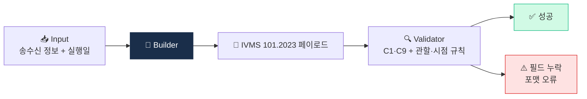
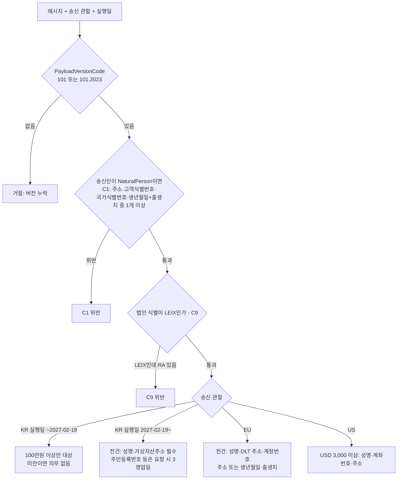

# Day 28 — 🛠️ 미니 프로젝트 1: IVMS 101.2023 메시지 빌더 + 4주 리뷰

> 손으로 IVMS 101 메시지를 만들어보면서 표준 체화. ⏱️ ~150분. 마지막 업데이트: 2026-10-21.

## 📖 오늘 뭘 배우나

Week 4 의 결산인 첫 미니 프로젝트. Python 으로 **IVMS 101.2023 메시지를 직접 생성·검증**하는 코드를 짜면서, 지난 6일간 배운 Travel Rule·프로토콜·솔루션 네트워크·Discovery 내용이 손에 익도록 만듭니다. 검증기는 두 겹입니다 — ① 관할과 무관한 **데이터 모델 제약**(PayloadVersionCode, C1, C9) ② **송신 관할 조문 + 이전 실행일** 기준 규칙(한국은 2027-02-18 까지 100만원 이상, 2027-02-19 부터 전건). 완성된 코드는 이후 D35(온체인 tracer)·D56(KYT wrapper)과 결합되어 Capstone 의 리스크 엔진으로 확장됩니다.


<!-- MAP-START -->
## 🗺 오늘의 지도


<!-- MAP-END -->

## 🎯 회고 질문
1. Travel Rule 을 "임계금액 한 칸"으로 요약하면 왜 틀리나? (A·B·C형, 유효 구간)
2. IVMS 101.2023 이 데이터 모델 표준이라는 게 왜 중요한가? 관할별 필수 항목은 누가 정하나?
3. 한국 시장 특수성 1가지? (힌트: 2027-02-19)

## 🧪 검증 흐름



근거: [`../notes/4-technology/travel-rule-protocols.md`](../notes/4-technology/travel-rule-protocols.md) §2·§N · [IVMS 101.2023 PDF](https://cdn.jsdelivr.net/npm/ivms101@2.0.0/specs/ivms101-2023.pdf) · [법제처 시행예정 판본](https://www.law.go.kr/DRF/lawService.do?OC=test&target=eflaw&MST=288765&efYd=20270219&type=XML) · [EBA/GL/2024/11](https://www.eba.europa.eu/sites/default/files/2024-07/6de6e9b9-0ed9-49cd-985d-c0834b5b4356/Travel%20Rule%20Guidelines.pdf) · [Cornell LII](https://www.law.cornell.edu/cfr/text/31/1010.410).

## 🛠️ 미니 프로젝트 (~120분)

### 목표
**Python 으로 IVMS 101.2023 메시지 빌더 + 검증 함수 작성**

### 사양
- 입력: 송신인/수신인 정보 + 금액(원화 환산) + 상대 VASP 정보 + **송신 관할 + 이전 실행일**
- 출력: IVMS 101.2023 구조의 페이로드 (PayloadVersionCode `101.2023`). 표준 문서에는 JSON 스키마가 없으므로 사용하는 구현체 스키마를 명시
- 검증: 데이터 모델 제약(C1·C9) / 관할·시점별 필수 항목 / 타입·포맷 오류

### 구현 가이드
프로젝트 폴더: `aml/projects/01-ivms101-builder/`

```python
# main.py 의사코드
from datetime import date

KR_THRESHOLD = [  # 시행령 §10의10 — valid_to 는 마지막 유효일(포함)
    {"amount_krw": 1_000_000, "comparator": "gte",
     "valid_from": date(2022, 3, 25), "valid_to": date(2027, 2, 18)},
    {"amount_krw": None,  # 기준금액 없음 — 전건 (대통령령 제36592호, enacted-not-in-force)
     "valid_from": date(2027, 2, 19), "valid_to": None},
]

def build_ivms101_message(
    originator: dict,      # name, account_number, + C1 항목 1개 이상(address / customer_id / national_id / dob+pob)
    beneficiary: dict,     # name, account_number
    originating_vasp: dict,
    beneficiary_vasp: dict,
    amount_krw: int,
    asset: str,
    transfer_date: date,
) -> dict:
    """IVMS 101.2023 구조 빌드. 한국 2027 판의 주민등록번호 등은 동시 전송하지 않는다(요청 시 제공)."""
    ...

def kr_in_scope(amount_krw: int, transfer_date: date) -> bool:
    """실행일에 유효한 구간으로 대상 여부 판정. 100만원 '이상'(gte) — '초과' 아님."""
    ...

def validate_ivms101(msg: dict, jurisdiction: str, transfer_date: date) -> tuple[bool, list[str]]:
    """C1·C9 + 관할·시점별 필수 항목 검증, (성공 여부, 에러 리스트)"""
    ...
```

### 테스트 케이스 (~7개)
1. **한국 정상 — 2026-12-01 실행, 150만원**: 대상(100만원 이상), 성명·가상자산주소 + C1 항목(예: 주소) 채움 → 통과
2. **한국 경계값 — 2026-12-01 실행, 정확히 1,000,000원**: "이상"이므로 **대상** → 정보 없으면 실패
3. **한국 소액 — 2026-12-01 실행, 50만원**: 대상 아님 / **같은 건을 2027-03-01 실행**하면 대상(전건)
4. **한국 2027 판 — 주민등록번호를 동시 전송 필드에 넣음**: 경고(요청 시 3영업일 항목)
5. **자연인 송신인 C1 위반**: 주소·고객식별번호·국가식별번호·생년월일 모두 없음 → `(False, ["IVMS 101.2023 C1 위반"])`
6. **EU — 주소만 있고 생년월일 없음**: TFR 제14조(1) 택일이므로 **통과해야 함** (이전 판의 "EU 는 dateAndPlaceOfBirth 필수"는 틀림)
7. **법인 송신인 — LEIX 식별에 registrationAuthority 기재**: C9 위반

### 산출물
- `projects/01-ivms101-builder/main.py`
- `projects/01-ivms101-builder/test.py`
- `projects/01-ivms101-builder/README.md` (사양 + 사용법 + 근거 조문)
- `projects/01-ivms101-builder/sample_messages/` (7개 JSON 예시)

→ 자세한 가이드: [`../projects/01-ivms101-builder/README.md`](../projects/01-ivms101-builder/README.md)

## ✅ 체크포인트
- [ ] IVMS 101.2023 메시지 빌더 작동
- [ ] 7개 테스트 케이스 통과 (경계값·시점 전환 포함)
- [ ] [`progress.md`](progress.md) Week 4 7개 모두 체크 + W4 미니 프로젝트 체크
- [ ] 산출물 git commit + push

## 💭 4주차 회고 (1개월 마감!)

1개월 학습 완료. 가장 큰 변화:
가장 의외였던 것:
다음 1개월 (W5~W8) 기대:

## 💼 실무 현장 (Industry Reality)

### 참조 구현과 스키마

- 표준 문서(IVMS 101.2023)에는 JSON/XML 스키마가 포함되지 않습니다 — 스키마는 구현체가 별도로 관리합니다
- npm 패키지 `ivms101@2.0.0` 이 표준 PDF 를 미러링하지만, **패키지 버전 2.0.0 은 표준 판 명칭이 아닙니다** ("IVMS101 v2" 는 없음)
- TRISA 는 GitHub `trisacrypto/trisa` 를 공개합니다([GitHub](https://github.com/trisacrypto/trisa))
- 이전 판의 "면접 과제 단골", "21 Analytics ivms101-ts·OpenVASP ivms-schemas 가 가장 널리 쓰임", "Notabene·VerifyVASP SDK 언어", "Coinbase IVMS101 Standardization Library 2024" 는 공개 1차 근거가 없어 삭제했습니다

### 코드 구조 예시 (Python, pydantic)

```python
from pydantic import BaseModel

class NameIdentifier(BaseModel):
    primary_identifier: str            # 성(family name) — 예: "Hong"
    secondary_identifier: str | None   # 이름(given name) — 예: "Gildong"
    name_identifier_type: str = "LEGL"

class NaturalPerson(BaseModel):
    name: list[NameIdentifier]
    geographic_address: list[dict] | None = None      # addressType GEOG/HOME/BIZZ
    customer_identification: str | None = None
    national_identification: dict | None = None
    date_and_place_of_birth: dict | None = None

    def satisfies_c1(self) -> bool:                    # IVMS 101.2023 C1 (송신인일 때)
        return any([self.geographic_address, self.customer_identification,
                    self.national_identification, self.date_and_place_of_birth])
```

### 운영 지표 — 자사 로그로 기준선을 잡는다

이전 판의 "송신 성공률 95%+, accept 90%+, Sunrise <5%, 재전송 <2%" 목표치는 공개 근거가 없어 뺐습니다. 미연결 상대방 비율·자동 성공률·오류 유형 분포의 업계 평균치는 공개 출처로 확인되지 않습니다. 추적할 **항목**만 정합니다: 상대방별 전송 실패 기록(EU 는 반복 누락 기관을 식별 후 3개월 안에 당국 보고, EBA GL §4.7), 보완요청 건수, 요청 시 3영업일 응답 준수율(한국 2027-02-19~).

### 자주 나오는 오해

- **"IVMS101 빌더는 간단한 JSON 작성"** — 택일 조건(C1, EU 주소 또는 생년월일), 시점별 금액 구간, 경계 문언(이상/초과)이 핵심 난이도입니다
- **"오픈소스 라이브러리 그대로 쓰면 된다"** — 데이터 모델 제약과 관할 조문은 별개라, 관할·시점 규칙은 직접 붙여야 합니다
- **"한국은 100만원 초과부터"** — 시행령 문언은 「1백만원 **이상**」입니다. 그리고 이 기준은 2027-02-18 까지입니다
