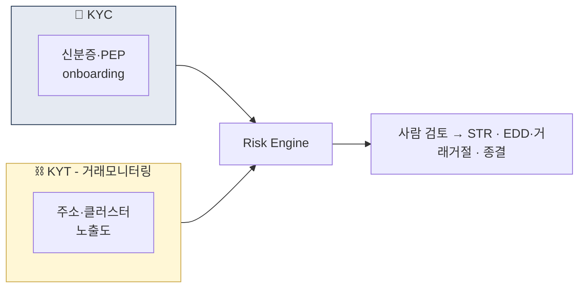
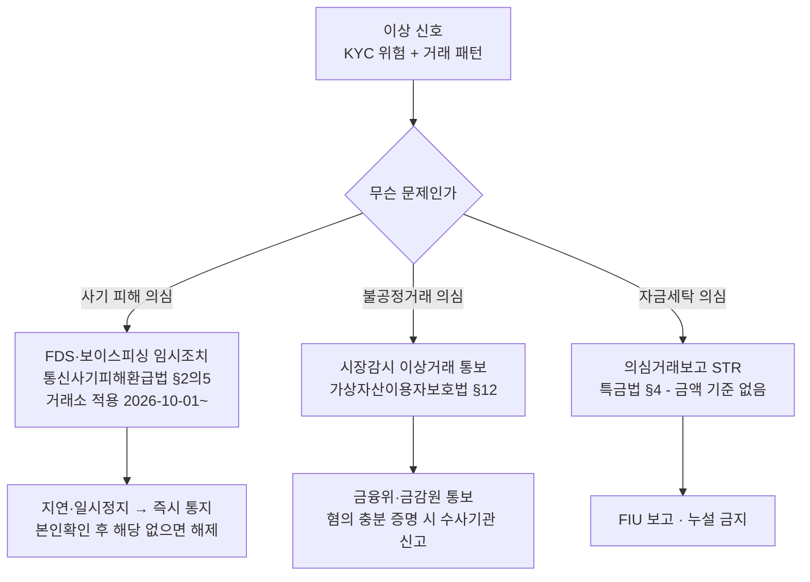
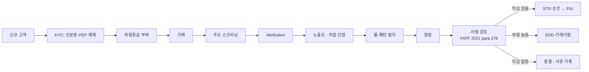

# Day 29 — KYC vs KYT 운영

> 사람을 안다 vs 거래/지갑을 안다. ⏱️ ~70분. 마지막 업데이트: 2026-10-21.

## 📖 오늘 뭘 배우나

Week 5 는 온체인 분석 주간. 먼저 **KYC(사람)와 KYT(거래·지갑)** 가 상호 보완적임을 확실히 하고, 거래모니터링 흐름(주소 스크리닝 → 노출도 → 룰 → 알람 → 사람 검토 → 케이스)을 이해합니다. 한 가지 주의 — **"KYT"는 규제 용어가 아닙니다.** FATF 7차 Targeted Update·2021 RBA 가이던스·MAS PSN02 의 언어는 "transaction(s) monitoring", "blockchain analytics (tools)", "wallet screening" 이고, 한국 「자금세탁방지 업무규정」은 **"거래모니터링체계"(제76~81조)** 라고 씁니다([`../notes/4-technology/kyc-kyt.md`](../notes/4-technology/kyc-kyt.md)). 그리고 한국에서 "이상" 신호는 **세 개의 법적 출구**(FDS 임시조치 / 시장감시 통보 / STR)로 갈라집니다.

<!-- MAP-START -->
## 🗺 오늘의 지도

<!-- MAP-END -->

## 🎯 핵심 질문
1. KYC 와 KYT 차이 핵심 5가지?
2. KYC 5단계 + 거래모니터링 단계 흐름은?
3. 한국에서 "이상거래" 신호가 갈라지는 세 법적 출구는?

## 📖 읽기 (~50분)
- 메인: [`../notes/4-technology/kyc-kyt.md`](../notes/4-technology/kyc-kyt.md)

## 🛠️ 미니 챌린지 (~15분)
- "온보딩 → 거래 → 알람 → 사람 검토 → STR/EDD/종결" 전체 흐름을 한 그림에 (KYC + KYT 통합)
- 같은 그림에 FDS 임시조치(통신사기피해환급법)와 시장감시 통보(이용자보호법 §12) 출구를 따로 그리기

## ✅ 체크포인트
- [ ] KYC vs KYT 즉답 가능
- [ ] KYC 5단계 (Onboarding / Verification / Screening / Assessment / Ongoing Monitoring) 외운다
- [ ] 거래모니터링 단계 (Address Discovery / Attribution / Exposure / 패턴 탐지 / Decision) 안다
- [ ] "KYT" 가 규제 용어가 아니고 한국 근거가 업무규정 제76~81조임을 안다
- [ ] Alert Fatigue 개념 안다

## 💭 오늘의 한 줄

## 🚦 한국의 세 출구 — "이상" 신호는 어디로 가나

근거: [`../notes/2-regulations/korea-user-protection.md`](../notes/2-regulations/korea-user-protection.md) 4절 · [`../notes/4-technology/kyc-kyt.md`](../notes/4-technology/kyc-kyt.md) §8.

## 💼 실무 현장 (Industry Reality)

### 조직 구성

KYC(온보딩)와 거래모니터링(거래 중 탐지)은 보는 대상이 달라 역할을 나눠 설계하는 경우가 많습니다. 다만 **STR 은 둘의 교차점** — KYC 위험 + 거래 패턴을 결합해야 narrative 가 설득력이 있습니다. 한국 업무규정은 분석담당자·FIU 보고·정보화(제79조), 분석자료 5년 이상 보존(제80조), 보고체제(제81조)를 요구합니다.

이전 판의 거래소별 팀 인원(3~8명·4~10명), 해외 거래소별 조직 구조, "KYC SaaS 1위", "본인확인기관 3개사 독점", 거래소별 자체 구축 여부는 공개 1차 근거가 없어 삭제했습니다. 한국 특화의 핵심은 **본인확인기관 연동**이고, 글로벌 KYC 도구가 이를 대신하지는 못하므로 실무 구성은 "글로벌 도구 + 국내 본인확인" 조합이 됩니다.

### KYC + 거래모니터링 통합 플로우

FATF 2021 para 275~276: "automated systems may be the only realistic method of monitoring transactions, and flagged transactions should go through human/expert analysis"([FATF 2021 RBA 가이던스](https://www.fatf-gafi.org/content/dam/fatf-gafi/guidance/Updated-Guidance-VA-VASP.pdf.coredownload.pdf)).

### Alert Fatigue — 공개 벤치마크가 없다

- 알람→SAR 전환율의 공개 벤치마크는 은행권 EY 2018 EMEIA 조사(리테일 평균 14%)뿐이고, **가상자산 전용 alert-to-STR 벤치마크는 존재하지 않습니다**(B)([EY 2018](https://ey.com/content/dam/ey-unified-site/ey-com/en-uk/industries/financial-services/documents/ey-anti-money-laundering-transaction-monitoring-2018-emeia-survey.pdf))
- 흔히 인용되는 "오탐 90~95%" 는 정의가 통일되지 않은 2차 수치입니다
- 이전 판의 "한국 VASP 평균 FP 70~90%", "일일 Alert 50~150건", "Alert 당 처리시간", "Coinbase Lynx·Elliptic Holistic" 은 출처가 없어 삭제했습니다
- 대응: FATF 2021 para 276 이 요구하는 **운영 룰 무결성 정기 검증** + 자동 처리 범위와 사람 승인 지점을 정책에 명시

### 자주 나오는 오해

- **"KYC 철저하면 KYT 안 해도 된다"** — KYC 는 입구, 거래모니터링은 거래 중 탐지. 둘 다 필요합니다
- **"알람 많으면 안전하다"** — FP 폭증은 **Alert Fatigue** 로 진짜 의심거래를 놓치는 원인. 품질 중심이 원칙
- **"의심되면 차단부터"** — AML 의 산출물은 STR·EDD·거래거절입니다. 자산을 묶는 조치는 별도 법적 요건(통신사기피해환급법 임시조치, 이용자보호법 §11 입출금 차단 제한)을 따릅니다
- **"이상거래 = STR"** — "이상거래"는 이용자보호법 §12(시장감시)의 용어이고, STR 은 특금법 §4 의 "의심되는 거래" 입니다
