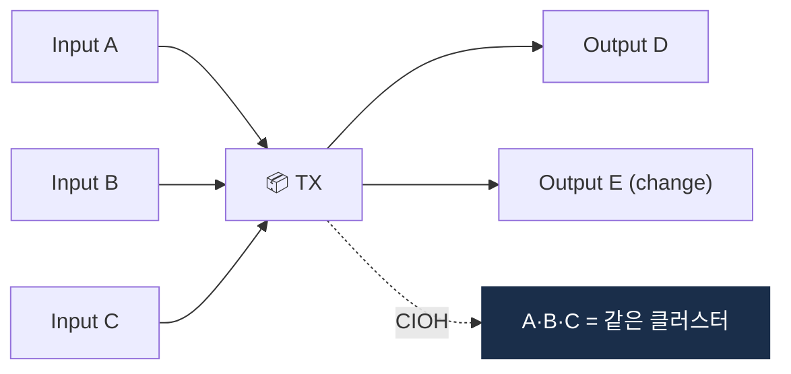
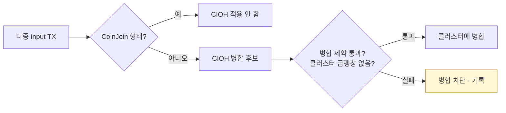

# Day 30 — UTXO + Common Input Ownership Heuristic

> 비트코인 분석의 가장 중요한 휴리스틱. ⏱️ ~80분. 마지막 업데이트: 2026-10-21.

## 📖 오늘 뭘 배우나

비트코인이 계좌가 아닌 **"돈봉투(UTXO)" 모음**으로 작동하는 구조, 그리고 이 구조에서 자연스럽게 도출되는 **Common Input Ownership Heuristic(CIOH)** 를 이해합니다. "한 트랜잭션의 여러 input은 같은 사람이 통제한다"는 단순한 논리가 왜 Bitcoin 주소 클러스터링의 출발점이 됐는지, CoinJoin이 어떻게 이를 깨는지, 그리고 이 휴리스틱의 "정확도 수치"가 왜 존재하지 않는지까지.


<!-- MAP-START -->
## 🗺 오늘의 지도


<!-- MAP-END -->

## 🎯 핵심 질문
1. UTXO 모델이 뭔가? (vs Account 모델)
2. Common Input Ownership 휴리스틱의 논리?
3. CoinJoin이 이 휴리스틱을 무력화하는 방식?

## 🧮 핵심 알고리즘 (구현 가능 수준)

### Common Input Ownership Heuristic (CIOH)

```python
def common_input_ownership(tx: Transaction) -> set[Address] | None:
    if len(tx.inputs) < 2:
        return None
    if is_coinjoin(tx):
        return None
    return {inp.address for inp in tx.inputs}
```

**전제**: Bitcoin UTXO 모델에서 여러 input을 한 tx에 소비하려면 각 input 의 서명 키가 필요 → "동일 소유자" 가정 (Meiklejohn 2013). 가정일 뿐 증명이 아닙니다.

**한계**:
- Ethereum Account 모델에 적용 불가 (from 주소 1개)
- CoinJoin 의도적 합치기 시 가정 위반
- Custodial 거래소 hot wallet은 거래소=entity로 맞지만 고객까지는 아님

### CoinJoin Fingerprint Detection (필수 전처리)

```python
def is_coinjoin(tx: Transaction) -> bool:
    if len(tx.inputs) < 2:
        return False
    amounts = [o.value for o in tx.outputs]
    uniform = [a for a in amounts if amounts.count(a) >= 3]
    if not uniform:
        return False
    # 지갑별 고정 denomination — 값은 지갑·버전마다 다르다.
    # 각 지갑의 공개 문서로 확인한 뒤 채울 것 (이 저장소가 검증하지 않은 자리표시자)
    KNOWN_DENOMS: set[int] = load_wallet_denominations()
    if any(a in KNOWN_DENOMS for a in uniform):
        return True
    # Input/Output 수가 대칭인 구조
    if len(tx.inputs) >= 5 and len(tx.outputs) >= 5 and abs(len(tx.inputs) - len(tx.outputs)) <= 1:
        return True
    return False
```

### 정확도 수치를 찾지 마세요 — 없습니다

> ⚠️ **2026-08-04 정정.** 이 자리에 CIOH·Fingerprint의 Precision/Recall/F1 비교표가 있었고 Möser 2017·Bellei 2024를 출처로 달았습니다. **두 논문 모두 그 수치를 담고 있지 않습니다.** 원논문을 받아 확인한 결과입니다.
> - Bellei 2024(Elliptic2)는 `common input`·`multi-input`·`CIOH` 언급이 **0회**입니다. 자금세탁 탐지 GNN 논문이지 주소 클러스터링 논문이 아닙니다.
> - Möser & Narayanan은 주제는 맞지만(multi-input 13회·fingerprint 12회) 그 수치가 **하나도 없고**, 2017년이 아니라 2021/22년 논문입니다. 저장소가 "Möser 2017"로 적은 것은 별개 논문(*Anonymous Alone?*, 믹서 측정)입니다.
>
> 같은 표의 **GCN/GAT 행(0.92~0.94 / 0.83~0.86 / 0.87~0.90)도 틀렸습니다.** Weber et al. 2019([arXiv 1908.02591](https://arxiv.org/abs/1908.02591)) Table 1·2의 실제 illicit 클래스 수치는 아래와 같습니다 — 세 지표 전부 부풀려져 있었습니다.
>
> 판정 근거는 [`kb/facts/contradictions.jsonl`](../kb/facts/contradictions.jsonl) `CTR:00007`.

### Elliptic 데이터셋 실제 성능 (Weber et al. 2019, illicit 클래스)

| 방법 | Precision | Recall | F1 |
|---|---|---|---|
| **RandomForest** (전체 피처 + 노드 임베딩, AF+NE) | **0.971** | **0.675** | **0.796** |
| RandomForest (전체 피처, AF) | 0.956 | 0.670 | 0.788 |
| EvolveGCN | 0.850 | 0.624 | 0.720 |
| Skip-GCN | 0.812 | 0.623 | 0.705 |
| GCN | 0.812 | 0.512 | 0.628 |
| MLP (AF) | 0.694 | 0.617 | 0.653 |
| Logistic Regression (AF) | 0.404 | 0.593 | 0.481 |

> 출처: RF(AF+NE)·GCN·Skip-GCN F1·LR F1 은 `research/2026-10-academic-literature.md` P-061(본문 수치, 확신도 B), RF(AF)·EvolveGCN·Skip-GCN P/R 은 `kb/facts/2026-08.jsonl` FACT:0000035(2026-08-04 원문 대조). MLP·LR 행은 2026-08-04 arXiv 1908.02591 Table 1 과 직접 대조한 값이다(커밋 7ca25ab). 2026-10-21 정정: 최고 행을 RF(AF)가 아니라 RF(AF+NE)로 바로잡았습니다.

**주목할 점: 이 논문에서 가장 좋은 모델은 GNN이 아니라 RandomForest입니다.** GCN이 만든 노드 임베딩을 피처로 더한 RF(AF+NE)가 최고였습니다. 그래프 정보가 도움이 된다는 것과 "GNN이 최고 성능"은 다른 이야기입니다. 삭제된 표는 GNN 우위를 암시하고 있었는데 논문은 그렇게 말하지 않습니다.

또 하나 — 논문의 핵심 관찰은 성능 수치가 아니라 **다크마켓 폐쇄 이후 모든 모델의 성능이 무너졌다**는 것입니다. 학습 시점 이후 생태계가 바뀌면 모델이 따라가지 못한다는 뜻이고, 이게 실무에서 훨씬 중요한 함의입니다.

학계의 실제 입장은 정반대입니다. Möser & Narayanan은 초록에서 이렇게 씁니다.

> *"current techniques rely on heuristics that **have not been rigorously evaluated or optimized**"*

즉 **표준화된 정확도 수치 자체가 존재하지 않습니다.** 데이터셋·시기·지갑 소프트웨어 구성에 따라 결과가 달라지기 때문입니다.

### 그래서 무엇을 봐야 하나 — Cluster Collapse

이 논문의 기여는 (1) 거스름돈 식별의 **ground truth 집합 구축**, (2) 낮은 오탐률을 목표로 한 예측 모델, (3) **클러스터 붕괴 탐지·예방**입니다.

붕괴가 실무 급소입니다. 휴리스틱이 한 번 잘못 병합하면 무관한 엔티티가 한 클러스터로 뭉치고, 그 위에 올린 위험 점수·노출도가 통째로 오염됩니다. 되돌리기도 어렵습니다.



**벤더 PoC 질문을 바꾸세요.** "정확도 몇 %인가"가 아니라 —
- 클러스터 붕괴를 어떻게 탐지하는가
- 붕괴가 발견되면 과거 판정을 어떻게 되돌리는가
- ground truth는 무엇으로 잡았고 언제 기준인가

**핵심 참고**: Meiklejohn 2013 "A Fistful of Bitcoins" · Möser & Narayanan 2022 "Resurrecting Address Clustering in Bitcoin" ([arXiv 2107.05749](https://arxiv.org/abs/2107.05749)) · Bellei 2024 "The Shape of Money Laundering" (Elliptic2, [arXiv 2404.19109](https://arxiv.org/abs/2404.19109) — 자금세탁 **탐지** GNN이지 클러스터링 논문 아님)

**심화**: [`../notes/4-technology/blockchain-analytics.md`](../notes/4-technology/blockchain-analytics.md) §2 참조.

## 📖 읽기 (~50분)
- 메인: [`../notes/4-technology/blockchain-analytics.md`](../notes/4-technology/blockchain-analytics.md) — 1~2절

## 🌐 외부 자료 (~20분)
- [Heuristic-Based Address Clustering in Bitcoin (논문)](https://www.researchgate.net/publication/347083664_Heuristic-Based_Address_Clustering_in_Bitcoin)
- [Elementus — Data Science Heuristics](https://www.elementus.io/blog-post/decoding-the-chain-how-data-science-based-heuristics-reveal-blockchain-networks)

## 🛠️ 미니 챌린지 (~10분)
- 트랜잭션 1개에 input 3개 (A, B, C) → output 2개 (D, E) 예시 그리기
- Common Input Ownership 적용 → 어느 주소들이 같은 클러스터?
- CoinJoin 시나리오를 추가하면 어떻게 깨지는지 메모

## ✅ 체크포인트
- [ ] UTXO 모델 이해
- [ ] Common Input Ownership 직접 설명 가능
- [ ] CoinJoin이 무력화하는 이유 안다
- [ ] 비트코인이 ETH보다 클러스터링이 강한 이유 안다

## 💭 오늘의 한 줄

## 💼 실무 현장 (Industry Reality)

> 2026-10-21 정리: 이전 판의 특정 거래소 SOC팀의 해킹 추적 사례, 벤더별 클러스터 DB 규모·정확도 비교, 특정 거래소 자체 엔진, "CoinJoin 등장 후 정확도 ~85~95%", 국내 VASP의 지갑별 자동 차단 정책 표준, 믹서 서비스 기소·중단 연도 서술은 이 저장소의 근거 자료에서 확인되지 않아 삭제했습니다.

### 실무에서 클러스터링을 다루는 방식

대부분의 VASP AML팀은 클러스터링을 직접 연산하지 않고, 외부 분석 도구가 돌려주는 "이 주소가 어느 엔티티 소속인가"를 조회합니다. 그래서 실무자에게 필요한 것은 알고리즘 구현보다 **결과를 의심하는 질문**입니다.

- 이 클러스터는 어떤 휴리스틱으로 묶였나 (CIOH만인가, 거스름 휴리스틱도 썼나)
- 병합 제약이 있나 — 제약 없는 병합은 무관한 엔티티를 한 클러스터로 뭉치게 합니다(Möser & Narayanan의 Mt.Gox 사례, 확신도 B)
- 라벨의 출처와 기준 시점은 언제인가

FATF 2021 RBA 가이던스 para 234는 분석 도구에 "cost consideration"이 있고 "not all VAs are covered by all vendors"라고 적었습니다([FATF 2021](https://www.onpcsb.ro/2022/01042022/Updated-Guidance-VA-VASP.pdf)).

### CIOH + 보조 휴리스틱

Bitcoin address clustering은 CIOH만으로 부족 → 조합 사용:

- **CIOH (Common Input Ownership)**: 한 TX의 여러 input = 같은 주인
- **Change Address Heuristic**: TX output 중 거스름으로 보이는 출력을 같은 주인으로 (개별 휴리스틱 TPR 대체로 10~30%, 확신도 B)
- **Consolidation Heuristic**: 여러 주소에서 하나로 모으는 패턴
- **Peel Chain Heuristic**: 긴 체인에서 일정하게 빠져나가는 출력 패턴

### CIOH 깨는 방법 (CoinJoin·PayJoin)

- **CoinJoin** (Wasabi·Samourai·JoinMarket): 여러 사용자의 input을 한 TX로 합침 → CIOH 가정 깨짐
- **PayJoin (BIP 78)**: 수신자도 input을 추가 → CIOH가 수신자까지 같은 주인으로 오판
- **Lightning Network**: 채널 개설·종료 TX만 온체인에 보이고 내부 경로는 숨겨짐

### 실무 SQL 예시 (Postgres 기반 자체 클러스터링)

```sql
-- Step 1: 같은 TX의 input 주소 쌍 추출
WITH co_inputs AS (
  SELECT i1.address AS a1, i2.address AS a2
  FROM tx_inputs i1
  JOIN tx_inputs i2 ON i1.tx_hash = i2.tx_hash
  WHERE i1.address < i2.address
)
-- Step 2: Union-Find로 cluster 생성 (recursive CTE)
SELECT cluster_id, array_agg(address) AS addresses
FROM address_clusters
GROUP BY cluster_id;
```

대용량에서는 분산 그래프 처리 엔진이 필요합니다. 이 SQL에는 CoinJoin 필터와 병합 제약이 없으므로 그대로 쓰면 클러스터 붕괴가 납니다 — 학습용입니다.

### UTXO vs Account 모델 클러스터링

- **Bitcoin (UTXO)**: CIOH·거스름 휴리스틱이라는 구조 신호가 있음
- **Ethereum (Account)**: CIOH 불가, 행동 기반 클러스터링(거래 패턴·시간·가스비 지불 주소)과 라벨 데이터 의존이 큼

### 자주 나오는 오해

- **"CIOH 정확도는 몇 %다"** — 표준화된 수치는 없습니다. Möser & Narayanan: "current techniques rely on heuristics that have not been rigorously evaluated or optimized."
- **"Ethereum도 CIOH 적용"** — Account 모델이라 input 개념 자체가 다릅니다. 별도 휴리스틱이 필요합니다.
- **"Elliptic 논문은 GNN이 최고라고 했다"** — 최고는 RandomForest(AF+NE)였고, 다크마켓 폐쇄 이후 모든 모델이 무너졌습니다.
