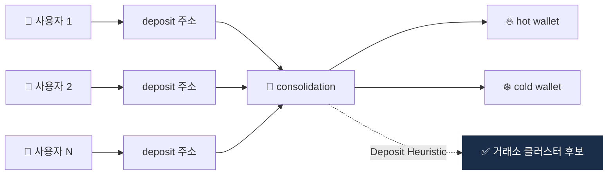
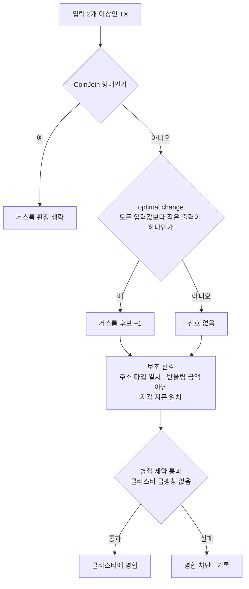

# Day 31 — Change Detection + Deposit Heuristic

> 거스름돈 식별 + 거래소 입금 패턴. ⏱️ ~70분. 마지막 업데이트: 2026-10-21.

## 📖 오늘 뭘 배우나

CIOH 다음으로 중요한 두 휴리스틱. **Change Detection** 은 거스름돈 출력을 원 소유자와 같은 클러스터로 묶고, **Deposit Heuristic** 은 거래소의 입금 주소 → consolidation 흐름으로 거래소 주소 체계를 드러냅니다. 둘 다 **단독으로는 약한 신호**입니다 — Möser & Narayanan(2022) 기준 개별 거스름 휴리스틱은 대체로 TPR 10~30% 수준이라 결합해서 씁니다(B), 그리고 Deposit Heuristic 의 정밀도를 공개 ground truth 로 평가한 2025~2026 논문은 확인되지 않았습니다([`../notes/4-technology/blockchain-analytics.md`](../notes/4-technology/blockchain-analytics.md) §2).


<!-- MAP-START -->
## 🗺 오늘의 지도


<!-- MAP-END -->

## 🎯 핵심 질문
1. 비트코인 거스름돈 출력은 어떻게 식별? ("optimal change" 정의)
2. Deposit Heuristic 이 거래소 attribution 의 핵심인 이유?
3. 두 휴리스틱의 정확도 한계 — 공개 수치는 무엇이 있고 무엇이 없나?

## 🔍 거스름 판정 흐름 (휴리스틱 결합)



근거: [`../notes/4-technology/blockchain-analytics.md`](../notes/4-technology/blockchain-analytics.md) §2-B · Möser & Narayanan 2022 ([arXiv 2107.05749](https://arxiv.org/abs/2107.05749)).

## 📖 읽기 (~50분)
- 메인: [`../notes/4-technology/blockchain-analytics.md`](../notes/4-technology/blockchain-analytics.md) — 2절 (B, C)

## 🛠️ 미니 챌린지 (~15분)
- 거래소 deposit 흐름 예시 그리기:
  - 사용자 100명 → 각자 deposit 주소 → consolidation 주소 → cold/hot wallet
- 분석가 관점에서 어떻게 거래소 클러스터를 식별하는지 단계 정리
- 위 거스름 판정 흐름에 예시 TX 3개를 넣어 결과 기록

## ✅ 체크포인트
- [ ] Change Detection 휴리스틱 ("optimal change", 주소 타입, 반올림 금액, 지갑 지문) 안다
- [ ] Deposit Heuristic 안다
- [ ] Consolidation 흐름이 거래소 주소 체계를 드러내는 이유 안다
- [ ] 휴리스틱 한계 (단독 TPR 10~30%, Deposit 정밀도 공개 평가 없음) 인지

## 💭 오늘의 한 줄

## 💼 실무 현장 (Industry Reality)

### 거래소 쪽에서 보면

거래소는 고객별로 입금 주소를 발급하므로 **자체 입금 주소 ↔ 사용자 매핑 테이블** 을 이미 갖고 있습니다. 이건 휴리스틱 추정이 아니라 내부 원장 사실이므로, 자사 주소에 관해서는 외부 휴리스틱보다 정확합니다. 외부 분석 도구가 돌려주는 라벨은 다른 엔티티 주소를 볼 때 쓰는 것이고, 그 라벨이 어떤 휴리스틱으로 만들어졌는지 질문할 수 있어야 합니다.

이전 판의 "한국 거래소는 자체 휴리스틱을 거의 돌리지 않는다", "자체 구현 시 연간 수십억원", "거래소가 벤더에 자사 주소를 역제공", "Chainalysis 2023~2025 ML 전환 공개", "TRM cross-chain 차별점", "Coinbase Lynx GNN" 은 공개 1차 근거가 없어 삭제했습니다.

### 실제 클러스터링 SQL (학습용)

```sql
-- 같은 tx 의 입력 주소 묶음 + "optimal change" 후보 탐지
WITH tx_inputs AS (
  SELECT tx_hash, ARRAY_AGG(DISTINCT address) AS input_addrs,
         MIN(value) AS min_input_value, COUNT(*) AS n_inputs
  FROM btc_vin GROUP BY tx_hash
),
tx_outputs AS (
  SELECT tx_hash, address, value FROM btc_vout
)
SELECT i.input_addrs, o.address AS change_candidate
FROM tx_inputs i
JOIN tx_outputs o ON i.tx_hash = o.tx_hash
WHERE i.n_inputs >= 2
  AND o.value < i.min_input_value          -- 모든 입력값보다 작은 출력
  AND NOT EXISTS (SELECT 1 FROM known_exchange_addrs k WHERE k.address = o.address);
-- 출력이 여러 개 걸리면 판정 보류 / CoinJoin 필터·병합 제약 없이 쓰면 클러스터 붕괴
```

이전 판의 "두 번째로 큰 output = change" 규칙은 근거가 없어 "optimal change" 정의로 바꿨습니다.

### 자주 나오는 오해

- **"Change 휴리스틱 정확도 60~80%"** — 출처가 없습니다. 개별 휴리스틱은 대체로 TPR 10~30%(B)라 단독으로 쓰지 않습니다
- **"CIOH 는 비트코인에만 적용"** — 맞습니다. Ethereum 같은 계정 모델에는 직접 적용할 수 없고, funding relationship·가스 지불 주소·ENS 같은 다른 패턴과 라벨 데이터에 더 의존합니다. 체인별 정확도를 비교한 공개 벤치마크는 없습니다
