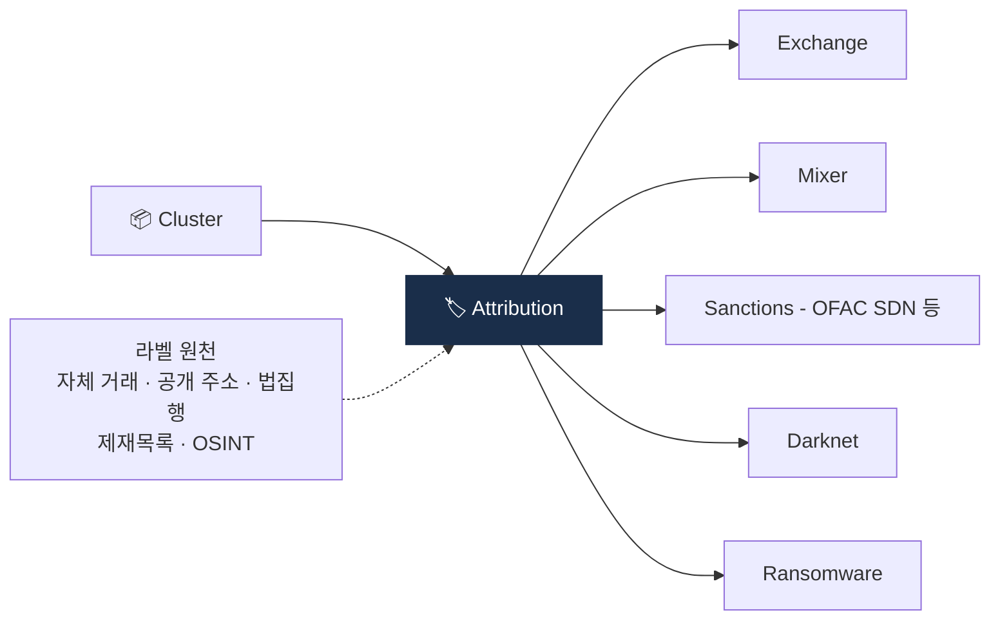
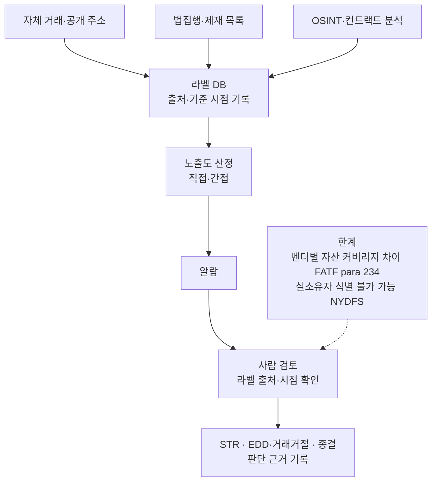

# Day 32 — Address Attribution + 라벨 DB

> 클러스터 → 알려진 엔티티 매핑. ⏱️ ~75분. 마지막 업데이트: 2026-10-21.

## 📖 오늘 뭘 배우나

Clustering 이 "구조"라면 Attribution 은 "정체성". 클러스터가 거래소인지 믹서인지 제재 대상인지 **라벨링**하는 작업이고, Attribution 은 알고리즘이 아니라 **데이터 누적**의 문제입니다. 라벨 데이터는 각 회사가 따로 쌓고 공개하지 않으므로, 벤더별 지역·분야 강점을 비교한 공개 평가는 확인되지 않습니다([`../notes/4-technology/blockchain-analytics.md`](../notes/4-technology/blockchain-analytics.md) §3). 오늘은 라벨의 출처와 한계, 그리고 벤더를 우열이 아니라 **PoC 에서 직접 재는 항목**으로 판단하는 법을 세웁니다.


<!-- MAP-START -->
## 🗺 오늘의 지도


<!-- MAP-END -->

## 🎯 핵심 질문
1. Attribution = Clustering + 무엇? (라벨 데이터)
2. 라벨 DB 의 데이터 소스는?
3. 감독기관은 분석 도구의 한계를 어떻게 적고 있나? (FATF para 234, NYDFS 2022-04-28)

## 🏷 라벨이 판단에 쓰이기까지



근거: [FATF 2021 RBA 가이던스](https://www.fatf-gafi.org/content/dam/fatf-gafi/guidance/Updated-Guidance-VA-VASP.pdf.coredownload.pdf) para 234 · [NYDFS 2022-04-28](https://www.dfs.ny.gov/industry_guidance/industry_letters/il20220428_guidance_use_blockchain_analytics).

## 📖 읽기 (~50분)
- 메인: [`../notes/4-technology/blockchain-analytics.md`](../notes/4-technology/blockchain-analytics.md) — 3절
- 보조: [`../notes/7-vendors/analytics-vendors.md`](../notes/7-vendors/analytics-vendors.md) — 1~3절

## 🌐 외부 자료 (~15분)
- [NYDFS 산업서한 — 블록체인 분석 활용 (2022-04-28)](https://www.dfs.ny.gov/industry_guidance/industry_letters/il20220428_guidance_use_blockchain_analytics)

## 🛠️ 미니 챌린지 (~10분)
- 라벨 카테고리 (Exchange / DEX / Mixer / Sanctions / Stolen Funds / Ransomware / Darknet Market / Scam / Gambling / ...) 다시 외우기
- 자사가 아는 주소(자사 입금 주소 등)로 외부 라벨이 맞는지 검증하는 방법 1가지

## ✅ 체크포인트
- [ ] Clustering vs Attribution 구분
- [ ] 라벨 DB 데이터 소스 (자체 거래·공개 정보·다크넷 관찰·법집행·제재 목록·컨트랙트 분석·OSINT) 안다
- [ ] 벤더별 강점 서열에는 공개 근거가 없다는 점을 안다
- [ ] 라벨은 출처·기준 시점과 함께 기록해야 함을 안다

## 💭 오늘의 한 줄

## 💼 실무 현장 (Industry Reality)

### 1차 문서로 확인되는 벤더 사실 (적다)

| 사실 | 출처 |
|---|---|
| FATF 7차 TU(2026-07-16) MIVA 표 검증에 "blockchain analytics companies' data" 사용(Chainalysis·TRM Labs) — 단, 그 데이터가 관할의 불법금융 위험평가에 기반한 것은 아니라는 단서 | [7차 TU PDF](https://www.fatf-gafi.org/content/dam/fatf-gafi/reports/7th-targeted-update-on-implementation-fatf-standards-vas-vasps-2026.pdf.coredownload.pdf) |
| FATF 6차 TU(2025-06-26) 데이터 제공: Chainalysis, Lukka, Merkle Science, TRM Labs | [6차 TU](https://www.fatf-gafi.org/content/dam/fatf-gafi/recommendations/2025-Targeted-Upate-VA-VASPs.pdf.coredownload.pdf) |
| 한국 FIU 2026 업무계획(2026-02-05)의 "체이널리시스(가상자산 분석도구) 도입" — **FIU 자체 도입 계획**이며 거래소 채택과는 별개 | [금융위 2026-02-05](https://fsc.go.kr/no010101/86209) |

벤더가 공개한 커버리지·라벨 주소 수·노출도 홉 정의·고객 수는 모두 자사 주장이고 정의가 달라 비교할 수 없습니다. 이전 판의 거래소별 벤더 조합, "자체 라벨 3~5만 건", "DAXA 공동 제재 주소 리스트 실시간 공유", 라이선스 가격($150K~$500K), "점유율 80%+", 벤더별 지역 강점, "벤더 불일치 5~15%", 특정 해킹 추적 속도 비교는 공개 근거가 없어 삭제했습니다([`../notes/7-vendors/analytics-vendors.md`](../notes/7-vendors/analytics-vendors.md)).

### 라벨 DB 구조 예시 (자체 보완용)

```json
{
  "address": "0xA1E4380A0B7E74E3B9B84a8B5b3D4f1D6e2c5a8f",
  "cluster_id": "cl_example_00482",
  "labels": [
    {"source": "vendor_a", "category": "exchange", "entity": "Exchange X",
     "vendor_score": 0.98, "as_of": "2026-10-20"},
    {"source": "internal", "category": "deposit", "customer_id": "uid_882311",
     "basis": "자사 입금주소 원장", "as_of": "2026-10-21"},
    {"source": "sanctions_list", "category": "sanctions", "list": "OFAC SDN",
     "listed_at": null}
  ],
  "last_refresh": "2026-10-21T03:00:00Z"
}
```

(가상의 예시입니다. 핵심은 라벨마다 **출처·기준 시점**을 남기는 것 — 벤더 점수는 정의가 공개되지 않았으므로 "벤더 점수" 로만 기록합니다.)

### AML Analyst 라벨 운영 루틴 (예시)

- **정기** — 제재 목록(OFAC SDN·UN·EU·한국) 변경분 확인 → 내부 차단 목록 동기화
- **정기** — 복수 출처 라벨이 엇갈린 케이스 표본 검토
- **정기** — FP 가 높았던 라벨의 원인 분석
- **분기** — 지원 자산별 커버리지 점검 (FATF para 234: "not all VAs are covered by all vendors")

주기·표본 수는 회사 위험평가로 정하고 근거를 남깁니다.

### 자주 나오는 오해

- **"분석 도구만 사면 된다"** — 감독기관이 보는 것은 "어느 벤더인가"가 아니라 **회사가 도구 출력을 어떻게 판단에 썼는가**입니다. 외주·자체 도구 모두 허용됩니다(NYDFS 2022-04-28)
- **"벤더 X 가 무조건 1위"** — 벤더 간 우열을 평가한 공개 근거는 없습니다. PoC 에서 자사 지원 자산·자사 상대방 주소로 직접 재야 합니다
