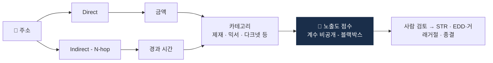
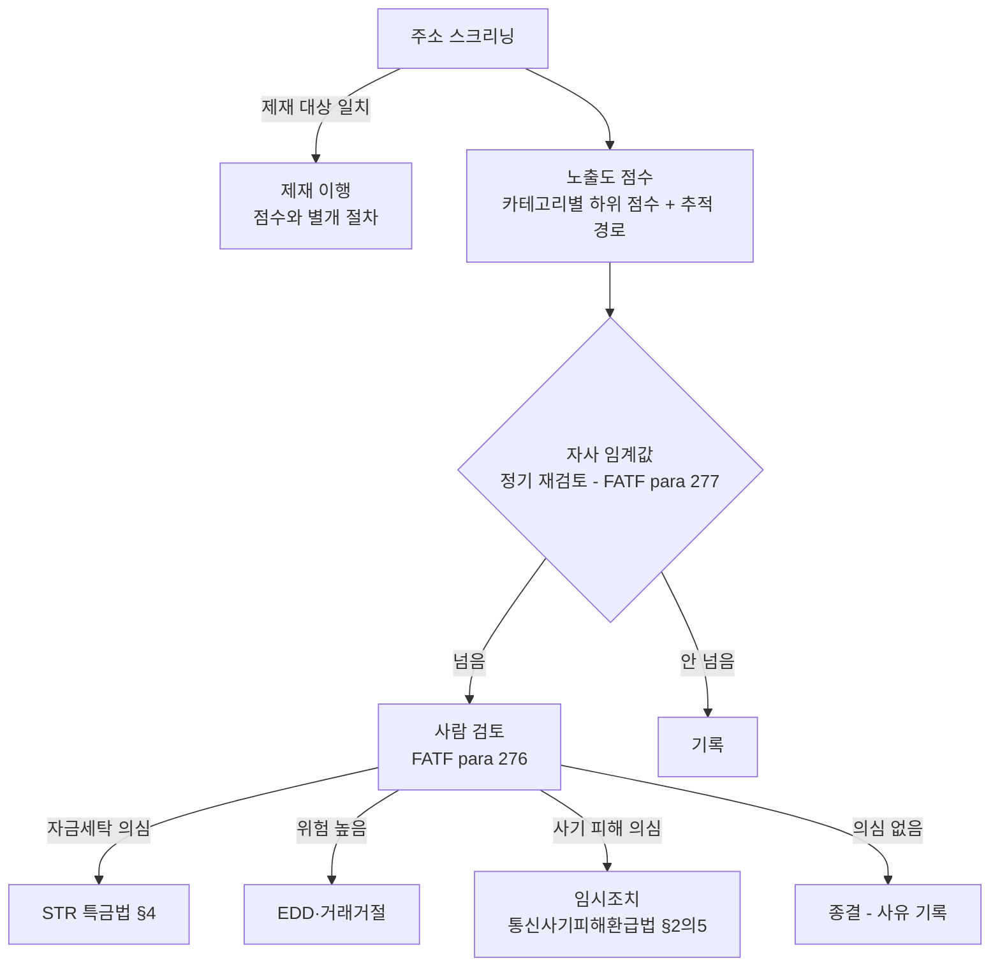

# Day 33 — Exposure Score (Direct vs N-hop)

> 위험 노출도 — 개념과 공개 근거의 한계. ⏱️ ~70분. 마지막 업데이트: 2026-10-21.

## 📖 오늘 뭘 배우나

Attribution 이 끝나면 **"이 주소가 위험 엔티티와 어떻게 연결돼 있나"** 를 정량화합니다. Direct(직접 거래) vs Indirect(중개 주소 경유) 노출, 금액·경과 시간·카테고리를 조합하는 구조를 이해합니다. 단, 두 가지를 먼저 못 박습니다:

1. **2026-10-21 기준 홉 수 상한·감쇠함수·카테고리 가중치를 공개한 벤더 자료는 확인되지 않았습니다.** 노출도 점수는 재현할 수 없는 블랙박스로 다뤄야 합니다(정본 보고서 부록 A-37). 이전 판의 가중치 표·벤더별 λ 표·"5-hop" 서술·계산 정답은 모두 근거가 없어 삭제했습니다.
2. **점수는 판단의 입력이지 자동 STR·자동 차단 스위치가 아닙니다.** FATF 2021 para 276 은 플래그된 거래의 "human/expert analysis" 를 요구합니다.

간접 노출을 보는 규범적 근거는 FATF 2021 para 277 — 고위험 상황의 강화 모니터링은 "extend beyond the immediate transaction" 이어야 하고 기준·임계값은 "reviewed on a regular basis" 여야 합니다([FATF 2021 RBA 가이던스](https://www.fatf-gafi.org/content/dam/fatf-gafi/guidance/Updated-Guidance-VA-VASP.pdf.coredownload.pdf)).


<!-- MAP-START -->
## 🗺 오늘의 지도


<!-- MAP-END -->

## 🎯 핵심 질문
1. Direct vs Indirect (N-hop) exposure 차이? 간접 노출을 보는 근거 문단은?
2. 노출도 구조의 입력 요소 4가지? (직접 비중·간접 비중·경과 시간·금액)
3. 점수 → 의사결정 흐름에서 사람 검토와 세 법적 출구는 어디에 오나?

## 🧮 Exposure 구조 (오늘의 핵심)

### 교육용 가설 구조 — 계수는 일부러 비워 둔다

```
# 어떤 벤더의 공식도 아니며 계수는 정의하지 않는다
exposure(addr) = Σ_category  f( 직접 노출 비중, 간접 노출 비중, 경과 시간, 금액 )
```

| 요소 | 무엇을 정해야 하나 | 공개 근거 |
|---|---|---|
| 카테고리 가중 | 제재·믹서·다크넷·랜섬웨어 등을 어떻게 차등할지 | 없음 — 자사 위험평가로 정하고 문서화 |
| 홉 깊이 | 간접 노출을 몇 단계까지 볼지 | 없음 — 깊을수록 무관한 주소가 섞임 |
| 시간 감쇠 | 오래된 노출을 얼마나 낮출지 | 없음 |
| 금액 | 금액이 클 때 민감도를 올릴지 | 없음 |
| 제재 대상 일치 | 점수와 무관하게 **제재 이행** 절차 | 제재 법령 |

### 점수 다음 단계 — 자동 STR 이 아니다



근거: [`../notes/4-technology/blockchain-analytics.md`](../notes/4-technology/blockchain-analytics.md) §4 · [`../notes/4-technology/kyc-kyt.md`](../notes/4-technology/kyc-kyt.md) §3·§8 · [업무규정 제76~81조(법제처)](https://www.law.go.kr/DRF/lawService.do?OC=test&target=admrul&ID=2100000267264&type=XML).

### 🛠️ 오늘의 미니 챌린지 (업그레이드)

**시나리오**: 고객 A, 5억원 출금 요청, 수신 0xABC...
- 직접 노출: 믹서 5%, 180일 전
- 2-hop 노출: 제재 대상 클러스터 8%, 365일 전
- 고객 위험등급: 저위험

1. **자사 정책으로** 카테고리 가중·홉 깊이·감쇠를 정하고 **각 선택의 근거를 한 줄씩** 적는다 (정답 계수는 없다)
2. 그 정책으로 점수를 계산한다
3. 결과가 임계값을 넘으면 어느 단계로 가는가? — 자동 차단이 아니라 **사람 검토**로 보내고, 검토 결과를 STR / EDD·거래거절 / 종결 중 하나로 기록
4. 2-hop 제재 노출은 "제재 대상 일치"와 다르다 — 왜 제재 이행 절차가 아니라 검토 대상인지 설명

**심화**: [`../notes/4-technology/blockchain-analytics.md`](../notes/4-technology/blockchain-analytics.md) §4 참조.

## 📖 읽기 (~50분)
- 메인: [`../notes/4-technology/blockchain-analytics.md`](../notes/4-technology/blockchain-analytics.md) — 4절
- 보조: [`../notes/4-technology/kyc-kyt.md`](../notes/4-technology/kyc-kyt.md) — 4절 (Exposure)

## 🛠️ 미니 챌린지 (~15분)
- 가상 주소 1개 시나리오를 직접 만들고 위 구조로 점수화 — 계수 선택 근거를 표로 남기기
- 같은 주소를 홉 깊이만 바꿔 다시 계산 → 깊이가 결과를 얼마나 흔드는지 메모

## ✅ 체크포인트
- [ ] Direct vs N-hop 차이 안다 (FATF para 277)
- [ ] 입력 요소 (카테고리 / 홉 / 시간 / 금액) 안다
- [ ] 벤더가 계수를 공개하지 않으므로 점수가 블랙박스라는 점 안다
- [ ] 점수 → 사람 검토 → STR / EDD·거래거절 / 임시조치 / 종결 흐름 안다

## 💭 오늘의 한 줄

## 💼 실무 현장 (Industry Reality)

### 벤더 점수를 쓰는 방식

벤더 점수는 그대로 결론이 될 수 없습니다 — 공식이 공개되지 않아 STR 작성 시 "왜 이 점수인가"를 설명하기 어렵기 때문입니다. 대응은 벤더에게 **카테고리별 하위 점수와 추적 경로**를 받아 사내 정책 언어로 다시 쓰는 것이고, FATF 2021 para 276 이 "operating rules" 를 이해하고 무결성을 정기 검증하라고 요구한다는 점이 근거가 됩니다.

이전 판의 "한국 VASP 의 Severe/mixer direct ≥5% 자동 차단 · 24h SLA", "FP 90% 넘으면 룰 완화", "해외 거래소의 KYC Tier 결합 사례", "Chainalysis 2024 Behavior Analytics", "TRM Risk Score 0~100 그대로 사용", "FP 70~90%", "direct + 2-hop 이 표준·벤더 기본값" 은 공개 근거가 없어 삭제했습니다.

### 룰 pseudocode (구조 예시 — 계수는 자사 정책값)

```
FUNCTION evaluate(address, tx, policy):
    if sanctions_list.match(address):
        return SANCTIONS_PROCEDURE               # 점수와 별개
    exp = analytics.get_exposure(address)        # 카테고리별 하위 점수 + 경로
    score = policy.combine(exp.direct, exp.indirect,
                           exp.age_days, tx.krw_amount)   # 계수는 policy 문서에
    if score >= policy.review_threshold:
        return QUEUE_FOR_HUMAN_REVIEW(evidence=exp.paths)
    return LOG_ONLY(score)

# 검토 결과는 STR / EDD·거래거절 / 임시조치 / 종결 중 하나로 기록하고 사유를 남긴다
# policy 의 임계값·계수는 정기 재검토 (FATF 2021 para 277)
```

### 자주 나오는 오해

- **"N-hop 을 깊게 볼수록 정확하다"** — 간접 노출을 깊이 따라갈수록 무관한 주소가 섞입니다. 깊이를 어디서 끊는지 공개된 표준은 없습니다
- **"점수 64점이면 BLOCK + STR 자동 발동"** — 틀린 연결입니다. 점수는 입력이고, 사람 검토를 거쳐 법적 출구가 정해집니다
- **"Threshold 는 한 번 정하면 끝"** — FATF para 277 은 기준·임계값을 "reviewed on a regular basis" 하라고 합니다. FP 를 줄이려다 FN(미탐)을 올리지 않도록 재검토 근거를 남기십시오
- **"노출도는 실시간이다"** — 노출도는 과거 라벨 기반이고, 새 라벨이 반영되기까지 지연이 있습니다(지연 기간을 측정한 공개 자료는 확인되지 않음)
