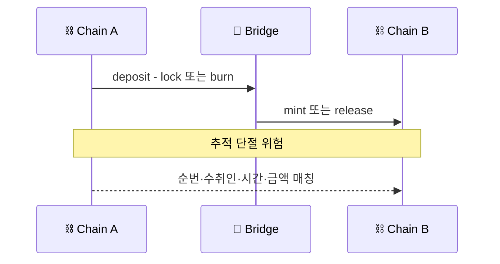
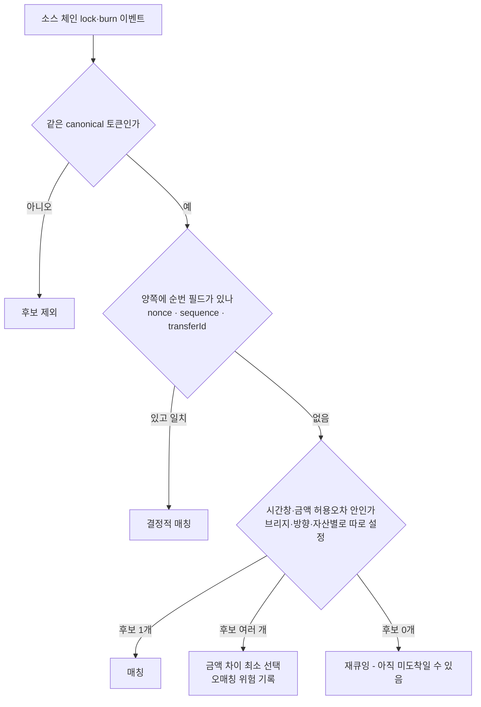

# Day 34 — Cross-chain Tracing + Bridge

> FATF 7차 TU 가 명시한 평가 항목 — 브리지·크로스체인 노출. ⏱️ ~75분. 마지막 업데이트: 2026-10-21.

## 📖 오늘 뭘 배우나

단일 체인 분석만으로는 체인을 건너는 자금 흐름을 놓칩니다. FATF 7차 Targeted Update(2026-07-16)는 VASP 에 "transactions monitoring and blockchain analytics tools" 로 급속 이전을 탐지하고 **프로토콜·브리지·믹서·크로스체인 도구에 대한 노출을 평가**하라고 권고했습니다([7차 TU PDF](https://www.fatf-gafi.org/content/dam/fatf-gafi/reports/7th-targeted-update-on-implementation-fatf-standards-vas-vasps-2026.pdf.coredownload.pdf)). 크로스체인 추적은 선택 기능이 아니라 위험평가 항목입니다. **Cross-chain tracing** 은 브리지 입출금 이벤트를 양쪽 체인에서 찾아 시간·금액·순번(nonce)으로 매칭하는 작업이고, 2025년 연구(ConneX)는 **브리지 양측 거래 쌍 매칭 실패가 자금 추적 실패의 주원인**이라고 문제를 정의했습니다([arXiv 2511.01393](https://arxiv.org/abs/2511.01393)).


<!-- MAP-START -->
## 🗺 오늘의 지도


<!-- MAP-END -->

## 🎯 핵심 질문
1. Cross-chain 추적이 왜 어려운가? (양측 거래 쌍 매칭)
2. Bridge 매칭에 쓰는 기준 4가지? (수취인·시간창·토큰·금액 + 순번)
3. LayerZero 같은 generic messaging 이 까다로운 이유?

## 🧮 Bridge Matching 알고리즘

### 매칭 판정 흐름



근거: [`../notes/4-technology/blockchain-analytics.md`](../notes/4-technology/blockchain-analytics.md) §5.

### 이벤트 매칭 pseudocode (교육용)

```python
def match_bridge(
    locks: list[LockEvent],
    mints: list[MintEvent],
    time_window: int,        # 초 — 브리지·방향별로 따로 정한다 (고정 기본값 없음)
    amount_tol: float,       # 수수료 차감 토큰은 별도 처리
) -> list[tuple]:
    matches = []
    for lock in locks:
        cands = [m for m in mints
                 if m.token_canonical == lock.token_canonical
                 and abs(m.ts - lock.ts) <= time_window
                 and abs(m.amount - lock.amount) / lock.amount <= amount_tol]
        # 순번(nonce) 우선 매칭 (결정적)
        if hasattr(lock, "nonce"):
            exact = [m for m in cands if getattr(m, "nonce", None) == lock.nonce]
            if exact:
                cands = exact[:1]
        if len(cands) == 1:
            matches.append((lock, cands[0]))
        elif cands:
            # 차선: 금액 차이 최소 — 오매칭 위험을 기록
            matches.append((lock, min(cands, key=lambda m: abs(m.amount - lock.amount))))
        # 0개: 목적지 체인에 아직 도착 안 함 — 재큐잉
    return matches
```

### Bridge 이벤트 구조 (참고 — 구현 전 컨트랙트 ABI 로 확인)

| 체인/브리지 | 이벤트 이름 | 순번 필드 |
|---|---|---|
| Polygon PoS | LockEvent | ✓ (depositCount) |
| Arbitrum | OutboundTransfer | ✓ (seqNumber) |
| Optimism | WithdrawalInitiated | ✓ (nonce) |
| Wormhole | LogMessagePublished | ✓ (sequence, nonce) |
| LayerZero | PacketSent | generic — payload 해석 필요 |
| Hop Protocol | TransferSentToL2 | transferId |

### 정확도 — 실측 연구 3건 (서로 비교 불가)

| 연구 | 대상 | 보고치 | 출처 |
|---|---|---|---|
| ABCTracer (Lin 외 2025) | 주류 브리지 12개 | 양방향 추적 F1 91.75% | [arXiv 2504.01822](https://arxiv.org/abs/2504.01822) |
| ConneX (Liang 외 2025) | 브리지 5개, 약 50만 건 | 평균 F1 0.9746 | [arXiv 2511.01393](https://arxiv.org/abs/2511.01393) |
| Yan·Huang·Tessone 2025 | Ethereum–Polygon, 2020-08-28~2023-08-28 | 입금 93.04~99.65%, 출금 67.55~92.78% (자산 유형별) (B) | [arXiv 2504.15449](https://arxiv.org/abs/2504.15449) |

브리지 집합·매칭 정의·지표가 연구마다 달라 숫자끼리 비교하면 안 됩니다. 세 번째 연구에서 출금 쪽 시간창(약 6.4일)은 입금(약 24분)의 약 380배였고 ERC20 출금(67.55%)이 가장 약했습니다(B) — **같은 브리지 안에서도 방향·자산 유형별로 신뢰도를 다르게** 둬야 합니다. 이전 판의 브리지별 "매칭 정확도 97~99% / LayerZero Generic 40~60%" 표, "time_window 300초·tolerance 0.5%" 기본값, "3-hop ≈ 0.90³ ≈ 0.73" 계산은 출처가 없어 삭제했습니다.

### 실패 케이스

| 시나리오 | 원인 | 대응 |
|---|---|---|
| LayerZero Generic Message | Payload 가 임의 bytes, 표준 금액 필드 없음 | DApp별 payload decoder |
| Fee-on-Transfer 토큰 | 전송 시 수수료 차감 → 금액 불일치 | 토큰별 허용오차 |
| Batched Bridge | 한 tx 에 여러 sender | 개별 사용자 추적 어려움 |
| 우연 매칭 | 같은 토큰·비슷한 금액이 시간창 안에 여럿 | 다중 조건 강화 |
| Failed Relay | 목적지 도착이 크게 지연 | 시간창 확장 |
| 유동성 풀 브리지 (THORChain·Across 등) | sender-receiver 가 1:1 로 연결되지 않음 | 별도 분석 |

### 🛠️ 오늘의 미니 챌린지 (업그레이드)

Etherscan API 2-hop tracer 에 **bridge event 인덱서 추가**:
1. Polygon PoS 이벤트 fetch (컨트랙트 ABI 로 이벤트명·필드 확인)
2. Ethereum side matching — 순번 필드 우선
3. 매칭 실패 케이스를 **브리지·방향·자산 유형별로** 로깅

**심화**: [`../notes/4-technology/blockchain-analytics.md`](../notes/4-technology/blockchain-analytics.md) §5 참조.

## 📖 읽기 (~50분)
- 메인: [`../notes/4-technology/blockchain-analytics.md`](../notes/4-technology/blockchain-analytics.md) — 5절
- 보조: [`../notes/3-crypto-aml/onchain-typology.md`](../notes/3-crypto-aml/onchain-typology.md) — 1절 C (Bridge)
- 보조: [`../notes/3-crypto-aml/defi-nft-risks.md`](../notes/3-crypto-aml/defi-nft-risks.md) — 4절 (Bridge)

## 🌐 외부 자료 (~15분)
- [Kumar & Thing 2025 — 원장 간 자산 이동 추적 서베이 (arXiv 2510.09624)](https://arxiv.org/abs/2510.09624)
- [FATF 7차 Targeted Update (2026-07-16)](https://www.fatf-gafi.org/content/dam/fatf-gafi/reports/7th-targeted-update-on-implementation-fatf-standards-vas-vasps-2026.pdf.coredownload.pdf)

## 🛠️ 미니 챌린지 (~10분)
- "BTC → ETH → USDT(Tron) 자금 이동" 시나리오의 분석 도전과제 3가지 적기
- 위 이벤트 표의 브리지 6개를 "순번 필드 있음 / generic / transferId" 로 분류

## ✅ 체크포인트
- [ ] 크로스체인 추적의 본질적 어려움(양측 거래 쌍 매칭) 안다
- [ ] Bridge indexing + 순번·시간·금액 매칭 방법 안다
- [ ] 실측 연구 3건의 수치가 서로 비교 불가한 이유 안다
- [ ] FATF 7차 TU 가 브리지·크로스체인 노출 평가를 권고했음을 안다

## 💭 오늘의 한 줄

## 💼 실무 현장 (Industry Reality)

### PoC 에서 직접 확인할 것

자사가 지원하는 체인 조합으로 실제 경로를 여러 개 만들어 복원 여부를 직접 확인하고, 결과를 **브리지·방향·자산 유형별로** 기록합니다. 단일 정확도 숫자로 요약하지 않는 것이 핵심입니다. 공통 ground truth 벤치마크는 2026-10-21 기준 없습니다.

이전 판의 "한국 거래소 wrapped 자산 입금 미지원 정책", "탐지 100% 벤더 의존", "TRM cross-chain 1위·OFAC 2023 공식 조달", "Chainalysis Crosschain Insights 인수", "Elliptic Holistic Screening 2024 런칭", 브리지 해킹 규모 목록(Ronin·Wormhole·Nomad·Multichain·Poly Network), "Poly Network 24시간 layering window", "DAXA 공유 채널" 은 이 저장소 근거 자료 범위 밖이거나 공개 근거가 없어 삭제했습니다(사례 범위는 [`../notes/6-cases/README.md`](../notes/6-cases/README.md) 참조).

### DeFi 의미 해석이 병목

AMLGuard 는 DeFi 거래를 "DeFi Semantic Unit" 으로 추상화해, 실제 세탁 사건 82건에서 목적지 정밀도 94.4%(단일체인)/87.6%(크로스체인)를 보고했습니다([arXiv 2607.18869](https://arxiv.org/abs/2607.18869)). 알려진 사건만 쓴 평가라 선택 편향이 있습니다.

### 자주 나오는 오해

- **"Bridge 는 추적 불가능"** — 대부분 브리지는 이벤트 로그가 공개돼 있어 추적할 수 있습니다. 어려운 건 generic messaging(임의 payload)과 유동성 풀 브리지입니다
- **"wrapped 토큰도 같은 주소로 간다"** — 체인 간 주소 체계가 다르면 수신자 주소가 바뀝니다. 순번·수취인·시간·금액 매칭이 링크입니다
- **"정확도 하나로 브리지를 평가"** — 같은 브리지에서도 입금과 출금, 자산 유형별 신뢰도가 크게 다릅니다(Yan·Huang·Tessone 2025, B)
