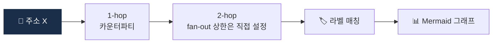
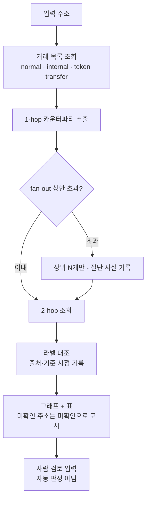

# Day 35 — 🛠️ 미니 프로젝트 2: Etherscan API 2-hop tracer + 5주 리뷰

> 직접 온체인 데이터 만져보기. ⏱️ ~150분. 마지막 업데이트: 2026-10-21.

## 📖 오늘 뭘 배우나

Week 5 의 결산. Etherscan(또는 Blockscout) API 로 **한 주소에서 2-hop 추적**을 직접 구현해보며, 지난 6일간 배운 Clustering·Attribution·Exposure 가 실제 공개 데이터에서 어떻게 나타나는지 체감합니다. 핵심 교훈은 Day 33 과 같습니다 — 간접 노출을 깊이 따라갈수록 무관한 주소가 섞이고, 깊이를 어디서 끊는지 공개된 표준은 없습니다([`../notes/4-technology/blockchain-analytics.md`](../notes/4-technology/blockchain-analytics.md) §4.4). 이 프로젝트의 결과물은 Capstone 의 Risk Engine 에 통합될 '온체인 분석 모듈'의 출발점입니다.


<!-- MAP-START -->
## 🗺 오늘의 지도


<!-- MAP-END -->

## 🎯 회고 질문
1. 클러스터링·Attribution·Exposure 중 가장 어려운 영역?
2. 자체 도구 vs 벤더 — 감독기관은 무엇을 허용하나? (NYDFS 2022-04-28: 외주·자체 모두 허용)
3. Cross-chain 추적 결과를 왜 브리지·방향·자산 유형별로 기록해야 하나?

## 🧭 Tracer 파이프라인



## 🛠️ 미니 프로젝트 2 (~120분)

### 목표
**Etherscan(또는 Blockscout) API 로 한 주소에서 2-hop trace + 결과 시각화**

### 사양
- 입력: Ethereum 주소 1개
- 출력:
  - 1-hop: 이 주소가 상호작용한 카운터파티 (주소 / 거래 수 / 합계 / 라벨 있으면 라벨+출처)
  - 2-hop: 1-hop 주소들이 또 누구와 거래했는가 (fan-out 상한과 절단 여부 기록)
  - 그래프 또는 테이블로

### 구현 가이드
프로젝트: `aml/projects/02-onchain-tracer/`

```python
# main.py 의사코드
import os, requests

# 엔드포인트·API 버전·호출 한도는 Etherscan(또는 Blockscout) 공식 문서로 확인해 설정
API_BASE = os.environ["EXPLORER_API_BASE"]
API_KEY = os.environ["EXPLORER_API_KEY"]
FANOUT_CAP = int(os.environ.get("FANOUT_CAP", "50"))   # 학습용 값 — 근거 있는 기준 아님

def get_normal_txs(address: str, limit: int = 100) -> list[dict]:
    """주소의 normal transactions 가져오기"""
    ...

def trace_one_hop(address: str) -> set[str]:
    """1-hop 카운터파티 주소 집합"""
    ...

def trace_two_hop(address: str) -> dict[str, set[str]]:
    """{1-hop 주소: {2-hop 주소들}} — FANOUT_CAP 초과 시 절단하고 기록"""
    ...

def render_graph(graph: dict) -> str:
    """Mermaid 다이어그램 출력 (노드 텍스트는 큰따옴표로 감쌀 것)"""
    ...

if __name__ == "__main__":
    # 테스트 주소: 공개적으로 알려진 주소 (공개 정보만 사용)
    target = "0x..."
    g = trace_two_hop(target)
    print(render_graph(g))
```

### 산출물
- `projects/02-onchain-tracer/main.py`
- `projects/02-onchain-tracer/README.md` (사용법 + .env 설정)
- `projects/02-onchain-tracer/sample_outputs/` (1~2개 trace 결과)

→ 자세한 가이드: [`../projects/02-onchain-tracer/README.md`](../projects/02-onchain-tracer/README.md)

### 보너스
- 1-hop 카운터파티 중 공개 라벨이 있는 주소 매칭 — 라벨마다 **출처·기준 시점** 기록
- 같은 주소를 1-hop / 2-hop / 3-hop 로 각각 돌려 "위험 엔티티 도달" 주소 수가 어떻게 늘어나는지 비교

## ✅ 체크포인트
- [ ] Tracer 작동
- [ ] 최소 1개 sample output 저장 (절단 여부·라벨 출처 포함)
- [ ] [`progress.md`](progress.md) Week 5 + W5 미니 프로젝트 체크
- [ ] git commit + push

## 💭 5주차 회고

가장 어려웠던 분석:
가장 흥미로웠던 발견:
실무에서 거래모니터링 도구 자체 구축은 가능?:

## 💼 실무 현장 (Industry Reality)

### 자체 도구 vs 벤더 — 규범이 말하는 것

- NYDFS 산업서한(2022-04-28)은 지원 자산마다 추적 절차를 갖추라고 요구하고 **외부 서비스와 자체 개발 도구를 모두 허용**합니다. 분석 도구가 "may not be able to identify underlying owners" 라는 한계도 명시합니다([NYDFS](https://www.dfs.ny.gov/industry_guidance/industry_letters/il20220428_guidance_use_blockchain_analytics))
- FATF 2021 para 234: "There is a cost consideration with these tools and not all VAs are covered by all vendors."([FATF 2021 RBA 가이던스](https://www.fatf-gafi.org/content/dam/fatf-gafi/guidance/Updated-Guidance-VA-VASP.pdf.coredownload.pdf))

이전 판의 "한국 거래소는 tracer 를 자체 구축하지 않는다", "Etherscan 5 req/sec·100K/day", 특정 거래소 내부 인덱서·자체 분석 플랫폼 명칭("Coinbase Lynx" 등)과 기술 스택, Pro tier·archive node 월 비용은 공개 1차 근거가 없어 삭제했습니다. 호출 한도·요금은 각 서비스 공식 문서로 확인하십시오.

### 이 프로젝트를 하는 이유

1. **벤더 블랙박스 이해** — 노출도 공식이 공개되지 않으므로, raw 온체인 데이터를 직접 만져 봐야 벤더 점수의 의미를 질문할 수 있습니다
2. **재현·검증** — 벤더 결과가 의심스러울 때 공개 탐색기로 경로를 재현하는 능력
3. **설명 책임** — STR narrative 에 "왜 이 주소가 위험한가"를 추적 경로로 쓰는 연습

### 자주 나오는 오해

- **"API tracer 는 장난감"** — 규모 면에서는 그렇지만, 원천 데이터로 경로를 재현할 수 있다는 점은 판단 근거 기록에 쓸모가 있습니다
- **"2-hop 이 업계 표준"** — 홉 깊이에 대한 공개 표준은 없습니다. 깊이를 바꿔 보는 보너스 과제가 그 이유를 보여 줍니다
