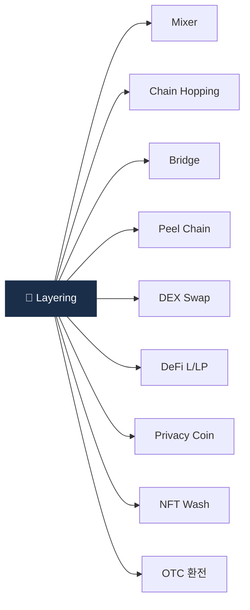
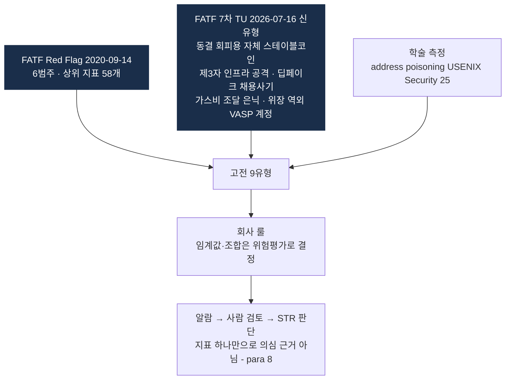

# Day 36 — 자금세탁 typology 종합 (고전 9유형 + 7차 TU 신유형)

> 가상자산 자금세탁의 핵심 패턴 지도. ⏱️ ~80분. 마지막 업데이트: 2026-10-21.

## 📖 오늘 뭘 배우나

Week 6 은 자금세탁 유형 주간. 오늘은 그 전체 지도인 **고전 9유형**(믹서 · 체인호핑 · 브리지 · peel chain · DEX swap · DeFi lending · 프라이버시코인 · NFT wash · OTC 환전)을 한 장에 정리합니다. 공식 지표 원천은 **FATF Red Flag Indicators(2020-09-14)** — 6개 범주(거래·거래패턴·익명성·송수신인·자금원/재산원·지리), 상위 지표 58개입니다([FATF Red Flag PDF](https://www.fatf-gafi.org/content/dam/fatf-gafi/reports/Virtual-Assets-Red-Flag-Indicators.pdf)). 2021년 이후 유형은 FATF 7차 Targeted Update(2026-07-16)가 보완합니다. 각 유형의 원리·탐지 신호를 비교하면서, 이후 6일간 각 유형을 deep 하게 들어가는 준비를 합니다(이전 판의 "7 typology" 는 노트의 9유형 분류로 맞췄습니다).

<!-- MAP-START -->
## 🗺 오늘의 지도

<!-- MAP-END -->

## 🧭 지표 원천 → 유형 → 룰

근거: [`../notes/3-crypto-aml/onchain-typology.md`](../notes/3-crypto-aml/onchain-typology.md) §1 · [7차 TU PDF](https://www.fatf-gafi.org/content/dam/fatf-gafi/reports/7th-targeted-update-on-implementation-fatf-standards-vas-vasps-2026.pdf.coredownload.pdf).

## 🎯 핵심 질문
1. 9유형 각 한 줄 정의? 각각 Red Flag 어느 범주(익명성·거래패턴 등)에 대응하나?
2. 7차 TU 가 새로 지목한 유형 5가지는?
3. Red Flag Case Study 2(한국 제출 사례)의 패턴은?

## 📖 읽기 (~55분)
- 메인: [`../notes/3-crypto-aml/onchain-typology.md`](../notes/3-crypto-aml/onchain-typology.md)

## 🌐 외부 자료 (~15분)
- [FATF — Virtual Assets Red Flag Indicators (2020-09-14)](https://www.fatf-gafi.org/content/dam/fatf-gafi/reports/Virtual-Assets-Red-Flag-Indicators.pdf)
- [Chainalysis 2026 Crypto Crime Report 소개 (2026-01-08)](https://www.chainalysis.com/blog/2026-crypto-crime-report-introduction/)

## 🛠️ 미니 챌린지 (~10분)
- 9유형을 표로 정리 (정의 / Red Flag 범주 / 탐지 신호 1개)
- 7차 TU 신유형 5개를 같은 표에 추가

## ✅ 체크포인트
- [ ] 9 typology 모두 한 줄 정의 가능
- [ ] Red Flag 6범주·58지표, "지표 하나만으로 의심 근거 아님(para 8)" 안다
- [ ] 7차 TU 신유형 안다
- [ ] 스테이블코인이 2025년 불법 거래량의 84%(Chainalysis, B) — 그리고 TRM 의 "84%" 는 분모가 다르다는 점 안다

## 💭 오늘의 한 줄

## 💼 실무 현장 (Industry Reality)

### 한국 제출 사례 — Red Flag Case Study 2

Red Flag Case Study 2 는 한국 제출 사례입니다. **피싱 피해금 약 4억원이 3종 가상자산으로 바뀐 뒤 국내 VASP 48개 계정을 거쳐 55회 이전되고 해외 지갑으로 빠져나갔습니다**(p.7). RF-T3(즉시 다수 해외 VASP 이전)·RF-P4(설명 없는 다종 자산·다계정)의 전형입니다([FATF Red Flag PDF](https://www.fatf-gafi.org/content/dam/fatf-gafi/reports/Virtual-Assets-Red-Flag-Indicators.pdf)).

이전 판의 "한국 거래소에서 유형별 STR 빈도 표", "Tornado direct ≥1% 자동 차단", "DAXA 공통 차단 기준 개정" 은 공개 근거가 없어 삭제했습니다. 유형별 국내 빈도 통계는 공개 1차 자료로 확인되지 않습니다.

### 규모 통계 — 발행처마다 분모가 다르다

- **Chainalysis(2026-01-08)**: 2025년 불법 거래량의 **84%** 가 스테이블코인(B)([Chainalysis](https://www.chainalysis.com/blog/2026-crypto-crime-report-introduction/))
- **TRM**: 2025년 제재 주체·관할 유입의 약 95%, **검증된 사기 유입의 84%** 가 스테이블코인([TRM](https://www.trmlabs.com/reports-and-whitepapers/2026-crypto-crime-report))
- 두 "84%" 는 분모가 다릅니다(불법 거래량 전체 vs 검증된 사기 유입) — 같은 통계로 인용하지 않습니다([`../notes/6-cases/circle-stablecoin-freeze.md`](../notes/6-cases/circle-stablecoin-freeze.md))

이전 판의 "불법 $51B·0.14%", "스테이블코인 63%(전년 54%)", "Cross-chain $21B", "CMLN $16.1B", "Sanctions $16B" 는 이 저장소 근거 자료로 재확인되지 않아 삭제했습니다(앞의 63% 는 위 84% 와도 모순).

### 자주 나오는 오해

- **"Mixer 가 1위 위협"** — 유형별 금액 순위를 같은 정의로 비교한 공개 근거는 이 저장소에 없습니다. 대신 측정된 사실: Tornado Cash 제재 후 입금액은 71.03% 줄었지만 Ethereum 보안사고의 78.33% 가 여전히 경유했습니다(WWW '26, [arXiv 2507.11721](https://arxiv.org/abs/2507.11721))
- **"9개로 다 포함된다"** — 7차 TU 가 동결 회피용 자체 스테이블코인·제3자 인프라 공격·딥페이크 채용사기·가스비 조달 은닉·위장 역외 VASP 계정을 새로 지목했고, 학계는 address poisoning(Ethereum·BSC 2년간 공격 2.7억 건, 최소 8,380만 달러 손실)을 측정했습니다
- **"한국 거래소는 해외 typology 와 무관"** — Red Flag Case Study 2 자체가 한국 VASP 를 경유한 사례입니다. 이전 판의 "Bybit 해킹 자금 국내 유입 정황(DAXA 공유)" 은 근거가 없어 삭제했고, Bybit 는 2024 가 아니라 2025 사건입니다(FATF 6차 TU)
