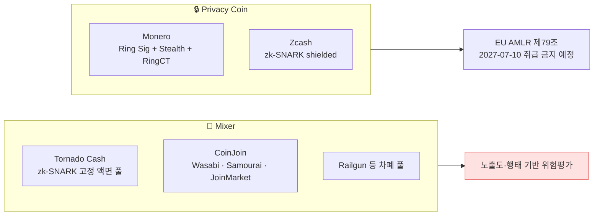
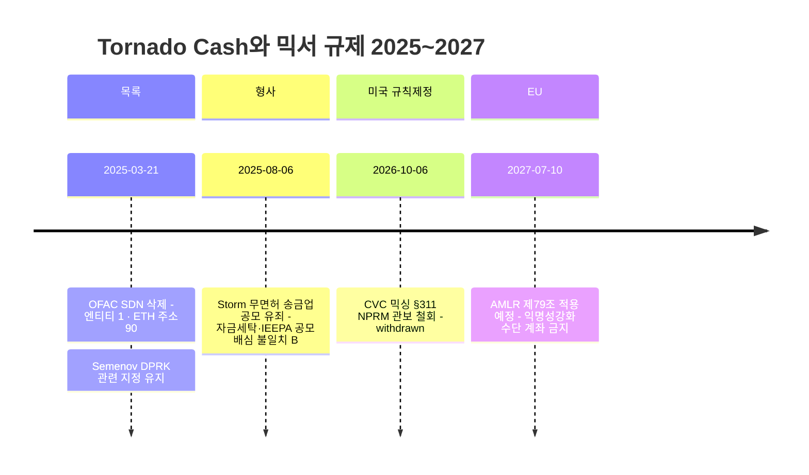

# Day 37 — Mixer + Privacy Coin

> Tornado Cash, CoinJoin, Monero — 익명 도구 deep. ⏱️ ~80분. 마지막 업데이트: 2026-10-21.

## 📖 오늘 뭘 배우나

익명 도구의 두 축 — **Mixer**(서비스·컨트랙트로서의 익명화)와 **Privacy Coin**(프로토콜로서의 익명화). Tornado Cash 의 **영지식 증명(zk-SNARK) 고정 액면 풀**, Monero 의 **Ring Signature + Stealth Address + RingCT**, CoinJoin 의 **협력 소비** — 각 기술의 원리를 이해하고, 2025~2027 규제 흐름을 **목록 변경 / 형사 / 규칙제정 / EU 금지** 네 트랙으로 구분합니다. 핵심 교훈: **제재 해제는 목록 변경이지 위험 해제가 아닙니다**([`../notes/6-cases/tornado-cash.md`](../notes/6-cases/tornado-cash.md)).


<!-- MAP-START -->
## 🗺 오늘의 지도


<!-- MAP-END -->

## 🎯 핵심 질문
1. Tornado Cash 2025-03-21 SDN 삭제는 무엇을 의미하고 무엇을 의미하지 않나?
2. Monero 추적 가능성에 대해 공개 연구는 무엇을 말하나? (2023년 초 패치 전후)
3. EU 는 언제부터 CASP 의 익명성강화코인 취급을 금지하나?

## 🛤 네 트랙 — 섞지 말 것



근거: [OFAC 2025-03-21](https://ofac.treasury.gov/recent-actions/20250321) · [Willkie 2025-08-08](https://complianceconcourse.willkie.com/articles/tornado-cash-cofounder-convicted-for-conspiring-to-operate-an-unlicensed-money-transmitting-business/) · [FR 2026-20429](https://public-inspection.federalregister.gov/2026-20429.pdf) · [EUR-Lex OJ L 2024/1624](https://eur-lex.europa.eu/legal-content/EN/TXT/PDF/?uri=OJ:L_202401624).

## 📖 읽기 (~55분)
- 메인: [`../notes/3-crypto-aml/defi-nft-risks.md`](../notes/3-crypto-aml/defi-nft-risks.md) — 3절 (Privacy Coin)
- 보조: [`../notes/3-crypto-aml/onchain-typology.md`](../notes/3-crypto-aml/onchain-typology.md) — 2절 A (Mixer), G (Privacy Coin)
- 보조: [`../notes/6-cases/tornado-cash.md`](../notes/6-cases/tornado-cash.md)

## 🌐 외부 자료 (~15분)
- [OFAC Recent Actions 2025-03-21](https://ofac.treasury.gov/recent-actions/20250321)
- [Liu 외 WWW '26 — Tornado Cash 제재 효과 측정 (arXiv 2507.11721)](https://arxiv.org/abs/2507.11721)

## 🛠️ 미니 챌린지 (~10분)
- Mixer 방식 3종 (zk 고정 액면 풀 / CoinJoin / 차폐 풀) 각 한 줄 정리 + 탐지 포인트
- Privacy coin 2종 (Monero / Zcash) 각 핵심 기술 1개씩

## ✅ 체크포인트
- [ ] zk-SNARK 고정 액면 풀 원리 (commitment 입금 → 영지식 증명 출금) 대략 안다
- [ ] Tornado Cash 2025-03-21 SDN 삭제 → 2025-08-06 Storm 평결(B) → 2026-10-06 믹싱 NPRM 철회 → 2027-07-10 AMLR 제79조 흐름 안다
- [ ] Monero ring signature + stealth address, 2023년 초 패치 전후 추적 가능성 차이 안다
- [ ] 제재 목록 대조와 위험평가를 분리해야 하는 이유 안다

## 💭 오늘의 한 줄

## 💼 실무 현장 (Industry Reality)

### 제재 해제 ≠ 위험 해제 — 측정치

Liu 외(WWW '26)는 957일·Ethereum 블록 679만 개·거래 10.7억 건으로 제재 효과를 쟀습니다([arXiv 2507.11721](https://arxiv.org/abs/2507.11721)).

| 측정 | 결과 |
|---|---|
| 제재 후 입금액 | **71.03% 감소** |
| Ethereum 보안사고 중 Tornado Cash 경유 비중 | **78.33%** (여전히) |
| 구조적 한계 | 이진 제재 목록의 **더스팅 공격 취약성** 등 |

재무부도 2025-03-21 해제 시 "continue to monitor closely any transactions that may benefit malicious cyber actors or the DPRK" 라고 밝혔습니다. 회사 정책이 "OFAC 목록 = 위험 판단"에 묶여 있으면 해제와 동시에 통제가 자동으로 풀립니다 — 목록 대조(제재 출구)와 위험평가(AML 출구)를 분리하십시오.

**더스팅 주의**: 누군가 소액을 Tornado 관련 주소에서 고객 주소로 보내면, 목록 대조만 하는 룰은 무고한 고객을 차단합니다. 노출 방향(수신 vs 송신)·금액·고객 행위를 같이 보는 룰이 필요합니다.

이전 판의 "한국 4대 거래소 privacy coin 전원 상장폐지(2021-03)·자동 반송", "Tornado direct ≥1% 자동 차단", "DAXA 공통 정책", "일본 2018 전면 금지", 2022~2024 지정·체포·소송·판결 일자, "FBI 용 Monero 추적 툴" 은 이 저장소 근거 자료로 확인되지 않아 삭제했습니다.

### Monero — "완전 추적 불가" 도 "추적 가능" 도 아니다

공개 연구(arXiv 2408.05332)에 따르면 2019~2023 지갑 버그·P2Pool·Mordinal 휴리스틱은 대부분 고정밀이었으나, **2023년 초 패치 이후 신규 거래에는 무효**입니다 — 패치 이전 구간은 부분 추적 가능, 이후는 아닙니다([arXiv 2408.05332](https://arxiv.org/abs/2408.05332)). Red Flag RF-A2 는 "투명 체인 자산 → 거래소 → 즉시 익명성강화코인 전환"을 지표로 듭니다 — **진입·탈출 순간**이 탐지 기회입니다.

차폐 풀도 정량 측정 대상입니다: Railgun 2026 측정에서 출금의 17.65% 가 입금과 하나로 연결됐고 중위 익명성 손실은 3.42비트였습니다([arXiv 2606.25926](https://arxiv.org/abs/2606.25926)).

### 룰 pseudocode (구조 예시)

```
RULE: anonymity_enhancing_exposure
WHEN deposit.counterparty_cluster IN mixer_clusters          # 목록 대조와 별개
  OR deposit.asset IN anonymity_enhancing_assets             # 취급 자산 정책에 따라
THEN
  IF sanctions_list.match(deposit.counterparty): SANCTIONS_PROCEDURE
  ELSE: QUEUE_FOR_HUMAN_REVIEW(
          evidence = [direction, amount, customer_behavior])  # 더스팅 구분
# 2027-07-10 부터 EU CASP 는 AMLR 제79조에 따라 익명성강화 수단 계좌 보유 금지
```

### 자주 나오는 오해

- **"Monero 는 완전 추적 불가"** — 패치 이전 구간은 부분 추적 가능했다는 측정이 있습니다. 이후 거래는 해당 휴리스틱이 무효입니다
- **"Tornado 제재 해제 → 자유 사용"** — 목록 변경일 뿐입니다. 형사 트랙은 별개이고(Storm 유죄 죄목은 제재가 아니라 무면허 송금업 공모, B), 위험 측정치도 그대로입니다
- **"미국이 믹서를 §311 로 묶었다"** — CVC 믹싱 §311 NPRM(88 FR 72701)은 2026-10-06 관보로 **철회(withdrawn)** 됐습니다. 믹서 노출을 거래모니터링에서 빼도 된다는 뜻은 아닙니다
- **"EU 는 이미 privacy coin 을 금지했다"** — AMLR 제79조는 **2027-07-10 적용 예정(enacted-not-in-force)** 입니다
