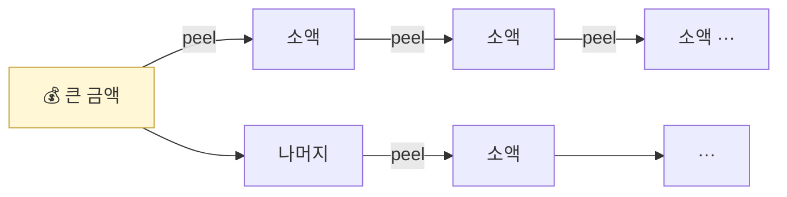
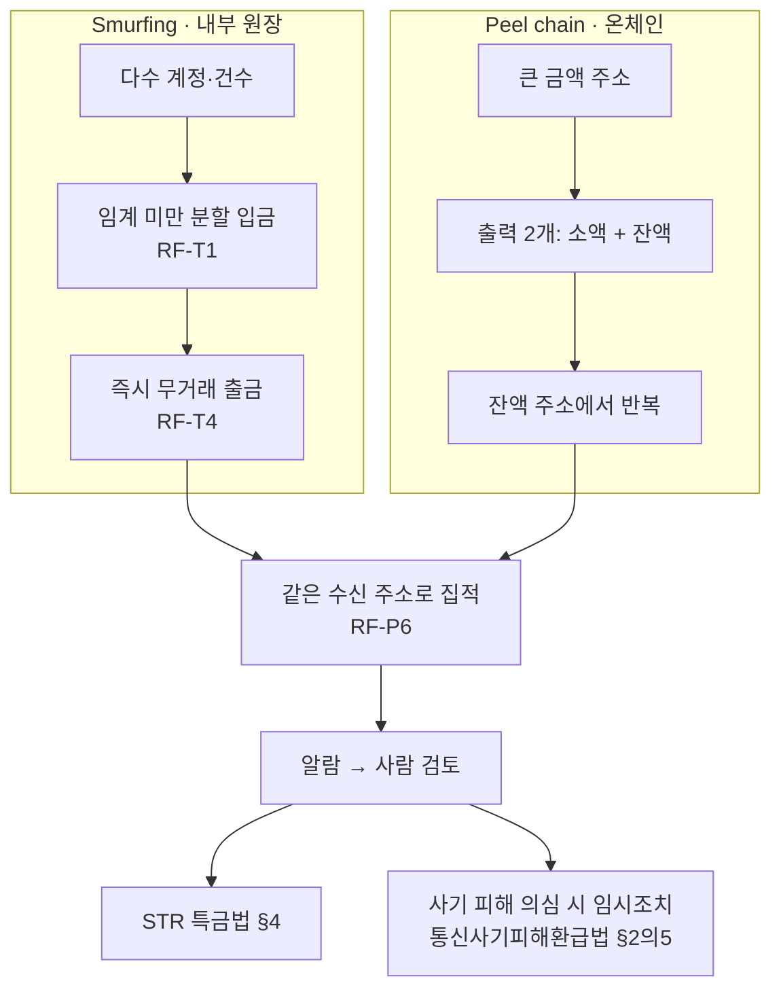

# Day 38 — Peel Chain + Smurfing

> 분할로 추적 회피. ⏱️ ~70분. 마지막 업데이트: 2026-10-21.

## 📖 오늘 뭘 배우나

전통 금융 AML 의 **smurfing / structuring**(임계 미만 분할)이 온체인에서는 **peel chain**(큰 금액에서 소액을 한 번씩 떼어내는 긴 사슬)으로 나타납니다. 두 패턴 모두 "여러 개로 쪼개 눈에 띄지 않게" 라는 같은 원리지만 데이터가 다릅니다 — smurfing 은 주로 **내부 원장**(입출금 건수·금액·시간), peel chain 은 **온체인 그래프**(출력 2개 구조의 반복)에서 보입니다. FATF Red Flag 의 대응 지표는 **RF-T1**(임계 미만 분할), **RF-P6**(다수 무관 지갑 소액 집적 후 일괄 이전), **RF-T4**(입금 후 즉시 무거래 출금 — "turns the exchange/VASP into an ML mixer")입니다([FATF Red Flag PDF](https://www.fatf-gafi.org/content/dam/fatf-gafi/reports/Virtual-Assets-Red-Flag-Indicators.pdf)).


<!-- MAP-START -->
## 🗺 오늘의 지도


<!-- MAP-END -->

## 🔀 두 패턴 비교 — 어디서 보이나



근거: [`../notes/3-crypto-aml/onchain-typology.md`](../notes/3-crypto-aml/onchain-typology.md) §1·§2-D · [`../notes/2-regulations/korea-user-protection.md`](../notes/2-regulations/korea-user-protection.md) 4·5절.

## 🎯 핵심 질문
1. Peel chain 의 그래프 패턴? (출력 2개, 소액/잔액 비율, 사슬 길이)
2. Smurfing(structuring)과 peel chain 의 차이 — 데이터 원천은?
3. 두 패턴의 Red Flag 지표 번호와 탐지 휴리스틱은?

## 📖 읽기 (~45분)
- 메인: [`../notes/3-crypto-aml/onchain-typology.md`](../notes/3-crypto-aml/onchain-typology.md) — 2절 D (Peel chain), 탐지 코드 절
- 보조: [`../notes/1-foundations/what-is-aml.md`](../notes/1-foundations/what-is-aml.md) — 2절 (Smurfing 언급)

## 🛠️ 미니 챌린지 (~20분)
- Peel chain 그림 그리기 (10단계)
- Smurfing 시나리오 그리기 (10명 → 1 wallet 합산)
- 두 패턴의 탐지 룰 의사코드 작성 (임계값은 자사 정책 변수로):
  ```
  IF (in_degree > POLICY_MIN_SENDERS AND each_amount < POLICY_SMALL
      AND time_window < POLICY_WINDOW)
    THEN flag as smurfing → 사람 검토
  ```

## ✅ 체크포인트
- [ ] Peel chain 패턴 구별 가능
- [ ] Smurfing = 임계 미만 분할(RF-T1) 안다
- [ ] 그래프 분석 (in-degree/out-degree) 개념 안다
- [ ] 룰 기반 탐지의 한계 (adversarial) 인지

## 💭 오늘의 한 줄

## 💼 실무 현장 (Industry Reality)

### 한국 사례 — FATF 가 기록한 패턴

Red Flag Case Study 2(한국 제출): **피싱 피해금 약 4억원이 3종 가상자산으로 바뀐 뒤 국내 VASP 48개 계정을 거쳐 55회 이전되고 해외 지갑으로 빠져나갔습니다**(p.7). 분할·다계정·즉시 해외 이전이 겹친 전형입니다.

이전 판의 "Peel chain + Smurfing 은 한국 STR 사유 Top 3", "100만원 단위 소액 반복", 자체 1차 룰 수치, "CMLN OTC 환전" 일반화는 공개 근거가 없어 삭제했습니다.

### 피해자 쪽 신호는 어디로 오나 — 경로 정정

이전 판은 "피해자 지급정지 → 은행이 KoFIU 에 보고 → KoFIU 가 거래소에 조회 공문" 이라고 적었지만, 이는 STR(FIU 보고) 과 보이스피싱 지급정지 제도를 섞은 서술입니다. 2026-10-01 부터 **가상자산거래소도 통신사기피해환급법상 "금융회사등"** 에 포함돼, 자체점검을 상시 실시해 피해의심거래계좌등으로 추정되면 이체·출금·가상자산 이전을 **지연·일시정지**하고, 즉시 통지·본인확인 후 해당이 없으면 해제해야 합니다(§2의5)([통신사기피해환급법 현행본](https://www.law.go.kr/LSW/lsInfoR.do?lsiSeq=290245&efYd=20261002&ancYnChk=0&chrClsCd=010202&urlMode=lsInfoR)). 사기 피해금이 가상자산으로 세탁되는 흐름은 별도로 **STR 후보**가 됩니다 — 제도별로 산출물을 분리합니다.

### 탐지 룰 SQL (구조 예시 — 임계값은 정책 변수)

```sql
-- 24시간 내 분할 입금 + 분할 출금 패턴 (RF-T1 + RF-T4 복합)
WITH inbound_agg AS (
  SELECT customer_id, COUNT(*) AS n_in, SUM(krw_amount) AS total_in,
         MAX(krw_amount) AS max_in
  FROM deposits
  WHERE ts >= NOW() - INTERVAL '24 hours'
  GROUP BY customer_id
  HAVING COUNT(*) >= :min_in_count            -- 정책 변수
     AND MAX(krw_amount) < :small_amount       -- 정책 변수
),
outbound_agg AS (
  SELECT customer_id, COUNT(*) AS n_out, SUM(krw_amount) AS total_out
  FROM withdrawals
  WHERE ts >= NOW() - INTERVAL '24 hours'
  GROUP BY customer_id
  HAVING COUNT(*) >= :min_out_count
)
SELECT i.customer_id, i.n_in, i.total_in, o.n_out, o.total_out
FROM inbound_agg i
JOIN outbound_agg o USING (customer_id);
```

이전 판의 "SUM 500만~9,900만원 = CTR 직전" 조건은 틀렸습니다 — CTR(특금법 §4의2)은 **현금거래** 보고이고 가상자산 거래 자체는 CTR 대상이 아닙니다([`../notes/2-regulations/korea-fiu-act.md`](../notes/2-regulations/korea-fiu-act.md)). 미국 structuring 조항·FinCEN 해석 서술도 이 저장소 근거 자료로 확인되지 않아 뺐습니다.

### Peel chain 탐지 (교육용)

```python
def peel_chain(addr, depth=20):
    chain, curr = [], addr
    for _ in range(depth):
        outs = get_outputs(curr)
        if len(outs) != 2: break                     # peel 특징: 출력 2개
        small, large = sorted(outs, key=lambda o: o.value)
        if small.value / large.value > RATIO: break  # 예시 비율 — 정책값
        chain.append(curr)
        curr = large.to_addr
    return len(chain) >= MIN_LEN                     # 예시 길이 — 정책값
```

### AML Analyst 시각 — 현장에서 보는 패턴

- **수신 주소 집적** — 서로 무관한 여러 고객의 출금이 같은 외부 주소로 모이면 RF-P6 신호(몇 명이면 "확실"하다는 공개 기준은 없음)
- **입금 직후 출금** — RF-T4. 거래 없이 통과만 하는 계정
- **Peel chain 은 그래프에서 긴 사슬**로 보인다 — 출력 2개 구조의 반복

### 자주 나오는 오해

- **"분할 입금은 일반 소액거래와 구분 불가"** — 개별 주체만 보면 정상으로 보여도, **카운터파티(수신 주소) 기준으로 집계**하면 집적 패턴이 드러납니다
- **"룰 임계치만 잘 맞추면 된다"** — 세탁범이 임계치를 학습합니다(adversarial). FATF para 277 처럼 임계값을 정기 재검토하고, 지표 하나만으로 의심 근거를 삼지 않습니다(Red Flag para 8)
