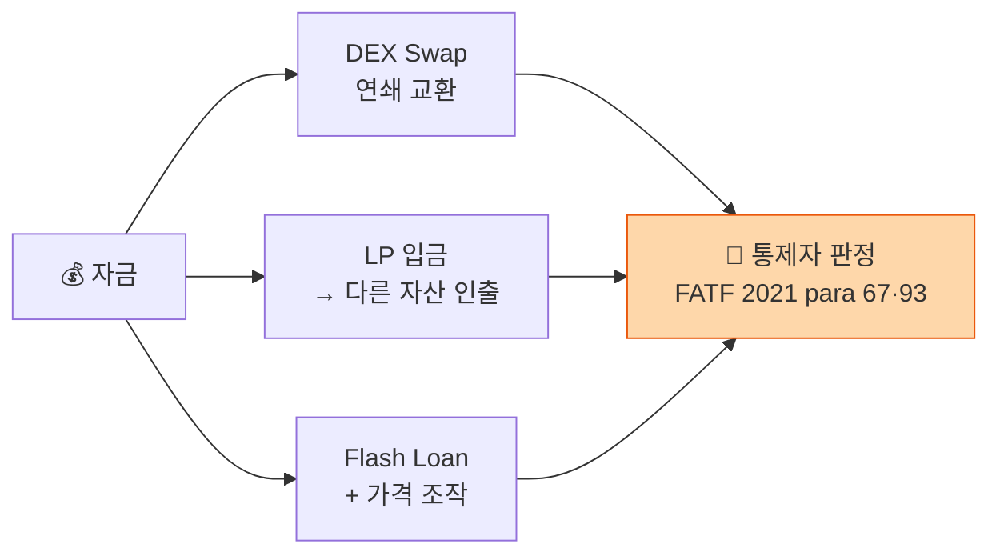
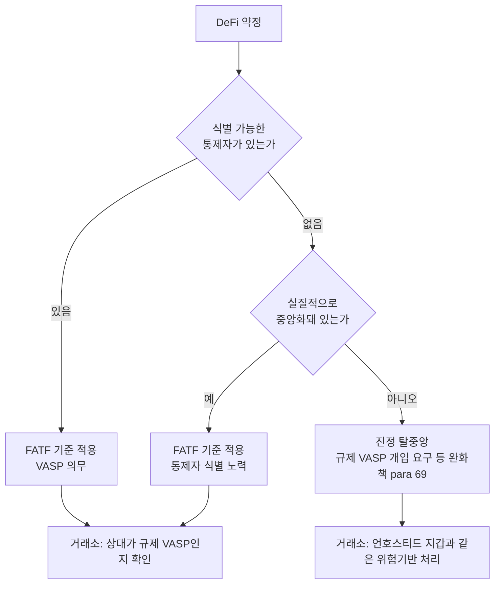

# Day 39 — DeFi 자금세탁 (DEX / LP / Flash Loan)

> 무중개 금융이 layering 인프라가 되는 방식. ⏱️ ~80분. 마지막 업데이트: 2026-10-21.

## 📖 오늘 뭘 배우나

DeFi 는 AML 을 위해 설계된 게 아니지만, **KYC 부재 + 글로벌 즉시 접근 + fork 가능성** 때문에 DEX swap·LP 입출금·Flash loan 이 layering 경로가 됩니다. 규범의 출발점은 FATF 2021 가이던스 para 67 — "A DeFi application (i.e. the software program) is not a VASP", 그러나 **통제력·충분한 영향력을 가진 사람**은 VASP 가 될 수 있습니다([FATF 2021 RBA 가이던스](https://www.fatf-gafi.org/content/dam/fatf-gafi/guidance/Updated-Guidance-VA-VASP.pdf.coredownload.pdf)). 2026-07-21 DeFi 타겟보고서가 이 분석을 갱신했고(가이던스·기준 변경 아님)([FATF DeFi 보고서](https://www.fatf-gafi.org/en/publications/Virtualassets/targeted-report-decentralised-finance-2026.html)), 7차 TU(2026-07-16)는 집행이 거의 비어 있음을 보여 줍니다 — DeFi 위험평가 완료 관할 18%(26/142), 자국 내 VASP 해당 DeFi 미식별 93%, 실제 인가 2개 관할, 집행 1개 관할입니다.


<!-- MAP-START -->
## 🗺 오늘의 지도


<!-- MAP-END -->

## 🎯 핵심 질문
1. DEX swap 이 layering 에 쓰이는 이유? (DEX 자체는 합법 — 무엇을 봐야 하나)
2. Liquidity Pool 입출금이 출처를 흐리는 메커니즘?
3. FATF 는 DeFi 의 누구를 VASP 로 보나? (para 67·93·69)

## 🧭 통제자 판정 — FATF 7차 TU 각주 1의 세 갈래



근거: [`../notes/3-crypto-aml/defi-nft-risks.md`](../notes/3-crypto-aml/defi-nft-risks.md) §1 · [7차 TU PDF](https://www.fatf-gafi.org/content/dam/fatf-gafi/reports/7th-targeted-update-on-implementation-fatf-standards-vas-vasps-2026.pdf.coredownload.pdf) para 46~47.

## 📖 읽기 (~55분)
- 메인: [`../notes/3-crypto-aml/defi-nft-risks.md`](../notes/3-crypto-aml/defi-nft-risks.md) — 1절 (DeFi), 5절, 6절
- 보조: [`../notes/3-crypto-aml/onchain-typology.md`](../notes/3-crypto-aml/onchain-typology.md) — 2절 E, F

## 🌐 외부 자료 (~15분)
- [FATF — Targeted Report on Regulatory Challenges from DeFi (2026-07-21)](https://www.fatf-gafi.org/en/publications/Virtualassets/targeted-report-decentralised-finance-2026.html)
- [AMLA — MiCA 재검토 AML 우선과제 (2026-10-07)](https://www.amla.europa.eu/amla-identifies-amlcft-priorities-review-mica_en)

## 🛠️ 미니 챌린지 (~10분)
- DEX → Lending → LP token → 다른 자산 인출 흐름 한 그림
- "DeFi 가 진정 탈중앙이면 AML 은 누가 책임?" — para 67·69 를 근거로 자기 답변 3줄

## ✅ 체크포인트
- [ ] DEX swap 은 swap 자체가 아니라 **전후 흐름**을 본다는 점 이해
- [ ] LP 입금 layering 효과 안다
- [ ] Flash loan 기본 메커니즘 안다 (한 트랜잭션 안에서 빌리고 갚는 무담보 대출)
- [ ] FATF 통제자 판정 (para 67·93) 과 7차 TU 집행 공백 수치 안다

## 💭 오늘의 한 줄

## 🧭 Staking·LST 관점 확장

DeFi 와 경계에 있는 **Staking·Liquid Staking Token(LST)**: 자산이 staking 토큰으로 감싸지고 또 감싸지면 형태가 바뀌어 layering 에 쓰일 수 있습니다. 핵심 논점:
- **LST 를 별도 자산으로 볼 것인가** — 별도 가격·유동성을 가지므로 거래모니터링·트래블룰 대상 자산 목록에 포함할지 결정해야 합니다
- **Unstaking 대기 기간** — 자금이 묶인 상태에서의 조사·동결 대응 절차
- EU 에서는 AMLA 가 2026-10-07 MiCA 재검토 AML 우선과제 5개(스테이킹·대출, DeFi 통제자 정의, 무인가 스테이블코인 등)를 제출했습니다

이전 판의 "한국 VASP 미출시·2026년 중 FIU 가이드라인 예정", "unstaking ~27h", 해외 거래소 소송·중단 사례는 근거가 확인되지 않아 삭제했습니다.

**상세**: [`../notes/3-crypto-aml/defi-nft-risks.md`](../notes/3-crypto-aml/defi-nft-risks.md) §7 참조.

## 💼 실무 현장 (Industry Reality)

### 거래소 쪽 방어선

- DeFi·브리지 경유 입금의 **직전 경로** 확인 — 경유 서비스에 통제자·규제 VASP 가 있었나
- DEX·브리지·차폐 풀 컨트랙트 주소 라벨링
- **2027-02-19 부터** 자기수탁 지갑과의 이전은 고객과 상대방이 **동일인일 때만** 허용(고시 §28-2④, enacted-not-in-force) — DeFi 에서 직접 들어오는 자금의 처리 정책 정비
- 차단 우선과 탐지 강화 중 무엇을 택하든 **판단 근거를 기록**(업무규정 제79·80조)

이전 판의 "한국 거래소의 DEX 라우터 직연결 자동 검토·LP 컨트랙트 차단 정책", "Uniswap Labs SEC Wells Notice·CFTC 제재", "MiCA·AMLR 가 DeFi 를 CASP 로 규제 명시", "FinCEN 2023 controlling entity 가이드", "FATF 2025 가이던스의 LP token 해석·한국 FIU 유사 입장" 은 이 저장소 근거 자료로 재확인되지 않아 삭제했습니다. 한국의 DeFi 규율은 2단계 입법 진행 상황이 확인되지 않았습니다(보고서 부록 B #10).

### 학술 측정 — 참고 수치

- **Sanction-Evasion MEV**: USDT 제재 주소의 7.3%, USDC 의 18.7% 가 동결 발효 전 전액 인출([arXiv 2603.27739](https://arxiv.org/abs/2603.27739))
- **Rug pull SoK(ISSTA 2025)**: 35개 유형(9개 신규), 13개 탐지 도구 커버리지 25.7~62.9%([ISSTA 2025](https://conf.researchr.org/details/issta-2025/issta-2025-papers/25/SoK-A-Taxonomic-Analysis-of-DeFi-Rug-Pulls-Types-Dataset-and-Tool-Assessment))

### DeFi 노출 탐지 룰 예시 (구조 — 임계값은 정책 변수)

```
RULE: defi_layering_suspect
WHEN deposit.prior_path INCLUDES (dex_router | lending_pool | bridge | shielded_pool)
  AND deposit.krw_amount > :policy_amount
THEN action = QUEUE_FOR_HUMAN_REVIEW
     require = [
       "경유 서비스 통제자·규제 VASP 여부",
       "직전 경로 노출도 + Red Flag 조합",
       "고객의 DeFi 이용 목적 확인"
     ]

RULE: lp_token_deposit
WHEN deposit.asset.contract IN known_lp_tokens
THEN action = QUEUE_FOR_HUMAN_REVIEW     # 자동 동결 아님 — 법적 근거가 있는 조치인지 구분
```

### 자주 나오는 오해

- **"DeFi 는 규제 불가"** — 소프트웨어는 VASP 가 아니지만 **통제력·충분한 영향력을 가진 사람**은 VASP 가 될 수 있습니다(para 67). 다만 2026-10-21 기준 실제 인가 2개 관할·집행 1개 관할로 집행은 거의 비어 있습니다
- **"Flash loan 은 해킹 도구"** — Flash loan 자체는 DeFi 원시 연산입니다. 가격 조작과 결합될 때 문제이고, 탐지는 대출+조작 거래+상환이 1 tx 에 묶이는 패턴입니다
- **"의심되면 동결"** — 이용자 자산을 묶는 조치에는 별도 법적 요건이 있습니다(통신사기피해환급법 임시조치, 이용자보호법 §11 입출금 차단 제한). AML 산출물은 STR·EDD·거래거절입니다
