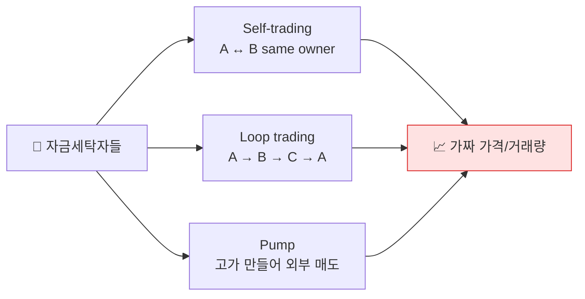
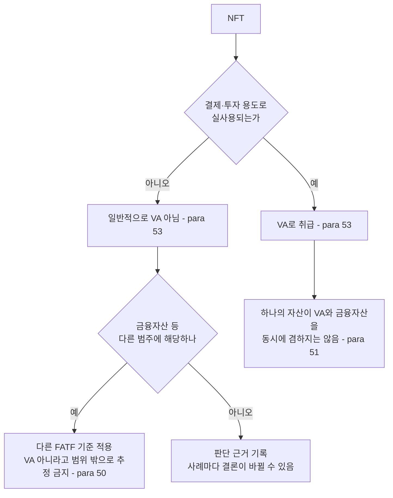

# Day 40 — NFT·스테이킹 AML 함의

> 가격을 당사자가 정하는 자산의 자금세탁. ⏱️ ~70분. 마지막 업데이트: 2026-10-21.

## 📖 오늘 뭘 배우나

NFT 는 **고유 자산 + 가격 자율 책정 + 즉시 글로벌 거래**의 조합입니다. 거래 가격을 당사자가 정하므로 자금 이전을 "작품 대금"으로 위장하기 쉽습니다. 오늘은 wash trading·self-laundering·로열티 악용 패턴과, FATF 의 NFT 분류 기준(**기능 기준** — 결제·투자 용도로 실사용되면 VA)을 정리하고, 스테이킹·LST 의 AML 판단 논점까지 봅니다. 한국의 NFT 가상자산 해당 여부 판단 기준은 이 저장소 근거 자료로 재확인되지 않았습니다([`../notes/3-crypto-aml/defi-nft-risks.md`](../notes/3-crypto-aml/defi-nft-risks.md) §2).


<!-- MAP-START -->
## 🗺 오늘의 지도


<!-- MAP-END -->

## 🎯 핵심 질문
1. NFT 가 자금세탁에 쓰이는 이유? (가격 자율 책정)
2. NFT 자금세탁 패턴 5가지? (wash trading / self-laundering / trading mule / phishing 결합 / royalty 악용)
3. FATF 의 NFT 분류 기준? (2021 가이던스 para 50·51·53)

## 🧭 NFT 는 VA 인가 — FATF 기능 기준



근거: [FATF 2021 RBA 가이던스](https://www.fatf-gafi.org/content/dam/fatf-gafi/guidance/Updated-Guidance-VA-VASP.pdf.coredownload.pdf) para 50·51·53.

## 📖 읽기 (~45분)
- 메인: [`../notes/3-crypto-aml/defi-nft-risks.md`](../notes/3-crypto-aml/defi-nft-risks.md) — 2절 (NFT), 7절 (스테이킹), 8절 (로열티)

## 🌐 외부 자료 (~15분)
- [FATF 2021 RBA 가이던스 (para 50~53)](https://www.fatf-gafi.org/content/dam/fatf-gafi/guidance/Updated-Guidance-VA-VASP.pdf.coredownload.pdf)
- [AMLA — MiCA 재검토 AML 우선과제 (2026-10-07, 스테이킹·대출 포함)](https://www.amla.europa.eu/amla-identifies-amlcft-priorities-review-mica_en)

## 🛠️ 미니 챌린지 (~10분)
- Self-trading 시나리오 직접 그리기 (A→B→A 같은 NFT)
- Loop trading 시나리오 (3자 순환)
- 탐지 룰 의사코드 (임계값은 정책 변수):
  ```
  IF (same_NFT_traded >= POLICY_REPEAT times in POLICY_WINDOW
      AND price_change > POLICY_RATIO
      AND addresses share cluster)
    THEN flag as wash trade suspect → 사람 검토
  ```

## ✅ 체크포인트
- [ ] NFT 자금세탁 매력 (가격 자율 + 글로벌 즉시) 안다
- [ ] Wash trading 순환 패턴 (Self / Loop / Pump) 안다
- [ ] FATF NFT VA 분류 기준 (기능 기준, para 50·51·53) 안다
- [ ] 한국 판단 기준은 이 저장소에서 원문 미확인임을 안다 (이전 판의 "2024-06 FSC 가이드라인" 세부는 근거 재확인 전까지 쓰지 않음)

## 💭 오늘의 한 줄

## 🧭 NFT 로열티 세탁 — 숨은 typology

로열티(2차 시장 거래 시 원작자가 일정 비율을 받는 구조)를 악용한 패턴:
1. 컬렉션 발행 + 높은 로열티 설정
2. 공모자 간 반복 거래(wash trading)
3. 로열티 지갑에 대금 누적
4. 표면상 "예술품 2차 거래" → 자금 이전 은폐

이전 판의 "Chainalysis 2023: Blur 상위 NFT 45~60% wash trading", "한국 거래소 NFT 사업 2024 대거 축소" 는 이 저장소 근거 자료로 재확인되지 않아 삭제했습니다.

**상세 + 탐지 룰 pseudocode**: [`../notes/3-crypto-aml/defi-nft-risks.md`](../notes/3-crypto-aml/defi-nft-risks.md) §8 참조.

## 🪙 스테이킹·LST — AML 판단 논점

| 논점 | 무엇을 정해야 하나 |
|---|---|
| 보상과 자금원천 | 보상 자체보다, 스테이킹을 경유한 자금 흐름이 출처를 흐리는지 |
| LST 의 자산 지위 | 별도 가격·유동성을 가지므로 거래모니터링·트래블룰 대상 자산 목록에 포함할지 |
| Unstaking 대기 | 자금이 묶인 상태에서의 조사·동결 대응 절차 |
| Slashing·MEV·Restaking | 고객 자산 손실 책임 경계, 보상에 섞인 MEV 수익의 자금원천 설명, 연쇄 위임의 통제 경계 |

EU AMLA 는 2026-10-07 MiCA 재검토 AML 우선과제에 **스테이킹·대출**을 포함했습니다. 한국의 스테이킹 관련 정책 진행은 이 저장소 근거 자료로 확인되지 않았습니다.

## 💼 실무 현장 (Industry Reality)

### 거래소 입장에서

NFT 마켓플레이스를 운영하거나 NFT 대금이 거래소로 들어온다면, **기능 기준**(결제·투자 용도인가)으로 VA 해당성을 판단한 근거를 남깁니다. NFT 판매대금이 ETH·스테이블코인으로 재입금되는 경로는 남아 있으므로, 입금의 **직전 경로**(마켓플레이스 컨트랙트 경유 여부)를 노출도 평가에 넣을 수 있습니다.

이전 판의 "2022 FSC 유권해석·2024-06 FSC 가이드라인 업데이트", 특정 거래소 NFT 서비스 중단 연도, "Chainalysis 2022 wash trading $8.9M/일·262개 주소", 마켓플레이스 정책 변경 연표, 미국 형사 기소 사례, "FATF 2023 업데이트", "Chainalysis Storyline 자동 라벨" 은 이 저장소 근거 자료로 재확인되지 않아 삭제했습니다(사례·통계 범위는 [`../notes/6-cases/README.md`](../notes/6-cases/README.md) 참조).

### Wash trade 탐지 룰 (구조 예시 — 임계값은 정책 변수)

```python
def detect_nft_wash_trading(trades):
    alerts = []
    for collection in group_by_collection(trades):
        # 1. 소수 거래자 집중도
        top_ratio = top_n_traders_volume(collection, n=10) / total_volume(collection)
        if top_ratio > POLICY_CONCENTRATION:
            alerts.append("Concentrated trading")
        # 2. 동일 주소쌍·동일 클러스터 반복 거래 + 종잣돈 출처 동일
        for pair in address_pairs(collection):
            if pair.trade_count >= POLICY_REPEAT and pair.same_funding_source:
                alerts.append(f"Wash trading pair: {pair}")
        # 3. 로열티 수취 지갑의 유출 흐름
        if suspicious_outflow(collection.royalty_wallet):
            alerts.append("Royalty wallet outflow")
    return alerts   # 알람은 사람 검토로 — 지표 하나만으로 의심 근거 아님 (Red Flag para 8)
```

### 자주 나오는 오해

- **"NFT 는 그림이라 자금세탁 불가"** — 당사자끼리 고가에 매매해 시장가를 만들고 외부에 매도하면 자금 이전이 "작품 대금"으로 위장됩니다
- **"NFT 는 VA 가 아니니 AML 범위 밖"** — FATF 는 "assets that do not qualify as VAs should not be presumed to fall outside the scope of the FATF Standards"(para 50)라고 했습니다
- **"Wash trading 은 NFT 만의 문제"** — 토큰 시장에서도 순환 거래가 있습니다. 한국에서는 시세조종 성격이면 시장감시(이용자보호법 §12) 출구, 자금세탁 의심이면 STR(특금법 §4) 출구로 갈라집니다
