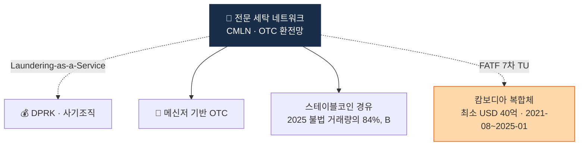
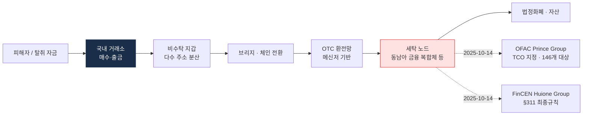

# Day 41 — 전문 세탁 네트워크 (CMLN · OTC · 동남아 금융 복합체)

> 개별 범죄자가 아니라 "세탁을 대행하는 노드"를 보는 날. ⏱️ ~70분. 마지막 업데이트: 2026-10-21.

## 📖 오늘 뭘 배우나

업계에서 **CMLN(Chinese Money Laundering Networks)** 이라고 부르는 것은 텔레그램 등 메신저 기반 OTC 환전망이 범죄수익의 가상자산 ↔ 법정화폐 전환을 **대행**하는 구조를 가리킵니다(Laundering-as-a-Service). 이 저장소의 근거 자료로는 CMLN의 연간 처리액·지갑 수·수수료율을 확인할 수 없으므로, 오늘은 **공식 문서가 기록한 세탁 노드**를 중심으로 봅니다. FATF 7차 Targeted Update(2026-07-16)는 캄보디아 소재 금융 복합체가 2021-08~2025-01 최소 USD 40억을 세탁했고 그중 최소 USD 3,700만이 DPRK 탈취자금이었다고 적었습니다(para 29–30). 미국은 2025-10-14 Prince Group을 초국가범죄조직으로 지정하고 같은 날 Huione Group을 §311 최종규칙으로 미국 금융시스템에서 끊었습니다. 분업 생태계가 왜 방어를 어렵게 만드는지, 그리고 규제가 왜 "유형"에서 "네트워크" 단위로 옮겨 가는지 이해합니다.


<!-- MAP-START -->
## 🗺 오늘의 지도


<!-- MAP-END -->

## 🎯 핵심 질문
1. FATF 7차 TU가 기록한 캄보디아 금융 복합체 사례의 규모와 기간은? DPRK 자금은 얼마였나?
2. Laundering-as-a-Service 모델에서 거래소는 어느 구간에 서 있나?
3. 미국이 2025-10-14 Prince Group·Huione Group에 쓴 수단은 각각 무엇인가?

## 📖 읽기 (~45분)
- 메인: [`../notes/3-crypto-aml/onchain-typology.md`](../notes/3-crypto-aml/onchain-typology.md) — §2-I (OTC·전문 세탁 네트워크), §3 (7차 TU 신유형)
- 보조: [`../notes/6-cases/lazarus-dprk.md`](../notes/6-cases/lazarus-dprk.md) — §4 (FATF가 서술한 세탁 경로)

## 🌐 외부 자료 (~20분)
- [FATF 7차 Targeted Update PDF (2026-07-16)](https://www.fatf-gafi.org/content/dam/fatf-gafi/reports/7th-targeted-update-on-implementation-fatf-standards-vas-vasps-2026.pdf.coredownload.pdf) — para 29–36
- [미 재무부 2025-10-14 Prince Group·Huione 보도자료](https://home.treasury.gov/news/press-releases/sb0278)
- [FinCEN pig butchering 주의보 FIN-2023-Alert005 (2023-09-08)](https://www.fincen.gov/sites/default/files/shared/FinCEN_Alert_Pig_Butchering_FINAL_508c.pdf)

## 🔀 세탁 노드가 끼는 흐름



근거: 7차 TU para 29–30·33, [재무부 sb0278](https://home.treasury.gov/news/press-releases/sb0278). 거래소가 실제로 볼 수 있는 구간은 자기 고객의 입출금과 직접 상대 주소까지이고, OTC·세탁 노드는 블록체인 분석 라벨로 간접 노출을 추정하는 구간입니다.

## 🛠️ 미니 챌린지 (~5분)
- 7차 TU 캄보디아 복합체 사례(기간·규모·DPRK 비중)와 "동결 회피용 자체 스테이블코인"(para 35)을 3줄로 메모
- "한국 거래소가 세탁 노드 노출 지갑을 어떻게 식별할까"를 **어떤 법적 출구(FDS 임시조치 / STR)로 보낼지**까지 포함해 3줄 메모

## ✅ 체크포인트
- [ ] 7차 TU: 캄보디아 복합체 최소 USD 40억(2021-08~2025-01), 그중 DPRK 최소 USD 3,700만 안다
- [ ] Laundering-as-a-Service 분업 생태계 안다
- [ ] 2025-10-14 Prince Group TCO 지정과 Huione §311 최종규칙을 구분한다
- [ ] CMLN 연간 처리액·수수료율은 이 저장소에서 검증되지 않은 수치임을 안다

## 💭 오늘의 한 줄

## 💼 실무 현장 (Industry Reality)

### 한국 VASP에서는

투자사기(pig butchering)·보이스피싱 피해금은 거래소에서 스테이블코인으로 바뀌어 외부 지갑으로 빠져나가는 경로를 자주 탑니다. 이 흐름에 대해 한국 거래소가 쓰는 수단은 **법적 근거가 서로 다른 두 갈래**입니다.

| 갈래 | 근거 | 산출물 |
|---|---|---|
| ① 피해 예방 (FDS) | 통신사기피해환급법 §2의5 — 법률 제21503호(2026-03-31 공포)로 가상자산거래소가 "금융회사등"에 포함, **2026-10-01 시행**. 피해의심거래로 추정되면 가상자산 이전을 지연·일시정지 | 지연·일시정지·지급정지·환급 |
| ② 자금세탁 (AML) | 특금법 §4 의심거래보고, FIU 고시 「자금세탁방지 업무규정」 제76~81조 거래모니터링체계(2026-01-22 시행) | STR, 거래거절, EDD |

출처: [법제처 통신사기피해환급법](https://www.law.go.kr/LSW/lsInfoR.do?lsiSeq=290245&efYd=20261002&ancYnChk=0&chrClsCd=010202&urlMode=lsInfoR), [금융위 2026-03-13](https://www.fsc.go.kr/no010101/86446), [법제처 DRF 업무규정](https://www.law.go.kr/DRF/lawService.do?OC=test&target=admrul&ID=2100000267264&type=XML).

2026-04-07에는 「강화된 출금지연제도」 표준 내규가 시행됐습니다. 근거가 된 집계는 2025-06~09 거래소 사기이용계좌 2,526개 중 1,490개(59%)가 출금지연 **예외계좌**였고 피해금의 75.5%가 예외계좌에서 빠져나갔다는 것입니다(B)([금융위 2026-04](https://www.fsc.go.kr/po010102/86656)).

이전 판의 "FIU 통계상 보이스피싱 STR 2배 급증", "신고 1일 수십 건", "DAXA 공유 블랙리스트 CMLN 허브 수천 개", 시간대별 대응 SOP는 공개 근거가 없어 삭제했습니다.

### 글로벌에서는

- **FATF 7차 TU(2026-07-16)**: 캄보디아 복합체 사례(para 29–30). 제3자 발행자가 USD 2,900만 이상을 동결하자 이 조직이 "immune to asset freezing"을 내세운 자체 스테이블코인을 발행했고, FATF는 VASP가 "issuer-level asset freeze/burn mechanisms"를 안전장치로 믿을 수 없을 수도 있다고 결론 냈습니다(para 35).
- **미국**: 2025-10-14 OFAC가 Prince Group을 초국가범죄조직(TCO)으로 지정(146개 대상), FinCEN이 같은 날 Huione Group §311 최종규칙을 발동했습니다([재무부 sb0278](https://home.treasury.gov/news/press-releases/sb0278)). 2026-10-05에는 러시아 연계 A7 네트워크 역외 하위대리인과의 자금이체를 금지하는 특별조치 NPRM(RIN 1506-AB77, proposed)을 냈습니다([Federal Register 2026-20371](https://public-inspection.federalregister.gov/2026-20371.pdf)).
- **FinCEN pig butchering 주의보(2023-09-08)** 의 기술 적신호 — "고유 IP·기기 ID·지역이 과거 접속 패턴과 불일치", "ETH를 받은 뒤 수수료가 낮은 TRX로 전환해 급출금" — 은 거래소 FDS 룰로 옮기기 쉬운 서술입니다.
- **학계**: USDT 제재 주소의 7.3%, USDC의 18.7%가 동결 발효 전에 전액 인출됐습니다([arXiv 2603.27739](https://arxiv.org/abs/2603.27739)).

이전 판의 "CMLN 연 $16.1B·일 $40M·지갑 1,800개+·Tron 80%", "FinCEN 2024-09 Huione 지정", "Ronin $625M 중 상당 부분 CMLN 경유"는 이 저장소 근거 자료로 확인되지 않아 삭제했습니다(Huione §311 최종규칙은 2025-10-14).

### 세탁 노드 노출 탐지 휴리스틱 (학습용 스케치)

아래 조건과 임계값은 **학습용 가설**입니다. 실제 값은 회사 위험평가로 정해야 하며 공개된 업계 표준은 없습니다.

```
FLAG_LAUNDERING_NODE_EXPOSURE(withdrawal):
    # 1. 직접/간접 상대가 제재·특별조치 대상 네트워크 라벨인가 (Prince Group, Huione 등)
    if counterparty_label in SANCTIONED_OR_311_NETWORKS: return "BLOCK_AND_REVIEW"
    # 2. 고객 프로필과 맞지 않는 신규 고액 스테이블코인 매수 후 즉시 외부 출금 (RF-T4 원형)
    if is_new_customer and stablecoin_buy_then_withdraw_immediately: score += 1
    # 3. 접속 기기·IP가 과거 패턴과 불일치 (FinCEN 2023 적신호) → FDS 쪽 신호
    if device_or_ip_mismatch: fds_flag = true
    # 4. 상대 주소가 OTC·고위험 결제 네트워크 클러스터인가 (분석도구 라벨, 확률적)
    if counterparty_cluster_type in {"OTC", "HIGH_RISK_PAYMENT"}: score += 1
    route: fds_flag -> 임시조치 절차 / score -> 사람 검토 -> STR 판단
```

### 자주 나오는 오해

- **"세탁 네트워크는 해외 문제"** — 피해자가 한국인이면 출금 경로가 한국 VASP를 지납니다. 2026-10-01부터 거래소도 통신사기피해환급법상 임시조치 의무를 집니다.
- **"피해 예방만 하면 된다"** — 피해 예방(FDS 임시조치)과 자금세탁 의심거래보고(STR)는 근거 법과 산출물이 다릅니다. 하나를 했다고 다른 하나가 면제되지 않습니다.
- **"발행자가 동결하면 끝"** — 7차 TU는 동결 회피 설계를 경고했고, 학계 측정도 동결 전 인출이 상당함을 보였습니다. 동결은 보조 수단이지 거래모니터링을 대신하지 못합니다.
