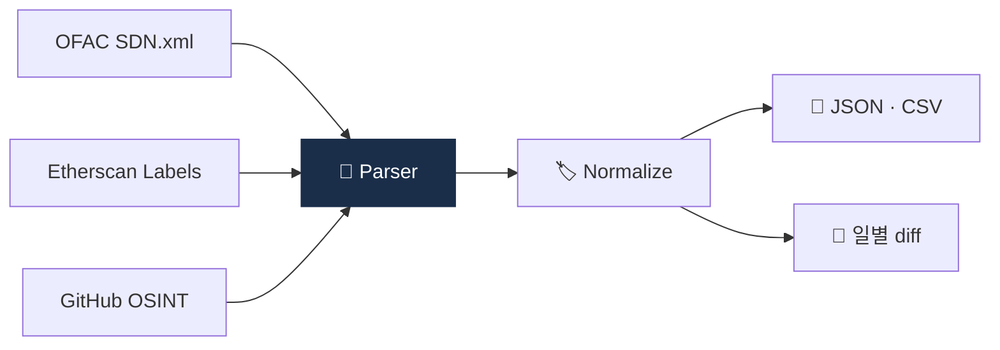
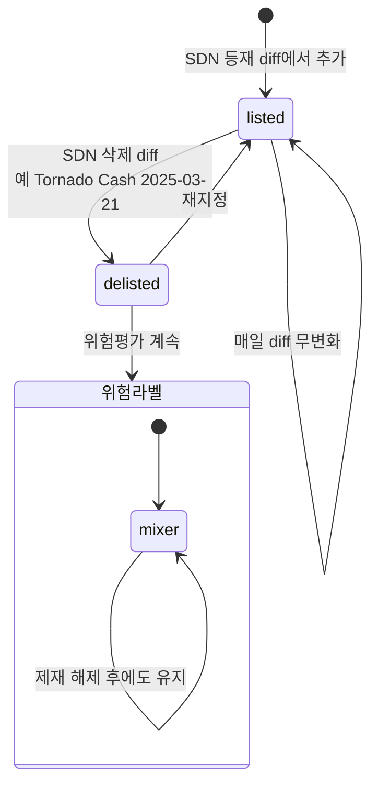

# Day 42 — 🛠️ 미니 프로젝트 3: Mixer 주소 라벨 fetcher + 6주 리뷰

> 위험 데이터셋 직접 만들어보기. ⏱️ ~150분. 마지막 업데이트: 2026-10-21.

## 📖 오늘 뭘 배우나

Week 6의 결산. 위험 주소 데이터셋을 **OSINT(OFAC SDN, Etherscan label 등 공개 소스)** 에서 수집해 표준 형식으로 저장하는 스크립트를 짭니다. 자체 라벨 DB의 어려움과 가치를 체감하는 과정이며, 결과물은 Capstone의 Sanctions 모듈로 연결됩니다. 핵심 교훈 하나: **목록은 늘어나기만 하지 않는다.** 2025-03-21 미 재무부는 Tornado Cash 엔티티 1개와 ETH 주소 90개를 SDN에서 삭제했습니다([OFAC 2025-03-21](https://ofac.treasury.gov/recent-actions/20250321)). 그래서 fetcher는 "추가"뿐 아니라 "삭제"도 기록하고, "제재 상태"와 "위험 라벨"을 다른 필드로 저장해야 합니다.


<!-- MAP-START -->
## 🗺 오늘의 지도


<!-- MAP-END -->

## 🎯 회고 질문
1. 고전 9유형 + 7차 TU 신유형 중, 내 거래소 데이터로 가장 먼저 탐지할 수 있는 것은?
2. 전문 세탁 네트워크(OTC·CMLN·동남아 금융 복합체)가 한국 사업자에게 미치는 길은?
3. 자체 라벨 DB 구축의 가치는?

## 🛠️ 미니 프로젝트 3 (~120분)

### 목표
**알려진 mixer 주소를 공개 소스에서 fetch + 표준 형식으로 저장**

### 사양
- 입력: 없음 (공개 소스 자동 수집)
- 출력: JSON/CSV 형식의 mixer 주소 리스트 + 메타데이터

### 구현 가이드
프로젝트: `aml/projects/03-mixer-fetcher/`

```python
# main.py 의사코드
import requests, csv, json
from datetime import datetime, timezone

# 공개 소스 (예시)
SOURCES = {
    # 다운로드 경로는 OFAC 공식 페이지에서 확인할 것 (배포 경로가 바뀔 수 있음)
    "ofac_sdn": "https://www.treasury.gov/ofac/downloads/sdn.xml",
    "etherscan_label_tornado": "https://etherscan.io/accounts/label/tornado-cash",
    # 그 외 OSINT 소스 (Wasabi, Samourai 등)
}

def fetch_ofac_crypto_addresses() -> list[dict]:
    """OFAC SDN XML 파싱 → 가상자산 주소만 추출"""
    ...

def fetch_etherscan_label(label: str) -> list[str]:
    """Etherscan label 페이지 스크랩 (라벨 DB)"""
    ...

def normalize(addr: str, chain: str, label: str, source: str,
              sanction_status: str) -> dict:
    # EVM 주소만 소문자 정규화. BTC bech32 외 Base58 주소는 대소문자 구분 → 그대로 둔다
    a = addr.lower() if chain in {"ETH", "BSC", "ARB"} else addr
    return {
        "address": a,
        "chain": chain,
        "label": label,                    # 위험 라벨 (예: mixer)
        "sanction_status": sanction_status, # "listed" / "delisted" / "none"
        "source": source,
        "fetched_at": datetime.now(timezone.utc).isoformat(),
    }

def save(records: list[dict]):
    """JSON + CSV 저장"""
    ...
```

### 산출물
- `projects/03-mixer-fetcher/main.py`
- `projects/03-mixer-fetcher/README.md`
- `projects/03-mixer-fetcher/data/mixer_addresses.json`
- `projects/03-mixer-fetcher/data/mixer_addresses.csv`

→ 자세한 가이드: [`../projects/03-mixer-fetcher/README.md`](../projects/03-mixer-fetcher/README.md)

### 보너스
- 일일 cron으로 자동 갱신
- diff 비교 (어제 vs 오늘 **추가·삭제**된 주소) — 삭제분은 지우지 말고 `sanction_status=delisted` 로 이력 보존

### 🔄 라벨 생애주기 — 제재 상태와 위험 라벨은 따로 움직인다



근거: Tornado Cash는 2025-03-21 SDN에서 빠졌지만, 학술 측정(WWW '26)에서 Ethereum 보안사고의 78.33%가 제재 후에도 Tornado Cash를 거쳤습니다([arXiv 2507.11721](https://arxiv.org/abs/2507.11721)). "제재 해제 ≠ 위험 해제"를 데이터 모델에 반영하는 이유입니다.

## ✅ 체크포인트
- [ ] Fetcher 작동
- [ ] 최소 OFAC SDN 가상자산 주소 수십 개 수집
- [ ] [`progress.md`](progress.md) Week 6 + W6 미니 프로젝트 체크
- [ ] git commit + push

## 💭 6주차 회고

가장 의외였던 자금세탁 패턴:
직접 만들어보니 라벨 DB의 어려움:
다음주 컴플 운영 기대:

## 💼 실무 현장 (Industry Reality)

### 한국 VASP에서는

자체 라벨 DB는 **분석도구(KYT) 라벨의 보완재**로 운영합니다. 구성 요소는 보통 다음과 같습니다(규모·건수는 회사마다 다르고 공개 통계가 없습니다).
- **OFAC SDN 가상자산 주소** — OFAC SDN은 지갑주소를 식별자로 싣는 대표적 목록입니다
- **UN·EU·한국 외교부 제재 리스트** — 이름 중심이라 주소 매핑은 제한적
- **자체 STR 이력 주소**, **피해 신고 연관 지갑** — 2026-10-01부터 거래소에도 통신사기피해환급법상 임시조치 의무가 생겨 피해의심 주소 관리의 법적 무게가 커졌습니다([법제처](https://www.law.go.kr/LSW/lsInfoR.do?lsiSeq=290245&efYd=20261002&ancYnChk=0&chrClsCd=010202&urlMode=lsInfoR))

FIU는 2026-02-05 업무계획에 "체이널리시스(가상자산 분석도구) 도입"을 넣었습니다([금융위 2026-02-05](https://fsc.go.kr/no010101/86209)). 감독기관도 분석도구 라벨을 쓴다는 뜻이지, 거래소 자체 라벨이 필요 없다는 뜻은 아닙니다.

이전 판의 "자체 블랙리스트 3~5만 건", "SDN 주소 500~1,000건", "DAXA 실시간 공유 블랙리스트", "업데이트 지연 시 감독당국 지적 사유"는 공개 근거가 없어 삭제했습니다.

### 글로벌에서는

- **NYDFS 2022-04-28 산업서한**은 지원 자산마다 거래 추적 절차를 두고 외주·자체 분석도구를 모두 허용하되, 분석도구가 "may not be able to identify underlying owners"라고 귀속의 한계를 인정했습니다([NYDFS](https://www.dfs.ny.gov/industry_guidance/industry_letters/il20220428_guidance_use_blockchain_analytics)).
- **FATF 2021 가이던스 para 273**은 블랙리스트 주소 대조를, **7차 TU 권고 5-ii**는 "wallet screening, blacklisting, and, where appropriate, whitelisting mechanisms"를 통제 요소로 열거합니다([7차 TU PDF](https://www.fatf-gafi.org/content/dam/fatf-gafi/reports/7th-targeted-update-on-implementation-fatf-standards-vas-vasps-2026.pdf.coredownload.pdf)).
- **OFAC SDN 가상자산 항목의 변화**: 2025-03-21 Tornado Cash 삭제(ETH 주소 90개), 2025-10-14 Prince Group 지정(146개 대상), 2026-09-17 이란 거래소 BitBank 등 E.O. 13902 지정([OFAC 2026-09-17](https://ofac.treasury.gov/recent-actions/20260917)).

이전 판의 "Chainalysis Data Accuracy Flywheel", "거래소 투명성 센터", "SDN 가상자산 주소 현재 수백 건·매 분기 수십 건 추가", "Chainabuse는 Chainalysis 운영"은 근거 자료로 확인되지 않아 삭제했습니다.

OSINT 데이터 소스 (학습용 — 각 소스의 이용약관을 먼저 확인):
- **OFAC SDN** — 공식 1차 소스
- **Etherscan labels** — 비공식 라벨, 대량 수집은 약관상 제한될 수 있음
- **커뮤니티 사기 신고 DB** — 신고 기반이라 검증 수준이 제각각
- **Tornado Cash 컨트랙트 목록** — 2025-03-21 이후 "제재 상태: delisted, 위험 라벨: mixer"로 저장

### 자체 라벨 DB 운영 체크리스트

```
DAILY:
  - OFAC SDN diff 확인, 신규·삭제 주소 sync (삭제는 이력 보존)
  - STR 작성 건의 수취인 주소 자체 DB 등록

WEEKLY:
  - 벤더 라벨과 자체 라벨 불일치 리포트
  - 오라벨 이의제기 수거 (False Positive 보고)

MONTHLY:
  - 3개월 이상 미갱신 라벨 재검증 (라벨 drift 방지)
  - 신규 OSINT 소스 평가 + 통합
```

### 자주 나오는 오해

- **"벤더 라벨이면 충분"** — 국내 피해 신고 지갑처럼 회사가 먼저 아는 정보는 자체 DB가 아니면 반영할 곳이 없습니다. 벤더 반영 속도에 대한 공개 측정치는 없습니다.
- **"크롤링만으로 라벨을 얻을 수 있다"** — 사이트 약관·차단 정책 때문에 공식 API나 계약이 필요한 경우가 많습니다.
- **"제재 해제된 주소는 DB에서 지운다"** — 지우면 과거 STR·검사 대응에서 "당시 무엇을 근거로 판단했는가"를 재현할 수 없습니다. 상태만 바꾸고 이력은 남깁니다.
- **"라벨 DB는 운영팀 업무"** — 라벨 품질은 오탐률과 STR 판단 품질로 이어지므로 AML 책임자가 관리 지표로 봐야 합니다.
