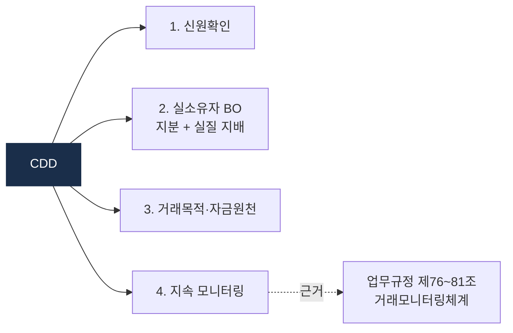
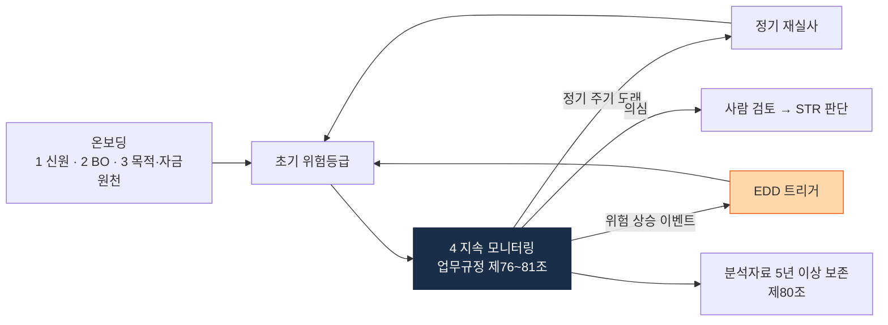

# Day 43 — CDD 4단계 운영

> 표준 실사 프로세스 deep. ⏱️ ~70분. 마지막 업데이트: 2026-10-21.

## 📖 오늘 뭘 배우나

Week 7은 컴플라이언스 운영 주간. 먼저 모든 고객에게 적용되는 **CDD 4단계**(식별·BO·목적·모니터링)를 운영 관점에서 깊이 봅니다. 특히 **지속 모니터링**이 onboarding 1회로 끝나지 않는다는 원칙을 정리합니다. FATF 2021 RBA 가이던스 para 275~276은 지속 모니터링을 "고객 프로파일 대비 거래 일관성 검증"으로 정의하고, 자동화와 사람의 검토를 함께 요구합니다([FATF 2021 가이던스](https://www.onpcsb.ro/2022/01042022/Updated-Guidance-VA-VASP.pdf)). 한국에서 지속 모니터링의 고시상 근거는 FIU 고시 제2025-2호 「자금세탁방지 업무규정」 제76~81조 "거래모니터링체계"(2026-01-22 시행)입니다. 흔히 인용되는 재실사 주기(저5/중3/고1년)와 실소유자 25% 기준은 이 저장소 근거 자료(research/)로 원문을 재확인하지 않았으므로, 법령·가이드라인 원문으로 확인하고 쓰세요.


<!-- MAP-START -->
## 🗺 오늘의 지도


<!-- MAP-END -->

## 🎯 핵심 질문
1. CDD 4단계 (식별/BO/목적/모니터링) 각 핵심 과제?
2. 한국 가이드라인의 RBA 4 차원?
3. 지속 모니터링은 "주기"와 "이벤트" 중 무엇으로 발동되나? FATF 2021 para 275~276은 무엇을 요구하나?

## 📖 읽기 (~50분)
- 메인: [`../notes/5-compliance/cdd-edd.md`](../notes/5-compliance/cdd-edd.md) — 1, 3절

## 🛠️ 미니 챌린지 (~15분)
- 가상 신규 고객 1명 시나리오 → CDD 4단계 모두 적용 메모
- "재실사 주기 알림 시스템" 가벼운 SQL 의사코드:
  ```sql
  SELECT customer_id FROM customers
  WHERE risk_level = 'HIGH' AND last_kyc_date < NOW() - INTERVAL '1 year'
  ```

## ✅ 체크포인트
- [ ] CDD 4단계 외운다
- [ ] BO 기준(지분율 + 실질 지배)을 법령 원문으로 확인했다
- [ ] 한국 RBA 4차원 + 등급별 통제 차이 안다
- [ ] 한국 거래모니터링 근거 = 업무규정 제76~81조, 분석자료 5년 이상 보존(제80조) 안다
- [ ] 지속 모니터링 ≠ onboarding 1회 안다

## 💭 오늘의 한 줄

## 🧮 RBA 점수 산정 (오늘의 핵심)

### 학습용 공식 (공개 표준 아님)

아래 공식·점수·구간은 **연습용 가설 모델**입니다. 감독기관이 공표한 점수표가 아니며, 실제 가중치와 구간은 회사 위험평가로 정합니다.

```
risk_score = w_customer × customer_factor + w_geography × country + w_product × product + w_channel × channel + w_behavior × behavior
```

가중치 합 = 1.0, 각 factor 0~100 점수.

### Factor 핵심 점수

| 항목 | 고위험 예시 (점수) |
|---|---|
| Customer | PEP(30) / 고위험 직업(15) |
| Geography | FATF Black(40) / Grey(25) |
| Product | Privacy coin(30) / Mixer(25) |
| Channel | Video KYC(15) |
| Behavior | Smurfing(40) / Pass-through(30) |

### 등급 매핑

| Score | 등급 | CDD 강도 |
|---|---|---|
| 0~29 | Low | 간소 |
| 30~59 | Medium | 표준 |
| 60~79 | High | EDD |
| 80+ | Critical | EDD + 수동 + AMLO |

### 🛠️ 오늘의 미니 챌린지 업그레이드

Python으로 RBA 점수 엔진 구현:
1. Factor 정의 (5개 dict)
2. 가중치 설정 (합 1.0)
3. 10개 샘플 고객에 대해 점수 산출
4. 등급 분포 플로팅 (Low/Medium/High/Critical %)

**상세**: [`../notes/5-compliance/cdd-edd.md`](../notes/5-compliance/cdd-edd.md) §8 참조.

## 💼 실무 현장 (Industry Reality)

### 한국 VASP에서는

CDD 4단계 운영은 **외부 본인확인·KYB 서비스 연동 + 내부 프로세스**로 쪼개집니다.

| 단계 | 담당 | 실무 포인트 |
|---|---|---|
| 1. 신원확인 | 본인확인기관 연동 | 실명확인 + 은행 실명계좌 연계 |
| 2. 실소유자(BO) 확인 | 자체 + 외부 KYB 보조 | 지분율 기준 + 실질 지배 자연인. 정확한 기준은 특금법 시행령 원문 확인 |
| 3. 거래목적·자금원천 | 자체 설문 + EDD 트리거 | 가입 시 간단 설문, 고위험 감지 시 EDD |
| 4. 지속 모니터링 | 자체 위험평가 + 거래모니터링 | 업무규정 제76~81조 — 비정상거래 주의(제77조), 분석 절차(제78조), 분석담당자·FIU 보고(제79조), 분석자료 **5년 이상 보존**(제80조) |

출처: [법제처 DRF 업무규정](https://www.law.go.kr/DRF/lawService.do?OC=test&target=admrul&ID=2100000267264&type=XML). 업무규정 본문에는 "가상자산"이라는 단어가 한 번도 나오지 않습니다. 한국 VASP의 지속 모니터링 근거가 금융권 공통 규정이라는 뜻입니다.

**왜 CDD가 실제 제재 사유가 되나**: FIU는 2025-11-06 두나무에 과태료 352억원을 결정했는데, 사유는 고객확인·거래제한·의심거래보고 등의 위반이었습니다(트래블룰 사유 아님)([FIU 보도자료 KDI 미러](https://eiec.kdi.re.kr/policy/materialView.do?num=273166)). 고객확인은 "형식 절차"가 아니라 가장 자주 지적되는 영역입니다.

실무적으로는 **위험 등급 상승이 감지되면 주기와 무관하게 재실사**합니다. 예: 프로파일과 맞지 않는 고액 거래 시작 → EDD 요청.

### 글로벌에서는

- **FATF 2021 가이던스**: para 275~276 지속 모니터링(자동화 + "human/expert analysis"), para 277~278 고위험 상황에서 "extend beyond the immediate transaction", para 156(c) EDD 수단으로 "blockchain analytics" 사용([FATF 2021 가이던스](https://www.onpcsb.ro/2022/01042022/Updated-Guidance-VA-VASP.pdf)).
- **EU**: AMLR(2024/1624)이 2027-07-10 적용 예정(enacted-not-in-force)이고, AMLA는 2026-10-01 CDD RTS(Art. 28(1)) 최종안을 집행위에 제출했습니다(아직 채택 전)([AMLA](https://www.amla.europa.eu/press-release-amla-finalises-key-standards-private-sector_en)).

이전 판의 "글로벌 KYC 벤더 4강", 벤더별 강점·토종 벤더 서술, "EU 15년 보관", "이용자보호법 15년" 은 공개 근거가 없거나 근거 자료로 확인되지 않아 삭제했습니다.

### 🔁 CDD는 순환한다 — 주기와 이벤트 두 개의 입구



### CDD 4단계 pseudocode

```python
def onboard_customer(applicant):
    # 1. 신원확인
    identity = kyc_vendor.verify(applicant.name, applicant.resident_id, applicant.phone)
    if not identity.verified: return reject("identity_fail")
    # 2. BO 확인 (법인이면)
    if applicant.is_corporate:
        bo_list = kyb_vendor.get_beneficial_owners(applicant.corp_id, threshold=0.25)
        if any(b.is_sanctioned for b in bo_list): return reject("bo_sanctioned")
    # 3. 거래목적·자금원천 수집
    purpose = applicant.declared_purpose
    sof = applicant.declared_source_of_funds
    # 4. 초기 리스크 등급
    risk = compute_risk(identity, purpose, sof, applicant.country)
    customer = create_customer(applicant, risk_level=risk)
    # 5. 지속 모니터링 예약
    schedule_next_kyc(customer, months=recurrence_by_risk(risk))  # 주기는 내부 정책값
    return customer

def ongoing_monitoring(customer):
    # 리스크 점수 재계산 (거래 이력 기반)
    new_risk = recompute_risk(customer.recent_txs_90d, customer.kyt_alerts)
    if new_risk > customer.risk_level:
        trigger_edd(customer)
    elif time_since_last_kyc(customer) > recurrence_limit(customer.risk_level):
        trigger_periodic_refresh(customer)
```

### 자주 나오는 오해

- **"KYC는 가입 시 한 번만"** — 틀림. 지속 모니터링이 CDD의 4단계. 재실사는 주기 + 이벤트 트리거 둘 다 있음.
- **"BO는 지분율만 보면 된다"** — 지분율 기준과 함께 **실질 지배** 자연인도 확인합니다. 업종별 하향 기준(예: "고위험 업종 10%")은 이 저장소 근거 자료로 확인되지 않았습니다.
- **"벤더 KYC로 모든 게 끝"** — 벤더는 신원확인까지. **리스크 스코어링·EDD·지속 모니터링은 회사 책임**입니다. 두나무 제재 사유에 고객확인 위반이 포함된 것이 그 예입니다.

