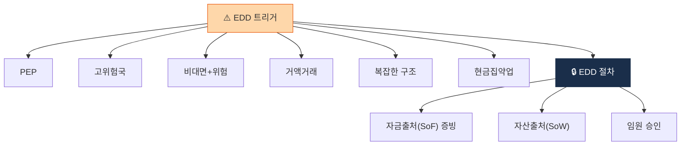
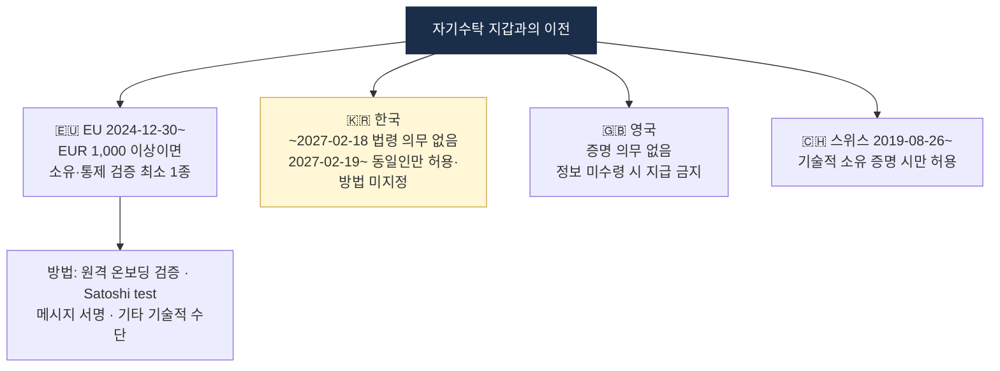

# Day 44 — EDD 트리거 + 자금원천 증빙

> 강화실사가 발동하는 6가지 + 자금출처 추적. ⏱️ ~75분. 마지막 업데이트: 2026-10-21.

## 📖 오늘 뭘 배우나

EDD의 본질은 **자금원천 증빙**. 일반 CDD 위에 **SoF(Source of Funds)·SoW(Source of Wealth) 서류 요구 + 고위경영진 승인**을 얹는 강화 절차이며, PEP·고위험국·비대면+위험 같은 6가지 트리거가 자동 발동됩니다. 가상자산 특화의 **자기수탁 지갑 소유·통제 검증**까지 연결합니다. 이 검증은 관할마다 의무 여부·발동 조건이 다릅니다 — EU는 EUR 1,000 초과 시 의무(2024-12-30~), 한국은 2027-02-19부터 동일인 간 이전만 허용(방법 미지정), 영국은 증명 의무 없음.

<!-- MAP-START -->
## 🗺 오늘의 지도

<!-- MAP-END -->

## 🎯 핵심 질문
1. EDD 트리거 6가지?
2. Source of Funds vs Source of Wealth 차이?
3. EDD 결재 라인 (고위경영진 승인)?

## 📖 읽기 (~50분)
- 메인: [`../notes/5-compliance/cdd-edd.md`](../notes/5-compliance/cdd-edd.md) — 2, 5절
- 보조: [`../notes/5-compliance/cdd-edd.md`](../notes/5-compliance/cdd-edd.md) — 4절 (가상자산 특화)

## 🛠️ 미니 챌린지 (~15분)
- EDD 트리거 6가지 시나리오 만들기:
  - PEP / 고위험국 / 비대면+위험 / 거액 / 복잡한 구조 / 현금집약 업종
- EBA/GL/2024/11이 열거한 자기수탁 주소 검증 방법(원격 온보딩 검증·Satoshi test·메시지 서명·기타 기술적 수단) 정리 + 한국(2027-02-19~)·영국과 비교

## ✅ 체크포인트
- [ ] EDD 6 트리거 외운다
- [ ] Source of Funds vs Wealth 차이 즉답
- [ ] 고위경영진 승인 필수 안다
- [ ] 자기수탁 지갑 검증: EU €1,000 초과 의무 / 한국 2027-02-19~ 동일인만 / 영국 증명 의무 없음 구분한다

## 💭 오늘의 한 줄

## 💼 실무 현장 (Industry Reality)

### 한국 VASP에서는

EDD 트리거의 금액 기준(예: "1일 누적 얼마 초과")은 **회사 내부 정책값**입니다. 법령이 정한 공통 금액 트리거가 아니며 업계 평균값을 공개한 자료도 없습니다. 이전 판의 "1일 1억원·월 3억원·신규 30일 3천만원" 트리거, PEP DB 벤더명·구독료는 공개 근거가 없어 삭제했습니다.

한국에서 금액이 법령에 들어가는 지점은 따로 있습니다. 혼동하지 마세요.

| 금액·조건 | 무엇인가 | 상태(2026-10-21) |
|---|---|---|
| 시행령 §10의10 **100만원 이상** | 트래블룰(특금법 §5의3) 정보제공 대상 | in-force, **2027-02-18까지** |
| 2027-02-19~ 기준금액 없음 | 다른 VASP로의 모든 이전에 정보제공 | enacted-not-in-force (대통령령 제36592호, 2026-08-18 공포) |
| 고시 §28-2③ **1천만원 이상** | 해외 VASP·자기수탁 지갑 거래에 **자체 의심거래 감시체계** 구축·운영 (자동 STR 아님) | enacted-not-in-force (시행일 2027-02 중, 확정 안 됨) |

출처: [법제처 DRF 시행예정 판본](https://www.law.go.kr/DRF/lawService.do?OC=test&target=eflaw&MST=288765&efYd=20270219&type=XML), [감독규정 FIU 고시 제2026-2호](https://www.law.go.kr/DRF/lawService.do?OC=test&target=admrul&ID=2100000285986&type=XML), [금융위 2026-08-11](https://www.fsc.go.kr/no010101/87499).

증빙 서류는 보통 아래 중 하나입니다(자금원천 유형별 예시):
- 근로소득: 급여명세서 + 원천징수영수증
- 사업소득: 사업자등록증 + 매출 증빙
- 자산 매각: 부동산 매도계약서·등기부등본, 주식 양도 증빙
- 해외 송금: 송금 이력

### 글로벌에서는

- **FATF 2021 가이던스 para 156(c)**: EDD 수단으로 "the use of analysis products, such as blockchain analytics"([FATF 2021 가이던스](https://www.onpcsb.ro/2022/01042022/Updated-Guidance-VA-VASP.pdf)).
- **FATF 7차 TU(2026-07-16)**: 비수탁지갑 관련 EDD, 소매 고객으로 위장한 역외 VASP 계정 탐지(권고 6-iii)를 요구합니다([7차 TU PDF](https://www.fatf-gafi.org/content/dam/fatf-gafi/reports/7th-targeted-update-on-implementation-fatf-standards-vas-vasps-2026.pdf.coredownload.pdf)).

이전 판의 "Coinbase EDD Tier 3~5", "Binance Wealth Manager", "OKX 2025-02 $504M 합의 후 Legacy KYC 전수 재검토"는 근거 자료로 확인되지 않아 삭제했습니다(OKX 사건 세부는 [`../notes/6-cases/major-enforcement.md`](../notes/6-cases/major-enforcement.md)에서도 "공개 근거 미확인").

### 가상자산 특화 — 자기수탁 지갑 소유·통제 검증

**EU (in-force, 2024-12-30~)**: TFR + EBA/GL/2024/11. 자기수탁 주소와의 이전이 **EUR 1,000 "amounts to or exceeds"** 이면 소유·통제를 평가합니다. 방법은 아래 중 **최소 1종**이고, 확인된 주소는 화이트리스트에 올릴 수 있습니다(¶83, ¶86)([EBA/GL/2024/11](https://www.eba.europa.eu/sites/default/files/2024-07/6de6e9b9-0ed9-49cd-985d-c0834b5b4356/Travel%20Rule%20Guidelines.pdf)).
1. **원격 온보딩 검증** 수단 활용
2. **Satoshi test** (소액 송금 테스트)
3. **메시지 서명** (nonce에 지갑 개인키로 서명 → 검증)
4. 기타 적절한 기술적 수단

**한국 (enacted-not-in-force, 2027-02-19~)**: 시행령 §10의20 ⑧, 고시 §28-2④ — "독점적인 관리 권한을 가지지 않은 가상자산주소"(자기수탁 지갑)와의 이전은 **고객과 상대방이 동일인일 때만** 허용. 확인 방법은 정하지 않았습니다. 2027-02-18까지는 법령상 자기수탁 지갑 소유 증명 의무가 없습니다(거래소 자체 정책은 별개).

**영국 (in-force)**: 소유 증명 의무 없음. 사업자가 고객에게 정보를 요청할 수 있고, 받지 못하면 "must not make the cryptoasset available to the beneficiary"([reg 64G](https://www.legislation.gov.uk/uksi/2017/692/regulation/64G)).

**스위스 (in-force, 2019-08-26~)**: 외부지갑 이전은 자기 고객 소유를 "suitable technical means"로 증명한 경우에만 허용([FINMA 02/2019](https://www.finma.ch/en/~/media/finma/dokumente/dokumentencenter/myfinma/4dokumentation/finma-aufsichtsmitteilungen/20190826-finma-aufsichtsmitteilung-02-2019.pdf)).

이전 판의 "EU는 Self-Hosted Wallet 입출금**마다** 소유 증명 요구"는 틀렸습니다 — EUR 1,000 이상 이전에서 발동합니다. "사진 인증은 사실상 폐기"는 근거 자료로 확인되지 않아 삭제했습니다.

### 자주 나오는 오해

- **"EDD는 고위험 고객만"** — 트리거 기반입니다. 일반 고객도 프로파일과 맞지 않는 거래를 시작하면 발동합니다.
- **"증빙은 PDF 받으면 끝"** — 증빙 서류의 **진위 확인**까지가 EDD입니다. 위조 의심 시 발급기관 조회 등으로 검증합니다.
- **"서명했으니 본인 지갑"** — 메시지 서명은 그 순간 키를 **통제**한다는 것만 증명하고 **수익적 소유**는 증명하지 못합니다. 자기수탁 소유 검증 방식을 학술적으로 평가한 2025~2026 논문은 확인되지 않았습니다. 서명 + 온체인 활동 이력 + 고객 프로파일을 함께 봅니다.
