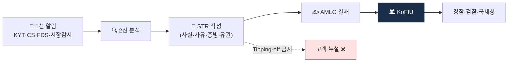
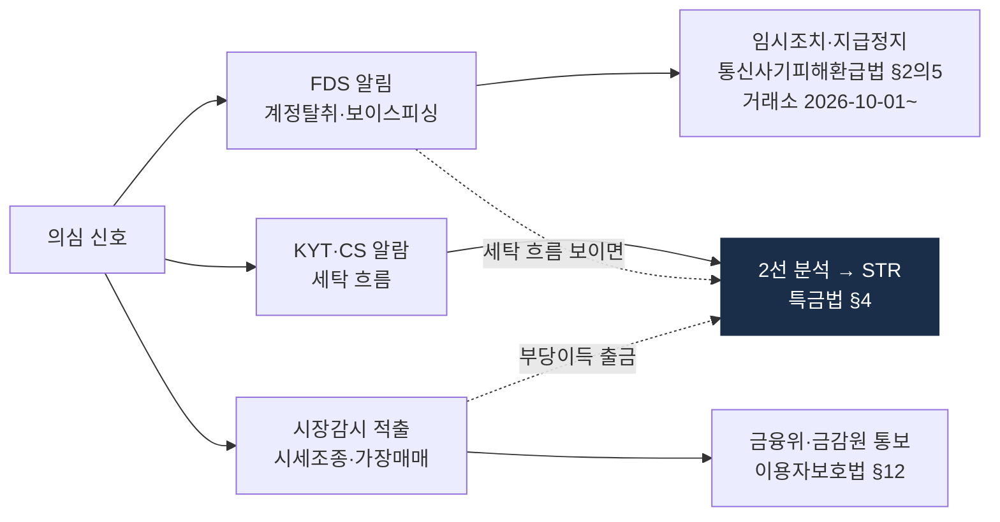

# Day 45 — STR 작성 SOP

> 좋은 STR vs 나쁜 STR. ⏱️ ~75분. 마지막 업데이트: 2026-10-21.

## 📖 오늘 뭘 배우나

STR은 AML 시스템의 **최종 출구**. 오늘은 **좋은 STR의 4요소**(사실·의심사유·증빙·유관거래)와 **Tipping-off 금지**를 중심으로 실제 작성 SOP를 익힙니다. STR(특금법 §4 의심거래보고)은 "이상거래보고"가 아닙니다 — "이상거래"는 가상자산이용자보호법 §12 시장감시의 용어입니다. FDS 알림(사기 피해금 흐름)과 시장감시 적출도 STR의 **입력원**이 되지만, FDS 임시조치·§12 통보는 STR과 별개의 법적 산출물입니다. "의심이 들면 문서화 후 STR, 아니면 사유 기록"이 기본값인 이유까지 봅니다.


<!-- MAP-START -->
## 🗺 오늘의 지도


<!-- MAP-END -->

## 🧮 STR 실무 템플릿 (오늘의 핵심)

### 실무에서 쓰기 좋은 7개 섹션 (FIU 공식 양식 항목과 대조해 쓸 것)

1. 보고기관 정보  2. 의심거래 개요 (5W1H)  3. 고객 정보 (KYC snapshot)
4. 거래 상세  5. 의심 근거  6. 첨부자료  7. 보고자 의견

### Good vs Bad STR 차이

- **❌ Bad**: "큰 금액 출금" (사유 빈약, 근거 없음)
- **✅ Good**: "어느 룰이 트리거됐는지(RF-ID) + 7일 구조화 패턴 + 믹서 간접 노출(분석도구 라벨, 확률적) + 자금원천 증빙 무응답" — 점수·노출 % 는 분석도구마다 산정 방식이 달라 그 정의를 함께 적는다

### 품질 체크리스트 (8개)

- [ ] 5W1H 완성
- [ ] 금액·일시·주소·tx 해시 정확
- [ ] 분석도구 결과 + 산정 방식(어느 도구·어느 시점) 첨부
- [ ] 제재 목록 조회 기록(조회 시점의 목록 판본)
- [ ] 관련 거래 7일 윈도우
- [ ] 자금원천 증빙 시도 기록
- [ ] Tipping-off 통제 ✓
- [ ] 의심 수준 명시

### 🛠️ 오늘의 미니 챌린지 업그레이드

샘플 케이스로 Good STR 작성:
- 고객 A, 5억원 출금, 믹서 간접 노출 + 제재 대상 2-hop 노출(분석도구 라벨). 참고: Tornado Cash는 2025-03-21 SDN에서 삭제됐으므로 "제재 노출"이 아니라 "믹서 위험 노출"로 써야 한다
- 위 7개 섹션 + 8개 체크리스트 모두 충족하여 작성
- 실제로 FIU에 제출 가능한 수준인지 동료 리뷰

**상세 템플릿**: [`../notes/5-compliance/str-ctr.md`](../notes/5-compliance/str-ctr.md) §9 참조.

## 🎯 핵심 질문
1. 좋은 STR 4요소?
2. Tipping-off 금지 — 무엇을 하면 위반이고, 고객에게는 어떻게 안내하나?
3. STR 사후 흐름 (KoFIU → 어디?) 그리고 FDS 임시조치·§12 통보와는 어떻게 다른가?

## 📖 읽기 (~50분)
- 메인: [`../notes/5-compliance/str-ctr.md`](../notes/5-compliance/str-ctr.md) — 1, 3, 5, 6절

## 🛠️ 미니 챌린지 (~20분)
- 가상 STR 1건 직접 작성 (사실/사유/증빙/유관거래)
  - 시나리오: "신규 고객 A가 가입 직후 입금 즉시 mixer로 전액 출금 요청"
- "Tipping-off를 피하는 고객 안내 문구" 3줄 메모 (조문·형량은 특금법 원문으로 확인)

## ✅ 체크포인트
- [ ] STR 4요소 (사실/의심사유/증빙/유관거래) 외운다
- [ ] Tipping-off 금지 원칙과 고객 안내 방식 안다 (형량은 특금법 원문 확인)
- [ ] STR 사후 흐름 (KoFIU → 경찰/검찰/국세청 등) 안다
- [ ] STR 패턴 7가지 (Mixer/SDN/Smurfing/Pass-through/신원불일치/도난/사기) 인지
- [ ] 2027-02-19~ 1천만원 이상 해외 VASP·자기수탁 이전 = 자체 의심거래 감시체계 (자동 STR 아님) 안다

## 💭 오늘의 한 줄

## 💼 실무 현장 (Industry Reality)

### 한국 VASP에서는

**STR 제출 채널은 KoFIU 전자보고 시스템(FIU-TIS)** 입니다. 담는 내용은 보통 다음과 같습니다.
- 보고기관 정보, 의심거래 개요
- 고객 정보(신원·거래내역)
- 의심사유 상세(**사실 + 분석**)
- 증빙 자료(거래내역, 분석도구 결과, 제재 목록 조회 기록)
- 유관 거래(같은 패턴 거래 목록)

건당 작성·제출 시간, 웹 입력과 API 중 무엇을 쓰는지, 분석가 1인당 월 건수, 거래소별 연간 건수는 **공표되지 않습니다**. 이전 판의 "7일 이내 수리 통보", "분석가 1인당 월 3~10건", "특정 거래소 연간 수천 건", "요약 200~500자·의심사유 2000자"는 공개 근거가 없어 삭제했습니다. 사내 실측값을 쌓아 인력 계획에 씁니다.

**STR이 실제 제재 사유가 된 예**: FIU는 2025-11-06 두나무에 과태료 352억원을 결정했고, 사유에 의심거래보고 위반이 포함됐습니다(트래블룰 사유 아님)([FIU 보도자료 KDI 미러](https://eiec.kdi.re.kr/policy/materialView.do?num=273166)).

### 🔀 한 사건, 세 개의 출구



FDS 임시조치나 §12 통보를 했다고 STR 판단이 끝나지 않고, STR을 했다고 §12 통보 의무가 사라지지도 않습니다. 출구별로 기록을 남깁니다([`../notes/5-compliance/str-ctr.md`](../notes/5-compliance/str-ctr.md) §1).

### 글로벌에서는

- **FinCEN (미국)**: 주의보 FIN-2023-Alert005(2023-09-08)가 pig butchering 관련 SAR에 키워드 "FIN-2023-PIGBUTCHERING"을 기재하도록 요청해, 사기 탐지와 의심거래보고의 연결을 공식화했습니다([FinCEN Alert](https://www.fincen.gov/sites/default/files/shared/FinCEN_Alert_Pig_Butchering_FINAL_508c.pdf)).
- **알람→SAR 전환율 벤치마크**: 공개 자료는 은행권(EY 2018, 리테일 평균 14%)뿐이고, **가상자산 전용 alert-to-STR 벤치마크는 존재하지 않습니다**(B)([EY 2018](https://ey.com/content/dam/ey-unified-site/ey-com/en-uk/industries/financial-services/documents/ey-anti-money-laundering-transaction-monitoring-2018-emeia-survey.pdf)).
- **EU**: AMLR(2024/1624)은 2027-07-10 적용 예정(enacted-not-in-force). 의심거래보고는 2026-10-21 현재도 회원국 FIU 체계로 이뤄집니다.

이전 판의 "Coinbase 연간 수만 건(2023 Transparency Report)", "SAR 건당 벌금 최대 $100K", "2027 EU 단일 goAML 도입", "FinCEN 2024 가이드의 5W1H"는 근거 자료로 확인되지 않아 삭제했습니다. 5W1H는 좋은 서술 습관으로 쓰되 특정 공문 출처로 인용하지 마세요.

### STR 작성 SOP (예시 — 소요시간은 사내 기준)

```
1. 1선 알람(KYT·CS·FDS 이관·시장감시 이관) → 분석가 1차 리뷰 (오탐 제외, 제외 사유 기록)
2. 의심 확정 시 조사 케이스 오픈
3. 증거 수집:
   - 온체인 tx 해시, 상대방 라벨(분석도구·조회 시점)
   - 고객 KYC 정보, 거래 이력
   - 제재 목록 조회 기록
   - FDS 임시조치·§12 통보가 있었다면 그 기록
4. STR 초안 작성 (트리거된 룰 + 사실 + 분석)
5. 보고책임자 결재
6. FIU-TIS 제출
7. 내부 기록 보관 (보존기간은 특금법·업무규정 원문 확인 — 업무규정 제80조는 거래모니터링 분석자료 5년 이상 보존)
8. *** Tipping-off 금지 — 고객·제3자에게 누설 금지 ***
```

### Tipping-off 금지

- 고객에게 STR 사실을 알리면 **별도 처벌 대상**입니다. 조문·형량은 특금법 원문으로 확인하세요 — 이 저장소의 2026-10 근거 자료에서는 재검증하지 않았습니다.
- 거래 거절·계좌폐쇄 사유로 "STR 보고했음"이라고 말하면 안 되고, "내부 정책상" 같은 일반적 사유로 안내합니다.
- STR 대상 고객 정보에 영업·마케팅 담당의 접근을 막는 것이 기본 내부통제입니다.

이전 판의 "특금법 §5의2: 1년 이하 징역 또는 1천만원 이하 벌금"(§5의2는 고객확인 조문), 2022·2024년 "실사례"는 근거 자료로 확인되지 않아 삭제했습니다.

### 자주 나오는 오해

- **"STR 많이 내면 잘하는 것"** — 수량보다 품질입니다. 다만 FIU가 회사별 STR 품질을 어떻게 평가하는지에 대한 공개 기준은 없습니다. 품질 낮은 STR 남발과 STR 부재 모두 검사에서 설명을 요구받을 수 있다는 전제로 판단 기록을 남깁니다.
- **"STR 제출하면 자동 수사"** — 아닙니다. KoFIU는 수집·분석·배포 기관이고 수사 개시는 수사기관이 판단합니다. STR 중 수사로 이어지는 비율에 대한 공개 수치는 이 저장소 근거 자료에 없습니다.
- **"1천만원 넘으면 무조건 STR"** — 2027-02-19부터 해외 VASP·자기수탁 지갑 1천만원 이상 이전은 **자체 의심거래 감시체계** 대상입니다. 입법예고안(2026-03-30)의 "위험도와 관계없이 의심거래로 보고"는 최종본에서 바뀌었습니다([금융위 2026-08-11](https://www.fsc.go.kr/no010101/87499)).
