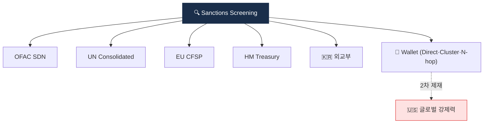
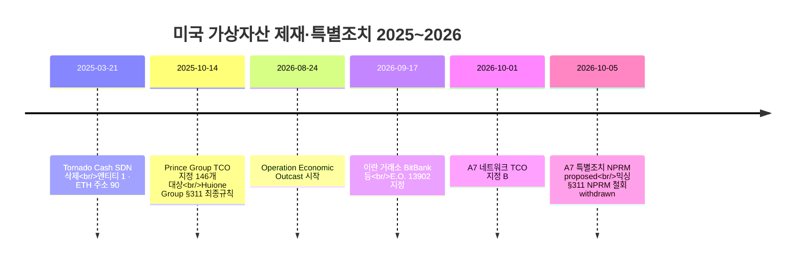

# Day 46 — 제재 스크리닝 (이름 + Wallet)

> OFAC/UN/EU/외교부 + 가상자산 SDN. ⏱️ ~80분. 마지막 업데이트: 2026-10-21.

## 📖 오늘 뭘 배우나

제재 스크리닝은 거래 **전·중·후** 3단 체크로 작동합니다. 오늘은 **5대 리스트**(OFAC SDN·UN·EU·HM Treasury·한국 외교부)와 **이름 fuzzy 매칭의 함정**, 그리고 **Wallet 주소 매칭 3종**(Direct·Cluster·Hop)을 정리. False Positive 처리(Disposition)가 왜 감독 검사의 핵심 증빙이 되는지도 이해합니다. 2025~2026년 미국 제재의 축은 "유형"(믹서)에서 "네트워크·조직"(Prince Group·A7·이란 거래소)으로 옮겨 갔고, Tornado Cash는 2025-03-21 SDN에서 **삭제**됐습니다 — 목록은 늘기만 하지 않습니다.


<!-- MAP-START -->
## 🗺 오늘의 지도


<!-- MAP-END -->

## 🧮 Fuzzy Matching 한국 튜닝 (오늘의 핵심)

### 문제: 한국 이름은 소수 성씨에 몰려 있다

소수 성씨에 인구가 몰려 있고 로마자 표기가 여러 가지(Kim/Gim/Ghim)라, 기본 Jaro-Winkler 임계값만 쓰면 "Kim Min-soo"와 SDN의 "Kim Min-su" 같은 쌍이 높은 점수로 매칭돼 알람이 폭증합니다.

### 한국 튜닝 규칙 (학습용 출발점 — 임계값은 사내 실측으로 정한다)

1. **성씨 로마자 variants 매칭** (Kim/Gim/Ghim)
2. **상위 성씨면 이름 유사도 임계값 상향**
3. **보조 식별자 필수**: (Name + DOB) OR (Name + Nationality)
4. **Disposition whitelist 운영**: 판정이 끝난 (고객, SDN 항목) 쌍은 재알람을 막되, SDN 항목이 바뀌면 재검토

### 튜닝 효과 — 직접 측정해서 채울 표

| Config | FP rate | FN rate | 일 alert |
|---|---|---|---|
| JW 단독 | ? | ? | ? |
| JW 상향 + DOB | ? | ? | ? |
| JW 상향 + DOB + 성씨필터 | ? | ? | ? |
| Full pipeline | ? | ? | ? |

이전 판의 표 값(FP 90%→12%, 일 alert 200+→10~15 등)은 "한국 VASP 추정"이라는 이름의 근거 없는 수치여서 삭제했습니다. 미니 챌린지에서 직접 측정한 값을 채우세요. FN은 정답 라벨이 있어야 잴 수 있으므로, 합성 테스트셋(알려진 SDN 이름 변형)을 만들어 측정합니다.

### 🛠️ 오늘의 미니 챌린지 업그레이드

Python으로 구현:
1. `jellyfish` 라이브러리로 Jaro-Winkler 계산
2. OFAC SDN 파일에서 이름·DOB·nationality·디지털통화주소 파싱 (필드 구조는 OFAC 배포 문서로 확인)
3. 한국 성씨 list + normalize 함수 구현
4. 10명 샘플 고객에 대해 3가지 config(기본/중간/Full) 비교
5. FP rate·FN rate 측정

**상세 pipeline**: [`../notes/5-compliance/sanctions-screening.md`](../notes/5-compliance/sanctions-screening.md) §12 참조.

## 🎯 핵심 질문
1. 핵심 제재 리스트 5개?
2. 이름 fuzzy 매칭의 함정?
3. Wallet 주소 매칭 3가지 (Direct/Cluster/Hop)?

## 📖 읽기 (~55분)
- 메인: [`../notes/5-compliance/sanctions-screening.md`](../notes/5-compliance/sanctions-screening.md) — 1~7절

## 🌐 외부 자료 (~15분)
- [OFAC SDN 검색](https://sanctionssearch.ofac.treas.gov/)
- [UN Consolidated List](https://www.un.org/securitycouncil/content/un-sc-consolidated-list)

## 🛠️ 미니 챌린지 (~10분)
- "Kim Min-soo" 같은 흔한 이름 → false positive 처리 흐름 메모
- Disposition 코드 3개 정의 (TP-Confirmed / FP-Different DOB / Pending)

## ✅ 체크포인트
- [ ] OFAC SDN + UN + EU + 외교부 5대 리스트 안다
- [ ] Wallet 매칭 3종 (Direct/Cluster/Hop) 안다
- [ ] False Positive disposition 흐름 안다
- [ ] OFAC 2차 제재의 글로벌 영향 안다
- [ ] 2025-03-21 Tornado Cash SDN 삭제, 2025-10-14 Prince Group, 2026-09-17 BitBank 지정 — 목록 변경 이력을 안다
- [ ] "주소 일치 = 즉시 동결"이 아니라 이용자보호법 §11 차단 제한과 내부 절차를 따른다는 것을 안다

## 💭 오늘의 한 줄

## 💼 실무 현장 (Industry Reality)

### 한국 VASP에서는

제재 스크리닝은 **온보딩 + 매 거래 + 목록 갱신 시 일괄 재대조**로 돌아갑니다. 이름 매칭은 외부 KYC 서비스 내장 기능이나 자체 fuzzy 엔진(Jaro-Winkler + 음차 변환 테이블 등)으로, 지갑주소 매칭은 SDN 주소 캐시 대조 + 분석도구의 간접 노출 결과로 처리하는 구성이 일반적입니다.

이전 판의 "4대 거래소 모두 특정 KYC 벤더·분석도구 사용", "외교부 목록 매일 09:00 수동 다운로드", "DAXA 5사 공동 제재 주소 블랙리스트를 특정 솔루션 채널로 공유"는 공개 근거가 없어 삭제했습니다.

**차단의 법적 요건**: 가상자산이용자보호법 §11은 정당한 사유 없는 입출금 차단을 제한하고, 차단 시 사유 통지·금융위 보고가 따릅니다. 허용 사유는 시행령 §17에 열거돼 있습니다([시행령](https://www.law.go.kr/LSW/lsInfoR.do?lsiSeq=290171&efYd=20261002&ancYnChk=0&chrClsCd=010202&urlMode=lsInfoR)). 제재 대상 직접 일치처럼 근거가 분명한 경우와 간접 노출 같은 확률적 신호는 처리 경로를 나눠야 합니다.

### 글로벌에서는 — 2025~2026 OFAC·FinCEN 가상자산 축



출처: [OFAC 2025-03-21](https://ofac.treasury.gov/recent-actions/20250321), [재무부 sb0278](https://home.treasury.gov/news/press-releases/sb0278), [OFAC 2026-09-17](https://ofac.treasury.gov/recent-actions/20260917), [Federal Register 2026-20371](https://public-inspection.federalregister.gov/2026-20371.pdf), [Federal Register 2026-20429](https://public-inspection.federalregister.gov/2026-20429.pdf). A7 TCO 지정은 FinCEN NPRM 각주 인용(B).

- **FATF 7차 TU 권고 5-ii**는 "wallet screening, blacklisting, and, where appropriate, whitelisting mechanisms as well as freezing and blocking capabilities"를 통제 요소로 열거합니다([7차 TU PDF](https://www.fatf-gafi.org/content/dam/fatf-gafi/reports/7th-targeted-update-on-implementation-fatf-standards-vas-vasps-2026.pdf.coredownload.pdf)).
- **제재 해제 ≠ 위험 해제**: Tornado Cash 제재 후 957일간 입금액은 71.03% 줄었지만 Ethereum 보안사고의 78.33%는 여전히 Tornado Cash를 거쳤습니다(WWW '26)([arXiv 2507.11721](https://arxiv.org/abs/2507.11721)).

이전 판의 "Coinbase Sanctions Operations 50~80명", "Binance 2023 합의 후 시간당 sync", "OKX $504M 합의(2025-02)의 원인"은 근거 자료로 확인되지 않아 삭제했습니다.

### 기술 스택 (예시)

- **이름 매칭**: 오픈소스 검색엔진의 fuzzy 질의, 또는 상용 PEP·제재 DB
- **Wallet 매칭**: SDN 주소 캐시(정확 일치) + 분석도구의 간접 노출(확률적)
- **SDN fetch**: OFAC 배포 파일 diff — 추가·**삭제** 모두 반영, 판본 이력 보존

### 실제 룰 (pseudocode — 처리 시간은 사내 기준)

```
RULE sanctions_wallet_direct
WHEN tx.counterparty_address IN ofac_sdn_crypto_cache   # 조회 시점 판본 기록
THEN action = HOLD_AND_ESCALATE        # 내부 절차 + 이용자보호법 §11·시행령 §17 검토
     str_review = TRUE
     notify = ["AMLO", "LEGAL"]

RULE sanctions_wallet_indirect
WHEN analytics.indirect_exposure.sanctioned > THRESHOLD   # 임계값은 위험평가로
THEN action = REVIEW_QUEUE
```

### 자주 나오는 오해

- **"OFAC은 미국 회사에만 적용"** — 2차 제재 위험과 달러·미국 발행 스테이블코인 경로 때문에 한국 VASP도 OFAC 목록을 축으로 스크리닝합니다.
- **"이름만 같으면 차단하면 된다"** — 흔한 이름은 오탐이 대량으로 납니다. 생년월일·국적·주소 같은 2차 필드 대조 없이는 운영할 수 없습니다.
- **"SDN에서 빠졌으니 안전"** — Tornado Cash처럼 제재가 풀려도 위험 라벨과 위험평가는 남습니다. 공동개발자 Roman Semenov 항목은 2025-03-21 이후에도 [DPRK3]로 유지됐습니다([OFAC 2025-03-21](https://ofac.treasury.gov/recent-actions/20250321)).
