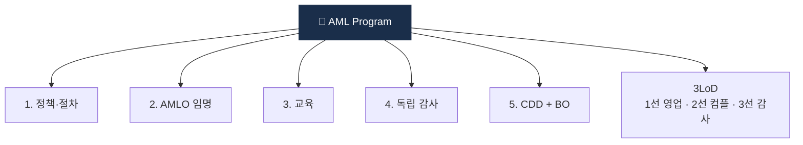
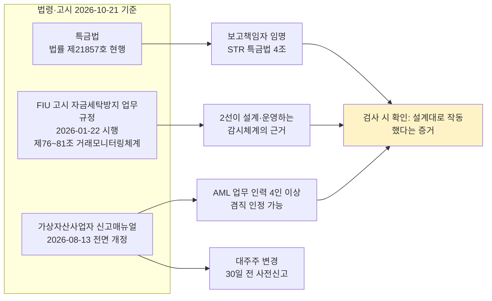

# Day 47 — 내부통제 5 pillars + 3LoD

> AML 거버넌스의 뼈대. ⏱️ ~75분. 마지막 업데이트: 2026-10-21.

## 📖 오늘 뭘 배우나

"AML은 시스템보다 거버넌스가 본질". 오늘은 **5 Pillars**(정책·AMLO·교육·감사·CDD)와 **3중 방어선**(영업-컴플-감사)을 정리하고, **ERA (Enterprise-wide Risk Assessment)** 가 왜 정기적으로 다시 돼야 하는지 이해합니다. 정책 매뉴얼의 12 챕터 구조는 실무 작성 시 참조 템플릿입니다. 한국 쪽에서는 2026-08-13 개정 신고매뉴얼(AML 인력 4인 이상)과 FIU 고시 「자금세탁방지 업무규정」(2026-01-22 시행)이 거버넌스 요건을 실제 숫자·조문으로 묶습니다.

<!-- MAP-START -->
## 🗺 오늘의 지도


<!-- MAP-END -->

## 🎯 핵심 질문
1. AML 5 pillars 이름?
2. 3중 방어선 각 라인의 역할?
3. ERA = 무엇? 왜 주기적으로 다시 하나?

## 📖 읽기 (~55분)
- 메인: [`../notes/5-compliance/internal-controls.md`](../notes/5-compliance/internal-controls.md) — 1~4, 6절
- 보조: [`../notes/6-cases/korea-enforcement.md`](../notes/6-cases/korea-enforcement.md) — 1절(두나무 제재대상사실 "의심거래 감시체계 구축 의무 위반")

> 주의: `internal-controls.md` 의 💼 블록(조직도 인원·연봉·D&O 보험·대형사 3LoD 사례)은 2026-10-21 기준 공개 근거가 확인되지 않은 서술을 포함한다. 개념(5 Pillars·3LoD·ERA) 위주로 읽는다.

## 🛠️ 미니 챌린지 (~10분)
- AML 정책 매뉴얼 12 챕터 구조 외워서 메모
- "1선 vs 2선 vs 3선" 한 줄 차이 정리

## ✅ 체크포인트
- [ ] 5 pillars (정책/AMLO/교육/감사/CDD) 외운다
- [ ] 3LoD 외운다
- [ ] ERA 의 평가 차원 + 정기 갱신 이유 안다
- [ ] 정책 매뉴얼 12 챕터 구조 안다
- [ ] 한국 신고매뉴얼 "AML 업무 인력 4인 이상"(2026-08-13) 안다

## 💭 오늘의 한 줄

## 🧭 한국 거버넌스 요건 — 무엇이 어디에 적혀 있나



근거: [금융위 2026-08-13 신고매뉴얼](https://www.fsc.go.kr/no010101/87521) · [AML 업무규정 법제처 DRF](https://www.law.go.kr/DRF/lawService.do?OC=test&target=admrul&ID=2100000267264&type=XML). 업무규정 본문에는 "가상자산"이라는 단어가 나오지 않는다 — 금융권 공통 규정이다.

## 💼 실무 현장 (Industry Reality)

### 한국 VASP에서는

5 Pillars와 3LoD는 검사에서 "있느냐"보다 **"작동하느냐"** 로 확인된다. 2025-12-09 FIU 제재공시상 두나무 제재대상사실에는 **"의심거래 감시체계 구축 의무 위반"** 이 들어 있다(B)([FIU 보도자료 KDI 미러](https://eiec.kdi.re.kr/policy/materialView.do?num=273166)). 감시체계를 갖추고 작동시키는 것 자체가 제재 대상이 된다는 뜻이다. 인력 요건은 2026-08-13 개정 신고매뉴얼의 **AML 업무 인력 4인 이상**(겸직 인정 가능)이 공개된 유일한 숫자다([금융위 2026-08-13](https://www.fsc.go.kr/no010101/87521)). 이전 판의 "매뉴얼 60~100페이지", "2선 5~10명(최대 ~20명)", 특정 회계법인 위탁 관행은 공개 근거가 없어 삭제했다. ERA 주기·이사회 승인 주기도 법령 원문으로 확인하지 못했으므로 사내 정책으로 정하고 근거를 문서화한다.

### 글로벌에서는

FATF 2021 RBA 가이던스 para 275~276은 지속 모니터링에서 "automated systems may be the only realistic method of monitoring transactions, and flagged transactions should go through human/expert analysis"라고 하고, 운영 룰의 무결성을 "regular basis"로 검증하라고 요구한다([FATF 2021 가이던스 미러](https://www.onpcsb.ro/2022/01042022/Updated-Guidance-VA-VASP.pdf)). 2선(룰 설계·튜닝)과 3선(효과성 검증)의 분리가 여기서 나온다. 이전 판의 "BSA 2020 개정으로 6번째 pillar 공식 추가", "Binance 합의서의 3LoD 붕괴", "CCO는 CEO 직속 의무화"는 이 저장소 근거 자료로 확인되지 않아 삭제했다(공개 근거 없음).

### 3LoD 실제 분담 (VASP 예시 — 설계 템플릿)

| 업무 | 1선 (영업/운영) | 2선 (컴플) | 3선 (감사) |
|---|---|---|---|
| KYC 심사 | 심사 수행 | 기준·룰 제정·샘플 검증 | 주기적 독립 감사 |
| 거래모니터링 알림 | 미관여 | 알림 처리·STR 판단 지원 | 처리 기한·품질 감사 |
| 신상품 출시 | 제안 | AML 영향평가(Pre-assessment) | 사후 감사 |
| 룰 튜닝 | 피드백 제공 | 룰 위원회 운영·변경 이력 기록 | 효과성 검증 |

주기(월 1회·연 1회 등)는 공개 기준이 없다 — 자사 위험평가로 정하고 근거를 남긴다.

### 정책 매뉴얼 12챕터 (참조 구조)

```
1. 목적·적용범위
2. 용어 정의 (FDS / 시장감시 §12 / STR 구분 포함)
3. 거버넌스·AMLO
4. 위험기반접근(RBA)·ERA
5. 고객확인(CDD/EDD)
6. 거래모니터링 (업무규정 제76~81조)
7. 제재 스크리닝
8. 의심거래보고(STR, 특금법 §4)
9. Travel Rule (특금법 §5의3, 시행령 §10의10 — 2027-02-18까지 100만원 이상, 2027-02-19부터 전건)
10. 기록보관 (보존기간은 법령 원문 확인)
11. 임직원 교육
12. 내부감사·이의제기
```

### 자주 나오는 오해

- **"5 Pillars만 갖추면 완성"** — 문서가 있어도 작동 증거(추출 기준, 점검 기록, 기준 변경 이력)가 없으면 미작동으로 본다. 두나무 제재대상사실의 "감시체계 구축 의무 위반"(B)이 그 예다.
- **"3선 내부감사는 형식"** — 3선은 2선의 룰 설계가 ERA 결과와 맞는지 독립적으로 검증하는 유일한 라인이다. 이전 판의 "Paxful 2025 지적 1위가 3선 독립성"은 틀렸다 — FinCEN 2025-12-09 Paxful 사유는 MSB 미등록·AML 프로그램 미비·SAR 미제출이다([FinCEN](https://www.fincen.gov/news/news-releases/fincen-assesses-35-million-penalty-against-paxful-facilitating-suspicious)).
