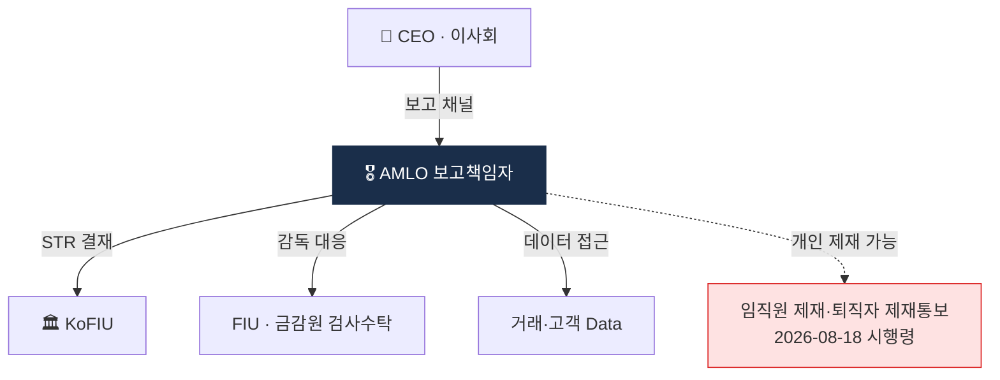
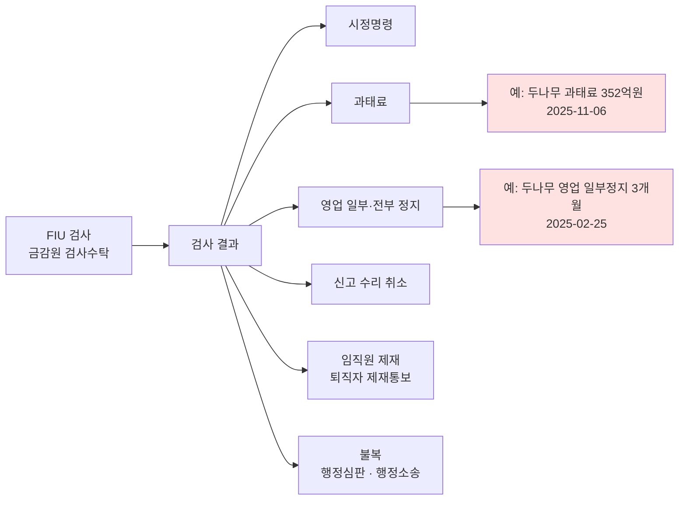

# Day 48 — AMLO 역할 + 거버넌스

> AML 책임자 = 회사 운영의 정점. ⏱️ ~70분. 마지막 업데이트: 2026-10-21.

## 📖 오늘 뭘 배우나

AMLO(자금세탁방지 보고책임자)는 단순 직책이 아니라 **경영진 보고 채널 + STR 결재 라인**의 중심입니다. 오늘은 특금법 체계에서 보고책임자가 맡는 일, 권한·책임·함정(영업 압력·자원 부족·개인 제재)을 정리합니다. 2026-08-20 이후 바뀐 것 — 신고매뉴얼의 AML 인력 4인 이상, 보고책임자 등 변경의 "30일 전 사전신고", 퇴직자 제재통보 권한의 검사수탁기관 위탁 — 도 함께 봅니다.

<!-- MAP-START -->
## 🗺 오늘의 지도


<!-- MAP-END -->

## 🎯 핵심 질문
1. 한국 특금법 체계에서 보고책임자의 위치와 신고 요건?
2. AMLO 핵심 권한 4가지?
3. AMLO 개인 책임의 위험성?

## 📖 읽기 (~50분)
- 메인: [`../notes/5-compliance/internal-controls.md`](../notes/5-compliance/internal-controls.md) — 3, 8~10절
- 보조: [`../notes/6-cases/korea-enforcement.md`](../notes/6-cases/korea-enforcement.md) — 1·5절(감독 주체, 2026 신고 요건)

> 주의: `internal-controls.md` 의 연봉·조직 인원·D&O 보험·Binance 사례 서술은 2026-10-21 기준 공개 근거가 확인되지 않았다. 개념 위주로 읽는다.

## 🛠️ 미니 챌린지 (~15분)
- 거버넌스 구조 그리기 (이사회 → 감사위/리스크위 → CCO → AMLO)
- RACI 매트릭스 5행 작성 (KYC/알람/STR/정책/검사대응)

## ✅ 체크포인트
- [ ] 보고책임자 임명·변경이 신고 사항이고 2026-08-20 이후 "30일 전 사전신고" 대상임을 안다
- [ ] AMLO 경영진 보고 채널 + STR 결재 라인 안다
- [ ] 2026-08-18 시행령의 퇴직자 제재통보 권한 위탁을 안다
- [ ] 검사 단골 지적(감시체계 작동 증거·STR 결정 기록) 인지

## 💭 오늘의 한 줄

## 💼 실무 현장 (Industry Reality)

### 한국 VASP에서는

- **신고 요건**: 2026-08-13 전면 개정 「가상자산사업자 신고매뉴얼」은 **AML 업무 인력 4인 이상**(겸직 인정 가능), 대주주·법령준수체계 변경의 **"변경 30일 전 사전신고"**(종전 변경 후 14일 내 사후신고)를 정했다([금융위 2026-08-13](https://www.fsc.go.kr/no010101/87521)). 보고책임자 변경 이력도 검사에서 확인하는 항목이다.
- **개인 책임**: 2026-08-18 개정 시행령은 FIU 의 퇴직자 제재통보 권한 중 임원 문책경고·주의적경고·주의와 직원 제재 전체를 검사수탁기관에 위탁한다([금융위 2026-08-11](https://www.fsc.go.kr/no010101/87499)). 퇴직 후에도 제재 이력이 통보될 수 있다는 뜻이다.
- **STR 결정 기록**: 검사에서 "최근 STR 결정 과정"을 물으면 알림 → 조사 기록 → 보고책임자 결재 → FIU 제출 기록을 보여 줘야 한다([`korea-fiu-act.md`](../notes/2-regulations/korea-fiu-act.md)).

이전 판의 "4대 거래소 AMLO 전원 상무급", 출신 경력 분포, 연봉 1.5~3억원, 특금법 조문별 개인 형사책임 서술, D&O 보험 "사실상 필수"는 공개 근거가 없어 삭제했다. 보고책임자의 직위 요건은 특금법 시행령 원문으로 확인한다.

### 글로벌에서는

FATF 2021 RBA 가이던스 para 275~276은 자동화된 모니터링과 "human/expert analysis"를 함께 요구한다([FATF 2021 가이던스 미러](https://www.onpcsb.ro/2022/01042022/Updated-Guidance-VA-VASP.pdf)). AMLO 권한이 약하면 이 "사람의 판단" 단계가 영업 압력에 밀린다. 이전 판의 "Binance CZ 4개월 실형 + $50M", "Coinbase CLO·CCO 투톱이 업계 표준", "분기별 이사회 직접 보고 의무"는 이 저장소 근거 자료로 확인되지 않아 삭제했다 — Binance 사건 세부는 DOJ·FinCEN 원 공고로 직접 확인한다([`major-enforcement.md`](../notes/6-cases/major-enforcement.md) "검증하지 않은 과거 대형 사건").

### AMLO 핵심 권한 (설계 원칙)

```
1. STR 판단·결재 라인 (영업 라인이 무효화할 수 없게 설계)
2. 거래·고객 데이터 접근권
3. 고위험 거래·고객 거래 거절·종결 권한
4. 예산·인력 요청권 (경영진·이사회 직접)
```

위 4개는 법령 문언이 아니라 **설계 원칙**이다. 자사 내규에 명시하고, 실제 행사 기록(거절 건, 결재 기록)으로 작동을 증명한다.

### AMLO 업무 루프

- 야간·주말 고위험 알림, 제재·언론 이슈 검토
- STR 후보 검토·결재 (건수 기준은 공개 벤치마크 없음 — 가상자산 전용 alert-to-STR 벤치마크는 존재하지 않는다(B))
- 신상품 AML 영향평가
- FIU·금감원 검사 대응
- 룰 위원회·정책 개정·이사회 보고

이전 판의 시간대별 일과표는 근거 없는 예시라 항목 목록으로 바꿨다.

### 자주 나오는 오해

- **"AMLO는 책임만 많고 권한 없다"** — 권한은 법령이 자동으로 주지 않는다. 내규로 권한을 명시하고 행사 기록을 남겨야 검사에서 "작동"으로 인정된다. 이전 판의 "특금법이 STR 결정을 AMLO 전속으로 명시", "CEO가 STR 막으면 CEO 형사책임"은 원문 근거를 확인하지 못해 삭제했다.
- **"사외이사·감사위원이 대신할 수 있다"** — 겸직·비상근 여부의 허용 범위는 시행령·신고매뉴얼 원문으로 확인한다. 신고매뉴얼은 AML 인력의 겸직을 인정 가능하다고 적는다.

## 🧭 감독 검사 대응 — 오늘의 실행 자료

한국 VASP가 받는 FIU/FSS 현장 검사를 **워크북 수준**으로 정리한 노트다. 검사 주기·기간·자료 건수 등 운영 수치는 공개 근거가 없는 **준비 계획용 가정**이다.

- **4주 타임라인** — 통지 → 자료 준비 → 모의 → 현장 → 사후
- **40개 자체 진단 체크리스트** — A 신고 ~ G Travel Rule
- **필수 서류 리스트** — 정책·증빙·사건 대응 기록
- **예상 질의 FAQ + 모범 답변 프레임**
- **흔한 실패 사례**

상세: [`../notes/5-compliance/inspection-response.md`](../notes/5-compliance/inspection-response.md)

### 검사 → 처분 → 불복 흐름



근거: [`korea-fiu-act.md`](../notes/2-regulations/korea-fiu-act.md)(처분 유형) · [FIU 보도자료 KDI 미러](https://eiec.kdi.re.kr/policy/materialView.do?num=273166)(두나무). 두나무 처분 이후 행정소송 경과는 보도 단독(C)이라 다루지 않는다.

### ⚖️ 이의제기 프로세스 — 검사 결과에 불복할 때

대형 조치(과태료·영업정지·신고말소) 시 행정심판·행정소송·상고 순으로 다툴 수 있다. 청구기간·관할·통상 소요기간은 행정심판법·행정소송법 원문으로 확인한다 — 이전 판의 "90일 내", "통상 1~2년", "상고 기각률 70%+", "DAXA 공동 의견 유효"는 공개 근거가 없어 삭제했다.

**상세 체크리스트**: [`../notes/5-compliance/inspection-response.md`](../notes/5-compliance/inspection-response.md) §8 참조.

### 🛠️ 오늘의 미니 챌린지 업그레이드

워크북의 **40개 체크리스트**를 인쇄해서 가상의 회사(자체 설정)에 적용. 어느 항목이 아직 미흡한지 마킹 + 3개월 이행 계획 스케치.
