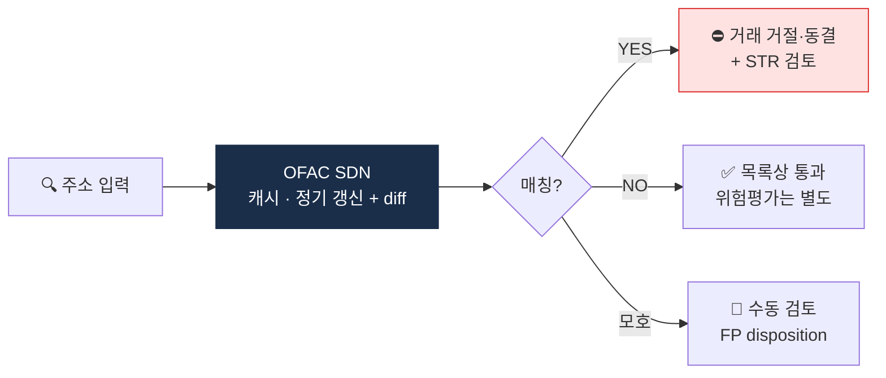
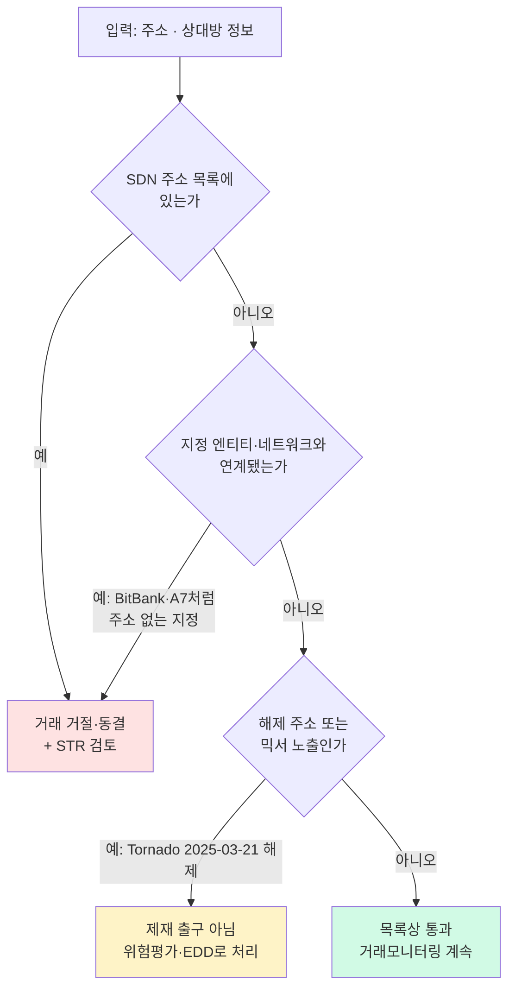

# Day 49 — 🛠️ 미니 프로젝트 4: OFAC SDN crypto wallet 스크리너 + 7주 리뷰

> 실제 OFAC 데이터로 스크리너 만들어보기. ⏱️ ~150분. 마지막 업데이트: 2026-10-21.

## 📖 오늘 뭘 배우나

Week 7의 결산. OFAC SDN의 **가상자산 주소를 파싱**해 입력 주소를 스크리닝하는 함수를 직접 만듭니다. 정기 갱신·캐시·bulk screening까지 실무에 가까운 구조로 짜보면 "OFAC 제재는 시스템 없이는 불가능하다"는 현실이 체감됩니다. 동시에 한계도 봅니다 — 2025-03-21 Tornado Cash 해제처럼 주소가 **목록에서 빠지기도** 하고, 2026-09-17 BitBank 지정처럼 **공고에 주소가 아예 없는** 지정도 있습니다. Capstone의 Sanctions 모듈의 기반.


<!-- MAP-START -->
## 🗺 오늘의 지도


<!-- MAP-END -->

## 🎯 회고 질문
1. CDD/EDD/STR 중 가장 까다로운 운영은?
2. 한국 컴플 운영의 특수성 1가지?
3. AMLO의 권한 부족이 부르는 위험?

## 🛠️ 미니 프로젝트 4 (~120분)

### 목표
**OFAC SDN의 가상자산 주소를 fetch + 입력 주소 스크리닝 함수**

### 사양
- 입력: 가상자산 지갑주소 1개
- 출력: 매칭 결과 (TRUE/FALSE) + 매칭 시 SDN entity 정보

### 구현 가이드
프로젝트: `aml/projects/04-ofac-screener/`

```python
# main.py 의사코드
import requests
from xml.etree import ElementTree as ET

OFAC_SDN_XML = "https://www.treasury.gov/ofac/downloads/sdn.xml"
# 또는 SDN.csv, advanced consolidated list

def fetch_ofac_crypto_addresses() -> dict[str, dict]:
    """
    OFAC SDN.xml 파싱 → {wallet_address.lower(): {entity_name, sdn_id, programs, listed_date}}
    """
    ...

CACHE = {}  # 일 1회 갱신

def screen(address: str) -> dict:
    """
    return {
        "matched": bool,
        "address": address,
        "match_info": {...} | None,
    }
    """
    addr = address.lower()
    info = CACHE.get(addr)
    return {
        "matched": info is not None,
        "address": address,
        "match_info": info,
    }

def bulk_screen(addresses: list[str]) -> list[dict]:
    return [screen(a) for a in addresses]

if __name__ == "__main__":
    # 테스트: 알려진 SDN crypto address (공개) + 정상 wallet
    test_addrs = ["0xKnownSDN...", "0xNormal..."]
    for r in bulk_screen(test_addrs):
        print(r)
```

### 산출물
- `projects/04-ofac-screener/main.py`
- `projects/04-ofac-screener/cache/sdn_crypto.json` (캐시)
- `projects/04-ofac-screener/README.md`
- `projects/04-ofac-screener/test.py`

→ 가이드: [`../projects/04-ofac-screener/README.md`](../projects/04-ofac-screener/README.md)

### 보너스
- Cluster matching (Etherscan label 또는 자체 데이터셋과 결합)
- 일일 배치 + diff 알람

## ✅ 체크포인트
- [ ] 스크리너 작동
- [ ] OFAC SDN crypto 주소 수십 개 캐시
- [ ] 테스트 케이스 통과
- [ ] [`progress.md`](progress.md) Week 7 + W7 미니 프로젝트 체크
- [ ] git commit + push

## 💼 실무 현장 (Industry Reality)

### 한국 VASP에서는

OFAC SDN 가상자산 주소의 총 개수·체인 분포, 거래소별 벤더 필드 사용 방식, "매칭 시 24시간 내 STR" 같은 SLA는 **공개 근거가 없다**(이전 판 수치 삭제). 확인되는 원칙은 두 가지다. 첫째, 한국 STR 판단 근거는 특금법 §4의 "의심되는 합당한 근거"와 FIU 고시 「자금세탁방지 업무규정」 제76~81조(2026-01-22 시행)이고, 해외 제재 목록 변경이 STR 판단을 자동으로 바꾸지 않는다([법제처 DRF](https://www.law.go.kr/DRF/lawService.do?OC=test&target=admrul&ID=2100000267264&type=XML)). 둘째, 벤더 피드와 자체 fetcher 를 함께 두는 이중화는 흔한 설계지만 업계 표준이라는 공개 근거는 없다 — 자사 위험평가로 결정하고 이유를 문서화한다.

### 글로벌에서는 — 2025~2026 OFAC 가상자산 조치

| 일자 | 조치 | 스크리너에 주는 의미 |
|---|---|---|
| 2025-03-21 | Tornado Cash SDN 삭제 — 엔티티 1개·ETH 주소 90개(주 1·대체 89). Roman Semenov 항목은 [DPRK3] 유지 | **삭제 diff** 도 처리해야 한다. 해제 ≠ 위험 해제 |
| 2025-10-14 | Prince Group TCO 지정(146개 대상), FinCEN Huione Group §311 최종규칙 | 주소가 아니라 **조직·네트워크 단위** 차단 |
| 2026-09-17 | 이란 거래소 BitBank 등 E.O. 13902 지정 — **공고에 디지털화폐 주소 미기재** | 주소 리스트 대조만으로는 못 잡는다 |
| 2026-10-01 | A7 네트워크 TCO 지정(B) | 엔티티명·연계 서비스까지 스크리닝 |

출처: [OFAC 2025-03-21](https://ofac.treasury.gov/recent-actions/20250321) · [재무부 sb0278](https://home.treasury.gov/news/press-releases/sb0278) · [OFAC 2026-09-17](https://ofac.treasury.gov/recent-actions/20260917) · [Federal Register 2026-20371](https://public-inspection.federalregister.gov/2026-20371.pdf)

이전 판의 "Coinbase·Kraken·Gemini 실시간 API 수신", "OFAC 주간 3~5회 업데이트", FeatureTypeID 번호별 체인 매핑(344=BTC 등)은 이 저장소 근거 자료로 확인되지 않아 삭제했다. 파싱할 때는 OFAC 가 배포하는 스키마 문서로 Feature 유형을 직접 확인한다.

### 주소 매칭이 못 잡는 것



### SDN advanced XML 구조 (형태 예시)

```xml
<sdnEntry>
  <uid>...</uid>
  <sdnType>Entity</sdnType>
  <lastName>...</lastName>
  <featureList>
    <feature featureTypeId="...">  <!-- 유형 ID 는 OFAC 스키마 문서로 확인 -->
      <featureVersion>
        <versionDetail>(지정된 디지털화폐 주소)</versionDetail>
      </featureVersion>
    </feature>
  </featureList>
</sdnEntry>
```

이전 판 예시에 들어 있던 주소는 실제 SDN 주소가 아니었으므로 자리표시자로 바꿨다. 테스트용 SDN 주소는 OFAC 공고(예: 2025-03-21 해제 목록)에서 직접 가져와 "해제됨" 케이스로 쓴다.

### 실무 파싱 체크리스트

```
1. SDN advanced XML 정기 다운로드 (주기는 자사 위험평가로 결정)
2. 디지털화폐 주소 Feature 전부 파싱 (유형 ID 는 스키마 문서로 확인)
3. 정규화: EVM 계열은 lower-case, BTC 등 대소문자 구분 체계는 원형 유지
4. diff 계산 → 신규 지정 / 삭제(해제) 양쪽 알람
5. 신규 지정 주소로 과거 거래 backfill 재조회
6. 주소 없는 지정(엔티티·네트워크)은 이름·연계 서비스 스크리닝 큐로
```

### 자주 나오는 오해

- **"해제된 Tornado Cash 주소는 지워도 된다"** — 제재 목록(제재 출구)에서는 지운다. 위험평가(AML 출구)는 별도다. Liu 외(WWW '26)는 제재 후 입금액이 71.03% 줄었지만 Ethereum 보안사고의 78.33%가 여전히 Tornado Cash 를 거쳤다고 측정했다([arXiv 2507.11721](https://arxiv.org/abs/2507.11721)). "다수 VASP가 내부 블랙리스트 유지"라는 이전 서술은 근거가 없어 삭제했다.
- **"주소만 보면 된다"** — BitBank(2026-09-17)처럼 주소 없이 지정되는 경우가 있다. 엔티티명·네트워크 연계까지 봐야 한다. 클러스터 귀속은 벤더 판단 결과라 출처를 케이스 기록에 남긴다.

## 💭 7주차 회고

가장 어려웠던 컴플 운영:
가장 자동화 가치가 큰 영역:
다음주 사례 중 가장 기대되는:
