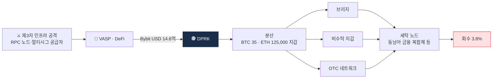
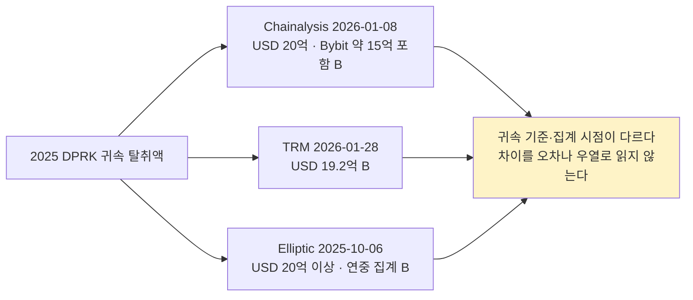

# Day 50 — 케이스: Lazarus DPRK + Bybit Hack

> 가상자산 1순위 위협 + 2025년 최대 단일 탈취. ⏱️ ~80분. 마지막 업데이트: 2026-10-21.

## 📖 오늘 뭘 배우나

Week 8은 사례·리서치·AI 주간. 첫날은 가상자산 업계의 **1순위 위협**인 DPRK(업계 통칭 Lazarus)와 FATF 6차 Targeted Update(2025-06-26)가 "2025년 최대 단일 탈취"로 기록한 **Bybit USD 14.6억** 사건입니다. FATF가 원문으로 남긴 것(지갑 35·125,000개, 회수율 3.8%)과 7차 TU(2026-07-16)가 새로 지목한 위험(RPC 노드·멀티시그 공급자 같은 **제3자 인프라 공격**, 동남아 금융 복합체 경유, AI 딥페이크 채용사기)을 구분해 실무 대응책을 정리합니다.

<!-- MAP-START -->
## 🗺 오늘의 지도

<!-- MAP-END -->

## 🎯 핵심 질문
1. FATF 6차 TU가 Bybit 사건에 대해 원문으로 남긴 3가지 사실은?
2. FATF 6·7차 TU가 서술한 DPRK 세탁 경로는?
3. 2025년 DPRK 귀속 탈취액은 왜 발행처마다 다른가?

## 📖 읽기 (~55분)
- 메인: [`../notes/6-cases/lazarus-dprk.md`](../notes/6-cases/lazarus-dprk.md)

## 🌐 외부 자료 (~20분)
- [FATF 6차 Targeted Update (2025-06-26) PDF](https://www.fatf-gafi.org/content/dam/fatf-gafi/recommendations/2025-Targeted-Upate-VA-VASPs.pdf.coredownload.pdf) — para 28–29
- [FATF 7차 Targeted Update (2026-07-16) PDF](https://www.fatf-gafi.org/content/dam/fatf-gafi/reports/7th-targeted-update-on-implementation-fatf-standards-vas-vasps-2026.pdf.coredownload.pdf) — para 29–35
- [Elliptic — North Korea-linked hackers 2025 (2025-10-06)](https://www.elliptic.co/blog/north-korea-linked-hackers-have-already-stolen-over-2-billion-in-2025)

## 🛠️ 미니 챌린지 (~5분)
- FATF가 서술한 세탁 경로(탈취 → 분산 → 브리지/비수탁 지갑/OTC → 세탁 노드)를 단계별 탐지 신호와 함께 메모
- AI 딥페이크 채용사기(7차 TU para 34)를 회사가 막는 통제 3가지 — 단, 업계 표준 방법은 공개 근거가 없다는 점도 적기

## ✅ 체크포인트
- [ ] Bybit USD 14.6억 · BTC 지갑 35개 · ETH 지갑 125,000개 · 회수율 3.8% (6차 TU) 안다
- [ ] 2025 DPRK 탈취: Chainalysis 20억 · TRM 19.2억 · Elliptic 20억 이상(연중) — 발행처·정의를 같이 적는다
- [ ] 7차 TU: 제3자 인프라 공격(para 33), 캄보디아 복합체 경유 DPRK 자금 최소 USD 3,700만(para 29–30) 안다
- [ ] 7차 TU 권고 6-ii "rapid transfer" 탐지, 6-iv 브리지·믹서·크로스체인 노출 평가 안다

## 💭 오늘의 한 줄

## 💼 실무 현장 (Industry Reality)

### 한국 VASP에서는

DPRK 노출은 한국 AML 의 우선 과제다. 다만 이전 판의 "2017 Bithumb·2018 Coinrail·2019 Upbit $49M 귀속", "모든 VASP가 두 벤더 라벨 이중 적용", "DPRK 노출 >0.5% 자동 freeze", "DAXA 5사 공급망 공동 지침"은 이 저장소 근거 자료로 확인되지 않아 삭제했다(공개 근거 없음). 확인되는 것은 법적 출구 구분이다 — 탐지 결과는 차단·지연(통신사기피해환급법, 거래소 2026-10-01~), 통보(가상자산이용자보호법 §12), STR(특금법 §4) 중 맞는 곳으로 보내야 한다. DPRK 라벨은 **귀속 판단의 결과물**이므로 라벨의 출처(공식 지정·수사기관 공개·벤더 자체 귀속)를 케이스 기록에 남긴다.

### 글로벌에서는

FATF 6차 TU 원문: "stealing $1.46 bn worth of VAs from the VASP ByBit", "35 bitcoin wallets and 125,000 Ethereum wallets", "only 3.8 percent of the stolen funds had been recovered"(para 28–29). 정확한 사고 일시, 공격 경로(서명 인터페이스 변조 여부 등), 사고 후 추적·동결 경과는 이 저장소 근거 자료에서 확인되지 않았다 — 이전 판의 "48시간 내 layering", "$160M 오프램프", 특정 브리지 이름, 발행사 동결 SLA 단축은 삭제했다. 7차 TU 본문에는 "Bybit" 문자열이 없다. FATF의 헤드라인이 2026년 **제3자 인프라 공격·동남아 금융 복합체**로 옮겨 갔다.

### 2025 DPRK 탈취 통계 — 발행처별

이전 판의 "누적 $6.75B", "2025 service compromises의 76%", "TraderTraitor 명칭"은 원문과 일치하지 않거나 확인되지 않아 삭제했다.

### 단계별로 볼 신호 (FATF 서술 기반)

1. **분산** — 소수 지갑 → 다수 신규 지갑 급속 팬아웃. 7차 TU 권고 6-ii "detect rapid transfer of VAs using transactions monitoring and blockchain analytics tools"
2. **브리지** — 체인이 바뀌면 단일 체인 추적이 끊긴다. 권고 6-iv 브리지·믹서·크로스체인 노출 평가
3. **비수탁 지갑·OTC** — 상대방이 VASP가 아닌 구간. 상대방 식별이 안 되는 이전에 대한 위험평가
4. **세탁 노드** — 캄보디아 복합체처럼 노드 자체가 제재·특별조치 대상(Huione §311, 2025-10-14)이 되면 노드 단위 차단이 주소 단위보다 넓게 걸린다

단계 사이의 시간·비율·수수료는 원문에 없다.

### AI 채용사기·제3자 인프라 방어 체크리스트

7차 TU para 34는 합성 프로필·딥페이크 화상 면접으로 신뢰를 쌓은 뒤 악성코드 설치·지갑 접근 권한을 유도해 **USD 100만 이상**을 탈취한 사례를 든다 — **DPRK 에 귀속하지 않는다**.
- 채용 단계 신원 확인, 신규 입사자 단말 권한 최소화
- 외부 RPC 노드·멀티시그 공급자·지갑 SDK 공급망 실사 (para 33)
- 서명자가 보는 내용과 실제 서명 데이터의 일치 검증

구체적 방법(화상 면접 의무화, IP 탐지 등)이 업계 표준이라는 공개 근거는 없다.

### 자주 나오는 오해

- **"DPRK 는 기술적 해킹만 한다"** — 7차 TU는 VASP·DeFi 뿐 아니라 거래소가 의존하는 **제3자 인프라**를 공격면으로 적었다(para 33). 이전 판의 "FBI·Mandiant 보고 절반 이상이 소셜 엔지니어링"은 근거가 없어 삭제했다.
- **"탈취 후 추적·동결로 회수하면 된다"** — Bybit 회수율 3.8%. 방어의 무게는 탈취 전(키·서명 통제)과 입금 시점(노출 스크리닝)에 있다. 7차 TU는 VASP가 "issuer-level asset freeze/burn mechanisms"를 준수 안전장치로 믿을 수 없을 수도 있다고 경고했다(para 35).
